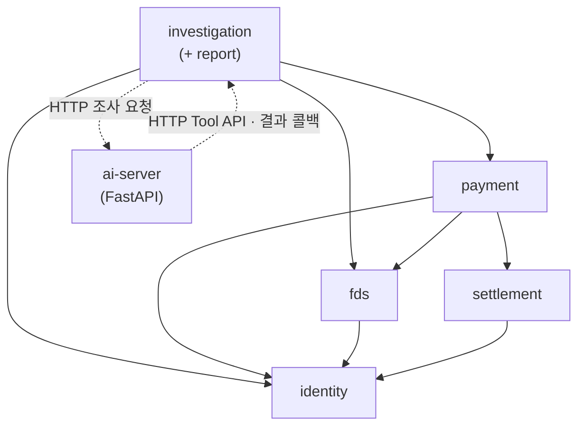

# DonWorry

**온라인 가맹점을 위한 결제·정산 관리와 이상거래 대응 서비스**

DonWorry는 가맹점 사장님이 결제 처리 결과와 정산 내역, 자금 현황을 한곳에서 확인할 수 있도록 돕는 B2B 서비스입니다.

보안 직원은 의심 거래의 근거와 AI 조사 보고서를 검토해 결제 처리 방향을 판단합니다. 관리자는 가맹점과 직원을 관리하고, 내부 직원의 이상 접근을 확인해 필요한 보안 조치를 검토합니다.

## 목차

- [프로젝트 배경](#프로젝트-배경)
- [주요 기능](#주요-기능)
- [서비스 흐름](#서비스-흐름)
- [기술 스택과 아키텍처](#기술-스택과-아키텍처)
- [프로젝트 구조와 담당](#프로젝트-구조와-담당)
- [로컬 실행](#로컬-실행)
- [개발 문서와 참여 방법](#개발-문서와-참여-방법)

## 프로젝트 배경

### 거래의 위험과 내부자의 접근을 함께 확인합니다

가맹점의 결제 운영에는 거래 접수뿐 아니라 의심 거래 조사, 처리 결과 확인, 정산 관리가 필요합니다. DonWorry는 이 과정을 연결해 가맹점과 운영 담당자가 각자의 역할에 맞게 업무를 처리하도록 구성했습니다.

거래를 보호하려면 내부 사용자의 접근도 살펴야 합니다. 거래 데이터에 이상이 없더라도, 직원이 업무 범위를 벗어나 정보를 조회하거나 권한을 부적절하게 사용할 수 있기 때문입니다.

DonWorry는 결제 데이터를 분석하는 이상금융거래탐지시스템(FDS)에서 출발해, 직원의 업무 접근을 기록하고 이상 접근을 탐지·조사하는 기능으로 범위를 확장했습니다.

| 관점 | 확인하는 대상 | 대응 방법 |
| --- | --- | --- |
| 거래 위험 | 가맹점에서 발생한 의심 결제 | 위험평가, 결제 보류, 사건 조사와 직원 판정 |
| 내부자 위험 | 거래 정보를 다루는 직원의 이상 접근 | 접근 기록, 이상 접근 탐지, 내부자 사건 조사와 계정 보안 조치 |

## 주요 기능

### 가맹점 사장님 — 결제와 정산 현황 확인

- **결제 연동:** 쇼핑몰에 결제창을 연결하고 결제 상태를 전달받습니다.
- **조치 결과 확인:** 의심 거래에 대한 직원 판정과 실제 결제 처리 상태를 확인합니다.
- **정산 관리:** 매입 내역, 수수료, 정산 예정금과 지급 내역을 조회합니다.
- **자금 관리:** 예정된 정산금과 등록한 지출을 바탕으로 현금흐름을 확인합니다.

### 보안 직원 — 근거에 기반한 거래 조사

- **위험평가 확인:** 탐지 규칙에 따른 위험 점수와 경보를 확인합니다.
- **담당 사건 조사:** 결제 내역, 탐지 근거, 관련 거래를 검토합니다.
- **AI 조사 보고서 활용:** 수집된 사실, 추가 확인 사항, 과거 유사 사건을 참고합니다.
- **결제별 판정:** 매입 또는 승인 취소를 요청하고 후속 처리 결과를 추적합니다.

### 관리자 — 운영 관리와 내부자 관제

- **가맹점·직원 관리:** 이용 신청, 계정, 역할과 권한을 관리합니다.
- **조사 업무 관리:** 사건 담당자를 배정하고 담당 변경 요청을 처리합니다.
- **탐지 정책 관리:** 탐지 규칙과 정책 변경 요청을 검토합니다.
- **내부자 관제:** 직원 접근 기록과 경보, 관련 사건을 함께 확인합니다.
- **계정 보안 조치:** 보안 정지 상태와 해제 검토 근거를 확인하고 판정합니다.

## 서비스 흐름

### 결제 조사에서 금융 처리까지

**결제 요청 → 위험평가 → 의심 결제 보류 → 사건 조사 → 직원 판정 → 금융 처리**

| 단계 | 처리 내용 |
| --- | --- |
| 결제 접수 | 가맹점의 요청을 인증하고 결제를 접수합니다. |
| 위험평가 | 탐지 규칙으로 위험도를 평가해 정상 처리·조사·거절 경로를 구분합니다. |
| 결제 보류 | 조사 대상 거래는 카드 승인 후 매입을 보류하고 조사 사건을 생성합니다. |
| 사건 조사 | 담당 보안 직원이 거래 근거와 AI 조사 보고서를 확인합니다. |
| 직원 판정 | 결제별로 매입 또는 승인 취소를 요청합니다. |
| 결과 반영 | 실제 금융 처리 결과를 사건과 가맹점 화면에 반영합니다. |

매입된 거래는 별도의 정산 흐름으로 이어집니다. 수수료와 영업일 D+3 정산 정책을 적용하고, 지급 내역과 환불에 따른 조정을 관리합니다.

AI는 조회한 사실과 확인할 사항을 제공하며 **최종 판정은 직원이 수행합니다.** 조사 종료와 정산·지급 완료는 별도로 관리합니다.

### 내부자 이상 접근 대응

**직원 접근 기록 → 이상 접근 탐지 → 경보·사건 연결 → 관리자 검토 → 보안 조치 판정**

관리자는 관제 화면에서 접근 기록과 경보, 내부자 사건을 확인하고 계정 보안 조치와 해제 여부를 검토합니다. 탐지 대상은 서비스 안에서 발생하는 직원의 업무 접근입니다.

현재 내부자 해제 검토 보고서는 코드로 계산한 사실과 고정 문장을 사용합니다. 결제 조사에 사용하는 AI 보고서와는 생성 방식이 다릅니다.

### 연동과 구현 범위

가맹점 연동 사례로 케이크 주문 서비스 [CakeShop](https://github.com/team-sweethan/cakeshop_refactoring)을 사용합니다. 전체 흐름을 재현하는 방법은 [로컬 시연 가이드](docs/demo/local-demo.md)에 정리되어 있습니다.

- 카드사 승인·취소·환불은 모의 구현입니다. 결제창의 카드는 시연용 가상 카드이며 카드번호 원문은 다루지 않습니다 ([ADR-0064](docs/decisions/0064-hosted-checkout-and-payment-webhook.md)).
- 매입·정산·가맹점 지급은 금액과 상태를 원장에 기록합니다. 실제 은행 계좌 이체는 하지 않습니다.
- 대출 상품은 가상 안내이며 실제 은행 잔액 조회와 대출 신청은 제공하지 않습니다.
- 기능별 활성화 설정과 외부 연동 준비가 필요합니다. 코드 구현 여부와 실행 환경에서의 검증 결과는 구분합니다.

기본값이 실행 결과를 바꾸는 주요 설정입니다 (`backend/src/main/resources/application.yml`, `dev` `4a24d40a` 기준).

| 설정 (환경 변수) | 기본 | 꺼져 있거나 비어 있으면 |
| --- | --- | --- |
| `ai.server.enabled` (`AI_SERVER_ENABLED`) | 꺼짐 | 결제 사건 보고서를 AI 서버 대신 고정 문장으로 만듭니다 |
| `ai.ml-shadow.enabled` (`ML_SHADOW_ENABLED`) | 꺼짐 | ML 그림자 채점을 하지 않습니다. 켜도 결제 판정에는 쓰지 않습니다 |
| `security.csrf.enabled` (`DONWORRY_CSRF_ENABLED`) | 켜짐 | 브라우저 변경 요청의 CSRF 검사를 하지 않습니다(신청 · 연동 관리 · FDS 복구 경로는 계속 검사). 명시적 false는 이전 동작 호환용으로만 남아 있어, 운영 설정에 false가 남지 않았는지 확인합니다 ([ADR-0063](docs/decisions/0063-csrf-default-enabled.md)) |
| `security.demo-api.enabled` | 켜짐 (운영 프로필 꺼짐) | 인증 없는 시연용 API를 막습니다. 운영에서 켜면 서버가 시작하지 않습니다 |
| `donworry.applications.enabled` (`DONWORRY_APPLICATIONS_ENABLED`) | 켜짐 (운영 프로필 꺼짐) | 공개 이용 신청을 받지 않습니다 |
| `donworry.scheduling.enabled` (`DONWORRY_SCHEDULING_ENABLED`) | 켜짐 | 기록 보관 기간 삭제 등 예약 작업을 돌리지 않습니다 |
| `donworry.pii.encryption-key` · `hmac-key` | 비어 있음 | 주문자 연락처를 저장하지 않고 결제는 그대로 진행합니다 |

## 기술 스택과 아키텍처

### 기술 스택

| 영역 | 주요 기술 |
| --- | --- |
| Backend | Java 21, Spring Boot, Spring Modulith, Spring Security, Spring Data JPA |
| Frontend | React, TypeScript, Vite, Ant Design |
| AI Server | Python, FastAPI, LangGraph |
| Database | MariaDB, Flyway |
| 개발·검증 | Gradle, uv, pytest, oxlint, Prettier, GitHub Actions |

정확한 의존성 버전은 [백엔드 빌드 설정](backend/build.gradle), [프론트엔드 패키지 설정](frontend/package.json), [AI 서버 프로젝트 설정](ai-server/pyproject.toml)을 기준으로 합니다.

### 모듈러 모놀리스

백엔드는 하나의 Spring Boot 애플리케이션 안에서 업무별 모듈을 분리합니다. 다른 모듈은 공개된 `api/` 경계를 통해 사용하며, 모듈 간 의존과 내부 접근 규칙은 자동 검사로 확인합니다.

AI 조사 서버는 별도 프로세스로 실행하며, 백엔드의 허용된 조회 API를 통해 증거를 수집합니다.

### 모듈 의존 방향



- **실선:** Java 코드에서 허용된 모듈 의존 방향입니다. 실행 중 발생하는 모든 호출의 방향을 나타내지는 않습니다.
- **점선:** 백엔드와 AI 서버 사이의 HTTP 통신입니다. 증거 조회는 읽기 전용 Tool API를 사용합니다.
- 모듈 간 상태 변경 알림에는 커밋 후 이벤트를 사용합니다.

의존 규칙과 이벤트 처리 방식은 [모듈 간 통신 문서](docs/modulith/04-dependency-and-events.md), AI 연동 구조는 [ADR-0009](docs/decisions/0009-ai-investigation-call-structure.md), 내부자 탐지의 담당 범위 조회 구조는 [ADR-0082](docs/decisions/0082-insider-access-security.md)를 참고합니다.

## 프로젝트 구조와 담당

### 디렉터리 구조

```text
DonWorry/
├── backend/                         # Spring Boot 업무 서버
│   └── src/main/java/com/donworry/
│       ├── identity/                # 계정·권한·가맹점·직원 접근 기록
│       ├── fds/                     # 위험평가·탐지 정책·경보
│       ├── investigation/           # 사건·판정·인계·내부자 관제
│       │   └── report/              # 조사 보고서·AI 서버 연동
│       ├── payment/                 # 결제·결제창·취소·환불
│       └── settlement/              # 매입·정산·지급·현금흐름
├── frontend/                        # React 웹 화면
│   └── src/
│       ├── app/                     # 라우팅·공통 구성
│       ├── api/                     # 서버 API 호출
│       ├── auth/                    # 인증·화면 접근 제어
│       ├── pages/                   # 역할별 화면
│       └── components/              # 공통 컴포넌트
├── ai-server/                       # FastAPI 조사 서버
│   └── app/                         # API·서비스·에이전트·LLM 연동
├── docs/                            # 업무·설계·개발 문서
├── scripts/demo/                    # 가맹점 서명 결제 등 시연 도구
├── ops/vm/                          # VM 배포·백업·복구
├── .github/                         # CI·이슈·PR 템플릿
├── docker-compose.yml               # 개발용 MariaDB
├── AGENTS.md                        # 작업 규칙
└── README.md
```

모듈 안의 `api`, `controller`, `service`, `repository` 등 패키지별 역할은 [모듈 내부 구조](docs/modulith/03-module-structure.md)에서 설명합니다.

### 모듈별 담당과 책임

| 모듈 | 담당 | 책임 |
| --- | --- | --- |
| `identity` | 주환 · 프론트엔드 병행 | 계정·권한·가맹점·이용 신청, 직원 접근 기록·계정 보안 정지 |
| `fds` | 정후 | 결제 위험평가·탐지 규칙·차단 목록, 이상 접근 경보 |
| `investigation` | 수민 | 사건 생성·담당 배정·판정·금융 조치 인계, 내부자 사건·관제 |
| `investigation/report` | 현규 · AI 서버 병행 | 조사 보고서·버전·재시도·Tool API, 내부자 해제 검토 보고서 |
| `payment` | 시은 | 결제 접수·결제창·웹훅·취소·환불, 거래 조회 |
| `settlement` | 민정 | 매입·수수료·정산·지급, 환불 조정·현금흐름 |

## 로컬 실행

### 준비 도구

| 도구 | 용도 |
| --- | --- |
| JDK 21 | 백엔드 실행 |
| Docker Desktop | 개발용 MariaDB 실행 |
| Node.js 22.14 이상인 22.x 또는 24 이상 | 프론트엔드 실행 |
| Python 3.13과 uv | AI 서버 실행 시 필요 |

Gradle은 저장소의 Wrapper를 사용하므로 별도로 설치하지 않아도 됩니다.

### 1. 저장소 준비

```bash
git clone https://github.com/team-sweethan/DonWorry.git
cd DonWorry
git switch dev
```

### 2. DB 실행

저장소 루트에서 실행합니다.

```bash
docker compose up -d
```

### 3. 백엔드 실행

새 터미널에서 저장소의 `backend/` 디렉터리로 이동합니다.

```bash
cd backend
./gradlew bootRun
```

Windows PowerShell에서는 다음 명령을 사용합니다.

```powershell
.\gradlew.bat bootRun
```

테이블은 서버 시작 시 Flyway가 생성·변경합니다. 로컬 DB 접속 정보가 기본값과 다르면 [개인 설정과 DB 준비 안내](docs/flyway/05-guide.md)를 확인합니다.

### 4. 프론트엔드 실행

새 터미널에서 저장소의 `frontend/` 디렉터리로 이동합니다.

```bash
cd frontend
npm ci
npm run dev
```

브라우저에서 **http://localhost:5173**에 접속합니다.

### 5. 결제·AI 조사 시연

결제 API와 AI 서버 연동은 추가 설정이 필요합니다. [로컬 시연 가이드](docs/demo/local-demo.md)에 따라 기능을 활성화하고 시연 데이터를 준비합니다.

| 구성 | 기본 포트 |
| --- | --- |
| 프론트엔드 | `5173` |
| 백엔드 | `8081` |
| AI 서버 | `8000` |
| MariaDB | `3307` |

- [화면 실행과 시연 계정](frontend/README.md)
- [결제부터 조사·매입까지 재현](docs/demo/local-demo.md)
- [DB 설정과 초기화](docs/flyway/05-guide.md)
- [Flyway·DB 오류 해결](docs/flyway/06-troubleshooting.md)

## 개발 문서와 참여 방법

### 목적별 문서

| 하려는 작업 | 먼저 읽을 문서 |
| --- | --- |
| 프로젝트 규칙 확인 | [작업 규칙](AGENTS.md) |
| 업무별 상세 문서 찾기 | [문서 안내](docs/README.md) |
| 코드 작성·수정 | [코드 작성 규칙](docs/conventions/02-code.md) |
| 모듈 구조와 통신 이해 | [Spring Modulith 안내](docs/modulith/README.md) |
| DB 구조 확인·변경 | [ERD](docs/erd/README.md), [Flyway 안내](docs/flyway/README.md) |
| 검사 실행·CI 오류 해결 | [CI 안내](docs/ci/README.md) |
| 설계 선택의 이유 확인 | [설계 결정 기록](docs/decisions/README.md) |
| VM 배포와 복구 | [VM 운영 안내](ops/vm/README.md) |

### 참여 절차

1. 작업 규칙과 관련 업무 문서를 확인합니다.
2. GitHub Issue를 기준으로 `dev`에서 `feature/<이슈번호>-<작업>` 브랜치를 만듭니다.
3. 변경 영역의 검사를 실행하고 결과를 확인합니다.
4. `dev`를 대상으로 PR을 작성하고, 변경 사항·검사 결과·미검증 항목을 기록합니다.
5. 리뷰와 필요한 CI 검사를 거쳐 병합합니다.

`main`과 `dev`에는 직접 push하지 않습니다. 모듈 경계·저장 방식·외부 계약·기술 선택이 달라지는 경우 설계 결정 기록을 함께 작성합니다.
