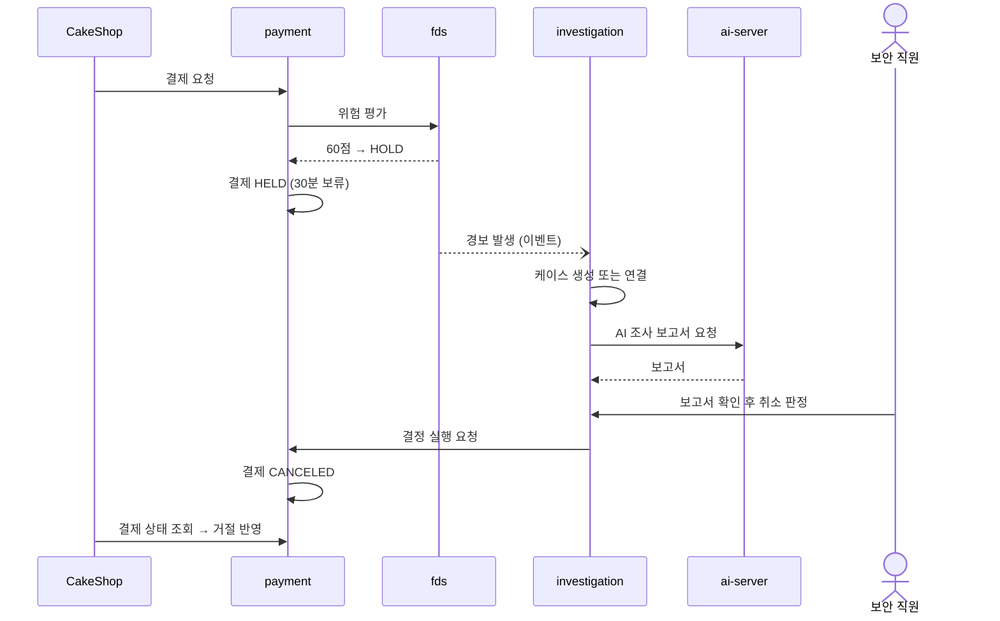
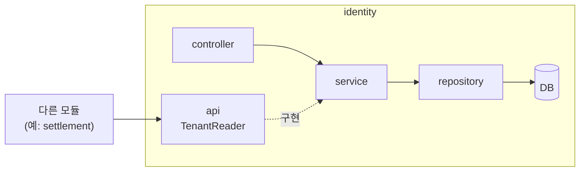
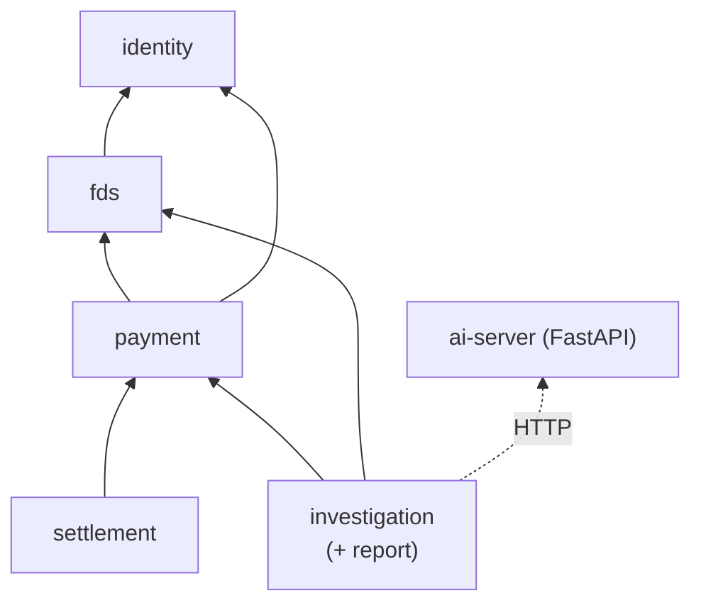

# DonWorry

DonWorry는 케이크 주문 서비스 CakeShop에서 발생한 결제를 받아 **PG 승인 → FDS 위험평가 → 보안 케이스 조사 → AI 조사 보고서 → 직원 판정 → 매입·정산**까지 하나의 흐름으로 처리하는 결제 대행(PG)·이상거래 탐지 백오피스입니다. 의심 결제를 바로 거절하지 않고 보안 직원이 근거를 보고 판단하도록 돕는 데 초점을 둡니다.

Spring Boot 4 · Spring Modulith 기반 백엔드, React 화면, FastAPI AI 서버로 구성된 모노레포입니다.

## 목차

- [Overview](#overview)
- [Features](#features)
- [핵심 흐름](#핵심-흐름)
- [Tech Stack](#tech-stack)
- [Getting Started](#getting-started)
- [Project Structure](#project-structure)
- [Architecture](#architecture)
- [Contributing](#contributing)
- [문서](#문서)
- [현재 상태](#현재-상태)

## Overview

- CakeShop(1차 프로젝트)과 연동하는 **2차 팀 프로젝트**이며, 6명이 업무 모듈을 하나씩 맡아 개발합니다.
- 서버를 여러 개로 나누지 않고, **하나의 Spring Boot 앱을 모듈 5개로 나누는 모듈러 모놀리스** 구조를 씁니다. 모듈 경계는 Spring Modulith 테스트로 강제합니다.
- 1차 목표는 **의심 결제가 보류되고, 보안 직원이 AI 보고서를 참고해 판정하고, 결과가 CakeShop에 반영되는 시연 경로**를 완성하는 것입니다.

## Features

> 아래는 1차 MVP 범위입니다. 현재 저장소는 골격 단계이며 기능은 **구현 예정**입니다.

- **결제(PG)** — CakeShop 결제 세션 생성, 모의 카드사 승인·취소, 결제 상태 관리(REQUESTED · HELD · APPROVED · DECLINED · CANCELED), 보류 30분 만료
- **FDS 위험평가** — 규칙 3개(고액 +35 · 신규 카드 +30 · 10분 내 3회 +25)로 점수를 매겨 50점 미만 ALLOW / 50~80 HOLD / 80 초과 REJECT, 카드·기기 차단 목록
- **보안 케이스 조사** — 같은 가맹점·고객의 경보를 첫 경보부터 30분 안에서 하나의 케이스로 묶고, 보안 직원이 보류 결제를 진행·취소 판정
- **AI 조사 보고서** — 케이스의 근거를 모아 FastAPI 서버가 보고서를 생성. AI는 판단을 돕기만 하고 결제를 바꾸지 않음
- **매입·정산** — 승인 결제 매입, 픽업 후 72시간 환불 마감이 지나면 정산 확정, 수수료 계산
- **사장님 결과 조회** — 직원이 검토·공개한 케이스 결과와 정산 내역 조회

## 핵심 흐름

의심 결제가 보류되었다가 보안 직원 판정으로 반려되는 시연 시나리오입니다.



## Tech Stack

| 구분 | 기술 | 버전 |
| --- | --- | --- |
| Backend | Java | 21 |
| | Spring Boot | 4.1.1 |
| | Spring Modulith | 2.1.1 |
| | Spring Data JPA · Spring Security · Lombok | Boot 관리 |
| | Gradle | 9.3.0 (Wrapper) |
| Database | MariaDB | 11.8 (Docker Compose) |
| | Flyway | Boot 관리 (현재 비활성화) |
| Frontend | React · React Router | 19 · 7 |
| | TypeScript · Vite | 7 · 8 |
| | oxlint · Prettier | — |
| AI Server | Python · FastAPI | 3.13 · — |
| | uv · ruff · pytest | — |
| CI | GitHub Actions | 서비스별 3개 |

정확한 버전은 `backend/build.gradle`, `frontend/package.json`, `ai-server/pyproject.toml`을 기준으로 합니다.

## Getting Started

### 사전 준비

| 도구 | 용도 |
| --- | --- |
| JDK 21 | backend 빌드·실행 |
| Docker Desktop | 개발용 MariaDB 실행 (직접 설치한 MariaDB도 가능) |
| Node.js 22 | frontend |
| Python 3.13 + [uv](https://docs.astral.sh/uv/) | ai-server |

Gradle은 설치하지 않아도 됩니다. `gradlew`가 정해진 버전을 내려받아 씁니다.

### 1. 저장소 내려받기

```bash
git clone https://github.com/team-sweethan/DonWorry.git
cd DonWorry
git switch dev
```

### 2. DB 실행

Docker로 MariaDB 11.8을 **3307** 포트에 띄웁니다. DB와 계정(`donworry` / `donworry`)이 자동으로 만들어집니다.

```bash
docker compose up -d          # 저장소 루트에서
docker compose down -v        # DB 초기화가 필요할 때 (데이터 삭제)
```

Docker 없이 직접 설치한 MariaDB를 쓴다면 관리자 계정으로 한 번 실행합니다.

```sql
CREATE DATABASE donworry CHARACTER SET utf8mb4 COLLATE utf8mb4_unicode_ci;
CREATE USER 'donworry'@'%' IDENTIFIED BY 'donworry';
GRANT ALL PRIVILEGES ON donworry.* TO 'donworry'@'%';
```

### 3. 개인 설정 (필요할 때만)

내 PC의 DB가 기본값(`localhost:3307` / `donworry` / `donworry`)과 다를 때만 개인 설정 파일을 만듭니다. 이 파일은 Git에 올라가지 않습니다.

```powershell
# Windows PowerShell
cd backend
copy src\main\resources\application-local.yml.example src\main\resources\application-local.yml
```

```bash
# macOS / Linux
cd backend
cp src/main/resources/application-local.yml.example src/main/resources/application-local.yml
```

바꿀 값(포트·비밀번호)만 남기고 나머지 줄은 지워도 됩니다.

### 4. backend 실행

```powershell
cd backend
.\gradlew.bat bootRun         # Windows
```

```bash
cd backend
./gradlew bootRun             # macOS / Linux
```

`Started DonWorryApplication`이 보이면 `http://localhost:8081`에서 실행 중입니다.

### 5. frontend 실행

```bash
cd frontend
npm install
npm run dev
```

`http://localhost:5173`에서 열립니다. `/api`로 시작하는 요청은 백엔드(8081)로 전달됩니다.

### 6. ai-server 실행

```bash
cd ai-server
uv sync
cp .env.example .env          # Windows: copy .env.example .env
uv run uvicorn app.main:app --reload --port 8000
```

`http://localhost:8000/health`가 `{"status":"ok"}`를 돌려주면 정상입니다.

### 7. 빌드와 테스트

PR을 올리기 전에 바꾼 영역의 검사를 돌립니다. CI도 같은 검사를 합니다.

```bash
cd backend   && ./gradlew check        # Windows: .\gradlew.bat check
cd frontend  && npm run lint && npm run format:check && npm run build
cd ai-server && uv run ruff check . && uv run pytest
```

`./gradlew check`는 DB 없이 돌아갑니다. 모듈 관계도는 `./gradlew test` 후 `backend/build/spring-modulith-docs/`에 생깁니다.

### 실행 포트

| 구성 | 포트 |
| --- | --- |
| CakeShop | 8080 |
| backend | 8081 |
| frontend (개발 서버) | 5173 |
| ai-server | 8000 |
| MariaDB (Docker) | 3307 |

### 자주 발생하는 문제

- **`docker compose up`이 포트 충돌로 실패** — PC에 직접 설치한 MariaDB나 MySQL이 3307을 쓰고 있습니다. 그 서비스를 중지하거나, 직접 설치한 DB를 쓰고 `application-local.yml`로 접속 정보를 맞춥니다.
- **`Access denied for user 'donworry'@'localhost'`** — DB 계정 비밀번호가 기본값과 다릅니다. `application-local.yml`에 실제 비밀번호를 넣습니다.
- **3306에 접속했는데 MariaDB가 아님** — 한 PC에 MySQL과 MariaDB가 함께 있으면 MySQL이 3306을 차지합니다. MariaDB 접속 후 `SHOW VARIABLES LIKE 'port';`로 실제 포트를 확인합니다.
- **`Unable to delete directory ...build\test-results`** — OneDrive가 `build/` 폴더를 잠근 경우입니다. `backend/build`를 지우고 다시 실행하고, 반복되면 프로젝트를 OneDrive 밖으로 옮깁니다.
- **CI에서 `uv.lock` 관련 실패** — 라이브러리를 추가했다면 갱신된 `uv.lock`을 함께 커밋합니다.
- **첫 backend CI가 오래 걸림** — 검사는 1분 이내이고 나머지는 캐시 업로드 시간입니다. 자세한 내용은 [CI 설명서](.github/workflows/README.md).

## Project Structure

```
DonWorry/
├── backend/                     # Spring Boot + Spring Modulith (8081)
│   └── src/main/java/com/donworry/
│       ├── identity/            # 로그인·계정·가맹점·권한
│       ├── fds/                 # 위험 평가·경보·차단 목록
│       ├── investigation/       # 케이스·보류 결제 판정·조치·공개
│       │   └── report/          # AI 보고서 요청·FastAPI 호출
│       ├── payment/             # 결제 접수·상태·모의 카드사
│       └── settlement/          # 매입·정산
├── frontend/                    # React + Vite (5173)
│   └── src/ app/ · api/ · pages/{auth,security,operator}/ · components/
├── ai-server/                   # FastAPI (8000)
│   └── app/ controller/ · service/ · agent/ · schemas/
├── docs/decisions/              # 설계 결정 기록 (ADR)
├── .github/                     # CI 3개 · PR 템플릿
├── docker-compose.yml           # 개발용 MariaDB
├── AGENTS.md                    # 작업 규칙
└── README.md
```

| 모듈 | 담당 | 책임 |
| --- | --- | --- |
| `identity` | 주환 (+ frontend) | 인증·계정·가맹점·권한 |
| `fds` | 정후 | 위험 점수·ALLOW/HOLD/REJECT·경보·차단 목록 |
| `investigation` | 수민 | 케이스·보류 결제 판정·조치·사장님 공개 |
| `investigation/report` | 현규 (+ ai-server) | AI 조사 보고서 |
| `payment` | 시은 | 결제 접수·상태 전이·모의 카드사 |
| `settlement` | 민정 | 매입·정산·환불 마감 |

### 모듈 하나의 내부 구조

모든 모듈은 같은 폴더 구성을 따릅니다. `identity`를 예로 들면 다음과 같습니다. 클래스 이름은 들어갈 내용을 보여주는 예시입니다.

```
identity/
├── package-info.java     # 모듈 선언 (@ApplicationModule) — 담당·책임 주석
├── api/                  # 🔓 다른 모듈에 공개 — 인터페이스·record·이벤트만
│   ├── TenantReader.java        # 예) 가맹점 조회 인터페이스
│   ├── TenantSummary.java       # 예) 조회 결과 record (엔티티 대신 내보내는 모양)
│   └── CurrentUser.java         # 예) 로그인 사용자·역할 조회
├── controller/           # 🔒 HTTP 요청 수신 — Service만 호출
│   └── AuthController.java      # 예) POST /api/auth/login
├── service/              # 🔒 업무 로직·트랜잭션, api 인터페이스의 구현체
│   ├── AuthService.java
│   └── TenantReaderImpl.java    # 예) TenantReader 구현 (다른 모듈은 이 클래스를 모름)
├── repository/           # 🔒 DB 조회·저장 (Spring Data JPA)
│   └── PlatformUserRepository.java
├── entity/               # 🔒 테이블과 1:1 매핑
│   ├── PlatformUser.java
│   └── Tenant.java
├── dto/                  # 🔒 요청·응답 모양
│   ├── LoginRequest.java
│   └── MeResponse.java
└── security/             # 🔒 identity 전용 — SecurityConfig
```

🔓 = 다른 모듈이 import 가능 · 🔒 = 이 모듈 안에서만 사용 (어기면 `./gradlew check` 실패)



- 화면·외부 요청은 `controller → service → repository` 순서로 흐릅니다. Controller는 Repository·Entity를 직접 쓰지 않습니다.
- 다른 모듈은 `api/`의 인터페이스만 주입받아 호출합니다. 실제로 실행되는 것은 `service/`의 구현체이고, Spring이 연결해 줍니다.
- 엔티티는 `api/` 밖으로 내보내지 않습니다. 다른 모듈에 줄 데이터는 `api/`의 record로 만듭니다.

## Architecture



- 화살표는 "호출한다(의존한다)" 방향입니다. 직접 호출은 아래층으로만 하고, 아래층이 위층에 알릴 일은 이벤트(`AlertRaised`, `PaymentHoldExpired`, `PaymentCanceled`)로 보냅니다.
- 이 방향은 [ADR-0001](docs/decisions/0001-module-dependency-direction.md)에서 **제안 단계**이며 팀 합의 후 확정합니다.
- 자동 검사
  - `ModularityTests` — 모듈 간 순환 의존, 다른 모듈 내부(`entity`·`repository` 등) 접근 금지
  - `ArchitectureTests` — 모듈 안 계층 규칙(Controller가 Repository·Entity를 직접 쓰지 않음)

## Contributing

1. 작업 전에 [AGENTS.md](AGENTS.md)를 읽습니다.
2. GitHub Issue를 확인하고 `dev`에서 `feature/<이슈번호>-<작업>` 브랜치를 만듭니다.
3. 바꾼 영역의 검사 명령을 돌립니다([7. 빌드와 테스트](#7-빌드와-테스트)).
4. `dev`로 PR을 엽니다. 템플릿의 "미검증" 칸을 비우지 않습니다.
5. CI 3개(`backend` · `frontend` · `ai-server`) 통과와 승인 1명 후 병합합니다.
6. `main`·`dev`에 직접 push하지 않습니다. `dev → main`은 시연·마일스톤 때 합칩니다.
7. 모듈 경계·의존 방향·기술 선택을 바꾸면 [ADR](docs/decisions/)을 남깁니다.

## 문서

- 📘 [AGENTS.md](AGENTS.md) — 작업 규칙 (사람·AI 공통)
- 🏛️ [docs/decisions/](docs/decisions/) — 설계 결정 기록 (ADR)
- ⚙️ [.github/workflows/README.md](.github/workflows/README.md) — CI 설명과 겪은 문제
- 📝 Notion — `1 상태값` · `2 API 명세서` · `3 ERD` (팀 Notion 워크스페이스)

## 현재 상태

**있는 것**

- 모듈 5개 골격과 모듈 경계·계층 자동 검사
- 개발용 DB(Docker Compose), CI 3개, PR 템플릿, 작업 규칙
- frontend 홈 화면, ai-server `/health`

**아직 없는 것**

- 업무 테이블 — ERD 확정 후 Flyway로 추가 (지금은 Flyway 꺼짐, `ddl-auto: update` 임시 사용)
- 로그인 — 지금은 모든 요청 허용 (`identity/security/SecurityConfig`)
- 업무 API·화면·AI 보고서 생성
- 시연용 시드 데이터(가맹점·직원·사장님 계정)
