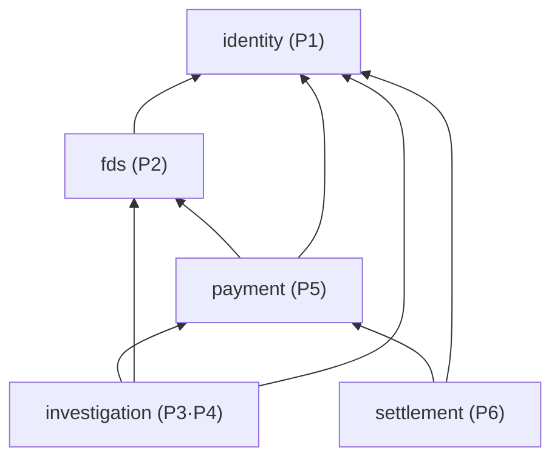

# 0001. 모듈 간 의존 방향

- **상태:** 제안 — 팀 합의 필요
- **날짜:** 2026-10-20 (2026-10-21 재작성: 채택된 FDS 업무 흐름 반영)
- **관련:** Notion FDS 공동 업무 — 설계 3.2 데이터 소유권 · 3.10 Spring Modulith 통신 설계, [ADR-0009](0009-ai-investigation-call-structure.md)
- **영향 받는 담당:** 전원

## 배경

Spring Modulith는 모듈 단위로 의존을 세므로, 두 모듈이 서로를 호출하면 기능이 달라도 순환으로 판정하고 `ModularityTests`(`verify()`)가 실패한다.

2026-10-21 팀이 FDS 업무 흐름을 채택했다. REVIEW 결제는 카드 승인 후 매입을 보류(HELD)하고, 직원이 결제별로 ACCEPT / REJECT 판정한 뒤 매입(CAPTURE) 또는 승인 취소(VOID)를 담당 모듈에 인계한다. 모듈 간 통신 방향은 설계 3.10에 [확정]으로 정해졌다. 이 ADR은 그 통신을 모듈 의존 그래프와 공개 `api/`·이벤트 표로 옮긴다.

업무 코드가 0줄인 지금 방향을 정하면 고칠 코드가 없다.

## 결정

**직접 호출(공개 `api/` 인터페이스)은 아래 방향으로만, 아래층이 위층에 알릴 일은 커밋 후 이벤트로 보낸다.**

| 모듈 | 직접 호출(의존) | 공개 `api/` (이름은 예시) | 발행 이벤트 | 구독 이벤트 |
| --- | --- | --- | --- | --- |
| identity | 없음 | `TenantReader`, `CurrentStaff`, `SecuritySignalReader` | — | — |
| fds | identity | `FdsEvaluator`, `FdsEvidenceReader` | — | — |
| payment | fds, identity | `PaymentReader`, `FinancialActionPort`, `CaptureIntakePort` | `PaymentHeld`, `CaptureRequested`, `HandoffResult` | — |
| investigation (+report) | payment, fds, identity (+ ai-server HTTP) | 없음 | — | `PaymentHeld`, `HandoffResult` |
| settlement | payment, identity | 없음 | — | `CaptureRequested` |

설계 3.10의 통신을 이렇게 구현한다.

| 설계 3.10 | 방식 | 의존 방향 |
| --- | --- | --- |
| P5 → P2 위험 평가 | `FdsEvaluator` 동기 호출 | payment → fds |
| P5 → P3 HELD 발생 | `PaymentHeld` 이벤트 | investigation이 payment 타입 구독 |
| P3 → P4 AI 조사 | 같은 모듈 내부 호출 | — |
| P4 ↔ FastAPI | HTTP, [ADR-0009](0009-ai-investigation-call-structure.md) | 모듈 의존 아님 |
| P3 → P5 금융 조치 요청 | `FinancialActionPort` 동기 호출, P3 커밋 후 | investigation → payment |
| P5 → P6 CAPTURE 요청 | `CaptureRequested` 이벤트 | settlement가 payment 타입 구독 |
| P6 → P5 CAPTURE 접수 확인 | `CaptureIntakePort` 동기 호출 | settlement → payment |
| P5 → P3 접수 결과 | `HandoffResult` 이벤트 | investigation이 payment 타입 구독 |

이벤트 타입은 **보내는 쪽 `api/`**에 둔다. 받는 쪽이 그 타입을 import하므로 의존 방향은 여전히 아래로 향한다.

순환을 만들지 않기 위한 규칙:

- fds는 payment를 조회하지 않는다. payment가 평가 요청에 재료(고객·가맹점·금액·카드·기기 등)를 담아 넘긴다. "단기간 반복 결제" 같은 규칙은 fds가 자기 평가 기록으로 센다
- payment는 investigation · settlement를 호출하지 않는다. 알릴 일은 이벤트로 보낸다
- 여러 모듈 데이터를 합치는 조회 화면 API(예: 거래 목록에 Case 번호 표시)는 위층(investigation)에 두거나 프론트가 API를 나눠 부른다. payment에 두지 않는다
- 로그인·기기 보안 신호는 identity가 제공하고 fds가 읽는다 (설계 5.7)

## 고려한 대안

| 대안 | 버린 이유 |
| --- | --- |
| 순환을 허용하고 `verify()`를 끈다 | 모듈 경계 검사 자체를 버리게 된다. 6명이 동시에 개발하면 얽힘이 빠르게 늘어난다 |
| 공통 모듈(`common`)에 공유 타입을 모은다 | 6번째 모듈이 생기고, 잡동사니 서랍이 되면 다시 순환이 생긴다 |
| 모든 모듈 간 통신을 이벤트로 | 결제 중 FDS 평가처럼 결과를 바로 받아야 하는 호출이 비동기가 되어 흐름이 복잡해진다 |
| fds가 경보 이벤트(`AlertRaised`)를 보내 Case 생성 | 평가는 카드 승인 전에 일어난다. 승인 실패(`DECLINED`)한 REVIEW 건도 경보가 되는데, 설계 2.2는 이 건을 Case 대상에서 제외한다. 승인까지 확정된 `PaymentHeld`가 맞다 |
| P5 → P6 동기 포트로 같은 트랜잭션 처리 | 설계 3.10이 이벤트 + 접수 확인 API로 확정했다 |
| P4를 별도 모듈로 | investigation과 서로 호출해 순환이 생긴다 |

## 2026-10-20 제안에서 바뀐 것

| 이전 | 지금 | 이유 |
| --- | --- | --- |
| 이벤트 `AlertRaised` · `PaymentHoldExpired` · `PaymentCanceled` | `PaymentHeld` · `CaptureRequested` · `HandoffResult` | 승인 전 보류·30분 만료·환불 모델을 버리고 승인 후 매입 보류 모델 채택 |
| payment api `ReviewExecutor` · `SettlementGate`, settlement의 환불 마감 등록 | `FinancialActionPort` · `CaptureIntakePort` | 판정은 인계 요청으로, 매입은 P6 접수 확인으로 바뀜 |
| investigation → payment · fds · identity | 같음, identity 사용 이유 명시(판정 직원 `staff_id`) | 설계 2.8 판정 기록 |
| 경보 목록 · 상세 API를 investigation으로 이동 | 조합 조회 API는 위층에 둔다는 일반 규칙 | 경보 화면 자체가 업무 흐름에서 빠짐 |

## 영향

- API: payment 공개 api가 조치 요청 · CAPTURE 접수 확인 중심으로 바뀜. 조합 조회 API는 investigation에 둠
- DB: 이 ADR로 새 테이블이 생기지 않음. 모듈 간 참조는 ID 값만 저장(FK 없음)
- 화면: 거래 목록의 Case 번호 등 조합 정보는 investigation API 또는 프론트 조합
- 테스트: 합의 후 각 모듈 `package-info.java`에 `allowedDependencies`를 넣어 `verify()`로 강제
- 이벤트 신뢰성: 커밋 후 발행 · 유실 재발행은 Modulith 이벤트 발행 기록(event publication registry)으로 처리. 재발행 설정은 공통 이벤트 담당(P2)과 별도 작업
- 문서: README Architecture · 핵심 흐름 갱신 (이 PR)

## 합의가 필요한 것

1. 이벤트 3종의 이름 · 페이로드 · 멱등 키 — 시은 · 수민 · 민정
2. P5/P6의 접수·실행 상세 저장 및 금융 실행 결과 계약 — 시은 · 민정 ([P5 설계](../payment/design.md))
3. fds가 identity에서 읽을 보안 신호 범위 — 정후 · 주환
4. 조합 조회 화면 API의 위치 — 정후 · 수민 · 시은

## 검증

미검증 — 업무 코드가 없다. 합의 후 `allowedDependencies`를 넣고, 방향을 어기는 임시 클래스로 `./gradlew check`가 실패하는지 확인한다.
