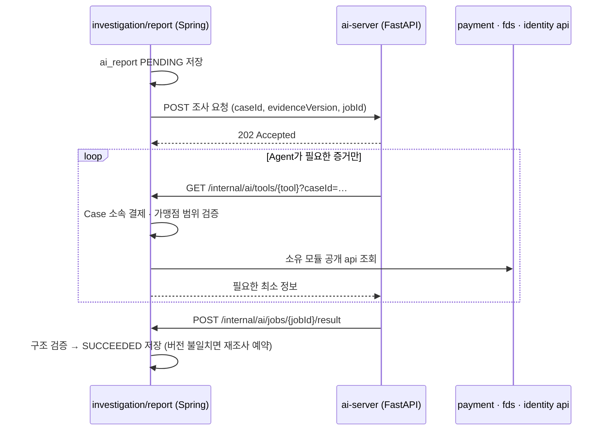

# 0009. AI 조사 호출 구조 (Spring ↔ FastAPI)

- **상태:** 제안 — 팀 합의 필요
- **날짜:** 2026-10-21
- **관련:** Notion FDS 공동 업무 — 기획 2.5 · 2.6, 설계 3.5 · 3.6 · 3.7, [ADR-0001](0001-module-dependency-direction.md)
- **영향 받는 담당:** P4 현규, P1 주환(인증 설정), P2 · P3 · P5(Tool이 읽는 공개 api 제공)

## 배경

설계 3.6 · 3.7은 다음 구조를 정했다.

- P4 Spring이 FastAPI에 조사를 **비동기**로 요청한다
- FastAPI의 AI Agent가 **Spring Tool API**를 호출해 증거를 읽는다 (Tool 6종)
- 결과는 콜백 또는 작업 결과 조회로 받고, Spring이 검증 · 저장한다
- FastAPI는 DB에 직접 접근하지 않고, 금융 상태를 바꾸지 못한다

그런데 저장소 문서에는 Spring → FastAPI 한 방향만 그려져 있어 **FastAPI → Spring 호출의 위치와 인증**이 정해져 있지 않다.

## 결정

**Tool API와 결과 수신 엔드포인트를 모두 `investigation/report`에 두고, 내부 전용 경로로 분리한다.**

| 항목 | 정한 것 |
| --- | --- |
| Tool API 위치 | `investigation/report`의 controller. Case 권한 검증을 한 곳에서 하고, 아래 모듈 api만 호출하므로 순환이 없다 |
| 경로 | `/internal/ai/**` — 화면용 `/api/**`와 분리 |
| 인증 | 서비스 간 키(헤더). 직원 로그인과 별개. 키는 환경 변수, 저장소에 올리지 않는다 |
| 권한 | Tool은 GET만. 결제 · 판정 · Case 상태를 바꾸는 Tool은 만들지 않는다 |
| 결과 수신 | FastAPI 콜백이 기본. 콜백이 오지 않으면 Spring이 작업 결과를 조회해 복구 |
| 재시도 | 최초 + 자동 재시도 2회(총 3회)는 Spring이 관리. 최종 실패 시 `FAILED`, 직원 알림 |
| 주문 정보 Tool | `get_order_context`는 Spring이 CakeShop을 HTTP로 조회해 전달 |

## 고려한 대안

| 대안 | 버린 이유 |
| --- | --- |
| Spring이 증거를 전부 모아 요청에 담아 보냄 (Tool Calling 없음) | 구현은 단순하지만, 설계 2.6 · 3.6이 채택한 Tool Calling(AI가 필요한 증거를 골라 조회)과 다르다 |
| Tool API를 각 소유 모듈(payment, fds …)에 분산 | FastAPI가 여러 모듈 경로를 알아야 하고, Case 소속 · 가맹점 범위 검증이 여러 곳에 흩어진다 |
| FastAPI가 DB를 직접 읽음 | 설계 3.6이 금지한다 |
| 동기 HTTP 한 번으로 보고서를 받음 | 생성 시간이 길어 타임아웃 위험이 있다. 설계 3.7이 비동기 접수(202)를 정했다 |
| 결과 조회(polling)만 사용 | 완료가 늦게 반영되고 Spring에 주기 작업이 필요하다. 콜백 유실 복구용으로만 쓴다 |

## 영향

- API: Spring `/internal/ai/tools/*`(GET 6종) · `/internal/ai/jobs/{jobId}/result`(POST), FastAPI 조사 요청 엔드포인트
- DB: `ai_report`(P4 소유)에 상태 · 버전 · 실패 정보. 상세 스키마는 ERD 확정 후
- 보안: `identity/security/SecurityConfig`에서 `/internal/ai/**`를 서비스 키 인증으로 분리해야 한다 — P1과 협의
- 화면: AI 최종 실패 알림, 보고서 최신 버전 여부 표시
- 테스트: 다른 Case · 가맹점의 결제를 Tool로 조회하면 거부되는지, 구버전 결과가 최신 보고서를 덮어쓰지 않는지
- 문서: README Architecture · AGENTS.md §6 (이 PR)

## 검증

미검증 — 업무 코드 없음.
