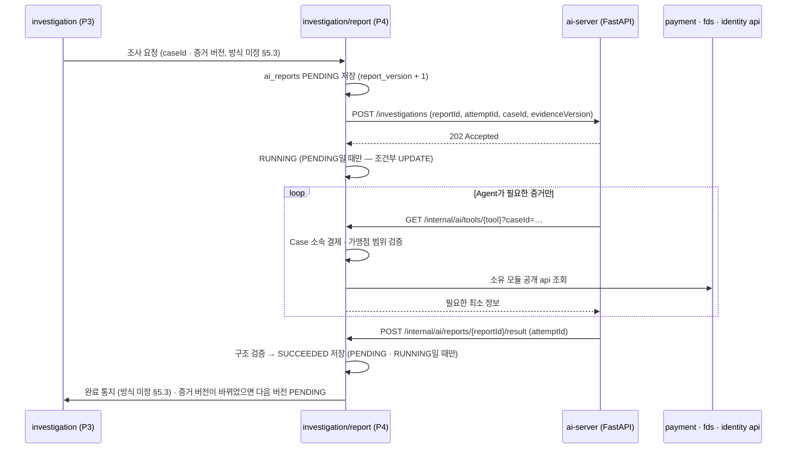

# 0009. AI 조사 호출 구조 (Spring ↔ FastAPI)

- **상태:** 제안 — 팀 합의 필요
- **날짜:** 2026-10-21 (같은 날 개정: fds 정본 ERD Baseline v1의 `ai_reports` 8개 컬럼에 맞춤) · 2026-10-23 개정: 화면 보고서 형식 · Tool 6종 반영 (#112) · 2026-10-27 개정: 1차 Tool 2종 응답 형식 (#254) · 2026-10-28 개정: 서비스 키 인증 위치 (#266, ADR-0041) · 2026-10-29 개정: 보고서 결론 · 권고 이유 · 규칙 근거 키와 문장 품질 검사 (#288) · 2026-10-29 개정: 조사 과정 기록 (#294) · 2026-10-29 개정: 7번째 Tool 비슷한 과거 사건 (#296) · 2026-11-03 개정: LLM 제공자 OpenAI 추가 (#453) · 2026-11-03 개정: 권고 기준 판정 지원 위주 (#482) · 2026-11-04 개정: 권고를 판정 기준표(코드)로 (#501)
- **관련:** Notion fds 정본 — 02 기획 2.5 · 2.6 · 2.7, 03 설계 3.5 · 3.6 · 3.7 · 3.9⑤ · 3.11, 공통 페이지 §5.3 · §5.4, [ADR-0012](0012-payment-settlement-dependency.md) (ADR-0001 대체), 화면 타입 `frontend/src/types/case.ts`
- **영향 받는 담당:** P4 현규, P3 수민(조사 요청 · 판정 검증), P1 주환(인증 설정 · 보안 이벤트 조회), P2 · P5(Tool이 읽는 공개 api 제공), CakeShop(주문 정보), 화면 담당(보고서 응답 형식)

## 배경

설계 3.6 · 3.7은 다음 구조를 정했다.

- P4 Spring이 FastAPI에 조사를 **비동기**로 요청한다 (`202 Accepted`)
- FastAPI의 AI Agent가 **Spring Tool API**를 호출해 증거를 읽는다 (Tool 6종)
- 결과는 콜백 또는 작업 결과 조회로 받고, Spring이 검증 · 저장한다
- FastAPI는 DB에 직접 접근하지 않고, 금융 상태를 바꾸지 못한다

설계 3.9⑤는 `ai_reports`를 8개 컬럼(`report_id` · `case_id` · `report_version` · `evidence_version` · `status` · `report_body` · `created_at` · `completed_at`)으로 확정했다. 작업 ID · 시도 횟수 · 실패 사유 컬럼은 없고, "시도 횟수 저장 방식은 P4 내부 설계에서 결정"으로 남겼다. 공통 페이지 §5.3(P3 ↔ P4) · §5.4(AI Tool)는 개발 전 결정 항목이 비어 있다.

이 ADR은 (1) FastAPI ↔ Spring 호출의 위치 · 인증, (2) 8개 컬럼 안에서 상태 · 재시도 · 실패를 다루는 방법을 정한다. §5.3 · §5.4는 합의 전이라 미정으로 남긴다.

## 결정 1 — 호출 구조

**Tool API와 결과 수신 엔드포인트를 모두 `investigation/report`에 두고, 내부 전용 경로로 분리한다. 작업 ID는 `report_id`를 그대로 쓴다.**



| 항목 | 정한 것 |
| --- | --- |
| Tool API 위치 | `investigation/report/controller`. Case 권한 검증을 한 곳에서 하고, 아래 모듈 api만 호출하므로 순환이 없다 |
| 경로 | Spring `/internal/ai/**` — 화면용 `/api/**`와 분리. FastAPI `POST /investigations` · `GET /investigations/{reportId}` |
| 작업 ID | `report_id`. 별도 job ID 컬럼을 만들지 않는다 (3.9⑤ 8개 컬럼 유지) |
| 인증 | 서비스 간 키(헤더 `X-Internal-Api-Key`). 직원 로그인과 별개. 키는 환경 변수, 저장소에 올리지 않는다. 확인은 identity의 `/internal/ai/**` 전용 보안 체인 ([ADR-0041](0041-ai-server-internal-api-key-authentication.md)) |
| 권한 | Tool은 GET만. 결제 · 판정 · Case 상태를 바꾸는 Tool은 만들지 않는다 |
| 결과 수신 | FastAPI 콜백이 기본. 콜백이 정해진 시간 안에 오지 않으면 Spring이 `GET /investigations/{reportId}`로 조회해 복구. 요청 · 콜백 · 조회에는 시도 토큰 `attemptId`를 함께 싣는다 (결정 2). 이전 시도 취소 API는 두지 않는다 |
| 진행 기록 (#322) | FastAPI `GET /investigations/{reportId}`는 `RUNNING`일 때 `progress`(지금까지 끝난 단계, `investigationTrace.steps`와 같은 모양)를 싣는다. 끝나면(`SUCCEEDED` · `FAILED`) 비우고 콜백에도 싣지 않는다. 메모리에만 두며, 새 시도가 오면 이전 시도의 늦은 진행 기록은 버린다. **화면 진행 표시에만 쓰고 결과 반영 · 재시도 판단에는 쓰지 않는다** |
| 주문 정보 Tool | `get_order_context`는 Spring이 CakeShop을 HTTP로 조회해 전달 (CakeShop 제공 범위는 §5.7 미결) |

### Tool 6종 (Notion 설계 3.6) + 7번째 (#296) + 8번째 (#352)

| Tool | 입력 | 하는 일 | 데이터 주인 |
| --- | --- | --- | --- |
| `get_case_payments` | `caseId` | Case 소속 결제 목록 | P3 + P5 |
| `get_fds_evidence` | `caseId` 또는 허용된 결제 ID | 결제별 FDS 점수 · 적중 규칙 | P2 |
| `get_payment_history` (#338) | `caseId` | 같은 고객의 최근 30일 결제(이 사건 제외, 최대 20건)와 상태별 건수 (참고 근거) | P5 (읽기만) |
| `get_security_events` | `caseId`, 조회 기간 | 로그인 · 기기 · 계정 이벤트 | P1 또는 CakeShop |
| `get_order_context` | `caseId` | 주문 · 배송 정보 | CakeShop |
| `get_payment_authentication` | `caseId` 또는 허용된 결제 ID | 카드 인증 · 승인 정보 | P5 |
| `find_similar_cases` (#296) | `caseId` | 비슷한 종료 사건과 결제별 직원 판정 결과 (참고 근거) | P3 + P2 (읽기만) |
| `find_linked_payments` (#352) | `caseId` | 같은 가맹점 · 최근 30일에 이 사건 결제와 같은 카드 · 기기 · IP를 쓴 다른 고객 결제의 건수 · 고객 수 · FDS 판정 · 카드사 거절 (참고 근거) | P2 (읽기만) |

**`find_similar_cases` (#296)** — 구현: `SimilarCaseFinder`. AI Tool과 AI를 끈 고정 보고서가 같은 규칙을 쓴다
- 후보는 종료(`CLOSED`) 사건만, 지금 사건 제외
- "같은 고객"(`SAME_CUSTOMER`): 같은 `merchant_id` + `customer_ref` (`customer_ref`는 가맹점마다 따로 매기는 값이라 가맹점도 같아야 한다)
- "같은 규칙 조합"(`SHARED_RULES`): 최근 종료 100건 중 적중 규칙 코드가 2개 이상 겹치는 사건
- 같은 고객을 먼저, 그다음 같은 규칙 조합. 각각 최근 종료 순, 최대 5건. 전체 건수는 `totalMatched`
- 결과는 결제별 직원 판정 건수(`acceptCount` · `rejectCount`) 그대로. "사기 확정" 같은 해석은 하지 않는다
- 기본 조회로 다룬다: 코드가 조사마다 한 번 조회한다 (결정 9, #578 전에는 "AI가 안 부르면 다시 요청 → 시스템 보충"). 조회가 실패하면 `similarCases: null`로 두고 보고서는 만든다 (참고 자료라 판정에 필요한 보고서를 막지 않는다)
- 조회는 별도 읽기 트랜잭션(`REQUIRES_NEW`)에서 한다 — 고정 보고서가 이 조회의 실패를 잡아도 보고서 트랜잭션이 되돌림 전용이 되지 않게

**`get_payment_history` (#338)** — 구현: `PaymentHistoryFinder` + P5 `PaymentReader.findRecentByCustomer`. AI Tool과 AI를 끈 고정 보고서가 같은 규칙을 쓴다
- "같은 고객": Case의 `merchant_id` + `customer_ref` (`find_similar_cases`와 같은 기준). 다른 가맹점 결제는 읽지 않는다
- 이 사건에 묶인 결제는 뺀다 — "평소 결제"와 비교하는 것이 목적이라, 사건 결제가 섞이면 사건 자체가 정상 근거처럼 보인다. P5 조회에서 건수를 세기 전에 빼서, 사건 결제가 아무리 많아도 사건 밖 결제를 놓치지 않는다 (#338 리뷰)
- 기간 · 건수는 코드에 고정: 조회 시각 기준 최근 30일, 최근 순 최대 20건. 기간 안에 더 있으면 `truncated: true`. AI가 기간을 고르지 않는다 (처음 표의 `lookbackDays` 입력은 뺐다 — 아래 고려한 대안)
- 상태별 건수(`statusCounts`)는 반환한 결제(최대 20건) 안에서 코드가 센다. 응답: `lookbackDays` · `payments[]`(`paymentId` · `amount` · `paymentStatus` · `requestedAt`) · `statusCounts[]`(`paymentStatus` · `count`) · `truncated`
- 필수 근거 · 실패 처리 · 별도 읽기 트랜잭션은 `find_similar_cases`와 같다 (기본 조회, 실패하면 `paymentHistory: null`로 두고 보고서는 만든다. AI 보고서는 한계 줄에 "고객 최근 결제를 조회하지 못했습니다"를 더한다)
- AI에게는 건수 · 상태별 건수 · 최근 5건의 금액 · 상태 · 시각만 참고로 보여 준다(결제 ID 없음). 이 숫자들은 판단 문장 숫자 검사(`fact_numbers`)에서 근거에 있는 숫자로 인정한다. "이력이 없다는 것만으로 의심하지 않고, 매입 완료 이력만으로 정상이라고 단정하지 않는다"를 지시한다

**`find_linked_payments` (#352)** — 구현: `LinkedPaymentFinder` + P2 `FdsLinkedPaymentReader.findLinked` ([ADR-0034](0034-fds-evidence-read-contract.md)). AI Tool과 AI를 끈 고정 보고서가 같은 규칙을 쓴다
- 비교할 값은 이 사건 결제의 FDS 평가에 남은 카드 토큰 · 기기 ID · IP 주소다 (이메일은 비교하지 않는다). 일치 비교는 P2 안에서 원문으로 하고, P2 밖으로는 숫자 · 판정 코드만 나온다. 카드 토큰 · IP 주소 · 기기 ID · 다른 고객 번호 · 다른 결제 ID는 P4 · AI · 보고서에 들어가지 않는다
- 범위는 Case의 `merchant_id`, 조회 시각 기준 최근 30일. 같은 고객(`customer_ref`) 결제와 이 사건 결제는 세지 않는다 — "다른 고객이 같은 카드를 썼나"가 목적이다
- 결제마다 하나로 센다. 재평가로 평가가 여러 개면 최신 비오류 평가의 판정을 쓴다(`FdsEvidenceReader`와 같은 규칙). 카드사 거절은 P5가 P2 평가에 기록한 승인 결과(`authorization_result = DECLINED`)로 센다 — P5를 따로 부르지 않는다
- 응답: `lookbackDays` · `card` · `device` · `ip` 각각 `provided`(이 사건 결제가 그 값을 보냈는지) · `otherCustomerCount` · `paymentCount` · `resultCounts[]`(`result` · `count`, 허용 · 검토 · 차단 · 평가 오류 순, 0건 제외) · `declinedCount`. `provided: false`는 "같은 값 없음"이 아니라 "비교하지 못함"이다 (현재 CakeShop은 IP를 보내지 않는다)
- **결제별 칸 (#533, 추가만 한다):** `payments[]` — 사건 결제마다 `paymentId` · `card` · `device` · `ip`(위와 같은 모양). 위 `card` · `device` · `ip`는 사건 전체 합계라 화면 카드 · 고정 보고서가 그대로 쓴다
  - 판정 기준표는 그 결제의 칸으로만 "같은 카드 · 기기 · IP를 다른 고객이 사용" 징후를 붙인다. 결제 1의 카드만 겹쳤는데 결제 2까지 고위험이 되던 문제 (PR #529 Codex 리뷰)
  - AI 입력에도 결제마다 "같은 카드 · 기기 · IP(이 결제)"를 넣는다. "다른 근거가 없다" 검사도 그 결제의 칸으로 본다
  - 결제별 칸이 없는 예전 응답이면 사건 단위로 붙이되 징후 이름을 "이 사건 결제 중 …"으로 쓴다
- 필수 근거 · 실패 처리 · 별도 읽기 트랜잭션은 `find_similar_cases`와 같다 (실패하면 `linkedPayments: null`, AI 보고서 한계 줄에 "같은 카드 · 기기 · IP를 쓴 다른 결제를 조회하지 못했습니다"). 필수 도구가 5종이 되어 Agent 도구 호출 한도를 6 → 7로 올렸다 (여유 2번 유지). #578부터 5종 모두 코드가 하는 기본 조회라 이 한도는 없어지고, AI가 고르는 추가 조회만 3번까지다 (결정 9)
- AI에게는 숫자 없이 "다른 고객 결제 있음 / 없음 / 정보 없음", 다른 고객 "한 명 / 여러 명", 그 결제들의 판정 이름, 카드사 거절 있음 / 없음만 보여 준다. 건수는 보고서 카드에 코드가 채운다. 도구 응답 자체가 숫자 · 판정뿐이라 `llm_content`에서 뺄 것이 없다. "그것만으로 도용을 단정하지 않는다(가족이 기기 · IP를 같이 쓰는 경우), 없음만으로 정상이라고 단정하지 않는다, 정보 없음은 위험 근거가 아니다"를 지시한다

입력에 `caseId`가 있다고 다른 모듈 데이터를 마음대로 읽는 것은 아니다. 각 Tool 구현이 Case 소속 결제 · 가맹점 범위를 검증하고, 소유 모듈의 공개 api로 필요한 정보만 모은다 (설계 3.6 주의).

## 결정 2 — `ai_reports` 8개 컬럼으로 상태 · 재시도 · 실패 다루기

| 상태 | 언제 | 채우는 컬럼 |
| --- | --- | --- |
| `PENDING` | P4가 조사 요청을 받아 행 생성 | `report_version` = 해당 Case 최대값 + 1, `evidence_version` = 요청 시점 Case 증거 버전, `created_at` |
| `RUNNING` | FastAPI가 `202`로 접수. **`PENDING`일 때만** 바꾼다 | — |
| `SUCCEEDED` | 결과 콜백이 구조 검증 통과. **`PENDING` · `RUNNING`일 때만** 바꾼다 | `report_body`(보고서 JSON), `completed_at` |
| `FAILED` | 총 3회 시도 모두 실패 | `report_body`에 `error` 객체(실패 코드 · 사유 · 시도 횟수 · 마지막 시도 시각), `completed_at` = 실패 확정 시각 |

- **상태 변경은 모두 조건부 UPDATE로 한다.** `WHERE report_id = ? AND status IN (…)`처럼 바꿔도 되는 이전 상태를 조건에 넣고, 변경 건수가 0이면 "이미 처리됨"으로 본다. 끝난 상태(`SUCCEEDED` · `FAILED`)는 어떤 경로로도 덮어쓰지 않는다
  - 예) 202 응답 직후 FastAPI가 바로 끝나 성공 콜백이 먼저 `SUCCEEDED`를 저장하면, 뒤이은 `RUNNING` UPDATE는 조건(`status = 'PENDING'`)이 맞지 않아 0건 변경으로 끝난다. 그래서 콜백은 `PENDING`에서도 받는다
- **시도마다 새 토큰 `attemptId`(UUID)를 붙인다.** Spring은 보고서별 "현재 시도 토큰" 하나만 기억하고, 콜백 · 조회 결과의 토큰이 **현재 토큰과 같을 때만** 반영한다
  - 다른 토큰의 콜백은 성공 · 실패 모두 무시한다. 이전 시도는 이미 타임아웃으로 실패 1회로 셌다 (같은 실패를 두 번 세지 않음)
  - 서버가 재시작되면 새 시도는 새 토큰을 받는다. 재시작 전 시도의 늦은 콜백도 같은 규칙으로 무시된다 (번호 1 · 2 · 3처럼 다시 겹치지 않음)
  - 행이 끝난 상태면 토큰이 같아도 무시한다 (조건부 UPDATE). `FAILED` 뒤에 늦게 온 성공도 뒤집지 않는다
  - 이전 시도를 취소하지 않는다. FastAPI가 버려질 작업을 끝까지 돌릴 수 있지만 결과는 반영되지 않는다 (MVP에서 감수)
- **재시도는 같은 행에서 한다.** 같은 증거를 다시 분석하는 것이므로 `report_version`을 올리지 않는다. `UNIQUE(case_id, report_version)`과 충돌하지 않는다
- **한 번의 시도 실패**로 세는 것: FastAPI가 202를 주지 않음(연결 실패 · 5xx · 타임아웃), FastAPI가 실패 결과를 보냄, 결과가 시간 안에 오지 않고 조회로도 완료가 아님, 결과가 구조 검증에 실패함
- **시도 횟수는 실행 중에는 Spring 프로세스 안에서 센다.** 최종 실패 때만 `report_body.error.attempts`에 남긴다. 컬럼을 늘리지 않기 위한 선택이며, 아래 "한계"를 받아들인다
- **실패 사유 위치:** 기획 2.5의 "실패 사유 기록"은 `report_body.error`로 충족한다 (별도 컬럼 없음)
- **`error`는 화면에 보내지 않는다.** 실패 이유는 개발자 조사용이다. 조회 응답은 `FAILED`면 `reportBody: null`로 보내고, 화면은 고정 문구("총 3회 시도")를 보여준다
- **AI 실패는 자동 판정으로 이어지지 않는다.** `FAILED`를 P3에 알리고, 직원이 직접 조사해 `report_id = NULL`로 판정한다 (설계 3.7)

**한계:** 실행 중 서버가 재시작되면 메모리의 시도 횟수 · 현재 시도 토큰이 사라진다. 늦은 콜백 구분은 새 토큰으로 유지되지만, 시도 횟수는 다시 센다. 재시작 시 오래된 `PENDING` · `RUNNING` 행은 조회로 상태를 확인하고, 확인되지 않으면 처음부터 다시 3회를 시도한다. 횟수를 엄밀히 지켜야 한다고 팀이 정하면 `attempt_count` 컬럼 추가를 설계 3.9에 먼저 제안한다.

## 결정 3 — 같은 Case의 중복 실행 방지와 버전

- **새 행을 만들지 않는 경우** (설계 3.5 중복 실행 방지)
  - 같은 Case에 `PENDING` · `RUNNING` 행이 있음 — 요청을 따로 저장하지 않는다. 아래 "완료 후 비교"가 최신 증거를 잡는다
  - 요청한 증거 버전 **이상**을 분석한 행이 이미 있음(상태 무관) — 중복 · 재전달 요청이다. `FAILED`여도 다시 만들지 않는다 (3회 제한 유지). 직원의 수동 재실행은 MVP 범위 밖
- **완료 후 비교는 두 단계로 한다.** ① 종료 상태(`SUCCEEDED` · `FAILED`)를 먼저 커밋하고, ② 별도 트랜잭션에서 현재 Case 증거 버전을 읽어 그 행의 `evidence_version`과 비교한다. 다르면 다음 `report_version`을 `PENDING`으로 만든다
  - 예) 완료 처리 중에 결제가 병합되면: 요청이 ① 전에 왔으면 "진행 중"을 보고 넘어가지만 ②가 그 뒤에 새 증거를 읽어 다음 버전을 만든다. ① 뒤에 왔으면 요청이 직접 만든다. 둘 다 만들려 하면 아래 UNIQUE 합류 규칙으로 하나만 남는다
  - 전제: P3는 증거 버전을 **커밋한 뒤** 조사 요청을 보낸다 (§5.3 합의 항목)
- **동시 요청으로 버전 번호가 겹치면 다시 읽어 합류한다.** 같은 Case에 요청 두 개가 동시에 와서 둘 다 "진행 중 없음 · 최대 버전 1"을 보면 둘 다 v2를 저장하려 한다. 늦은 쪽은 `UNIQUE(case_id, report_version)` 위반을 받는데, 이를 오류로 끝내지 않고 진행 중인 행을 다시 읽어 그 작업에 합류한 것으로 처리한다
  - 늦은 쪽이 더 새 증거 버전을 가져왔어도 빠지지 않는다. 바로 아래 "끝나면 비교" 규칙이 다음 버전을 예약한다
- 늦게 도착한 결과는 자기 행에만 쓴다. 다른 버전 행을 덮어쓰지 않는다. 끝난 행에 오는 결과는 무시한다(멱등, 결정 2 조건부 UPDATE)
- "최신 보고서" = Case 최대 `report_version`이면서 `evidence_version`이 현재 Case 증거 버전과 같은 `SUCCEEDED` 행

## 결정 4 — 화면 계약 (보고서 응답 · ID · 권고 값)

보안 직원 화면(`ReportCard`)이 먼저 만들어졌으므로 응답 형식은 화면 타입 `frontend/src/types/case.ts`(`AiReport` · `ReportBody`)를 따른다. #292부터 화면은 Case 상세의 요약 카드(`ReportCard`)와 보고서 전문 페이지(`CaseReportPage`, `/security/cases/:id/report`)로 나뉜다. **화면 타입과 이 절은 같이 바뀐다. 한쪽만 고치지 않는다.**

- **ID:** DB는 `BIGINT`를 유지하고, P4 응답 JSON에서만 문자열로 보낸다 (`5` → `"5"`). 접두어(`CASE-` 등)는 붙이지 않는다. 요청으로 받은 ID는 문자열 → 숫자로 바꾼다. migration · P3 · 화면은 바꾸지 않는다
- **`report_body` 구조:** 키 순서는 기획 2.7 순서와 같다. 화면 위치는 #292 보고서 전문 페이지 기준이다

| 키 | 화면 위치 |
| --- | --- |
| `overview` | 상세 정보 펼치기 — 사건 개요 |
| `summary` | 결론 카드의 요약 문장 (결제 1건이면 결제 카드의 조사 요약) |
| `summaryFacts` | 요약 문장별 근거 사실 번호 — 화면이 문장 끝에 표 카드 링크를 붙인다 (#559) |
| `paymentAnalyses` | 결제별 카드 (기준표 판정 · 이유 · 판정 근거), 결론 카드의 결제별 권고, "AI가 아직 모르는 것"(`unknowns`, #548부터 코드가 씀). 위험 근거 · 정상 정황 칸은 #548에서 없앴다 |
| `timeline` | 사건 경위 (시간순) |
| `facts` | 사실 번호별 원래 사실 · 그 사실을 가져온 조회 기록(`evidenceId`) · 결제 하나의 사실이면 `paymentId` (#548, #559) |
| `additionalChecks` | 판정 전에 확인할 것 — 먼저 해 볼 것 (첫 항목은 결론 카드에도 표시) |
| `recommendation` | 상세 정보 펼치기 — AI 권고 원문 · 한계 |
| `evidence` | 상세 정보 펼치기 — 증거 추적 표 (증거 ID · Tool · 출처 · 조회 시각 · 데이터 버전) |
| `verdict` | 결론 카드 — `headline`(결론 한 줄, #532부터 코드가 씀) · `overallRecommendation`(종합 권고) (#288). Case 상세 요약 카드에도 표시 |
| `investigationTrace` | "조사 과정" 탭 (#294) |
| `similarCases` | 결제별 카드 아래 "비슷한 과거 사건" 카드 (#296) |
| `paymentHistory` | "비슷한 과거 사건" 아래 "고객 최근 결제" 카드 (#338) |
| `linkedPayments` | "고객 최근 결제" 아래 "같은 카드 · 기기 · IP를 쓴 다른 결제" 카드 (#352) |

- **#288에서 더한 키 — 추가만 한다.** 그 전에 저장된 보고서에는 없으므로 화면 타입에서는 선택 항목(`?`)이고, ai-server 스키마와 Spring 저장 전 검사에서는 새 보고서에 필수다
  - `verdict.headline`: 결론 한 줄. #532부터 코드가 기준표 판정으로 쓴다 (그 전 보고서는 AI 문장 — 60자 이내 한 문장 검사)
  - `verdict.overallRecommendation`: 코드가 결제별 권고로 계산한다. 하나라도 `REJECT_REVIEW`면 `REJECT_REVIEW`, 모두 `ACCEPT_REVIEW`면 `ACCEPT_REVIEW`, 그 외 `NEEDS_CHECK`
  - `paymentAnalyses[].reason`: 결제별 이유 한 문장. #532부터 코드가 판정 근거의 징후 이름으로 쓴다 (그 전 보고서는 AI 문장)
  - `paymentAnalyses[].ruleHitDetails[]`: `code` · `name` · `appliedScore` · `evidenceId`. 코드가 FDS 조회 기록에서 채우고, `evidenceId`는 그 값을 받은 `evidence` 줄의 ID다. AI 문장으로 만들지 않는다
- **#326에서 더한 키 — 추가만 한다.** `paymentAnalyses[].ruleHitDetails[]`의 `criterion`(기준, 예: "50만 원 이상") · `observed`(이번 결제, 예: "60만 원"). 아래 `get_fds_evidence` 값을 코드가 그대로 옮긴다. AI 문장이 아니고, AI가 판단 문장을 쓸 때 받는 근거에도 넣지 않는다 (판단 문장의 숫자 금지는 그대로)
  - 화면 타입 · ai-server 스키마 모두 선택 항목이다. 그 전 보고서와 정리할 수 없는 규칙은 값이 없고, 화면은 규칙 이름 · 점수만 보여 준다
- **#294에서 더한 키 — 추가만 한다.** `investigationTrace`: `provider`(`OLLAMA` · `OPENAI` · `MOCK` · `FIXED`, `OPENAI`는 #453에서 추가) · `model` · `durationMs` · `steps[]`(`kind` · `actor` · `title` · `durationMs` · `asked` · `received` · `retryReason`) · `promptFingerprint`(#581, 선택)
  - `promptFingerprint`: 프롬프트 지문 — 사건 사실을 뺀 고정 지시문(추가 조사 · 사실 문장 쓰기 · 고쳐 쓰기)과 추가 도구 설명을 해시한 sha256 앞 12자리. AI 보고서만 채우고 고정 · 예전 보고서에는 없다. 요약 측정(`scripts/measure_summary.py`) 결과를 어느 프롬프트로 쟀는지 묶는 데 쓴다. 지시문 전문은 저장하지 않는다
  - `kind`: `DECIDE`(AI가 추가 조회를 고름, #578 전에는 다음 조회) · `TOOL`(조회 실행) · `NUDGE`(빠진 근거 다시 요청 — #578 전 보고서에만 있다) · `WRITE`(사실 문장 쓰기 · 형식 검사, #548 전에는 "판단 문장 쓰기") · `ASSEMBLE`(조립 · 증거 버전 확인). `actor`: `AI` / `SYSTEM`(코드가 한 기본 조회 · 확인 단계, #578 전에는 보충 조회)
  - 코드가 만든 짧은 요약만 담는다. 결제 금액 · 시각 같은 Tool 응답 원본, 프롬프트, 형식 검사에 걸린 AI 문장은 넣지 않는다 (재시도 사유는 검사 규칙만)
  - 화면 타입에서는 선택 항목(`?`), ai-server 스키마에서는 필수다. **Spring 저장 전 검사는 이 키를 요구하지 않는다** — 판정에 쓰지 않는 표시용이라, 없어도 보고서는 성공으로 저장되고 탭에만 "기록 없음"이 보인다
  - AI 서버를 끈 고정 보고서(`FixedReportGenerator`)는 `provider: FIXED`와 시스템 단계만 남긴다
  - 사장님 화면(`MerchantCaseQueryService`)은 요약 · 권고만 골라 쓰므로 이 키는 보안 직원 화면에만 나간다
- **#296에서 더한 키 — 추가만 한다.** `similarCases`: `cases[]`(`caseId` · `similarity` · `sharedRules[]`(`code` · `name`) · `closedAt` · `acceptCount` · `rejectCount`) · `totalMatched`
  - Tool 기록(`find_similar_cases` 응답)에서 코드가 채운다. AI 판단 문장 형식에는 이 칸이 없다. AI에게는 사건 번호 없이 이유 · 결과만 참고로 보여 주고 "지난 결과만으로 권고를 정하지 말 것"을 지시한다
  - 키가 없으면 예전 보고서(화면에서 카드 숨김), `null`이면 조회하지 못함(화면에 안내). Spring 저장 전 검사는 이 키를 요구하지 않는다 (`investigationTrace`와 같은 이유)
- **#346에서 더한 키 — 추가만 한다.** `paymentAnalyses[].signals`: `cardDisplayLabel` · `cardProvided` · `deviceProvided` · `ipCountryCode` · `ipProvided` (FDS 평가가 없으면 `null`)
  - P4 `PaymentSignalReader`가 P2 `FdsEvidenceReader`를 직접 읽어 `get_fds_evidence` 응답의 결제별 `signals`로 내보내고(P3 결제 정보 창구는 거치지 않음), ai-server는 Tool 기록에서 코드가 채운다. AI를 끈 고정 보고서도 같은 값
  - 원문 식별자는 P2 밖으로 나오지 않는다. AI에게는 "카드 정보 있음 · 기기 정보 있음 · 접속 국가(한국/해외(코드)/정보 없음)"만 보여 주고 카드 표시값(끝자리 숫자)은 넣지 않는다 — 도구를 고르는 단계(도구 응답을 AI에게 돌려줄 때, `llm_content`)와 판단 문장을 쓰는 단계 모두. 보고서를 채우는 Tool 기록에는 표시값을 남긴다 (#346 리뷰)
  - 가맹점이 보내지 않은 값은 "정보 없음 (가맹점이 보내지 않음)"으로 표시하고, AI 보고서 한계 줄에 종류별로 남긴다. AI에게 "정보 없음은 위험 근거가 아니다"를 지시한다 (돈워리가 받는 접속 IP는 가맹점 서버 IP라 구매자 IP로 쓸 수 없다)
  - AI 고정 한계 줄에서 "기기"를 뺐다 — 이제 기기 정보 유무는 확인한다
- **#338에서 더한 키 — 추가만 한다.** `paymentHistory`: `lookbackDays` · `payments[]`(`paymentId` · `amount` · `paymentStatus` · `requestedAt`) · `statusCounts[]`(`paymentStatus` · `count`) · `truncated`
  - Tool 기록(`get_payment_history` 응답)에서 코드가 채운다. AI 판단 문장 형식에는 이 칸이 없다
  - 키가 없으면 예전 보고서(화면에서 카드 숨김), `null`이면 조회하지 못함(화면에 안내). Spring 저장 전 검사는 이 키를 요구하지 않는다
  - AI 보고서의 고정 한계 줄에서 "결제 이력"을 뺐다 — 이제 조회한다 (기기 · 로그인 기록 · 주문 정보는 그대로 미확인)
- **#352에서 더한 키 — 추가만 한다.** `linkedPayments`: `lookbackDays` · `card` · `device` · `ip`(각각 `provided` · `otherCustomerCount` · `paymentCount` · `resultCounts[]`(`result` · `count`) · `declinedCount`)
  - Tool 기록(`find_linked_payments` 응답)에서 코드가 채운다. AI 판단 문장 형식에는 이 칸이 없다. AI를 끈 고정 보고서도 같은 값
  - 키가 없으면 예전 보고서(화면에서 카드 숨김), `null`이면 조회하지 못함(화면에 안내). Spring 저장 전 검사는 이 키를 요구하지 않는다
- **문장 품질 검사 (ai-server, 걸리면 다시 쓰기 · 횟수 넘으면 `NARRATIVE_INVALID`):** 근거에 없는 숫자 · 코드값 · 확률 단정(기존)에 더해 한자 · 일본 문자, 같은 묶음 안 반복 문장, 영어 단어(`FDS` · `IP` · `OTP` · `VPN` · `ID` · `AI` 및 시연 표기 `mock` · `Qwen` 제외). 결론 길이 검사는 #532에서 뺐다 (결론은 코드가 쓴다)
  - **#355에서 더한 것 (실제 Qwen 보고서 Case 8 · 9에서 본 문제):**
    - 규칙 밖 정황(같은 카드 · 기기 · IP를 쓴 다른 고객 결제, 고객 최근 결제의 승인 취소 · 거절 · 차단, 해외 접속)이 근거에 있는데 요약 · 종합 분석 · 권고 요약 · 결제별 이유가 "다른 근거가 없다/부족하다"고 쓴 문장. 근거가 규칙뿐이면 검사하지 않는다 (맞는 문장까지 막아 조사 실패가 늘지 않게)
      - 요약 · 종합 분석 · 권고 요약은 사건 전체 정황으로, 결제별 이유는 **그 결제에 해당하는 정황**으로 검사한다. 같은 카드 결제 · 고객 최근 결제는 사건 전체 정보라 모든 결제에, 해외 접속은 그 결제가 해외일 때만 (Codex 리뷰 — 결제 A만 해외인데 국내 결제 B의 사실대로 쓴 이유까지 거부했다)
    - 요약 · 종합 분석 · 확인할 것이 2개 미만 — 출력 형식(JSON Schema)에도 `minItems: 2`
  - 예시는 결론이 다른 가상 사건 2개(카드사 거절 직후 재시도 → 추가 확인 / 평소와 비슷한 고액 결제 → 매입 진행 검토). 측정 시나리오(고액 + 단시간 반복 + 같은 카드)와 일부러 다르게 둔다
  - AI 입력: 같은 카드 결제는 "다른 고객 한 명/여러 명"과 "그 고객들의 결제 한 건/여러 건"을 따로 준다(고객 수를 결제 수로 바꿔 쓴 문제). 고객 최근 결제는 사건 결제 앞뒤 10분 안의 "같은 연속 결제", 그보다 앞선 "그 전 결제", 사건 10분 뒤부터의 "사건 뒤 결제(평소 결제 아님)"로 나눠 주고, 같은 연속 결제는 정상 정황으로 쓰지 말라고 지시한다. 사건 뒤 결제는 나중에 다시 조사할 때 조회 시각 기준 30일에 섞여 들어온다 (Codex 리뷰)
  - 규칙 되풀이 금지 · 같은 카드 결제의 허용 판정을 "정상"으로 쓰지 말 것은 프롬프트로만 지시한다 (문장 모양이 다양해 검사로 막으면 맞는 문장까지 걸린다)
  - AI 고정 한계 줄에서 "AI 권고는 참고용이며 최종 판정은 보안 직원이 합니다"를 뺐다 — 보고서 전문 화면이 같은 안내를 항상 보여 준다
  - **#542에서 더한 것 (로컬 시연 Case 2, OpenAI gpt-4.1-mini에서 본 문제):** 판정 코드는 같은 연속 결제를 정상 근거에서 뺐는데 AI 문장이 "연속 결제가 모두 매입 완료 → 정상 가능성"으로 써서 화면의 "정상 거래 근거: 없음"과 반대로 보였다
    - AI 입력의 같은 연속 결제 목록에서 결제 상태를 뺀다 (금액 · 요청 시각만)
    - 사건에 같은 연속 결제가 있으면 다시 쓰게 하지 않고 코드가 뺀다: 정상 정황은 연속 결제를 말한 문장, 요약 · 종합 분석은 연속 결제와 "매입 완료 · 정상 · 평소"가 함께 든 문장. "단시간 반복 결제"는 규칙 이름이라 대상이 아니다
    - 규칙 되풀이 위험 문장은 "규칙에 걸렸습니다"에 더해 "규칙에 적중하여 의심 신호가 있습니다" 모양도 코드가 뺀다
  - Ollama 입력 창 `num_ctx`를 8192로 고정(`AI_SERVER_OLLAMA_NUM_CTX`), 도구 고르기 · 판단 문장 쓰기 단계의 입력 · 출력 토큰 수를 조사 과정 기록 `received`와 ai-server 로그에 남긴다
  - **형식 검사를 통과한 뒤 코드가 빼는 문장 (`sanitize_narrative`)** — 다시 쓰게 하지 않는다. temperature 0인 7B는 "다시 써"를 받아도 같은 문장을 3번 내서 조사가 실패했다(3차 실측 `NARRATIVE_INVALID`). 빼도 잃는 게 없는 것만 빼고, 결론 · 이유 · 권고 요약은 건드리지 않는다. 뺀 수는 조사 과정의 판단 문장 단계에 "문장 N개 뺌"으로 남긴다
    - 출력 예시 문장을 그대로 쓴 문장 (띄어쓰기 · 문장부호 빼고 같으면) — 예시 사건(카드사 거절)의 "거절 사유 확인"이 무관한 사건에 들어갔다 (Case 8)
    - 요약 · 종합 분석 문장을 결제별 위험 · 정상 근거에 그대로 복사한 문장 (Case 10). 단 그 목록에 복사 문장밖에 없으면 남긴다 — 빼면 이유는 "정황이 있다"는데 목록이 비어 보였다 (Case 13). 이유 = 권고 요약은 결제가 하나면 원래 같은 내용이라 둔다
    - 뺀 뒤 요약 · 종합 분석 · 확인할 것이 비면(예시 문장만으로 채운 경우) 그때만 다시 쓰게 한다. 비운 채 조립하면 요약 최소 1줄 제약에 걸려 조사가 알 수 없는 오류(`AGENT_ERROR`)로 끝났다 (Codex 리뷰)
    - "○○ 규칙에 걸렸습니다/적중했습니다"로만 된 위험 근거 — 규칙 카드와 같은 내용 (보고서 조립 때 `drop_rule_only`)
  - **한계 줄(`recommendation.limitations`)은 AI가 쓰지 않는다** — AI 출력 형식에서 칸을 뺐다. "무엇을 조회했나 · 못 했나"는 해석이 아니라 사실이라 코드가 조회 기록으로 쓴다(결정 기록 "사실 필드는 Spring이 정본, AI는 해석만"과 같은 원칙). AI가 쓰던 한계 줄이 조회한 같은 카드 결제를 "확인할 수 없다/알 수 없었다"고 반대로 썼다 (Case 10 · 12). 코드가 쓰는 줄: mock 조사 표시, 조회 실패(이력 · 같은 카드 결제), 가맹점이 보내지 않은 카드 · 기기 · IP, 금액 · 시각을 못 찾은 결제, 같은 카드 결제를 찾았을 때 "건수 · 판정만 보고 개별 결제 내용은 보지 않았다(다른 고객 정보 보호)", 고정 줄 2개. 판단에 모자란 사실은 AI가 결제별 `unknowns`에 쓴다
  - 도구 고르기 답 길이를 128토큰으로 제한(`AI_SERVER_OLLAMA_CHOOSE_MAX_TOKENS`) — "조사 완료" 한 마디에 설명 307토큰 · 28초 (Case 10), 256으로도 꽉 참 (Case 12). 도구 4개를 한 번에 골라도 93토큰
- **#501에서 더한 키 — 추가만 한다.** `paymentAnalyses[].basis`(판정 근거): `signals[]`(`key` · `label` · `detail` · `level` · `normalReason` · `countedIn`) · `normals[]`(`key` · `label` · `canExplain` · `explains`) · `rule` · `recommendation`
  - 코드가 Tool 기록(FDS 근거 · 고객 최근 결제 · 같은 카드 · 기기 · IP 결제)으로 계산한다. AI 문장이 아니다 (결정 7)
  - `paymentAnalyses[].recommendation`은 `basis.recommendation`과 같다. 그 전 보고서는 AI가 고른 값이다
  - 화면 타입 · ai-server 스키마 모두 선택 항목이다. 키가 없으면 그 전 보고서다. Spring 저장 전 검사는 이 키를 요구하지 않는다 (`investigationTrace`와 같은 이유)
- **권고 값:** `ACCEPT_REVIEW` / `REJECT_REVIEW` / `NEEDS_CHECK`. 참고용이며 최종 판정은 직원이 한다. #501부터 결제별 권고는 AI가 아니라 판정 기준표가 정한다 (결정 7)
- **보고서 속 결제 ID:** Tool로 받은 실제 ID만 쓴다. 저장 전에 Case 소속인지 검증하고, 아니면 구조 검증 실패(시도 실패 1회)로 처리한다
- **실패 정보:** 결정 2대로 `error`는 응답에서 뺀다
- **진행 조회 (#322) — 생성 중인 보고서의 끝난 단계:** `GET /api/security-cases/{caseId}/reports/{reportId}/progress` → `{ reportId, status, steps[] }`. `steps[]`는 `investigationTrace.steps`와 같은 모양(코드가 만든 요약만, 원본 값 · 프롬프트 없음)
  - 컨트롤러는 P4 패키지(`investigation/report/controller`)에 둔다. 경로만 P3 Case 아래이고 P3 코드 · `ReportGateway`는 바꾸지 않는다
  - 보안 직원만 본다(`SecurityStaffGuard`). 다른 Case의 보고서 번호면 404
  - **조회 전용:** FastAPI가 끝났다고 답해도 보고서 상태를 바꾸지 않는다. 결과 반영은 콜백 · 복구 경로만 한다 (결정 2의 조건부 UPDATE 밖으로 상태가 바뀌지 않게)
  - Spring이 기억하는 현재 시도(`attemptId`)와 같은 기록만 보여 준다
  - `steps`가 빈 목록인 경우: 보고서가 `RUNNING`이 아님 · AI 서버를 끔(고정 보고서) · FastAPI 조회 실패나 기록 없음. **오류를 내지 않는다** — 진행 표시 때문에 Case 상세가 깨지지 않게
  - ID는 문자열(위 ID 규칙)
  - 화면(`ReportCard`)은 새 타이머 없이 Case 상세의 자동 조회(3초 · 2분 제한, #238)에 맞춰 부른다. 같은 보고서의 조회가 끝나지 않았으면 새로 보내지 않고, 늦게 온 응답도 보고서 번호가 같으면 반영한다

## 결정 5 — LLM 제공자: 배포 VM은 OpenAI (#453)

- **상황:** 보고서는 Ollama(Qwen 7B, 약 4.7GB) 기반 내부망으로 만들었다. 그러나 배포 VM은 사양 한계로 Ollama를 따로 설치할 수 없다. CPU만으로 돌리면 보고서 하나에 수 분이 걸린다. mock은 정해진 문장이라 실제 AI 보고서를 보여 줄 수 없다. 그래서 배포 VM에서는 외부 LLM(OpenAI)을 쓸 수밖에 없다
- **결정:** 기존 LLM 호출 경계(`LlmClient`, AGENTS.md 6절)에 `OpenAiLlmClient`를 추가한다. `AI_SERVER_LLM_PROVIDER=openai`로 켠다. 기본값은 그대로 `mock`이고 `ollama`도 그대로 둔다
- **OpenAI가 맡는 것:** 도구 고르기(#578부터 추가 조사만, 결정 9)와 판단 문장 쓰기만 맡는다. 조사 흐름 · 허용 Tool 목록 · 문장 검사 · 다시 쓰기 · 보고서 조립은 그대로다. 판정은 직원이 하고, AI 실패 시 자동 ACCEPT/REJECT는 없다 (결정 1 그대로)
- **외부로 나가는 것:** AI 입력, 곧 사건의 결제 · FDS 근거 요약이 OpenAI API로 나간다. 범위는 Ollama 때와 같다 (카드 표시값 · IP 원문 없음, #346). 시연 데이터는 합성이다. 실제 고객 데이터에 쓰려면 다시 결정한다
- **키:** `AI_SERVER_LLM_API_KEY`(이미 있던 설정, 팀 공용 키)를 쓴다. 환경 변수로만 넣고 저장소에는 넣지 않는다. `openai`인데 키가 비어 있으면 ai-server가 시작 단계에서 멈춘다
- **모델:** `AI_SERVER_OPENAI_MODEL`, 기본 `gpt-4.1-mini`. 같은 근거에 같은 답을 내도록 `temperature 0`을 쓰므로, temperature를 바꿀 수 없는 추론 모델(GPT-5 계열 등)은 쓰지 않는다
- **출력 형식:** 판단 문장은 JSON Schema 구조화 출력(strict)으로 받는다. strict는 모든 객체에 `additionalProperties: false`가 있어야 하므로, OpenAI 클라이언트 안에서만 스키마 복사본에 붙인다 (Ollama 스키마는 그대로)
- **조사 과정 기록:** `provider: OPENAI`, `model`은 설정한 모델 이름이다. 화면은 OLLAMA처럼 실제 LLM 색(보라)으로 보여 준다

## 결정 6 — 권고 기준: 추가 확인 위주에서 판정 지원 위주로 (#479)

> **#501 결정 7로 대체됨.** 권고를 AI가 고르는 방식은 결정 7에서 판정 기준표(코드)로 옮겼다. 아래는 그 전까지의 기록이다.

- **상황:** 보고서는 보안 직원이 매입 진행(ACCEPT) 또는 승인 취소(REJECT)로 판정하도록 돕는 것이 목적이다. 그런데 판단 문장 프롬프트(`WRITE_SYSTEM`)가 추가 확인 필요(`NEEDS_CHECK`) 쪽으로 기울어 있었다. 직원 입장에서는 "그래서 어느 쪽?"이 남았다
  - 권고 기준에 "대부분의 사건은 이 값이다"(`NEEDS_CHECK`)가 있었다
  - 출력 예시 2개가 `NEEDS_CHECK` · `ACCEPT_REVIEW`뿐이었다. 모델은 규칙보다 예시를 더 잘 따른다(#355)
  - "구매자 본인의 결제 의사"는 모든 결제에서 늘 모르는 사실인데(코드가 `unknowns`에 항상 붙임), 기준이 이것을 판정을 가를 사실의 예로 들어 언제든 `NEEDS_CHECK`를 고를 수 있었다
- **결정:**
  - 위험 · 정상 정황을 모두 따져 어느 쪽이 무거운지를 권고로 고르게 한다. 서로 다른 위험 정황 여럿이 같은 방향을 가리키고 그것을 설명할 정상 정황이 없으면 `REJECT_REVIEW`, 정상 정황이 위험 신호를 설명하면 `ACCEPT_REVIEW`
  - `NEEDS_CHECK`는 정황이 비슷하게 맞서고 판정을 가를 사실을 몰라 어느 쪽으로도 기울지 않을 때만 고른다. 확신이 없다는 이유만으로 고르지 않는다. "구매자 본인의 결제 의사"만으로는 고르지 않는다
  - 출력 예시에 `REJECT_REVIEW` 예시를 더해 권고 세 가지를 하나씩 둔다 (측정 · 시연 시나리오와 다른 가상 사건: 처음 보는 기기 · 카드 · 해외 접속 + 같은 기기를 쓴 다른 고객)
  - **코드 검사:** `NEEDS_CHECK`인 결제의 `unknowns`가 비어 있으면 다시 쓰게 한다(`needs_check_errors`). 예시의 모르는 사실을 그대로 써서 코드가 뺀 뒤 비어도 같다(`emptied_errors`). 직원은 추가 확인 필요를 받으면 무엇을 확인할지 알아야 한다
  - **정상 정황은 같은 종류의 위험 신호만 설명한다:** 평소 비슷한 금액 이력은 고액 신호를 설명하지만 처음 쓰는 기기 · 카드 · 해외 접속은 설명하지 못한다. 설명되지 않은 위험 신호가 남고 그 이유를 모르면 `NEEDS_CHECK`. 1차 실측에서 `measure_mixed`(해외 접속 + 새 기기 vs 평소 금액 이력)가 금액 이력만으로 `ACCEPT_REVIEW`가 나와 넣었다
  - **승인 취소 검토는 정상 고객에게 드문 정황이 하나 이상 있을 때만 (#490):** 드문 정황은 카드사 거절 직후 재시도 · 카드 테스팅 · 같은 카드나 기기를 다른 고객이 씀 · 같은 카드나 기기로 차단된 결제 이력. 해외 접속 · 처음 쓰는 기기 · 처음 쓰는 카드 · 고액 결제는 흔한 신호라 이것들만 겹치면 `NEEDS_CHECK`. 흔한 신호 2개만으로도 "위험 정황 여럿 + 설명할 정상 정황 없음"이 맞아 `REJECT_REVIEW`와 `NEEDS_CHECK` 기준을 동시에 채웠고, 모델이 실행마다 다른 쪽을 골랐다
- **측정:** `run_report --sample tests/fixtures/measure_*.json`(OpenAI gpt-4.1-mini). 고치기 전에는 세 샘플 모두 `NEEDS_CHECK`, 1차 수정 후 `measure_reject` → `REJECT_REVIEW`, `measure_accept` → `ACCEPT_REVIEW`, `measure_mixed` → `ACCEPT_REVIEW`(기대 `NEEDS_CHECK`). 2차 수정(같은 종류만 설명) 후 2회: reject · accept는 기대대로, `measure_mixed`는 `REJECT_REVIEW` · `NEEDS_CHECK`로 갈림. 드문 정황 보강(#490) 후 2회: `measure_reject` → `REJECT_REVIEW` · `measure_accept` → `ACCEPT_REVIEW` · `measure_mixed` → `NEEDS_CHECK`로 2회 모두 기대대로
- **그대로인 것:** 권고는 참고용이고 최종 판정은 직원이 한다. 보고서 형식 · 종합 권고 계산(결정 4) · Spring · 화면은 바꾸지 않는다
- **영향:** AI가 결론을 더 분명히 내면, 직원이 AI와 반대로 판정할 때 사유를 더 써야 하는 경우가 늘어난다(화면의 권고 반대 판정 규칙, `caseDetailView.isOpposing`). 2차의 관리자 승인(권고 반대 매입 허용)과도 이어진다

## 결정 7 — 권고를 판정 기준표(코드)로 (#501)

- **상황:** AI 권고 성적표(v3 합성 시험지 25건, OpenAI gpt-4.1-mini)에서 위험한 놓침 · 잘못된 취소는 0건이었지만 22건이 `NEEDS_CHECK`였다. 단서가 있는 사기 3건(같은 카드를 다른 고객이 씀)도 모두 `NEEDS_CHECK`였다
  - 1건(시험지 1011)을 단독 실행해 보니 단서는 AI 입력에 들어 있었다. 그런데 AI가 ① 평소 결제 이력(매입 완료 9건)을 정상 정황으로 들어 새 카드 · 새 기기 · 해외 접속까지 맞섰다고 보고 ② 단서를 위험 근거가 아니라 `unknowns`(모르는 사실)로 미뤘다
  - 결정 6의 문장("같은 종류만 설명한다" · "드문 정황")이 있었지만 다른 문장("가족이 같이 쓸 수도")이 이겼다. 사건마다 문장을 덧붙이는 방식(#355 · #479 · #490)으로는 문장끼리 충돌하는 일이 반복된다
- **결정:** 결제별 권고는 코드의 판정 기준표가 정한다. AI는 권고를 고르지 않고, 근거를 모아 이어서 설명한다. 최종 판정은 지금처럼 직원이 한다 (`app/agent/evidence.py`)
  - **징후 나누기:** 고위험 징후(정상 고객에게 거의 없음) — 카드 테스팅(R06) · 차단 목록(R07) · 카드사 거절 직후 재시도(R08) · 같은 카드를 다른 고객이 씀 · 같은 기기를 다른 고객이 씀. 주의 징후(정상 고객에게도 있음) — 고액(R01) · 처음 쓰는 기기(R02) · 처음 쓰는 카드(R03) · 짧은 시간 반복(R04) · 고위험 국가(R05) · 해외 접속(R05가 없을 때) · 같은 IP를 다른 고객이 씀(공유기 · 회사 망에서도 흔해서). 모르는 규칙 코드는 주의 징후로 본다. 예전 영문 코드(`HIGH_AMOUNT` 등)도 같은 규칙으로 읽는다
  - **정상 거래 근거는 정해진 징후만 설명한다(정상 사유):** 사건 전에 비슷한 금액(0.5~1.5배)으로 매입 완료된 결제 2건 이상 → 고액. 사건 결제 앞뒤 10분 안의 결제와 첫 사건 결제 뒤 결제(사건 도중 · 뒤)는 평소 결제로 치지 않는다 (`split_history`의 "그 전 결제"와 같은 기준). 사건은 30분 안의 보류 결제를 합쳐 길어지므로 마지막 사건 결제가 아니라 첫 사건 결제를 기준으로 한다 (#532). 고위험 징후에는 자료만으로 정상 사유를 붙이지 않는다 — 직원 확인으로만 풀린다
  - **"전에 승인된 본인 카드"는 정상 근거로 쓰지 않는다 (Codex 리뷰):** R03이 안 걸린 것은 관리자가 R03을 꺼 둔 경우와 구분할 수 없고, 고객 최근 결제는 카드별 이력이 아니다. P2는 평가 기록(`fds_evaluations.card_token` · 승인 여부)으로 이 값을 계산할 수 있지만 `FdsPaymentEvidence`로 넘기지 않는다. 필요해지면 P2 계약 변경으로 따로 제안한다
  - **같은 행동을 두 번 세지 않는다:** 거절 후 재시도(R08) · 카드 테스팅(R06)이 있으면 짧은 시간 반복(R04)은 그 징후에 포함된 것으로 보고(`countedIn`) 판정에 따로 세지 않는다. 10분 안에 거절된 뒤 다시 결제했다면 이미 짧은 시간에 여러 번 결제한 것이다
  - **판정 기준표:** 정상 사유가 없는 징후로 정한다. 고위험 + 다른 징후 → `REJECT_REVIEW` · 고위험 하나만 → `NEEDS_CHECK` · 주의 징후만 → `NEEDS_CHECK` · 모두 정상 사유 있음 → `ACCEPT_REVIEW`. 종합 권고 계산은 결정 4 그대로다
  - **AI가 하는 일:** 판단 문장 입력에 결제별 "판정 근거"(징후 · 정상 사유 · 기준표 판정, 숫자 · 영문 코드 없이)를 넣는다. AI 출력 형식에서 `recommendation`을 뺐다. AI는 결론 한 줄 · 요약 · 결제별 이유(그 기준표 판정이 나온 이유) · 위험 근거 · 정상 정황 · 모르는 것 · 확인할 일을 쓴다
  - **코드 검사:** 기준표 판정이 `NEEDS_CHECK`인데 `unknowns`가 비면 다시 쓰게 한다 (결정 6의 검사를 기준표 값으로 옮김)
  - **판단 문장도 코드가 쓴다 (#532):** 기준표 판정은 코드가 정해도 결론 한 줄 · 권고 요약 · 결제별 이유를 AI가 써서, 판정과 반대되는 문장(결과는 매입 진행 검토인데 결론은 "승인 취소를 권고")이 그대로 저장될 수 있었다 (PR #529 Codex 리뷰)
    - 이 세 칸은 코드(`app/agent/verdict_text.py`)가 기준표 판정으로 쓰고, AI 출력 형식 · 지시문 · 예시에서 뺐다. 보고서 JSON 모양은 그대로다
    - AI는 요약 · 종합 분석 · 위험 근거 · 정상 정황 · 모르는 것 · 확인할 일(사실)만 쓴다
    - AI 문장에 판단 문구(승인 취소 · 매입 진행을 권고 · 검토)가 섞이면 다시 쓰게 하지 않고 코드가 뺀다 — 같은 문장을 반복하다 조사가 실패한 기록이 있다 (#355). 지난 결제 상태("승인 취소된 결제")는 사실이라 남긴다
  - **FDS 점수 없음 (#532):** 점수가 없으면(평가 오류 · 평가 없음) "FDS 평가 결과 미확인" 주의 징후를 붙여 "징후 없음 → 매입 진행 검토"가 되지 않게 한다. 판정을 올리지도 내리지도 않는다 — 고위험과 겹치는 "다른 징후"로 세지 않는다. 지금은 보고서 생성 전 검사가 점수 없는 결제를 먼저 막아 방어용이다
- **확인:** 단위 테스트(`tests/test_decision_basis.py`)에 시험지 사건 모양을 옮겼다. 1011(같은 카드 다른 고객 + 새 카드 · 기기 · 해외) → `REJECT_REVIEW`, 1066 · 1015(거절 후 재시도 + 짧은 시간 반복, 한 행동으로 셈) · 1014(해외 여행, 주의 징후만) → `NEEDS_CHECK`, 평소 금액의 고액 → `ACCEPT_REVIEW`. 1066(카드 테스팅 모양 사기)은 지금 자료로 한도를 모르고 다시 누른 정상 고객(1015)과 가를 수 없어 추가 확인으로 둔다 (매입 진행이 아니므로 위험한 놓침은 아니다)
- **그대로인 것:** 권고는 참고용이고 최종 판정은 직원이 한다. 권고 값 3종 · 종합 권고 계산 · Spring 저장 전 검사 · 반대 판정 사유 규칙(`caseDetailView.isOpposing`)
- **영향:**
  - 화면: "AI 권고"를 "기준표 판정"으로 바꾸고 판정 근거를 보여 준다. 판정 패널(P3) · 사장님 화면은 문구만 바뀐다 (#501 화면 PR)
  - 같은 근거면 언제나 같은 권고가 나온다. 권고 성적표는 이제 AI가 아니라 기준표를 재는 셈이므로, AI 품질은 문장(이유 · 모르는 것 · 확인할 일)으로 본다
  - 기준표의 짝과 등급은 합성 시험지 기준이다. 실제 결제(Shadow 기록)가 쌓이면 다시 본다. ML 참고 위험도를 넣을 때도 이 기준표에 주의 징후로 더한다 (ML 혼자서 승인 취소 검토가 되지 않게)

## 결정 8 — AI는 판단하지 않고 조사한 사실을 주제별로 전달 (#548)

- **상황:** #532 뒤에도 AI 출력 칸이 판단 모양이었다 — 결제별 위험 근거 · 정상 근거 · 종합 분석. 어떤 사실을 "정상 쪽"에 넣는 것 자체가 판단이라, AI가 기준표와 반대로 분류했다 (예: 사건 결제 앞뒤 10분 안의 같은 연속 결제를 "모두 매입 완료라 평소 결제"로 정상 쪽에 씀)
  - 코드는 이를 단어 목록으로 뒤늦게 지워 왔다 (#542 · #545). 자연어는 단어로 다 가를 수 없어 구멍을 막을 때마다 맞는 문장("평소 결제가 아닙니다")이 잘못 지워졌고, Codex 리뷰가 3차까지 이어졌다
- **결정:** AI의 역할은 전달자다. 사람이 일일이 조회하기 어려운 사실을 모아 주제별로 보여 준다. 위험 · 정상 분류는 기준표(결정 7), 최종 판정은 직원
  - **주제 = 조회 도구 하나:** 결제 이력(`get_payment_history`, 번호 `이력-N`) · 같은 카드 · 기기 · IP(`find_linked_payments`, `연결-N`) · 카드 · 기기 · 접속 정보(`get_fds_evidence`의 접속 정보, `접속-N`) · 비슷한 과거 사건(`find_similar_cases`, `과거-N`). 사건 결제 자체는 결제 카드 · 기준표에 있어 주제로 두지 않는다. 등록표(`app/agent/facts.py`의 `FACT_TOPICS`)에 한 줄 + 사실 뽑는 함수만 더하면 도구가 늘어도 번호 · 출력 형식 · 검사 · 저장이 따라온다
  - **사실 번호:** 코드가 Tool 기록을 사실 한 줄씩으로 만들고 번호를 붙인다. AI에게 줄 때와 보고서에 저장할 때 같은 함수(`fact_catalog`)로 만들어 번호가 어긋나지 않는다. 조회 기록이 없는 주제(조회 실패 · 안 부름)는 빼서 "없다"는 사실로 보이지 않게 한다 (조회 못 한 것은 지금처럼 코드가 한계 줄에 쓴다)
  - **AI 출력:** `summary`(문장 + 근거 번호 2~3개) · `topics`(주제별 문장 + 근거 번호) · `additionalChecks`(확인할 일, 번호 없음). 출력 형식(JSON Schema)이 주제 키와 번호 목록(`enum`)을 고정한다. 모르는 사실(`unknowns`)은 코드가 쓴다
  - **검사:** 단어로 뜻을 추측하지 않는다. ① 근거 번호가 있고 준 번호인지, 주제 칸에는 그 주제 번호인지 ② 문장 속 숫자가 인용한 사실 안에 있는지(작은 수도 본다) ③ 겉모양 — 영어 코드값 · 한자 · 영어 단어 · "확률" 같은 단정 · "~해야" 같은 판단 문구 · 예시 베끼기 · 반복. 걸리면 코드가 지우지 않고 다시 쓰게 한다 (횟수를 넘으면 `NARRATIVE_INVALID`, 자동 판정 없음)
  - **저장:** `summary`는 문장 목록 그대로 둔다 — 사장님 화면(`MerchantCaseQueryService`, P3)이 읽는다. `factTopics`(주제별 문장 + 번호) · `facts`(번호별 사실 + `evidenceId`)를 더하고 `overallAnalysis` · 결제별 `riskEvidence` · `normalEvidence`를 뺐다. Spring 저장 전 검사는 `overallAnalysis` 대신 `factTopics` · `facts`를 필수로 본다. 고정 보고서(`FixedReportGenerator`)는 둘 다 빈 목록
  - **예전 보고서:** 데이터는 지우지 않는다(물리 삭제 금지). 화면은 예전 AI 문장(위험 쪽 · 정상 쪽 · 종합 분석)을 보여 주지 않고 "예전 형식 보고서라 AI 조사 사실이 없어요"만 보여 준다. 코드가 만든 칸은 그대로다
- **버린 대안:**
  - 단어 필터를 계속 보강 — 자연어 문장 모양이 끝없이 달라 맞는 문장을 지우는 일이 반복된다 (#542 · #545 리뷰 3차)
  - 위험 · 정상 칸은 두고 AI에게 "판단하지 말라"고만 지시 — 칸 이름 자체가 분류를 요구한다
  - 평가어("정상" · "의심") 금지 목록 추가 — 또 하나의 단어 필터라 같은 문제가 생긴다. 프롬프트로만 지시한다
  - 걸린 문장을 지금처럼 코드가 빼기 — 빠진 문장 때문에 칸이 비면 결국 다시 쓰기가 필요했고, 무엇이 왜 빠졌는지 남지 않는다. 지금 기본 제공자(OpenAI)는 지적하면 고쳐 쓴다
- **영향:**
  - ai-server: `facts.py` 추가, 출력 형식 · 검사 · 프롬프트 · 조립 변경. 단어 필터(`sanitize_narrative` · `drop_rule_only` · 연속 결제 필터 · "다른 근거 없음" 검사)와 그 테스트 삭제
  - backend(P4): 저장 전 검사 섹션, 고정 보고서 모양
  - 화면: "AI 참고 설명(위험 쪽 · 정상 쪽)" · "종합 분석" → "AI가 조사한 사실(주제별)", 번호를 누르면 사실 원문과 조회 기록
  - 다시 쓰기가 조금 늘 수 있다 (예전 Qwen 7B는 같은 문장을 반복해 실패한 기록이 있다). 로컬 시연으로 실패 빈도를 본다

- **보충 — 주제별 문장 카드를 빼고 요약이 사실을 잇는다 (#559):**
  - 상황: 실제 화면에서 주제별 문장("AI가 조사한 사실" 카드)이 바로 아래 표 카드(고객 최근 결제 · 같은 카드 · 기기 · IP · 비슷한 과거 사건)를 문장으로 다시 읽을 뿐이었다. 주제별로 나눠 쓰니 같은 결제(최근 30일 결제 2건 = 사건 앞뒤 10분 안 결제 2건)를 따로 적어 "평소 결제가 2건 있다"로 읽힐 수 있었고, 번호 칩("이력-1")도 사람에게 헷갈렸다
  - 결정: AI 출력의 주제별 문장(`topics`)과 보고서 `factTopics`를 뺐다. 요약(`summary`)을 1~3문장으로 하고, 주제를 넘나들며 같은 결제를 이어 쓰게 지시한다. 사실 하나하나는 표 카드가 맡는다
  - 저장: `summary`(문장 목록, 사장님 화면)는 그대로, `summaryFacts`(문장 + 근거 번호)를 더했다. Spring 저장 전 검사는 `factTopics` 대신 `summaryFacts`를 요구한다. 접속 정보 사실에는 `paymentId`를 둔다
  - 화면: 번호는 보이지 않는다. 요약 문장 끝에 근거 사실의 표 카드 제목으로 작은 링크("› 고객 최근 결제")를 붙이고, 누르면 그 카드로 이동해 잠깐 강조한다. 접속 정보는 결제 카드로 간다. 조사 요약 박스의 징후 색 밑줄과 뜻이 겹치지 않게 밑줄 대신 글자 링크로 했다
  - 버린 대안: 주제별 카드를 표로 바꾸기(코드가 그리는 표와 같은 표가 두 번 나온다) · 표 카드마다 AI 한 줄(배치 작업이 크다) · 코드 점검표(표 카드와 겹친다) · 번호 칩 유지(헷갈린다) · 밑줄 링크(징후 색 밑줄과 겹친다). 시간축 · 관계 그림은 다음 작업으로 미뤘다
  - #548로 만든 보고서(`factTopics`만 있음)는 링크 없이 요약 문장만 보인다

## 결정 9 — 기본 조회는 코드가, AI는 추가 조사만 고른다 (#578)

- **상황:** 기본 근거 5종(결제 목록 · FDS 근거 · 비슷한 사건 · 고객 최근 결제 · 같은 카드 · 기기 · IP)을 다 봐야 조사가 끝났다. AI가 빠뜨리면 다시 요청하고, 그래도 안 보면 코드가 보충했다
  - 그래서 AI가 무엇을 고르든 보고서 내용은 같았다. 고르기에 걸린 시간만 남았다: Case 5 기준 13.4초 중 9.2초(조사 시간의 69~79%)
- **결정:** 기본 조회 5종은 코드가 조사마다 한 번씩 한다 (`graph.py`의 `base`). FDS 근거는 사건 결제 번호를 코드가 넣어 한 번에 받는다
  - 실패 규칙은 그대로다: 결제 목록 · FDS 근거를 못 보면 조사 실패(직원은 수동 판정), 참고 3종은 그 칸만 비우고 보고서를 만든다
  - AI는 기본 조회 결과를 보고 더 볼 것이 있을 때만 추가 조회 도구를 고른다. 추가 도구 목록(`EXTRA_TOOLS`)이 비어 있으면 AI를 부르지 않는다 — 첫 추가 도구는 고객 이력 90일 (다음 작업)
  - 고르기 틀은 그대로 옮겼다: 허용 목록(기본 조회 도구도 거절) · 도구 설명에 없는 인자 버리기 · 최대 3번(`AI_SERVER_AGENT_MAX_EXTRA_CALLS`, 거절한 호출도 센다)
  - 추가 조회가 실패하면 AI에게는 정해진 문장만 준다. 오류 원문(내부 주소 등)은 외부 AI로 보내지 않고 ai-server 로그에만 남긴다
  - 조사 과정 기록: 기본 조회는 `TOOL`/`SYSTEM`, 추가 조사는 `DECIDE`/`AI` · `TOOL`/`AI`. 단계 이름은 그대로라 예전 보고서도 같은 화면으로 보인다
  - 기본 조회도 지금처럼 ai-server가 Tool API(`/internal/ai/tools/*`)로 조회한다. 권한 검증 · 데이터 범위는 결정 1 그대로다
- **영향:**
  - ai-server: 조사 흐름(`graph.py`), 도구 목록(`tools.py`의 `ExtraTool` · `EXTRA_TOOLS`), 조사 지시문, 설정(`agent_max_tool_calls` · `agent_max_nudges` → `agent_max_extra_calls`). 증거 출처의 "(자동 보충)" 꼬리는 뺐다(기본 조회가 정상 경로). Spring에 보내는 `toolCalls[].filledBySystem`은 기본 조회면 `true`
  - 화면: 생성 중 첫 문구 "사건 근거를 보고 첫 조회를 고르는 중" → "기본 조회 실행 중". 보고서 · 조사 과정 탭 모양은 그대로
  - Spring: 변경 없음

## 미정 — P3 ↔ P4 계약 (공통 페이지 §5.3)

정본 §5.3의 개발 전 결정 항목(조사 요청 방식 · 입력, 완료 · 실패 통지, 병합 중 중복 요청 · 구버전 처리, 판정 시 버전 검증 · 수동 판정 전달)은 **P3 담당과 합의 전이라 이 ADR에서 정하지 않는다.** 정해지면 이 절을 갱신한다.

이 ADR이 전제하는 것은 정본에 이미 있는 내용뿐이다.

- 둘 다 `investigation` 모듈 안이라 Modulith 의존 문제는 없다. 다만 테이블 소유가 달라(설계 3.9) P4는 `security_cases` · `case_payments`를, P3는 `ai_reports`를 직접 바꾸지 않는다
- 조사 요청 입력에는 최소 `caseId` · 증거 버전이 들어간다 (§5.3)
- 결정 3은 P3가 증거 버전을 커밋한 **뒤에** 조사를 요청한다고 전제한다. 요청 방식을 정할 때 이 순서를 함께 합의한다
- P4는 조사 완료 · 실패를 P3가 알 수 있게 해야 한다 (§5.3, 설계 3.7 "P3가 최신 보고서 확인 가능")

## Tool 조회 실패 처리 — 정본 원칙만 따르고 세부는 미정 (공통 페이지 §5.4)

**정본에 있는 원칙 (따른다)**

- 미확인 값을 임의로 채우지 않는다, 증거 없는 사실을 단정하지 않는다 (기획 2.7 작성 강제 규칙)
- 확인되지 않은 것은 "미확인 사항 · 판단의 한계"로 분리해 적는다 (기획 2.6 · 2.7, 04 예시 `limitations`)
- 조회 데이터의 품질과 한계를 고려한다 (업무분석 1.2 F)
- 부정거래 확률을 만들어내지 않는다 (기획 2.6)

**미정 (정본 §5.4 개발 전 결정 항목)**

- 데이터 누락 · 조회 실패 · 타임아웃 때 Tool이 돌려줄 응답 형식
- Tool 하나가 실패하면 보고서 생성 실패(재시도 횟수 차감)로 볼지, 미확인 사항으로 적고 계속 쓸지
- Tool별 타임아웃 · 반환 필드 · 필수/선택 데이터 — 각 제공 담당(P1 · P2 · P5 · CakeShop)과 합의

**1차 Tool 2종 응답 형식 (#254)** — 이미 공개된 조회(`PaymentInfoReader` = P5 + P2)만 쓰므로 P4가 정했다. 나머지 4종은 위 미정 항목을 따른다

- 경로: `GET /internal/ai/tools/get_case_payments?caseId=…`, `GET /internal/ai/tools/get_fds_evidence?caseId=…[&paymentIds=…]`
- 공통 필드: `caseId` · `evidenceVersion`(조회 시점 Case 증거 버전) · `source`(`P3·P5` / `P2`) · `retrievedAt` · `payments` · `missingPaymentIds`. ID는 문자열 (결정 4)
- `get_case_payments`의 결제: `paymentId` · `amount` · `paymentStatus` · `requestedAt`
- `get_fds_evidence`의 결제: `paymentId` · `riskScore` · `fdsResult` · `ruleHits`(`code` · `name` · `appliedScore` · `criterion` · `observed`). `paymentIds`를 비우면 Case 결제 전체
  - `criterion` · `observed`(#326): Spring이 P2 기준값 · 실제값 JSON에서 허용한 규칙의 숫자 키만 골라 만든 문장. R01 · R02 · R03 · R04 · R06 · R08만 만들고, 식별자가 든 R05 · R07과 모르는 규칙 · 깨진 JSON은 `null`. 원본 JSON은 응답에 넣지 않는다 (카드 토큰 · IP가 AI 입력에 들어가지 않게)
- 값을 못 찾은 결제는 추측하지 않고 `null`로 두고 `missingPaymentIds`에 넣는다 (`get_case_payments`는 금액, `get_fds_evidence`는 점수 기준). 응답은 성공(200)이다 — 보고서에 "미확인"으로 적을지는 AI 쪽에서 정한다
- 거부: 없는 Case `404 INV_001`, Case 소속이 아닌 결제 `400 INV_006`, `caseId` 누락 · 형식 오류 `400`
- 증거 버전과 결제 목록은 같은 읽기 트랜잭션에서 읽어 같은 시점 값이다
- 서비스 키가 맞아야 답한다 (보안 체인, [ADR-0041](0041-ai-server-internal-api-key-authentication.md)). ai-server를 켰을 때(`ai.server.enabled=true`)만 경로가 생긴다 — 2026-10-28 #266에서 별도 스위치 `ai.tools.enabled`를 합쳤다

보고서 JSON(`report_body`) 구조는 결정 4를 따른다 (기획 2.7 순서와 같다).

## 패키지 구성

`investigation/report/` 아래를 다른 모듈과 같은 계층으로 나눈다. `ArchitectureTests`의 `..controller..` · `..entity..` 규칙이 그대로 적용된다.

```
investigation/report/
├── controller/   # /internal/ai/tools/* · /internal/ai/reports/{reportId}/result
├── service/      # 조사 요청 · 재시도 · 버전 비교 · Tool 조합 조회
├── client/       # FastAPI HTTP 호출
├── repository/   # ai_reports
├── entity/       # AiReport
└── dto/          # Tool 응답 · 결과 콜백 · report_body 구조
```

## 고려한 대안

| 대안 | 버린 이유 |
| --- | --- |
| Spring이 증거를 전부 모아 요청에 담아 보냄 (Tool Calling 없음) | 구현은 단순하지만, 설계 2.6 · 3.6이 채택한 Tool Calling(AI가 필요한 증거를 골라 조회)과 다르다 |
| Tool API를 각 소유 모듈(payment, fds …)에 분산 | FastAPI가 여러 모듈 경로를 알아야 하고, Case 소속 · 가맹점 범위 검증이 여러 곳에 흩어진다 |
| FastAPI가 DB를 직접 읽음 | 설계 3.6이 금지한다 |
| 동기 HTTP 한 번으로 보고서를 받음 | 생성 시간이 길어 타임아웃 위험이 있다. 설계 3.7이 비동기 접수(202)를 정했다 |
| 결과 조회(polling)만 사용 | 완료가 늦게 반영되고 Spring에 주기 작업이 필요하다. 콜백 유실 복구용으로만 쓴다 |
| 별도 job ID · `attempt_count` · `error_message` 컬럼 추가 | 설계 3.9⑤가 8개 컬럼으로 확정했다. `report_id`와 `report_body.error`로 충분하다. 재시작 때 횟수 보존이 필요해지면 그때 3.9 변경을 제안한다 |
| `RUNNING`을 FastAPI 호출 전에 저장 | 콜백과의 순서 경합은 막지만, 호출이 실패해도 "진행 중"이 먼저 기록된다. `RUNNING` = "FastAPI가 접수함"이라는 뜻을 유지하고, 경합은 조건부 UPDATE로 막는다 |
| 시도 번호(1 · 2 · 3)로 콜백 구분 | 서버 재시작 후 번호가 다시 1부터 시작해 재시작 전 콜백과 겹친다. UUID 토큰은 겹치지 않고 컬럼도 필요 없다 |
| 이전 시도 취소 API(`DELETE /investigations/…`) | 현재 토큰만 받는 규칙으로 늦은 콜백이 이미 무시된다. 계약을 하나 더 늘릴 이유가 MVP에서는 작다 |
| 최신 요청 증거 버전을 따로 저장(watermark 컬럼) | 설계 3.9⑤ 8개 컬럼을 바꿔야 한다. 종료 커밋 후 비교 순서로 같은 효과를 낸다 |
| 버전 번호를 정할 때 `security_cases` 행을 잠금(`SELECT … FOR UPDATE`) | 동시 요청을 한 줄로 세울 수 있지만 P3 소유 테이블을 P4가 잠그게 된다. UNIQUE 위반 시 다시 읽어 합류하는 방식으로 충분하다 |
| 재시도마다 새 `report_version` 행 | 같은 증거를 다시 분석하는 것인데 버전이 늘어 "v1 · v2"의 뜻(증거가 바뀜)이 흐려진다 |
| 결론 카드에 AI가 매기는 위험도 점수(0~100)를 새로 둠 (#288) | FDS 점수와 숫자가 둘이 되어 헷갈리고, "FDS 점수는 확률이 아니다"는 원칙과 부딪힌다. 화면은 FDS 최고 점수를 그대로 쓴다 |
| 결정 6처럼 권고 기준 문장을 지시문에 계속 덧붙임 (#501) | 문장끼리 충돌한다. 1011번에서 "가족일 수도"가 "드문 정황이면 승인 취소 검토"를 이겼다. 같은 근거에도 실행마다 권고가 갈렸다 |
| 권고를 아예 없애고 근거만 보여 줌 (#501) | 반대 판정 사유 규칙(판정 패널)과 사장님 화면이 권고 값을 쓴다. 직원에게 "어디부터 볼지"의 출발점도 사라진다 |
| AI 권고를 두고 기준과 다르면 "기준과 다름"만 표시 (#501) | 같은 사건에 다른 권고가 나오고, 직원이 어느 쪽을 믿을지 하나 더 고민하게 된다 |
| 종합 권고도 AI가 씀 (#288) | 결제별 권고와 어긋날 수 있다. 규칙이 단순해 코드가 계산하는 편이 항상 일치한다 |
| 근거 문장마다 출처를 AI가 붙임 (#288) | AI가 증거 ID를 지어낼 수 있다. 출처가 필요한 규칙 근거는 코드가 조회 기록에서 채운다 |
| 조사 과정을 별도 테이블 · 컬럼에 저장 (#294) | 보고서와 항상 함께 읽고 따로 검색하지 않는다. `report_body` 안에 두면 보고서 버전별로 함께 쌓이고 migration이 필요 없다 |
| Spring 저장 전 검사에서 `investigationTrace`를 필수로 요구 (#294) | 판정에 쓰지 않는 표시용인데, 필수로 두면 ai-server를 먼저 배포하지 않았을 때 보고서가 실패한다 (#288의 배포 순서 주의점과 같은 문제) |
| 비슷한 사건을 같은 카드 · 기기 · IP로도 찾음 (#296) | P2 공개 창구(`FdsPaymentEvidence`)에 `card_token` · `device_id`가 없고, 결제 데이터에는 IP 주소 없이 국가 코드만 있다. 카드 · 기기는 P2 합의(수치 근거 이슈와 함께) 후 추가한다 |
| 비슷한 사건의 결과를 사건 하나에 한 값("일부 승인 취소")으로 표시 (#296) | 결제가 2건인지 3건인지 구분되지 않는다. 판정은 원래 결제별로 저장되므로 건수를 그대로 보여 준다 |
| 비슷한 사건 조회 실패를 보고서 실패로 처리 (#296) | 참고 자료 때문에 판정에 필요한 보고서가 막히면 수동 판정이 늘어난다. 값만 비운다 |
| 진행 단계를 SSE · 웹소켓으로 밀어 줌 (#322) | 연결 관리 · 재연결이 새로 생기고, 열린 연결이 세션 무활동 만료(ADR-0014)를 막는다. 3초 간격이면 기존 자동 조회로 충분하다 |
| 진행 단계를 DB에 저장 (#322) | migration이 필요하고, 조사가 끝나면 `investigationTrace`와 중복된다. 생성 중에만 필요한 값이라 FastAPI 메모리로 충분하다 (FastAPI 재시작 시 사라져도 보고서에는 영향 없음) |
| P3 Case 상세 응답(`ReportGateway`)에 진행 단계를 실음 (#322) | P3 계약이 바뀌고, 상세 조회마다 FastAPI를 부르게 된다. P4 API로 따로 둔다 |
| 화면이 진행 조회용 타이머를 따로 둠 (#322) | 요청마다 세션이 연장돼 자리를 비워도 무활동 만료가 오지 않는다 (#238과 같은 문제) |
| 진행 조회 중 끝난 결과를 받으면 바로 반영 (#322) | 화면 조회가 상태를 바꾸면 결과 반영 경로가 둘이 되어 결정 2의 검증 · 멱등 규칙을 우회할 수 있다 |
| 프롬프트 · Tool 응답 원문을 그대로 저장 (#294) | 보고서가 커지고 결제 값이 본문과 중복 저장된다. 시연 · 확인에는 요약으로 충분하다 |
| Tool 응답에 P2 기준값 · 실제값 JSON 원본을 그대로 실음 (#326) | 차단 목록(R07) 실제값의 카드 토큰 · IP · 이메일이 AI 입력과 보고서에 남는다. 숫자 키만 골라 문장으로 만든다 |
| 기준 · 실제 문장을 ai-server나 화면에서 만듦 (#326) | 금액 단위 처리를 Python · TS에 따로 두게 되고, AI 서버를 끈 고정 보고서와 문장이 달라진다. Spring 한 곳에서 만든다 |
| 카드 · IP를 P3 결제 정보 창구(`PaymentInfoReader`)에 더해서 받음 (#346) | P3 기록 · 테스트 14곳을 고쳐야 하고 P3 허락이 필요하다. `investigation → fds::api`가 이미 허용돼 P4가 P2를 직접 읽는다 |
| AI에게 카드 표시값(`신한 ****1234`)을 그대로 보여 줌 (#346) | 끝자리 숫자가 판단 문장에 섞여 숫자 검사에 걸리고, 판단에 쓸 정보는 "카드 정보 있음"으로 충분하다 |
| 출력 예시를 "모든 경우"로 늘림 (#355) | 조합이 수백 가지라 다 담을 수 없고, 베낄 문장 · 입력 길이만 늘며, 측정 시나리오와 비슷한 예시가 들어가면 복사한 문장을 실력으로 착각한다. 결론이 다른 2개로 대비만 보여 주고 나머지는 근거별 규칙 · 검사가 맡는다 |
| 예시를 빈칸(`<규칙 이름>`) 모양으로 (#355) | 7B 모델이 빈칸 표기를 그대로 출력할 수 있다. 구체 예시 + 같은 문장 검사로 막는다 |
| AI가 한계 줄을 쓰고 틀린 문장만 걸러 냄 (#355) | 표현이 바뀔 때마다 걸러 내기를 빠져나갔다("확인할 수 없습니다" → "알 수 없었습니다"). 조회 여부는 코드가 정확히 아는 사실이라 코드가 쓴다 |
| 틀리거나 겹친 문장을 다시 쓰기로 돌려보냄 (#355, 3차 실측) | temperature 0인 7B가 같은 문장을 3번 내 조사가 실패했다. 빼도 되는 문장은 코드가 빼고, 다시 쓰기는 "다른 근거가 없다"처럼 뺄 수 없는 이유 칸에만 쓴다 |
| 이유 어긋남 · 규칙 되풀이를 모두 검사로 막음 (#355) | 규칙 되풀이 · "정상" 해석은 문장 모양이 다양해 오탐이 많다. 오탐은 다시 쓰기 실패 → AI 조사 실패로 이어진다. 명확한 "다른 근거가 없다" 패턴만 검사한다 |
| AI가 기본 조회까지 고름 (#578 전 방식) | 기본 5종을 다 봐야 끝나서 AI 선택이 보고서를 바꾸지 못했고, 고르기가 조사 시간의 69~79%였다. 빠뜨리면 다시 요청 · 보충하는 코드도 필요했다. AI 고르기는 결과가 달라지는 추가 조사에만 둔다 |
| 결제 이력 기간을 AI가 고름 (`lookbackDays` 입력, #338) | 7B 모델이 매번 다른 기간을 골라 같은 사건의 보고서가 달라지고, 너무 긴 기간은 조회량이 커진다. 30일 · 20건으로 고정한다 |
| 결제 이력에 이 사건 결제도 포함 (#338) | "평소 결제"와 비교하려는 목적이 흐려지고, 사건 결제가 정상 이력처럼 보인다 |
| 결제 이력을 FDS 평가 기록(`fds_evaluations`)으로 대신 (#338) | 평가 기록에는 매입 완료 · 승인 취소 같은 결제 상태가 없다. 결제 상태는 P5만 안다 |
| 상태별 건수를 P5 공개 창구에서 따로 셈 (#338) | P5 공개 메서드가 하나 더 늘고 최근 20건 목록과 기준이 달라진다. 받은 목록 안에서 P4가 센다 |
| 연관 결제 결과를 결제 상태(매입 완료 · 승인 취소)로 보임 (#352) | 다른 고객의 결제 ID를 P2 밖으로 꺼내 P5에 넘겨야 한다. P2 평가 기록의 FDS 판정 · 카드사 거절로 충분하다 |
| 연관 결제 목록(시각 · 금액 · 결제 ID)을 보고서에 보임 (#352) | 다른 고객 결제의 상세가 보고서 · AI 입력에 들어간다. 보안 직원이 결제를 열어 볼 화면(#348 결제 단건 조회)이 생긴 뒤 다시 검토한다 |
| AI에게 연관 결제 건수 · 고객 수를 그대로 보여 줌 (#352) | 판단에 필요한 것은 "다른 고객이 썼나 · 여러 명인가"이고, 숫자를 주면 문장에 섞이거나 잘못 옮길 수 있다. 건수는 카드에 코드가 채운다 |
| 배포 VM에 Ollama 설치 (#453) | VM 사양 한계로 따로 설치할 수 없고, CPU만으로는 보고서 하나에 수 분이 걸린다 |
| 배포 VM에서 mock 사용 (#453) | 정해진 문장이라 실제 AI 보고서를 보여 줄 수 없다. OpenAI 키 · 연결 문제 때의 대비책으로만 둔다 |
| OpenAI를 기본 제공자로 (#453) | CI와 팀원 PC가 키 없이 돌아가야 한다. 기본값은 `mock` 그대로 둔다 |
| 키가 비어도 서버는 뜨고 첫 조사에서 실패 (#453) | 설정 누락을 시연 중에야 알게 되고 보고서마다 실패한다. 시작 단계에서 멈춘다 |
| AI 판단 문장에도 기준값 숫자를 허용 (#326) | 7B 모델이 숫자를 틀리게 옮길 위험이 있고 문장 검사(`fact_numbers`)를 넓혀야 한다. 숫자는 코드가 채운 규칙 근거 줄에만 둔다 |

## 영향

- API: Spring `/internal/ai/tools/*`(GET 6종 + `find_similar_cases` · `find_linked_payments`, 구현은 현재 5종 — `get_payment_history` #338 · `find_linked_payments` #352) · `/internal/ai/reports/{reportId}/result`(POST), FastAPI `POST /investigations` · `GET /investigations/{reportId}`(`RUNNING`이면 `progress`, #322). 화면용 `GET /api/security-cases/{caseId}/reports/{reportId}/progress` (#322)
- DB: `ai_reports`는 설계 3.9⑤ 8개 컬럼 그대로. `UNIQUE(case_id, report_version)`. `case_id`는 `security_cases`에 대한 논리 참조
- 보안: `/internal/ai/**`는 identity의 전용 보안 체인이 서비스 키로 확인한다 — #266, P1 동의 ([ADR-0041](0041-ai-server-internal-api-key-authentication.md))
- P3: §5.3 조사 요청 · 완료 통지 · 판정 검증 방식 합의 필요 (미정)
- P5: Tool 3종(`get_case_payments` 결제 정보 · `get_payment_history` · `get_payment_authentication`)용 조회 api
  - #338: `PaymentReader.findRecentByCustomer(merchantId, customerRef, since, excludePaymentIds, limit)` 읽기 전용 추가 (P5 허락). `payments`에 `(merchant_id, customer_ref, created_at)` 인덱스는 추가하지 않았다 — 필요하면 P5가 정한다
- P2: `find_linked_payments`용 `FdsLinkedPaymentReader` 읽기 전용 추가 (#352, P2 허락, [ADR-0034](0034-fds-evidence-read-contract.md)). 인덱스는 추가하지 않았다
- P1: `get_security_events`용 조회 api
- CakeShop: `get_order_context` 제공 범위 (§5.7)
- P1 · P2 · P5: §5.4 Tool 응답 형식 · 실패 처리 합의 필요 (미정)
- P3: `find_similar_cases`용 읽기 쿼리 추가 — `SecurityCaseRepository`(종료 사건 2종) · `CasePaymentRepository` · `PaymentDecisionRepository`(여러 사건 한 번에) (#296, P4 개선 작업 범위로 P3 허락)
- 화면: AI 최종 실패 알림, 보고서 최신 버전 여부 표시. 보고서 조회 응답은 결정 4 형식이며 `frontend/src/types/case.ts`와 함께 관리. #288의 새 키는 화면에서 선택 항목이며 #292 보고서 전문 페이지에서 표시한다. `investigationTrace`는 #294 "조사 과정" 탭. 생성 중 진행 단계는 #322 `ReportCard`
- 테스트: 다른 Case · 가맹점의 결제를 Tool로 조회하면 거부되는지, 구버전 결과가 최신 보고서를 덮어쓰지 않는지, 다른 `attemptId`의 콜백(재시작 전 시도 포함)이 무시되는지, 완료 처리 중 병합돼도 다음 버전이 생기는지, 같은 증거 버전 재요청이 새 행을 만들지 않는지(`FAILED` 포함), 202 직후 성공 콜백이 `RUNNING`으로 덮이지 않는지, 같은 Case 동시 요청이 오류 없이 하나로 합류하는지, 3회 실패 시 `FAILED` · `report_body.error`가 남는지, 실행 중 병합되면 다음 버전이 예약되는지, 화면 응답에 `error`가 없는지, 보고서 속 결제 ID가 Case 소속이 아니면 거부되는지, 결론(`verdict`)이 없거나 종합 권고 값이 허용 밖이면 거부되는지(#288), 규칙 근거의 증거 ID가 실제 조회 기록과 맞는지(#288), 조사 과정 기록이 실제 순서대로 남고 시스템 보충을 AI와 구분하며 원본 값 · 실패한 AI 문장을 담지 않는지(#294), 비슷한 사건이 다른 가맹점의 같은 `customer_ref`를 같은 고객으로 보지 않는지 · 진행 중 사건을 빼는지 · 결과를 결제별로 세는지 · AI가 안 부르면 보충되는지 · 조회 실패에도 보고서가 만들어지는지(#296), 고객 최근 결제가 다른 가맹점의 같은 `customer_ref`를 빼는지 · 이 사건 결제를 빼는지 · 상태별 건수 · 30일 · 20건 자르기 · AI가 안 부르면 보충되는지 · 이력 숫자를 쓴 문장이 거부되지 않는지 · 조회 실패에도 보고서가 만들어지는지(#338), P2 요약에 카드 토큰 · IP 주소 원문이 없는지 · 안 보낸 값을 "있음"으로 표시하지 않는지 · 평가 없는 결제에 다른 결제의 카드 정보가 붙지 않는지 · AI 입력에 카드 표시값이 없는지 · IP 없음이 한계 줄에 남는지(#346), 같은 카드를 쓴 다른 고객의 고객 수 · 결제 수 · 판정 · 카드사 거절을 세는지 · 같은 고객 · 이 사건 결제를 빼는지 · 보내지 않은 값을 "정보 없음"으로 두는지 · 재평가 결제를 한 번만 세는지 · 다른 가맹점 결제를 빼는지(MariaDB) · AI가 숫자를 지어낼 수 없는지 · Spring 응답 키를 읽는지 · 조회 실패에도 보고서가 만들어지는지(#352), AI 입력이 고객 수와 결제 수를 따로 주는지 · 예시 문장을 그대로 쓰면 코드가 빼는지 · 규칙 밖 정황이 있는데 "다른 근거가 없다"면 다시 쓰고 근거가 규칙뿐이면 통과하는지 · 사건 결제 앞뒤 10분 안의 결제를 같은 연속 결제로 나누는지 · 요약 · 종합 분석 · 확인할 것이 2개 미만이면 다시 쓰는지 · 한계 줄이 AI 문장 없이 조회 기록으로만 채워지는지 · 요약을 복사한 결제별 근거를 빼되 이유 = 권고 요약은 두는지 · 규칙만 되풀이한 위험 근거를 빼는지 · Case 10 모양의 출력이 다시 쓰기 없이 성공하는지 · 예시 문장만 쓴 요약이 오류 대신 다시 쓰기로 가는지 · 사건 뒤 결제가 "그 전 결제"에 들어가지 않는지 · 결제별 이유를 그 결제의 정황으로 검사하는지 · 복사 문장뿐인 결제 근거를 남기는지(#355), 진행 중 상태 조회에 끝난 단계가 실리는지 · 이전 시도의 진행 기록이 버려지는지 · 단계별 실행으로 바꿔도 최종 보고서가 같은지 · Spring이 `progress`를 읽는지 · 진행 조회가 보고서를 바꾸지 않는지 · 다른 Case 보고서는 404인지(#322)
- 외부 서비스 (#453): `AI_SERVER_LLM_PROVIDER=openai`일 때만 OpenAI API를 부른다. 키 · 비용은 팀 공용 키, 배포 VM 환경 변수는 VM 담당이 넣는다. FastAPI 응답의 `investigationTrace.provider`에 `OPENAI`가 추가된다 (추가만, Spring은 문자열로 저장만 해서 변경 없음). 화면 타입 `frontend/src/types/case.ts`에도 추가
- 문서: README Architecture · AGENTS.md §6 · `docs/demo/local-demo.md` 4-1 (OpenAI로 켜기, #453)

## 검증

미검증 — 업무 코드 없음. 결정 2 · 3의 동시성 규칙(조건부 UPDATE, 시도 토큰, 완료 후 비교, UNIQUE 합류)은 문서상 설계이며, 구현 단계에서 위 "영향 — 테스트" 항목으로 검증한다.
