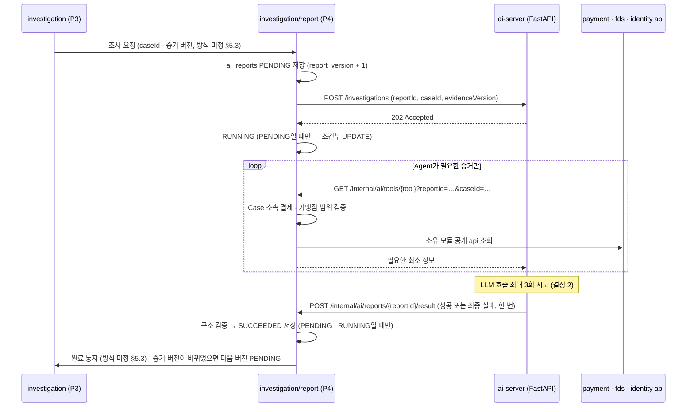

# 0009. AI 조사 호출 구조 (Spring ↔ FastAPI)

- **상태:** 제안 — 팀 합의 필요
- **날짜:** 2026-10-21 (같은 날 개정: fds 정본 ERD Baseline v1의 `ai_reports` 8개 컬럼에 맞춤) · 2026-10-23 개정: 화면 보고서 형식 · Tool 6종 · 사실 필드 채우기 · 재시도를 AI 서버 안으로 (#112 · #119)
- **관련:** Notion fds 정본 — 02 기획 2.5 · 2.6 · 2.7, 03 설계 3.5 · 3.6 · 3.7 · 3.9⑤ · 3.11, 공통 페이지 §5.3 · §5.4, [ADR-0012](0012-payment-settlement-dependency.md) (ADR-0001 대체), 화면 타입 `frontend/src/types/case.ts`
- **영향 받는 담당:** P4 현규, P3 수민(조사 요청 · 판정 검증), P1 주환(인증 설정 · 보안 이벤트 조회), P2 · P5(Tool이 읽는 공개 api 제공), CakeShop(주문 정보), 화면 담당(보고서 응답 형식)

## 배경

설계 3.6 · 3.7은 다음 구조를 정했다.

- P4 Spring이 FastAPI에 조사를 **비동기**로 요청한다 (`202 Accepted`)
- FastAPI의 AI Agent가 **Spring Tool API**를 호출해 증거를 읽는다 (Tool 6종)
- 결과는 콜백 또는 작업 결과 조회로 받고, Spring이 검증 · 저장한다
- FastAPI는 DB에 직접 접근하지 않고, 금융 상태를 바꾸지 못한다

설계 3.9⑤는 `ai_reports`를 8개 컬럼(`report_id` · `case_id` · `report_version` · `evidence_version` · `status` · `report_body` · `created_at` · `completed_at`)으로 확정했다. 작업 ID · 시도 횟수 · 실패 사유 컬럼은 없고, "시도 횟수 저장 방식은 P4 내부 설계에서 결정"으로 남겼다. 공통 페이지 §5.3(P3 ↔ P4) · §5.4(AI Tool)는 개발 전 결정 항목이 비어 있다.

이 ADR은 (1) FastAPI ↔ Spring 호출의 위치 · 인증, (2) 8개 컬럼 그대로 상태 · 재시도 · 실패를 다루는 방법을 정한다 (시도 횟수 저장 방식은 설계 3.7이 P4에 맡겼다). §5.3 · §5.4는 합의 전이라 미정으로 남긴다.

이 ADR은 원칙만 정한다. 시간 초과 값, Tool 응답 기록 방식 같은 세부는 구현 PR에서 테스트로 정한다.

## 결정 1 — 호출 구조

**Tool API와 결과 수신 엔드포인트를 모두 `investigation/report`에 두고, 내부 전용 경로로 분리한다. 작업 ID는 `report_id`를 그대로 쓴다.**



| 항목 | 정한 것 |
| --- | --- |
| Tool API 위치 | `investigation/report/controller`. Case 권한 검증을 한 곳에서 하고, 아래 모듈 api만 호출하므로 순환이 없다 |
| 경로 | Spring `/internal/ai/**` — 화면용 `/api/**`와 분리. FastAPI `POST /investigations` |
| 작업 ID | `report_id`. 별도 job ID 컬럼을 만들지 않는다 |
| 인증 | 서비스 간 키(헤더). 직원 로그인과 별개. 키는 환경 변수, 저장소에 올리지 않는다 |
| 권한 | Tool은 GET만. 결제 · 판정 · Case 상태를 바꾸는 Tool은 만들지 않는다 |
| 결과 수신 | FastAPI 콜백으로 받는다. 정해진 시간 안에 오지 않으면 FAILED로 끝낸다 (결정 2). 결과 조회 API · 취소 API는 두지 않는다 |
| 주문 정보 Tool | `get_order_context`는 Spring이 CakeShop을 HTTP로 조회해 전달 (CakeShop 제공 범위는 §5.7 미결) |

### Tool 6종 (Notion 설계 3.6)

| Tool | 입력 | 하는 일 | 데이터 주인 |
| --- | --- | --- | --- |
| `get_case_payments` | `caseId` | Case 소속 결제 목록 | P3 + P5 |
| `get_fds_evidence` | `caseId` 또는 허용된 결제 ID | 결제별 FDS 점수 · 적중 규칙 | P2 |
| `get_payment_history` | `caseId`, `lookbackDays` | 고객 과거 결제 패턴 | P5 |
| `get_security_events` | `caseId`, 조회 기간 | 로그인 · 기기 · 계정 이벤트 | P1 또는 CakeShop |
| `get_order_context` | `caseId` | 주문 · 배송 정보 | CakeShop |
| `get_payment_authentication` | `caseId` 또는 허용된 결제 ID | 카드 인증 · 승인 정보 | P5 |

입력에 `caseId`가 있다고 다른 모듈 데이터를 마음대로 읽는 것은 아니다. 각 Tool 구현이 Case 소속 결제 · 가맹점 범위를 검증하고, 소유 모듈의 공개 api로 필요한 정보만 모은다 (설계 3.6 주의).

Tool 요청에는 `reportId`를 싣는다. 이미 끝난 보고서(`SUCCEEDED` · `FAILED`)면 거부한다. Spring은 그 보고서에 준 응답(출처 · 증거 ID · 조회 시각 · 데이터 버전)을 기록했다가 `evidence`에 넣는다 (결정 4).

## 결정 2 — 재시도는 AI 서버 안에서, Spring은 한 번만 의뢰한다

| 상태 | 언제 | 채우는 컬럼 |
| --- | --- | --- |
| `PENDING` | P4가 조사 요청을 받아 행 생성 | `report_version` = 해당 Case 최대값 + 1, `evidence_version` = 요청 시점 Case 증거 버전, `created_at` |
| `RUNNING` | FastAPI가 `202`로 접수. **`PENDING`일 때만** 바꾼다 | — |
| `SUCCEEDED` | 결과가 구조 검증 통과. **`PENDING` · `RUNNING`일 때만** 바꾼다 | `report_body`(보고서 JSON), `completed_at` |
| `FAILED` | 아래 실패 조건 중 하나. **`PENDING` · `RUNNING`일 때만** 바꾼다 | `report_body`에 `error` 객체(실패 종류 · 사유 · AI 서버 시도 횟수), `completed_at` = 실패 확정 시각 |

- **재시도는 AI 서버 안에서 한다.** FastAPI는 LLM 호출을 최대 3번(최초 + 재시도 2번) 시도하고, 최종 결과(성공 또는 실패)를 **한 번만** 보낸다. 실패면 시도 횟수와 이유를 함께 보낸다 (설계 3.5 "총 3회 시도")
- **Spring은 보고서마다 한 번만 의뢰한다.** 다시 의뢰하지 않는다. 같은 보고서를 두 AI 작업이 동시에 쓰는 일이 없으므로 결과는 `report_id`로 식별한다
- **`FAILED`가 되는 경우**
  - FastAPI가 최종 실패를 보냄
  - 의뢰가 접수되지 않음 (연결 실패 · 5xx · 시간 초과)
  - 정해진 시간 안에 결과가 오지 않음
  - 결과가 구조 검증에 실패함
  - Spring이 재시작될 때 남아 있던 `PENDING` · `RUNNING` 행
- **상태 변경은 모두 조건부 UPDATE로 한다.** `WHERE report_id = ? AND status IN (…)`처럼 바꿔도 되는 이전 상태를 조건에 넣고, 변경 건수가 0이면 "이미 처리됨"으로 본다. 끝난 상태(`SUCCEEDED` · `FAILED`)는 어떤 경로로도 덮어쓰지 않는다
  - 예) 202 응답 직후 FastAPI가 바로 끝나 성공 결과가 먼저 `SUCCEEDED`를 저장하면, 뒤이은 `RUNNING` UPDATE는 조건(`status = 'PENDING'`)이 맞지 않아 0건 변경으로 끝난다. 그래서 결과는 `PENDING`에서도 받는다
  - 예) 시간 초과로 `FAILED`가 된 뒤 결과가 늦게 와도 반영하지 않는다
- **실패 사유 위치:** 기획 2.5의 "실패 사유 기록"은 `report_body.error`로 충족한다 (별도 컬럼 없음)
- **`error`는 화면에 보내지 않는다.** 실패 이유는 개발자 조사용이다. `FAILED`면 P3에 넘기는 `ReportSnapshot.reportBody`를 null로 두고, 화면은 "AI 보고서 생성에 실패했습니다"를 보여준다
- **AI 실패는 자동 판정으로 이어지지 않는다.** `FAILED`를 P3에 알리고, 직원이 직접 조사해 `report_id = NULL`로 판정한다 (설계 3.7)

**한계:** 결과가 늦게 오거나 Spring이 재시작되면, AI가 실제로는 성공했더라도 `FAILED`가 되고 직원이 직접 판정한다. MVP에서는 단순함과 안전(자동 판정 없음)을 택한다.

## 결정 3 — 같은 Case의 중복 실행 방지와 버전

- **새 행을 만들지 않는 경우** (설계 3.5 중복 실행 방지)
  - 같은 Case에 `PENDING` · `RUNNING` 행이 있음 — 요청을 따로 저장하지 않는다. 아래 "완료 후 비교"가 최신 증거를 잡는다
  - 요청한 증거 버전 **이상**을 분석한 행이 이미 있음(상태 무관) — 중복 · 재전달 요청이다. `FAILED`여도 다시 만들지 않는다 (AI 서버가 이미 최대 3회 시도함). 직원의 수동 재실행은 MVP 범위 밖
- **완료 후 비교는 두 단계로 한다.** ① 종료 상태(`SUCCEEDED` · `FAILED`)를 먼저 커밋하고, ② 별도 트랜잭션에서 현재 Case 증거 버전을 읽어 그 행의 `evidence_version`과 비교한다. 다르면 다음 `report_version`을 `PENDING`으로 만든다
  - 예) 완료 처리 중에 결제가 병합되면: 요청이 ① 전에 왔으면 "진행 중"을 보고 넘어가지만 ②가 그 뒤에 새 증거를 읽어 다음 버전을 만든다. ① 뒤에 왔으면 요청이 직접 만든다. 둘 다 만들려 하면 아래 UNIQUE 합류 규칙으로 하나만 남는다
  - 전제: P3는 증거 버전을 **커밋한 뒤** 조사 요청을 보낸다 (§5.3 합의 항목)
- **동시 요청으로 버전 번호가 겹치면 다시 읽어 합류한다.** 같은 Case에 요청 두 개가 동시에 와서 둘 다 "진행 중 없음 · 최대 버전 1"을 보면 둘 다 v2를 저장하려 한다. 늦은 쪽은 `UNIQUE(case_id, report_version)` 위반을 받는데, 이를 오류로 끝내지 않고 진행 중인 행을 다시 읽어 그 작업에 합류한 것으로 처리한다
  - 늦은 쪽이 더 새 증거 버전을 가져왔어도 빠지지 않는다. 바로 아래 "끝나면 비교" 규칙이 다음 버전을 예약한다
- 늦게 도착한 결과는 자기 행에만 쓴다. 다른 버전 행을 덮어쓰지 않는다. 끝난 행에 오는 결과는 무시한다(멱등, 결정 2 조건부 UPDATE)
- "최신 보고서" = Case 최대 `report_version`이면서 `evidence_version`이 현재 Case 증거 버전과 같은 `SUCCEEDED` 행

## 결정 4 — 화면 계약 (보고서 형식 · ID · 권고 값 · 사실 필드)

보안 직원 화면(`ReportCard`)이 먼저 만들어졌으므로 보고서 형식은 화면 타입 `frontend/src/types/case.ts`(`AiReport` · `ReportBody`)를 따른다. **화면 타입과 이 절은 같이 바뀐다. 한쪽만 고치지 않는다.**

- **ID:** P4는 P3의 `ReportGateway`(`ReportSnapshot`)로 숫자(`Long`) ID를 넘긴다. 화면은 P3 `CaseDetailResponse`로 보고서를 받으므로, 화면 응답에서 ID를 숫자로 보낼지 문자열로 보낼지는 P3 응답과 화면이 함께 정한다 (이 ADR 범위 밖)
- **`report_body` 구조:** 기획 2.7 순서와 같다

| 키 | 화면 섹션 |
| --- | --- |
| `overview` | 1. 사건 개요 |
| `summary` | 2. 핵심 요약 |
| `paymentAnalyses` | 3. 결제별 분석 (위험 근거 · 정상 근거 · 미확인 · 권고) |
| `timeline` | 4. 사건 타임라인 |
| `overallAnalysis` | 5. 종합 분석 |
| `additionalChecks` | 6. 추가 확인 사항 |
| `recommendation` | 7. AI 권고 (요약 · 한계) |
| `evidence` | 8. 증거 추적 (Tool · 출처 · 증거 ID · 조회 시각 · 데이터 버전) |

- **권고 값:** `ACCEPT_REVIEW` / `REJECT_REVIEW` / `NEEDS_CHECK`. 참고용이며 최종 판정은 직원이 한다
- **사실 필드는 Spring이 정본 데이터로 채운다.** AI는 해석만 쓴다. AI 결과에 사실 필드가 들어 있어도 쓰지 않고 정본 값으로 덮어쓴다

| 누가 채우나 | 필드 |
| --- | --- |
| Spring (정본 데이터) | `overview` 전체, `paymentAnalyses[]`의 `paymentId` · `amount` · `requestedAt` · `riskScore` · `ruleHits`, `timeline`, `evidence` |
| AI (해석) | `summary`, `paymentAnalyses[]`의 `riskEvidence` · `normalEvidence` · `unknowns` · `recommendation`, `overallAnalysis`, `additionalChecks`, `recommendation` |

- **결제별 분석 대상:** AI가 Case에 속하지 않은 결제에 대한 분석을 보내면 구조 검증 실패(시도 실패 1회)로 처리한다
- **실패 정보:** 결정 2대로 `error`는 P3에 넘기지 않는다

## 미정 — P3 ↔ P4 계약 (공통 페이지 §5.3)

정본 §5.3의 개발 전 결정 항목(조사 요청 방식 · 입력, 완료 · 실패 통지, 병합 중 중복 요청 · 구버전 처리, 판정 시 버전 검증 · 수동 판정 전달)은 **P3 담당과 합의 전이라 이 ADR에서 정하지 않는다.** 정해지면 이 절을 갱신한다.

P3가 요청 · 조회 경계 `investigation/service/ReportGateway`(`request` · `findByCase`)를 만들었다 (#103). P4는 이를 구현해 `MockReportGateway`를 교체한다. 판정 시 버전 검증은 여전히 미정이다.

**제안 (P3 합의 필요):** P4는 보고서가 끝나면(`SUCCEEDED` · `FAILED`) 완료 이벤트를 발행하고, P3가 받아 Case 상태를 다시 계산한다. 지금 Mock은 요청 즉시 완료되어 이 경로가 필요 없었지만, 실제 보고서는 시간이 걸린다. 이벤트 이름 · 내용은 P3와 합의한다.

이 ADR이 전제하는 것은 정본에 이미 있는 내용뿐이다.

- 둘 다 `investigation` 모듈 안이라 Modulith 의존 문제는 없다. 다만 테이블 소유가 달라(설계 3.9) P4는 `security_cases` · `case_payments`를, P3는 `ai_reports`를 직접 바꾸지 않는다
- 조사 요청 입력에는 최소 `caseId` · 증거 버전이 들어간다 (§5.3)
- 결정 3은 P3가 증거 버전을 커밋한 **뒤에** 조사를 요청한다고 전제한다. 요청 방식을 정할 때 이 순서를 함께 합의한다
- P4는 조사 완료 · 실패를 P3가 알 수 있게 해야 한다 (§5.3, 설계 3.7 "P3가 최신 보고서 확인 가능")

## Tool 조회 실패 처리 — 정본 원칙만 따르고 세부는 미정 (공통 페이지 §5.4)

**정본에 있는 원칙 (따른다)**

- 미확인 값을 임의로 채우지 않는다, 증거 없는 사실을 단정하지 않는다 (기획 2.7 작성 강제 규칙)
- 확인되지 않은 것은 "미확인 사항 · 판단의 한계"로 분리해 적는다 (기획 2.6 · 2.7, 04 예시 `limitations`)
- 조회 데이터의 품질과 한계를 고려한다 (업무분석 1.2 F)
- 부정거래 확률을 만들어내지 않는다 (기획 2.6)

**미정 (정본 §5.4 개발 전 결정 항목)**

- 데이터 누락 · 조회 실패 · 타임아웃 때 Tool이 돌려줄 응답 형식
- Tool 하나가 실패하면 보고서 생성 실패(재시도 횟수 차감)로 볼지, 미확인 사항으로 적고 계속 쓸지
- Tool별 타임아웃 · 반환 필드 · 필수/선택 데이터 — 각 제공 담당(P1 · P2 · P5 · CakeShop)과 합의

보고서 JSON(`report_body`) 구조는 결정 4를 따른다 (기획 2.7 순서와 같다).

## 패키지 구성

`investigation/report/` 아래를 다른 모듈과 같은 계층으로 나눈다. `ArchitectureTests`의 `..controller..` · `..entity..` 규칙이 그대로 적용된다.

```
investigation/report/
├── controller/   # /internal/ai/tools/* · /internal/ai/reports/{reportId}/result
├── service/      # 조사 요청 · 재시도 · 버전 비교 · Tool 조합 조회
├── client/       # FastAPI HTTP 호출
├── repository/   # ai_reports
├── entity/       # AiReport
└── dto/          # Tool 응답 · 결과 콜백 · report_body 구조
```

## 고려한 대안

| 대안 | 버린 이유 |
| --- | --- |
| Spring이 증거를 전부 모아 요청에 담아 보냄 (Tool Calling 없음) | 구현은 단순하지만, 설계 2.6 · 3.6이 채택한 Tool Calling(AI가 필요한 증거를 골라 조회)과 다르다 |
| Tool API를 각 소유 모듈(payment, fds …)에 분산 | FastAPI가 여러 모듈 경로를 알아야 하고, Case 소속 · 가맹점 범위 검증이 여러 곳에 흩어진다 |
| FastAPI가 DB를 직접 읽음 | 설계 3.6이 금지한다 |
| 동기 HTTP 한 번으로 보고서를 받음 | 생성 시간이 길어 타임아웃 위험이 있다. 설계 3.7이 비동기 접수(202)를 정했다 |
| 결과 조회(polling)만 사용 | 완료가 늦게 반영되고 Spring에 주기 작업이 필요하다 |
| 결과 조회로 늦은 결과 살리기 | 늦은 결과는 `FAILED` + 직원 판정이 안전하다. MVP에서는 단순함을 택한다 |
| Spring이 최대 3번 재의뢰 (이전 결정) | 이전 작업을 취소하지 않으므로 같은 보고서를 여러 AI 작업이 동시에 쓴다. 시도 번호 저장 · 재의뢰 선점 · Tool 응답 구분이 모두 필요해진다 (#120 리뷰) |
| 재시도 없이 한 번만 | LLM 일시 오류가 흔해 수동 판정이 잦아지고, 설계 3.5 "총 3회 시도"와 어긋난다 |
| `attempt_count` 칸 추가 | 재시도를 AI 서버가 하므로 Spring이 셀 필요가 없다. 설계 3.9⑤의 8개 컬럼을 유지한다 |
| 별도 job ID · `error_message` 컬럼 추가 | 설계 3.9⑤의 8개 컬럼을 늘린다. `report_id`와 `report_body.error`로 충분하다 |
| P4 DTO · OpenAPI를 보고서 형식의 기준으로 삼기 | 화면이 먼저 만들어졌고 이미 기획 2.7을 반영했다. 두 곳에서 정의하면 어긋난다 |
| 실패 정보를 화면에 보내거나 실패 응답을 따로 두기 | 직원 판정에 필요 없고 내부 오류가 드러난다. 고정 문구("AI 보고서 생성에 실패했습니다")로 충분하다 |
| 이 ADR에서 화면 ID 타입을 숫자나 문자열로 정하기 | 화면은 P3 응답으로 보고서를 받는다. P3 · 화면 공통 문제라 P4 ADR에서 정하지 않는다 |
| AI가 사실 필드까지 쓰고 Spring이 대조하기 | 비교 코드가 많고, 불일치가 생기면 재시도만 늘어난다. 정본에서 채우면 틀릴 여지가 없다 |
| 결제 ID만 검증하기 | 금액 · 점수 등 잘못 쓴 사실을 막지 못한다 (#115 리뷰) |
| `RUNNING`을 FastAPI 호출 전에 저장 | 콜백과의 순서 경합은 막지만, 호출이 실패해도 "진행 중"이 먼저 기록된다. `RUNNING` = "FastAPI가 접수함"이라는 뜻을 유지하고, 경합은 조건부 UPDATE로 막는다 |
| 최신 요청 증거 버전을 따로 저장(watermark 컬럼) | 설계 3.9⑤ 8개 컬럼을 바꿔야 한다. 종료 커밋 후 비교 순서로 같은 효과를 낸다 |
| 버전 번호를 정할 때 `security_cases` 행을 잠금(`SELECT … FOR UPDATE`) | 동시 요청을 한 줄로 세울 수 있지만 P3 소유 테이블을 P4가 잠그게 된다. UNIQUE 위반 시 다시 읽어 합류하는 방식으로 충분하다 |

## 영향

- API: Spring `/internal/ai/tools/*`(GET 6종) · `/internal/ai/reports/{reportId}/result`(POST), FastAPI `POST /investigations`
- DB: `ai_reports`는 설계 3.9⑤ 8개 컬럼 그대로. `UNIQUE(case_id, report_version)`. `case_id`는 `security_cases`에 대한 논리 참조
- 보안: `identity/security/SecurityConfig`에서 `/internal/ai/**`를 서비스 키 인증으로 분리해야 한다 — P1과 협의
- P3: P4가 `ReportGateway`를 구현해 `MockReportGateway`를 교체. 완료 이벤트(제안)를 받아 Case 상태를 다시 계산하는 부분 · 판정 검증 방식 합의 필요
- P3 · 화면: P3 응답 ID는 `Long`, 화면 타입은 `string`이라 표현을 맞추는 협의 필요
- P5: Tool 3종(`get_case_payments` 결제 정보 · `get_payment_history` · `get_payment_authentication`)용 조회 api
- P1: `get_security_events`용 조회 api
- CakeShop: `get_order_context` 제공 범위 (§5.7)
- P1 · P2 · P5: §5.4 Tool 응답 형식 · 실패 처리 합의 필요 (미정)
- 화면: AI 최종 실패 알림, 보고서 최신 버전 여부 표시. 보고서 형식은 결정 4이며 `frontend/src/types/case.ts`와 함께 관리. 실패 문구를 "AI 보고서 생성에 실패했습니다"로 바꾸도록 요청 (지금은 "총 3회 시도" 고정)
- ai-server: LLM 호출 최대 3회 시도 후 최종 결과를 한 번만 보낸다
- 테스트: 다른 Case · 가맹점의 결제를 Tool로 조회하면 거부되는지, 구버전 결과가 최신 보고서를 덮어쓰지 않는지, 완료 처리 중 병합돼도 다음 버전이 생기는지, 같은 증거 버전 재요청이 새 행을 만들지 않는지(`FAILED` 포함), 202 직후 성공 콜백이 `RUNNING`으로 덮이지 않는지, 같은 Case 동시 요청이 오류 없이 하나로 합류하는지, AI 서버 최종 실패 · 연결 실패 · 시간 초과 · 재시작 때 `FAILED` · `report_body.error`가 남는지, `FAILED` 뒤 늦은 결과가 무시되는지, 끝난 보고서의 Tool 요청이 거부되는지, 실행 중 병합되면 다음 버전이 예약되는지, P3에 넘기는 보고서에 `error`가 없는지, Case 밖 결제 분석이 거부되는지, AI가 보낸 사실 필드가 정본 값으로 덮이는지
- 문서: README Architecture · AGENTS.md §6

## 검증

미검증 — 업무 코드 없음. 결정 2 · 3의 동시성 규칙(조건부 UPDATE, 완료 후 비교, UNIQUE 합류)은 문서상 설계이며, 구현 단계에서 위 "영향 — 테스트" 항목으로 검증한다.
