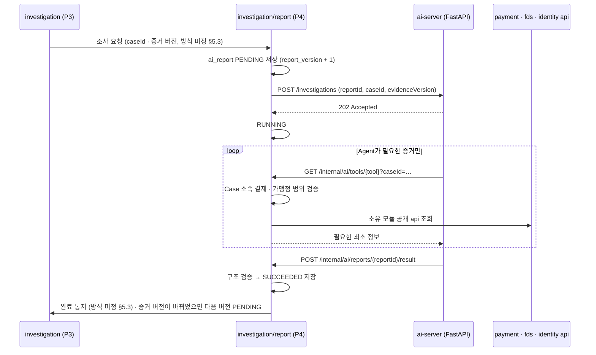

# 0009. AI 조사 호출 구조 (Spring ↔ FastAPI)

- **상태:** 제안 — 팀 합의 필요
- **날짜:** 2026-10-21 (같은 날 개정: fds 정본 ERD Baseline v1의 `ai_report` 8개 컬럼에 맞춤)
- **관련:** Notion fds 정본 — 02 기획 2.5 · 2.6 · 2.7, 03 설계 3.5 · 3.6 · 3.7 · 3.9⑤ · 3.11, 공통 페이지 §5.3 · §5.4, [ADR-0001](0001-module-dependency-direction.md)
- **영향 받는 담당:** P4 현규, P3 수민(조사 요청 · 판정 검증), P1 주환(인증 설정), P2 · P5(Tool이 읽는 공개 api 제공)

## 배경

설계 3.6 · 3.7은 다음 구조를 정했다.

- P4 Spring이 FastAPI에 조사를 **비동기**로 요청한다 (`202 Accepted`)
- FastAPI의 AI Agent가 **Spring Tool API**를 호출해 증거를 읽는다 (Tool 6종)
- 결과는 콜백 또는 작업 결과 조회로 받고, Spring이 검증 · 저장한다
- FastAPI는 DB에 직접 접근하지 않고, 금융 상태를 바꾸지 못한다

설계 3.9⑤는 `ai_report`를 8개 컬럼(`report_id` · `case_id` · `report_version` · `evidence_version` · `status` · `report_body` · `created_at` · `completed_at`)으로 확정했다. 작업 ID · 시도 횟수 · 실패 사유 컬럼은 없고, "시도 횟수 저장 방식은 P4 내부 설계에서 결정"으로 남겼다. 공통 페이지 §5.3(P3 ↔ P4) · §5.4(AI Tool)는 개발 전 결정 항목이 비어 있다.

이 ADR은 (1) FastAPI ↔ Spring 호출의 위치 · 인증, (2) 8개 컬럼 안에서 상태 · 재시도 · 실패를 다루는 방법을 정한다. §5.3 · §5.4는 합의 전이라 미정으로 남긴다.

## 결정 1 — 호출 구조

**Tool API와 결과 수신 엔드포인트를 모두 `investigation/report`에 두고, 내부 전용 경로로 분리한다. 작업 ID는 `report_id`를 그대로 쓴다.**



| 항목 | 정한 것 |
| --- | --- |
| Tool API 위치 | `investigation/report/controller`. Case 권한 검증을 한 곳에서 하고, 아래 모듈 api만 호출하므로 순환이 없다 |
| 경로 | Spring `/internal/ai/**` — 화면용 `/api/**`와 분리. FastAPI `POST /investigations` · `GET /investigations/{reportId}` |
| 작업 ID | `report_id`. 별도 job ID 컬럼을 만들지 않는다 (3.9⑤ 8개 컬럼 유지) |
| 인증 | 서비스 간 키(헤더). 직원 로그인과 별개. 키는 환경 변수, 저장소에 올리지 않는다 |
| 권한 | Tool은 GET만. 결제 · 판정 · Case 상태를 바꾸는 Tool은 만들지 않는다 |
| 결과 수신 | FastAPI 콜백이 기본. 콜백이 정해진 시간 안에 오지 않으면 Spring이 `GET /investigations/{reportId}`로 조회해 복구 |
| 주문 정보 Tool | `get_order_context`는 Spring이 CakeShop을 HTTP로 조회해 전달 (CakeShop 제공 범위는 §5.7 미결) |

## 결정 2 — `ai_report` 8개 컬럼으로 상태 · 재시도 · 실패 다루기

| 상태 | 언제 | 채우는 컬럼 |
| --- | --- | --- |
| `PENDING` | P4가 조사 요청을 받아 행 생성 | `report_version` = 해당 Case 최대값 + 1, `evidence_version` = 요청 시점 Case 증거 버전, `created_at` |
| `RUNNING` | FastAPI가 `202`로 접수 | — |
| `SUCCEEDED` | 결과 콜백이 구조 검증 통과 | `report_body`(보고서 JSON), `completed_at` |
| `FAILED` | 총 3회 시도 모두 실패 | `report_body`에 `error` 객체(실패 코드 · 사유 · 시도 횟수 · 마지막 시도 시각), `completed_at` = 실패 확정 시각 |

- **재시도는 같은 행에서 한다.** 같은 증거를 다시 분석하는 것이므로 `report_version`을 올리지 않는다. `UNIQUE(case_id, report_version)`과 충돌하지 않는다
- **한 번의 시도 실패**로 세는 것: FastAPI가 202를 주지 않음(연결 실패 · 5xx · 타임아웃), FastAPI가 실패 결과를 보냄, 결과가 시간 안에 오지 않고 조회로도 완료가 아님, 결과가 구조 검증에 실패함
- **시도 횟수는 실행 중에는 Spring 프로세스 안에서 센다.** 최종 실패 때만 `report_body.error.attempts`에 남긴다. 컬럼을 늘리지 않기 위한 선택이며, 아래 "한계"를 받아들인다
- **실패 사유 위치:** 기획 2.5의 "실패 사유 기록"은 `report_body.error`로 충족한다 (별도 컬럼 없음)
- **AI 실패는 자동 판정으로 이어지지 않는다.** `FAILED`를 P3에 알리고, 직원이 직접 조사해 `report_id = NULL`로 판정한다 (설계 3.7)

**한계:** 실행 중 서버가 재시작되면 메모리의 시도 횟수가 사라진다. 재시작 시 오래된 `PENDING` · `RUNNING` 행은 조회로 상태를 확인하고, 확인되지 않으면 처음부터 다시 3회를 시도한다. 횟수를 엄밀히 지켜야 한다고 팀이 정하면 `attempt_count` 컬럼 추가를 설계 3.9에 먼저 제안한다.

## 결정 3 — 같은 Case의 중복 실행 방지와 버전

- 같은 Case에 `PENDING` · `RUNNING` 행이 있으면 새 행을 만들지 않는다. 요청은 "최신 증거 버전 기록"으로만 남는다 (설계 3.5)
- 실행이 끝나면(`SUCCEEDED` · `FAILED`) 그 행의 `evidence_version`과 현재 Case 증거 버전을 비교한다. 다르면 다음 `report_version`을 `PENDING`으로 만든다
- 늦게 도착한 결과는 자기 행에만 쓴다. 다른 버전 행을 덮어쓰지 않는다. 이미 `SUCCEEDED`인 행에 같은 결과가 다시 오면 무시한다(멱등)
- "최신 보고서" = Case 최대 `report_version`이면서 `evidence_version`이 현재 Case 증거 버전과 같은 `SUCCEEDED` 행

## 미정 — P3 ↔ P4 계약 (공통 페이지 §5.3)

정본 §5.3의 개발 전 결정 항목(조사 요청 방식 · 입력, 완료 · 실패 통지, 병합 중 중복 요청 · 구버전 처리, 판정 시 버전 검증 · 수동 판정 전달)은 **P3 담당과 합의 전이라 이 ADR에서 정하지 않는다.** 정해지면 이 절을 갱신한다.

이 ADR이 전제하는 것은 정본에 이미 있는 내용뿐이다.

- 둘 다 `investigation` 모듈 안이라 Modulith 의존 문제는 없다. 다만 테이블 소유가 달라(설계 3.9) P4는 `security_case` · `case_payment`를, P3는 `ai_report`를 직접 바꾸지 않는다
- 조사 요청 입력에는 최소 `caseId` · 증거 버전이 들어간다 (§5.3)
- P4는 조사 완료 · 실패를 P3가 알 수 있게 해야 한다 (§5.3, 설계 3.7 "P3가 최신 보고서 확인 가능")

## Tool 조회 실패 처리 — 정본 원칙만 따르고 세부는 미정 (공통 페이지 §5.4)

**정본에 있는 원칙 (따른다)**

- 미확인 값을 임의로 채우지 않는다, 증거 없는 사실을 단정하지 않는다 (기획 2.7 작성 강제 규칙)
- 확인되지 않은 것은 "미확인 사항 · 판단의 한계"로 분리해 적는다 (기획 2.6 · 2.7, 04 예시 `limitations`)
- 조회 데이터의 품질과 한계를 고려한다 (업무분석 1.2 F)
- 부정거래 확률을 만들어내지 않는다 (기획 2.6)

**미정 (정본 §5.4 개발 전 결정 항목)**

- 데이터 누락 · 조회 실패 · 타임아웃 때 Tool이 돌려줄 응답 형식
- Tool 하나가 실패하면 보고서 생성 실패(재시도 횟수 차감)로 볼지, 미확인 사항으로 적고 계속 쓸지
- Tool별 타임아웃 · 반환 필드 · 필수/선택 데이터 — 각 제공 담당(P1 · P2 · P5 · CakeShop)과 합의

보고서 JSON(`report_body`)의 큰 순서는 기획 2.7을 따른다: 사건 개요 · 핵심 요약 · 결제별 분석 · 타임라인 · 종합 분석 · 추가 확인 사항 · 결제별 AI 권고 · 증거 추적. 세부 스키마는 정본대로 P4 구현 때 구체화한다.

## 패키지 구성

`investigation/report/` 아래를 다른 모듈과 같은 계층으로 나눈다. `ArchitectureTests`의 `..controller..` · `..entity..` 규칙이 그대로 적용된다.

```
investigation/report/
├── controller/   # /internal/ai/tools/* · /internal/ai/reports/{reportId}/result
├── service/      # 조사 요청 · 재시도 · 버전 비교 · Tool 조합 조회
├── client/       # FastAPI HTTP 호출
├── repository/   # ai_report
├── entity/       # AiReport
└── dto/          # Tool 응답 · 결과 콜백 · report_body 구조
```

## 고려한 대안

| 대안 | 버린 이유 |
| --- | --- |
| Spring이 증거를 전부 모아 요청에 담아 보냄 (Tool Calling 없음) | 구현은 단순하지만, 설계 2.6 · 3.6이 채택한 Tool Calling(AI가 필요한 증거를 골라 조회)과 다르다 |
| Tool API를 각 소유 모듈(payment, fds …)에 분산 | FastAPI가 여러 모듈 경로를 알아야 하고, Case 소속 · 가맹점 범위 검증이 여러 곳에 흩어진다 |
| FastAPI가 DB를 직접 읽음 | 설계 3.6이 금지한다 |
| 동기 HTTP 한 번으로 보고서를 받음 | 생성 시간이 길어 타임아웃 위험이 있다. 설계 3.7이 비동기 접수(202)를 정했다 |
| 결과 조회(polling)만 사용 | 완료가 늦게 반영되고 Spring에 주기 작업이 필요하다. 콜백 유실 복구용으로만 쓴다 |
| 별도 job ID · `attempt_count` · `error_message` 컬럼 추가 | 설계 3.9⑤가 8개 컬럼으로 확정했다. `report_id`와 `report_body.error`로 충분하다. 재시작 때 횟수 보존이 필요해지면 그때 3.9 변경을 제안한다 |
| 재시도마다 새 `report_version` 행 | 같은 증거를 다시 분석하는 것인데 버전이 늘어 "v1 · v2"의 뜻(증거가 바뀜)이 흐려진다 |

## 영향

- API: Spring `/internal/ai/tools/*`(GET 6종) · `/internal/ai/reports/{reportId}/result`(POST), FastAPI `POST /investigations` · `GET /investigations/{reportId}`
- DB: `ai_report`는 설계 3.9⑤ 8개 컬럼 그대로. `UNIQUE(case_id, report_version)`. `case_id`는 `security_case`에 대한 논리 참조
- 보안: `identity/security/SecurityConfig`에서 `/internal/ai/**`를 서비스 키 인증으로 분리해야 한다 — P1과 협의
- P3: §5.3 조사 요청 · 완료 통지 · 판정 검증 방식 합의 필요 (미정)
- P1 · P2 · P5: §5.4 Tool 응답 형식 · 실패 처리 합의 필요 (미정)
- 화면: AI 최종 실패 알림, 보고서 최신 버전 여부 표시
- 테스트: 다른 Case · 가맹점의 결제를 Tool로 조회하면 거부되는지, 구버전 결과가 최신 보고서를 덮어쓰지 않는지, 3회 실패 시 `FAILED` · `report_body.error`가 남는지, 실행 중 병합되면 다음 버전이 예약되는지
- 문서: README Architecture · AGENTS.md §6

## 검증

미검증 — 업무 코드 없음.
