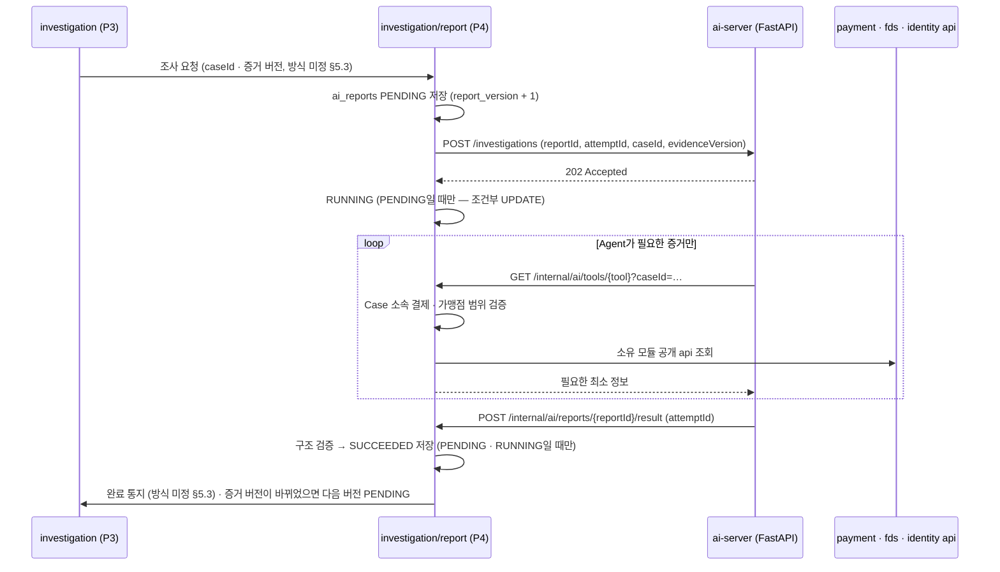

# 0009. AI 조사 호출 구조 (Spring ↔ FastAPI)

- **상태:** 제안 — 팀 합의 필요
- **날짜:** 2026-10-21 (같은 날 개정: fds 정본 ERD Baseline v1의 `ai_reports` 8개 컬럼에 맞춤) · 2026-10-23 개정: 화면 보고서 형식 · Tool 6종 반영 (#112) · 2026-10-27 개정: 1차 Tool 2종 응답 형식 (#254) · 2026-10-28 개정: 서비스 키 인증 위치 (#266, ADR-0041) · 2026-10-29 개정: 보고서 결론 · 권고 이유 · 규칙 근거 키와 문장 품질 검사 (#288)
- **관련:** Notion fds 정본 — 02 기획 2.5 · 2.6 · 2.7, 03 설계 3.5 · 3.6 · 3.7 · 3.9⑤ · 3.11, 공통 페이지 §5.3 · §5.4, [ADR-0012](0012-payment-settlement-dependency.md) (ADR-0001 대체), 화면 타입 `frontend/src/types/case.ts`
- **영향 받는 담당:** P4 현규, P3 수민(조사 요청 · 판정 검증), P1 주환(인증 설정 · 보안 이벤트 조회), P2 · P5(Tool이 읽는 공개 api 제공), CakeShop(주문 정보), 화면 담당(보고서 응답 형식)

## 배경

설계 3.6 · 3.7은 다음 구조를 정했다.

- P4 Spring이 FastAPI에 조사를 **비동기**로 요청한다 (`202 Accepted`)
- FastAPI의 AI Agent가 **Spring Tool API**를 호출해 증거를 읽는다 (Tool 6종)
- 결과는 콜백 또는 작업 결과 조회로 받고, Spring이 검증 · 저장한다
- FastAPI는 DB에 직접 접근하지 않고, 금융 상태를 바꾸지 못한다

설계 3.9⑤는 `ai_reports`를 8개 컬럼(`report_id` · `case_id` · `report_version` · `evidence_version` · `status` · `report_body` · `created_at` · `completed_at`)으로 확정했다. 작업 ID · 시도 횟수 · 실패 사유 컬럼은 없고, "시도 횟수 저장 방식은 P4 내부 설계에서 결정"으로 남겼다. 공통 페이지 §5.3(P3 ↔ P4) · §5.4(AI Tool)는 개발 전 결정 항목이 비어 있다.

이 ADR은 (1) FastAPI ↔ Spring 호출의 위치 · 인증, (2) 8개 컬럼 안에서 상태 · 재시도 · 실패를 다루는 방법을 정한다. §5.3 · §5.4는 합의 전이라 미정으로 남긴다.

## 결정 1 — 호출 구조

**Tool API와 결과 수신 엔드포인트를 모두 `investigation/report`에 두고, 내부 전용 경로로 분리한다. 작업 ID는 `report_id`를 그대로 쓴다.**



| 항목 | 정한 것 |
| --- | --- |
| Tool API 위치 | `investigation/report/controller`. Case 권한 검증을 한 곳에서 하고, 아래 모듈 api만 호출하므로 순환이 없다 |
| 경로 | Spring `/internal/ai/**` — 화면용 `/api/**`와 분리. FastAPI `POST /investigations` · `GET /investigations/{reportId}` |
| 작업 ID | `report_id`. 별도 job ID 컬럼을 만들지 않는다 (3.9⑤ 8개 컬럼 유지) |
| 인증 | 서비스 간 키(헤더 `X-Internal-Api-Key`). 직원 로그인과 별개. 키는 환경 변수, 저장소에 올리지 않는다. 확인은 identity의 `/internal/ai/**` 전용 보안 체인 ([ADR-0041](0041-ai-server-internal-api-key-authentication.md)) |
| 권한 | Tool은 GET만. 결제 · 판정 · Case 상태를 바꾸는 Tool은 만들지 않는다 |
| 결과 수신 | FastAPI 콜백이 기본. 콜백이 정해진 시간 안에 오지 않으면 Spring이 `GET /investigations/{reportId}`로 조회해 복구. 요청 · 콜백 · 조회에는 시도 토큰 `attemptId`를 함께 싣는다 (결정 2). 이전 시도 취소 API는 두지 않는다 |
| 주문 정보 Tool | `get_order_context`는 Spring이 CakeShop을 HTTP로 조회해 전달 (CakeShop 제공 범위는 §5.7 미결) |

### Tool 6종 (Notion 설계 3.6)

| Tool | 입력 | 하는 일 | 데이터 주인 |
| --- | --- | --- | --- |
| `get_case_payments` | `caseId` | Case 소속 결제 목록 | P3 + P5 |
| `get_fds_evidence` | `caseId` 또는 허용된 결제 ID | 결제별 FDS 점수 · 적중 규칙 | P2 |
| `get_payment_history` | `caseId`, `lookbackDays` | 고객 과거 결제 패턴 | P5 |
| `get_security_events` | `caseId`, 조회 기간 | 로그인 · 기기 · 계정 이벤트 | P1 또는 CakeShop |
| `get_order_context` | `caseId` | 주문 · 배송 정보 | CakeShop |
| `get_payment_authentication` | `caseId` 또는 허용된 결제 ID | 카드 인증 · 승인 정보 | P5 |

입력에 `caseId`가 있다고 다른 모듈 데이터를 마음대로 읽는 것은 아니다. 각 Tool 구현이 Case 소속 결제 · 가맹점 범위를 검증하고, 소유 모듈의 공개 api로 필요한 정보만 모은다 (설계 3.6 주의).

## 결정 2 — `ai_reports` 8개 컬럼으로 상태 · 재시도 · 실패 다루기

| 상태 | 언제 | 채우는 컬럼 |
| --- | --- | --- |
| `PENDING` | P4가 조사 요청을 받아 행 생성 | `report_version` = 해당 Case 최대값 + 1, `evidence_version` = 요청 시점 Case 증거 버전, `created_at` |
| `RUNNING` | FastAPI가 `202`로 접수. **`PENDING`일 때만** 바꾼다 | — |
| `SUCCEEDED` | 결과 콜백이 구조 검증 통과. **`PENDING` · `RUNNING`일 때만** 바꾼다 | `report_body`(보고서 JSON), `completed_at` |
| `FAILED` | 총 3회 시도 모두 실패 | `report_body`에 `error` 객체(실패 코드 · 사유 · 시도 횟수 · 마지막 시도 시각), `completed_at` = 실패 확정 시각 |

- **상태 변경은 모두 조건부 UPDATE로 한다.** `WHERE report_id = ? AND status IN (…)`처럼 바꿔도 되는 이전 상태를 조건에 넣고, 변경 건수가 0이면 "이미 처리됨"으로 본다. 끝난 상태(`SUCCEEDED` · `FAILED`)는 어떤 경로로도 덮어쓰지 않는다
  - 예) 202 응답 직후 FastAPI가 바로 끝나 성공 콜백이 먼저 `SUCCEEDED`를 저장하면, 뒤이은 `RUNNING` UPDATE는 조건(`status = 'PENDING'`)이 맞지 않아 0건 변경으로 끝난다. 그래서 콜백은 `PENDING`에서도 받는다
- **시도마다 새 토큰 `attemptId`(UUID)를 붙인다.** Spring은 보고서별 "현재 시도 토큰" 하나만 기억하고, 콜백 · 조회 결과의 토큰이 **현재 토큰과 같을 때만** 반영한다
  - 다른 토큰의 콜백은 성공 · 실패 모두 무시한다. 이전 시도는 이미 타임아웃으로 실패 1회로 셌다 (같은 실패를 두 번 세지 않음)
  - 서버가 재시작되면 새 시도는 새 토큰을 받는다. 재시작 전 시도의 늦은 콜백도 같은 규칙으로 무시된다 (번호 1 · 2 · 3처럼 다시 겹치지 않음)
  - 행이 끝난 상태면 토큰이 같아도 무시한다 (조건부 UPDATE). `FAILED` 뒤에 늦게 온 성공도 뒤집지 않는다
  - 이전 시도를 취소하지 않는다. FastAPI가 버려질 작업을 끝까지 돌릴 수 있지만 결과는 반영되지 않는다 (MVP에서 감수)
- **재시도는 같은 행에서 한다.** 같은 증거를 다시 분석하는 것이므로 `report_version`을 올리지 않는다. `UNIQUE(case_id, report_version)`과 충돌하지 않는다
- **한 번의 시도 실패**로 세는 것: FastAPI가 202를 주지 않음(연결 실패 · 5xx · 타임아웃), FastAPI가 실패 결과를 보냄, 결과가 시간 안에 오지 않고 조회로도 완료가 아님, 결과가 구조 검증에 실패함
- **시도 횟수는 실행 중에는 Spring 프로세스 안에서 센다.** 최종 실패 때만 `report_body.error.attempts`에 남긴다. 컬럼을 늘리지 않기 위한 선택이며, 아래 "한계"를 받아들인다
- **실패 사유 위치:** 기획 2.5의 "실패 사유 기록"은 `report_body.error`로 충족한다 (별도 컬럼 없음)
- **`error`는 화면에 보내지 않는다.** 실패 이유는 개발자 조사용이다. 조회 응답은 `FAILED`면 `reportBody: null`로 보내고, 화면은 고정 문구("총 3회 시도")를 보여준다
- **AI 실패는 자동 판정으로 이어지지 않는다.** `FAILED`를 P3에 알리고, 직원이 직접 조사해 `report_id = NULL`로 판정한다 (설계 3.7)

**한계:** 실행 중 서버가 재시작되면 메모리의 시도 횟수 · 현재 시도 토큰이 사라진다. 늦은 콜백 구분은 새 토큰으로 유지되지만, 시도 횟수는 다시 센다. 재시작 시 오래된 `PENDING` · `RUNNING` 행은 조회로 상태를 확인하고, 확인되지 않으면 처음부터 다시 3회를 시도한다. 횟수를 엄밀히 지켜야 한다고 팀이 정하면 `attempt_count` 컬럼 추가를 설계 3.9에 먼저 제안한다.

## 결정 3 — 같은 Case의 중복 실행 방지와 버전

- **새 행을 만들지 않는 경우** (설계 3.5 중복 실행 방지)
  - 같은 Case에 `PENDING` · `RUNNING` 행이 있음 — 요청을 따로 저장하지 않는다. 아래 "완료 후 비교"가 최신 증거를 잡는다
  - 요청한 증거 버전 **이상**을 분석한 행이 이미 있음(상태 무관) — 중복 · 재전달 요청이다. `FAILED`여도 다시 만들지 않는다 (3회 제한 유지). 직원의 수동 재실행은 MVP 범위 밖
- **완료 후 비교는 두 단계로 한다.** ① 종료 상태(`SUCCEEDED` · `FAILED`)를 먼저 커밋하고, ② 별도 트랜잭션에서 현재 Case 증거 버전을 읽어 그 행의 `evidence_version`과 비교한다. 다르면 다음 `report_version`을 `PENDING`으로 만든다
  - 예) 완료 처리 중에 결제가 병합되면: 요청이 ① 전에 왔으면 "진행 중"을 보고 넘어가지만 ②가 그 뒤에 새 증거를 읽어 다음 버전을 만든다. ① 뒤에 왔으면 요청이 직접 만든다. 둘 다 만들려 하면 아래 UNIQUE 합류 규칙으로 하나만 남는다
  - 전제: P3는 증거 버전을 **커밋한 뒤** 조사 요청을 보낸다 (§5.3 합의 항목)
- **동시 요청으로 버전 번호가 겹치면 다시 읽어 합류한다.** 같은 Case에 요청 두 개가 동시에 와서 둘 다 "진행 중 없음 · 최대 버전 1"을 보면 둘 다 v2를 저장하려 한다. 늦은 쪽은 `UNIQUE(case_id, report_version)` 위반을 받는데, 이를 오류로 끝내지 않고 진행 중인 행을 다시 읽어 그 작업에 합류한 것으로 처리한다
  - 늦은 쪽이 더 새 증거 버전을 가져왔어도 빠지지 않는다. 바로 아래 "끝나면 비교" 규칙이 다음 버전을 예약한다
- 늦게 도착한 결과는 자기 행에만 쓴다. 다른 버전 행을 덮어쓰지 않는다. 끝난 행에 오는 결과는 무시한다(멱등, 결정 2 조건부 UPDATE)
- "최신 보고서" = Case 최대 `report_version`이면서 `evidence_version`이 현재 Case 증거 버전과 같은 `SUCCEEDED` 행

## 결정 4 — 화면 계약 (보고서 응답 · ID · 권고 값)

보안 직원 화면(`ReportCard`)이 먼저 만들어졌으므로 응답 형식은 화면 타입 `frontend/src/types/case.ts`(`AiReport` · `ReportBody`)를 따른다. #292부터 화면은 Case 상세의 요약 카드(`ReportCard`)와 보고서 전문 페이지(`CaseReportPage`, `/security/cases/:id/report`)로 나뉜다. **화면 타입과 이 절은 같이 바뀐다. 한쪽만 고치지 않는다.**

- **ID:** DB는 `BIGINT`를 유지하고, P4 응답 JSON에서만 문자열로 보낸다 (`5` → `"5"`). 접두어(`CASE-` 등)는 붙이지 않는다. 요청으로 받은 ID는 문자열 → 숫자로 바꾼다. migration · P3 · 화면은 바꾸지 않는다
- **`report_body` 구조:** 키 순서는 기획 2.7 순서와 같다. 화면 위치는 #292 보고서 전문 페이지 기준이다

| 키 | 화면 위치 |
| --- | --- |
| `overview` | 상세 정보 펼치기 — 사건 개요 |
| `summary` | 결론 카드의 요약 문장 |
| `paymentAnalyses` | 결제별 카드 (권고 · 이유 · 위험 근거 / 정상 정황 비교), 결론 카드의 결제별 권고, "AI가 아직 모르는 것"(`unknowns`) |
| `timeline` | 사건 경위 (시간순) |
| `overallAnalysis` | 종합 분석 |
| `additionalChecks` | 판정 전에 확인할 것 — 먼저 해 볼 것 (첫 항목은 결론 카드에도 표시) |
| `recommendation` | 상세 정보 펼치기 — AI 권고 원문 · 한계 |
| `evidence` | 상세 정보 펼치기 — 증거 추적 표 (증거 ID · Tool · 출처 · 조회 시각 · 데이터 버전) |
| `verdict` | 결론 카드 — `headline`(AI 결론 한 줄) · `overallRecommendation`(종합 권고) (#288). Case 상세 요약 카드에도 표시 |
| `investigationTrace` | "조사 과정" 탭 (#294) |

- **#288에서 더한 키 — 추가만 한다.** 그 전에 저장된 보고서에는 없으므로 화면 타입에서는 선택 항목(`?`)이고, ai-server 스키마와 Spring 저장 전 검사에서는 새 보고서에 필수다
  - `verdict.headline`: AI가 쓰는 결론 한 줄. 60자 이내 한 문장, 단정 금지 (아래 문장 품질 검사)
  - `verdict.overallRecommendation`: 코드가 결제별 권고로 계산한다. 하나라도 `REJECT_REVIEW`면 `REJECT_REVIEW`, 모두 `ACCEPT_REVIEW`면 `ACCEPT_REVIEW`, 그 외 `NEEDS_CHECK`
  - `paymentAnalyses[].reason`: AI가 쓰는 결제별 권고 이유 한 문장
  - `paymentAnalyses[].ruleHitDetails[]`: `code` · `name` · `appliedScore` · `evidenceId`. 코드가 FDS 조회 기록에서 채우고, `evidenceId`는 그 값을 받은 `evidence` 줄의 ID다. AI 문장으로 만들지 않는다
- **#294에서 더한 키 — 추가만 한다.** `investigationTrace`: `provider`(`OLLAMA` · `MOCK` · `FIXED`) · `model` · `durationMs` · `steps[]`(`kind` · `actor` · `title` · `durationMs` · `asked` · `received` · `retryReason`)
  - `kind`: `DECIDE`(AI가 다음 조회를 고름) · `TOOL`(조회 실행) · `NUDGE`(빠진 근거 다시 요청) · `WRITE`(판단 문장 쓰기 · 형식 검사) · `ASSEMBLE`(조립 · 증거 버전 확인). `actor`: `AI` / `SYSTEM`(코드가 보충하거나 확인한 단계)
  - 코드가 만든 짧은 요약만 담는다. 결제 금액 · 시각 같은 Tool 응답 원본, 프롬프트, 형식 검사에 걸린 AI 문장은 넣지 않는다 (재시도 사유는 검사 규칙만)
  - 화면 타입에서는 선택 항목(`?`), ai-server 스키마에서는 필수다. **Spring 저장 전 검사는 이 키를 요구하지 않는다** — 판정에 쓰지 않는 표시용이라, 없어도 보고서는 성공으로 저장되고 탭에만 "기록 없음"이 보인다
  - AI 서버를 끈 고정 보고서(`FixedReportGenerator`)는 `provider: FIXED`와 시스템 단계만 남긴다
  - 사장님 화면(`MerchantCaseQueryService`)은 요약 · 권고만 골라 쓰므로 이 키는 보안 직원 화면에만 나간다
- **문장 품질 검사 (ai-server, 걸리면 다시 쓰기 · 횟수 넘으면 `NARRATIVE_INVALID`):** 근거에 없는 숫자 · 코드값 · 확률 단정(기존)에 더해 한자 · 일본 문자, 같은 묶음 안 반복 문장, 영어 단어(`FDS` · `IP` · `OTP` · `VPN` · `ID` · `AI` 및 시연 표기 `mock` · `Qwen` 제외), 60자를 넘거나 두 문장인 결론
- **권고 값:** `ACCEPT_REVIEW` / `REJECT_REVIEW` / `NEEDS_CHECK`. 참고용이며 최종 판정은 직원이 한다
- **보고서 속 결제 ID:** Tool로 받은 실제 ID만 쓴다. 저장 전에 Case 소속인지 검증하고, 아니면 구조 검증 실패(시도 실패 1회)로 처리한다
- **실패 정보:** 결정 2대로 `error`는 응답에서 뺀다

## 미정 — P3 ↔ P4 계약 (공통 페이지 §5.3)

정본 §5.3의 개발 전 결정 항목(조사 요청 방식 · 입력, 완료 · 실패 통지, 병합 중 중복 요청 · 구버전 처리, 판정 시 버전 검증 · 수동 판정 전달)은 **P3 담당과 합의 전이라 이 ADR에서 정하지 않는다.** 정해지면 이 절을 갱신한다.

이 ADR이 전제하는 것은 정본에 이미 있는 내용뿐이다.

- 둘 다 `investigation` 모듈 안이라 Modulith 의존 문제는 없다. 다만 테이블 소유가 달라(설계 3.9) P4는 `security_cases` · `case_payments`를, P3는 `ai_reports`를 직접 바꾸지 않는다
- 조사 요청 입력에는 최소 `caseId` · 증거 버전이 들어간다 (§5.3)
- 결정 3은 P3가 증거 버전을 커밋한 **뒤에** 조사를 요청한다고 전제한다. 요청 방식을 정할 때 이 순서를 함께 합의한다
- P4는 조사 완료 · 실패를 P3가 알 수 있게 해야 한다 (§5.3, 설계 3.7 "P3가 최신 보고서 확인 가능")

## Tool 조회 실패 처리 — 정본 원칙만 따르고 세부는 미정 (공통 페이지 §5.4)

**정본에 있는 원칙 (따른다)**

- 미확인 값을 임의로 채우지 않는다, 증거 없는 사실을 단정하지 않는다 (기획 2.7 작성 강제 규칙)
- 확인되지 않은 것은 "미확인 사항 · 판단의 한계"로 분리해 적는다 (기획 2.6 · 2.7, 04 예시 `limitations`)
- 조회 데이터의 품질과 한계를 고려한다 (업무분석 1.2 F)
- 부정거래 확률을 만들어내지 않는다 (기획 2.6)

**미정 (정본 §5.4 개발 전 결정 항목)**

- 데이터 누락 · 조회 실패 · 타임아웃 때 Tool이 돌려줄 응답 형식
- Tool 하나가 실패하면 보고서 생성 실패(재시도 횟수 차감)로 볼지, 미확인 사항으로 적고 계속 쓸지
- Tool별 타임아웃 · 반환 필드 · 필수/선택 데이터 — 각 제공 담당(P1 · P2 · P5 · CakeShop)과 합의

**1차 Tool 2종 응답 형식 (#254)** — 이미 공개된 조회(`PaymentInfoReader` = P5 + P2)만 쓰므로 P4가 정했다. 나머지 4종은 위 미정 항목을 따른다

- 경로: `GET /internal/ai/tools/get_case_payments?caseId=…`, `GET /internal/ai/tools/get_fds_evidence?caseId=…[&paymentIds=…]`
- 공통 필드: `caseId` · `evidenceVersion`(조회 시점 Case 증거 버전) · `source`(`P3·P5` / `P2`) · `retrievedAt` · `payments` · `missingPaymentIds`. ID는 문자열 (결정 4)
- `get_case_payments`의 결제: `paymentId` · `amount` · `paymentStatus` · `requestedAt`
- `get_fds_evidence`의 결제: `paymentId` · `riskScore` · `fdsResult` · `ruleHits`(`code` · `name` · `appliedScore`). `paymentIds`를 비우면 Case 결제 전체
- 값을 못 찾은 결제는 추측하지 않고 `null`로 두고 `missingPaymentIds`에 넣는다 (`get_case_payments`는 금액, `get_fds_evidence`는 점수 기준). 응답은 성공(200)이다 — 보고서에 "미확인"으로 적을지는 AI 쪽에서 정한다
- 거부: 없는 Case `404 INV_001`, Case 소속이 아닌 결제 `400 INV_006`, `caseId` 누락 · 형식 오류 `400`
- 증거 버전과 결제 목록은 같은 읽기 트랜잭션에서 읽어 같은 시점 값이다
- 서비스 키가 맞아야 답한다 (보안 체인, [ADR-0041](0041-ai-server-internal-api-key-authentication.md)). ai-server를 켰을 때(`ai.server.enabled=true`)만 경로가 생긴다 — 2026-10-28 #266에서 별도 스위치 `ai.tools.enabled`를 합쳤다

보고서 JSON(`report_body`) 구조는 결정 4를 따른다 (기획 2.7 순서와 같다).

## 패키지 구성

`investigation/report/` 아래를 다른 모듈과 같은 계층으로 나눈다. `ArchitectureTests`의 `..controller..` · `..entity..` 규칙이 그대로 적용된다.

```
investigation/report/
├── controller/   # /internal/ai/tools/* · /internal/ai/reports/{reportId}/result
├── service/      # 조사 요청 · 재시도 · 버전 비교 · Tool 조합 조회
├── client/       # FastAPI HTTP 호출
├── repository/   # ai_reports
├── entity/       # AiReport
└── dto/          # Tool 응답 · 결과 콜백 · report_body 구조
```

## 고려한 대안

| 대안 | 버린 이유 |
| --- | --- |
| Spring이 증거를 전부 모아 요청에 담아 보냄 (Tool Calling 없음) | 구현은 단순하지만, 설계 2.6 · 3.6이 채택한 Tool Calling(AI가 필요한 증거를 골라 조회)과 다르다 |
| Tool API를 각 소유 모듈(payment, fds …)에 분산 | FastAPI가 여러 모듈 경로를 알아야 하고, Case 소속 · 가맹점 범위 검증이 여러 곳에 흩어진다 |
| FastAPI가 DB를 직접 읽음 | 설계 3.6이 금지한다 |
| 동기 HTTP 한 번으로 보고서를 받음 | 생성 시간이 길어 타임아웃 위험이 있다. 설계 3.7이 비동기 접수(202)를 정했다 |
| 결과 조회(polling)만 사용 | 완료가 늦게 반영되고 Spring에 주기 작업이 필요하다. 콜백 유실 복구용으로만 쓴다 |
| 별도 job ID · `attempt_count` · `error_message` 컬럼 추가 | 설계 3.9⑤가 8개 컬럼으로 확정했다. `report_id`와 `report_body.error`로 충분하다. 재시작 때 횟수 보존이 필요해지면 그때 3.9 변경을 제안한다 |
| `RUNNING`을 FastAPI 호출 전에 저장 | 콜백과의 순서 경합은 막지만, 호출이 실패해도 "진행 중"이 먼저 기록된다. `RUNNING` = "FastAPI가 접수함"이라는 뜻을 유지하고, 경합은 조건부 UPDATE로 막는다 |
| 시도 번호(1 · 2 · 3)로 콜백 구분 | 서버 재시작 후 번호가 다시 1부터 시작해 재시작 전 콜백과 겹친다. UUID 토큰은 겹치지 않고 컬럼도 필요 없다 |
| 이전 시도 취소 API(`DELETE /investigations/…`) | 현재 토큰만 받는 규칙으로 늦은 콜백이 이미 무시된다. 계약을 하나 더 늘릴 이유가 MVP에서는 작다 |
| 최신 요청 증거 버전을 따로 저장(watermark 컬럼) | 설계 3.9⑤ 8개 컬럼을 바꿔야 한다. 종료 커밋 후 비교 순서로 같은 효과를 낸다 |
| 버전 번호를 정할 때 `security_cases` 행을 잠금(`SELECT … FOR UPDATE`) | 동시 요청을 한 줄로 세울 수 있지만 P3 소유 테이블을 P4가 잠그게 된다. UNIQUE 위반 시 다시 읽어 합류하는 방식으로 충분하다 |
| 재시도마다 새 `report_version` 행 | 같은 증거를 다시 분석하는 것인데 버전이 늘어 "v1 · v2"의 뜻(증거가 바뀜)이 흐려진다 |
| 결론 카드에 AI가 매기는 위험도 점수(0~100)를 새로 둠 (#288) | FDS 점수와 숫자가 둘이 되어 헷갈리고, "FDS 점수는 확률이 아니다"는 원칙과 부딪힌다. 화면은 FDS 최고 점수를 그대로 쓴다 |
| 종합 권고도 AI가 씀 (#288) | 결제별 권고와 어긋날 수 있다. 규칙이 단순해 코드가 계산하는 편이 항상 일치한다 |
| 근거 문장마다 출처를 AI가 붙임 (#288) | AI가 증거 ID를 지어낼 수 있다. 출처가 필요한 규칙 근거는 코드가 조회 기록에서 채운다 |
| 조사 과정을 별도 테이블 · 컬럼에 저장 (#294) | 보고서와 항상 함께 읽고 따로 검색하지 않는다. `report_body` 안에 두면 보고서 버전별로 함께 쌓이고 migration이 필요 없다 |
| Spring 저장 전 검사에서 `investigationTrace`를 필수로 요구 (#294) | 판정에 쓰지 않는 표시용인데, 필수로 두면 ai-server를 먼저 배포하지 않았을 때 보고서가 실패한다 (#288의 배포 순서 주의점과 같은 문제) |
| 프롬프트 · Tool 응답 원문을 그대로 저장 (#294) | 보고서가 커지고 결제 값이 본문과 중복 저장된다. 시연 · 확인에는 요약으로 충분하다 |

## 영향

- API: Spring `/internal/ai/tools/*`(GET 6종) · `/internal/ai/reports/{reportId}/result`(POST), FastAPI `POST /investigations` · `GET /investigations/{reportId}`
- DB: `ai_reports`는 설계 3.9⑤ 8개 컬럼 그대로. `UNIQUE(case_id, report_version)`. `case_id`는 `security_cases`에 대한 논리 참조
- 보안: `/internal/ai/**`는 identity의 전용 보안 체인이 서비스 키로 확인한다 — #266, P1 동의 ([ADR-0041](0041-ai-server-internal-api-key-authentication.md))
- P3: §5.3 조사 요청 · 완료 통지 · 판정 검증 방식 합의 필요 (미정)
- P5: Tool 3종(`get_case_payments` 결제 정보 · `get_payment_history` · `get_payment_authentication`)용 조회 api
- P1: `get_security_events`용 조회 api
- CakeShop: `get_order_context` 제공 범위 (§5.7)
- P1 · P2 · P5: §5.4 Tool 응답 형식 · 실패 처리 합의 필요 (미정)
- 화면: AI 최종 실패 알림, 보고서 최신 버전 여부 표시. 보고서 조회 응답은 결정 4 형식이며 `frontend/src/types/case.ts`와 함께 관리. #288의 새 키는 화면에서 선택 항목이며 #292 보고서 전문 페이지에서 표시한다. `investigationTrace`는 #294 "조사 과정" 탭
- 테스트: 다른 Case · 가맹점의 결제를 Tool로 조회하면 거부되는지, 구버전 결과가 최신 보고서를 덮어쓰지 않는지, 다른 `attemptId`의 콜백(재시작 전 시도 포함)이 무시되는지, 완료 처리 중 병합돼도 다음 버전이 생기는지, 같은 증거 버전 재요청이 새 행을 만들지 않는지(`FAILED` 포함), 202 직후 성공 콜백이 `RUNNING`으로 덮이지 않는지, 같은 Case 동시 요청이 오류 없이 하나로 합류하는지, 3회 실패 시 `FAILED` · `report_body.error`가 남는지, 실행 중 병합되면 다음 버전이 예약되는지, 화면 응답에 `error`가 없는지, 보고서 속 결제 ID가 Case 소속이 아니면 거부되는지, 결론(`verdict`)이 없거나 종합 권고 값이 허용 밖이면 거부되는지(#288), 규칙 근거의 증거 ID가 실제 조회 기록과 맞는지(#288), 조사 과정 기록이 실제 순서대로 남고 시스템 보충을 AI와 구분하며 원본 값 · 실패한 AI 문장을 담지 않는지(#294)
- 문서: README Architecture · AGENTS.md §6

## 검증

미검증 — 업무 코드 없음. 결정 2 · 3의 동시성 규칙(조건부 UPDATE, 시도 토큰, 완료 후 비교, UNIQUE 합류)은 문서상 설계이며, 구현 단계에서 위 "영향 — 테스트" 항목으로 검증한다.
