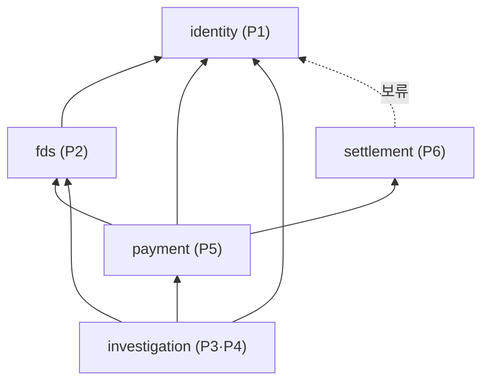

# 0012. 모듈 간 의존 방향 — Payment → Settlement 개정

- **상태:** 채택
- **날짜:** 2026-10-22
- **관련:** Issue #35, [ADR-0001](0001-module-dependency-direction.md)(이 ADR로 대체), Notion fds 정본 — 03 설계 3.2 데이터 소유권 · 3.10 Spring Modulith 통신 설계, [ADR-0009](0009-ai-investigation-call-structure.md)
- **영향 받는 담당:** 전원 (특히 P5 시은 · P6 민정)

## 배경

[ADR-0001](0001-module-dependency-direction.md)은 Notion 설계 3.10을 따라 `settlement → payment`로 정했다. P5가 CAPTURE 요청 이벤트를 발행하고, P6가 P5 공개 API를 호출해 매입 요청의 영속 접수를 확인하는 구조였다.

P6가 매입·정산 업무를 설계하면서 **"정산 완료 이후에는 취소할 수 없다"** 는 규칙이 생겼다. 취소(VOID·환불)는 P5 담당이므로, P5가 취소 전에 P6의 정산 상태를 확인해야 한다. 기존 방향에서 P5가 P6를 호출하면 `payment ↔ settlement` 순환이 되어 `ModularityTests`(`verify()`)가 실패한다.

P5 · P6 논의 결과 의존 방향을 `payment → settlement`로 뒤집기로 했다. 업무 코드가 아직 없어 고칠 코드가 없다.

이 ADR은 ADR-0001 전체를 대체한다. ADR-0001의 다른 규칙도 그대로 옮겨 적어, 이 문서만 읽으면 되게 한다.

## 결정

**직접 호출(공개 `api/` 인터페이스)과 이벤트 타입 import는 아래 방향으로만 한다. 반대 방향으로 알릴 일은 커밋 후 이벤트로 보낸다.**

- 의존 목록: `fds → identity`, `payment → fds`, `payment → identity`, `payment → settlement`, `investigation → payment`, `investigation → fds`, `investigation → identity`
- **보류** `settlement → identity`: P6가 가맹점 정보(수수료율 등)를 P1 공개 API로 읽어야 할 때 추가한다. identity는 어느 모듈도 의존하지 않으므로 나중에 추가해도 순환이 생기지 않는다
- 위 그래프에는 순환이 없다. 맨 아래 `identity`부터 `fds`·`settlement` → `payment` → `investigation` 순서로 쌓인다

### 이벤트 전달 방향과 코드 의존 방향은 다르다

이벤트는 양방향으로 오갈 수 있다. 의존을 만드는 것은 **이벤트 타입(클래스)을 import하는 쪽**이다.

**이벤트 타입은 두 모듈 중 상대가 import해도 되는 쪽(의존 화살표를 받는 쪽)의 `api/`에 둔다.** 이벤트를 보내는 쪽과 받는 쪽 모두 그 클래스를 import해야 하므로, 클래스가 화살표를 받는 쪽에 있어야 허용된 방향의 import만 생긴다.

| 이벤트 | 보내는 쪽 → 받는 쪽 | 타입 위치 | import하는 쪽 | 결과 의존 |
| --- | --- | --- | --- | --- |
| `PaymentHeld` | payment → investigation | `payment.api` | investigation (구독) | investigation → payment |
| 인계 결과 (`HandoffResult`) | payment → investigation | `payment.api` | investigation (구독) | investigation → payment |
| `CaptureRequested` | payment → settlement | **`settlement.api`** | payment (발행) | payment → settlement |
| 매입 접수 결과 (예: `CaptureIntakeAccepted` · `CaptureIntakeRejected`) | settlement → payment | `settlement.api` | payment (구독) | payment → settlement |
| 매입 실행 결과 (예: `CaptureCompleted` · `CaptureFailed`) | settlement → payment | `settlement.api` | payment (구독) | payment → settlement |

`CaptureRequested`는 P5가 보내지만 P6 패키지에 둔다. P6는 자기 모듈의 타입을 구독하므로 payment를 import하지 않는다.

### 모듈별 정리

| 모듈 | 직접 호출(의존) | 공개 `api/` (이름은 예시) | 발행 이벤트 | 구독 이벤트 |
| --- | --- | --- | --- | --- |
| identity | 없음 | `TenantReader`, `CurrentStaff`, `SecuritySignalReader` | — | — |
| fds | identity | `FdsEvaluator`, `FdsEvidenceReader` | — | — |
| settlement | 없음 (identity 보류) | 매입 요청·결과 이벤트 타입, (2차 MVP) 정산 상태 확인 포트 | 매입 접수 결과, 매입 실행 결과 | `CaptureRequested` |
| payment | fds, identity, settlement | `PaymentReader`, `FinancialActionPort`, `PaymentHeld`, `HandoffResult` | `PaymentHeld`, `CaptureRequested`, `HandoffResult` | 매입 접수 결과, 매입 실행 결과 |
| investigation (+report) | payment, fds, identity (+ ai-server HTTP) | 없음 | — | `PaymentHeld`, `HandoffResult` |

### 설계 3.10 통신의 구현 방식

| 통신 | 방식 | 의존 방향 | ADR-0001과 비교 |
| --- | --- | --- | --- |
| P5 → P2 위험 평가 | `FdsEvaluator` 동기 호출 | payment → fds | 같음 |
| P5 → P3 HELD 발생 | `PaymentHeld` 이벤트 | investigation → payment | 같음 |
| P3 → P4 AI 조사 | 같은 모듈 내부 호출 | — | 같음 |
| P4 ↔ FastAPI | HTTP, [ADR-0009](0009-ai-investigation-call-structure.md) | 모듈 의존 아님 | 같음 |
| P3 → P5 금융 조치 요청 | `FinancialActionPort` 동기 호출, P3 커밋 후 | investigation → payment | 같음 |
| P5 → P6 CAPTURE 요청 | `CaptureRequested` 이벤트 (타입은 `settlement.api`) | payment → settlement | **변경** (타입 위치 이동) |
| P6 → P5 CAPTURE 영속 접수 확인 | 매입 접수 결과 **이벤트** | payment → settlement | **변경** (동기 호출 → 이벤트) |
| P6 → P5 CAPTURE 실행 결과 | 매입 실행 결과 이벤트 | payment → settlement | **추가** (ADR-0001은 미정) |
| P5 → P3 접수 결과 | `HandoffResult` 이벤트 | investigation → payment | 같음 |
| P5 → P6 취소 전 정산 상태 확인 (2차 MVP) | settlement 공개 포트 동기 호출 | payment → settlement | **추가** |

### 순환을 만들지 않기 위한 규칙

- **settlement는 payment를 호출·import하지 않는다.** P6가 매입 실행에 필요한 값(결제 ID, 가맹점, 금액, 승인 참조 등)은 P5가 `CaptureRequested`에 담아 보낸다. P6가 P5에 결제 상태를 다시 묻지 않는다
- fds는 payment를 조회하지 않는다. payment가 평가 요청에 재료(`payment_id`·고객·가맹점·금액·카드·기기 등)를 담아 넘긴다. "단기간 반복 결제" 같은 규칙은 fds가 자기 평가 기록으로 센다
  - 04 DB 설계 §3.2의 "`fds_evaluation.payment_id`는 P5 공개 계약으로 확인"은 P5가 `FdsEvaluator`를 호출하며 넘긴 `payment_id`를 그대로 저장하는 것으로 충족한다
- payment는 investigation을 호출하지 않는다. 알릴 일은 이벤트로 보낸다
- 여러 모듈 데이터를 합치는 조회 화면 API(예: 거래 목록에 Case 번호 표시)는 위층(investigation)에 두거나 프론트가 API를 나눠 부른다. payment에 두지 않는다
- 로그인·기기 보안 신호는 identity가 제공하고 fds가 읽는다 (설계 5.7)
- 받는 쪽은 같은 이벤트가 두 번 와도 한 번만 반영한다 (멱등)

## 고려한 대안

| 대안 | 버린 이유 |
| --- | --- |
| `settlement → payment` 유지 (ADR-0001) | P5가 취소 전에 P6 정산 상태를 확인할 수 없다. 확인하려면 순환이 생긴다 |
| 기존 방향 유지 + P6가 정산 상태 변경을 이벤트로 P5에 알려 P5가 사본을 보관 | P5가 오래된 사본을 보고 취소할 수 있다. 정산 확정과 취소가 동시에 일어나면 "정산 후 취소 금지"를 지킬 수 없다 |
| 순환을 허용하고 `verify()`를 끈다 | 모듈 경계 검사 자체를 버리게 된다 |
| 공통 모듈(`common`)에 공유 이벤트 타입을 모은다 | 6번째 모듈이 생기고 잡동사니 서랍이 되어 다시 순환이 생긴다 |
| `CaptureRequested`를 기존처럼 `payment.api`에 둔다 | settlement가 구독하려면 payment를 import해야 해서 `settlement → payment`가 다시 생겨 순환이 된다 |

## ADR-0001에서 바뀐 것

| ADR-0001 | ADR-0012 | 이유 |
| --- | --- | --- |
| `settlement → payment`, `settlement → identity` | `payment → settlement`, `settlement → identity`는 보류 | 정산 후 취소 금지 확인 |
| "이벤트 타입은 보내는 쪽 `api/`에 둔다" | "이벤트 타입은 상대가 import해도 되는 쪽(의존 화살표를 받는 쪽) `api/`에 둔다" | `CaptureRequested`는 payment가 보내지만 settlement가 받으므로, payment에 두면 settlement가 payment를 import해야 해서 순환 |
| `CaptureRequested` ∈ `payment.api` | `CaptureRequested` ∈ `settlement.api` | 위와 같음 |
| P6 → P5 접수 확인 = `CaptureIntakePort` 동기 호출 | 매입 접수 결과 이벤트 | settlement가 payment를 호출할 수 없음 |
| "payment는 investigation · settlement를 호출하지 않는다" | "payment는 investigation을 호출하지 않는다", "settlement는 payment를 호출·import하지 않는다" | 방향 반전 |
| P6 → P5 실행 결과 전달 방식 미정 | 매입 실행 결과 이벤트 | 새 방향에서 자연스럽게 정해짐 |

## 영향

- API: `CaptureIntakePort`(payment 공개 api)가 없어진다. settlement 공개 api에 이벤트 타입과 (2차 MVP) 정산 상태 확인 포트가 생긴다
- DB: 이 ADR로 생기는 테이블은 없다. 모듈 간 참조는 ID 값만 저장하는 원칙 그대로 ([ERD 5절](../erd/README.md#5-모듈-간-참조-규칙))
- 화면: 없음
- 테스트: 팀 합의 후 각 모듈 `package-info.java`에 `allowedDependencies`(허용 의존 목록)를 넣어 `verify()`로 방향까지 강제한다. 그 전까지 `verify()`는 순환과 내부 접근만 막는다
- 문서
  - 저장소: README 모듈 의존 방향·핵심 흐름 갱신 (이 PR)
  - Notion 설계 3.10의 "README 정적 모듈 의존성은 `Settlement → Payment`를 유지한다"와 "P6 → P5: P5 공개 API로 접수 확인" 문구 갱신 필요 (팀)
  - [`docs/payment/design.md`](../payment/design.md) §3.3 (P6 이벤트·접수 확인을 `payment/api` 소유·동기 호출로 기술) 갱신 필요 (P5 시은)

## 합의가 필요한 것

1. **P6 매입 판단에 필요한 값의 전달:** settlement가 payment에 물어볼 수 없으므로, 승인 유효성(설계 3.11 "유효하지 않은 승인에 대해 P6 매입 실행 금지")을 판단할 값을 `CaptureRequested`에 담아야 한다. 승인 만료 시각을 담는 `payment.auth_expires_at`은 현재 ERD에서 빠져 있다 — 시은 · 민정
2. **`settlement → identity` 필요 여부:** 정산금 계산에 P1 가맹점 정보가 필요한지 — 민정 · 주환
3. **이벤트 이름·필드·멱등 키:** `CaptureRequested`, 매입 접수 결과, 매입 실행 결과, `PaymentHeld`, `HandoffResult` — 시은 · 민정 · 수민
4. **정산 상태 확인 포트 (2차 MVP):** 조회와 정산 확정 사이의 동시성 처리 방식 — 시은 · 민정

## 검증

- 새 의존 목록으로 순환이 없음을 확인 (위상 정렬: identity → fds · settlement → payment → investigation)
- 코드 검증은 미실시 — 업무 코드가 없다. 합의 후 `allowedDependencies`를 넣고, 방향을 어기는 임시 클래스로 `./gradlew check`가 실패하는지 확인한다
