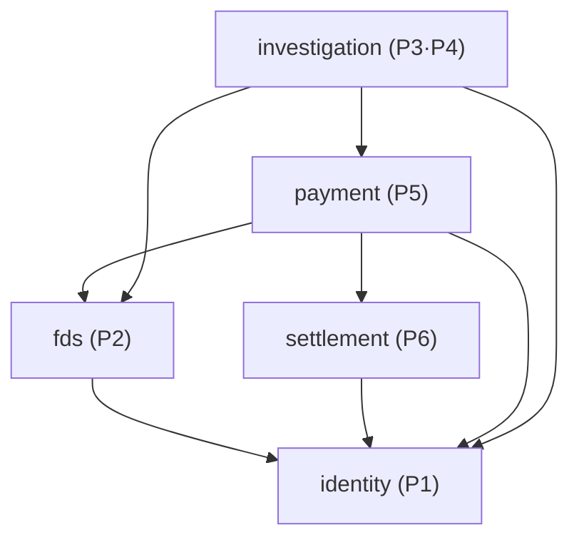

# 0038. Settlement → Identity 의존 허용 (ADR-0012 보류 항목 확정)

- **상태:** 채택 — 2026-10-27 P1 주환 결정 (PR #245, P6 별도 리뷰 없음)
- **날짜:** 2026-10-27
- **관련:** Issue #240 · #241, 후속 #227 · #228 · #229, 상위 Issue #68, [ADR-0012](0012-payment-settlement-dependency.md) · [ADR-0020](0020-identity-public-read-contracts.md) · [ADR-0037](0037-merchant-hmac-authentication.md)
- **영향 받는 담당:** P1 주환 · P6 민정

## 배경

[ADR-0012](0012-payment-settlement-dependency.md)는 `settlement → identity`를 **보류**로 두고, "P6가 가맹점 정보를 P1 공개 API로 읽어야 할 때 추가한다"고 적었다. 같은 ADR의 합의 필요 2번도 이 의존의 필요 여부다.

2026-10-27 `dev` `4b7ebc5` 기준으로 P6가 아래 두 경로에서 인증된 가맹점을 알아야 하는 상황이 생겼다.

| 경로 | 호출자 | 인증 방식 | 필요한 P1 공개 계약 | 관련 |
| --- | --- | --- | --- | --- |
| 사장님 정산·자금관리 화면 API | 사장님 브라우저 | 세션 ([ADR-0014](0014-session-authentication.md)) | `CurrentStaff` → `StaffSummary.merchantId` · `role` · `permissions` | #240, #228 · #229 · #235 · #236 |
| CakeShop 픽업 PUT API | CakeShop 서버 | HMAC 서명 ([ADR-0037](0037-merchant-hmac-authentication.md)) | `CurrentMerchant` → `MerchantIdentity.merchantId` | #241, #227 |

두 계약은 이미 `identity/api`에 있고 P3·P5가 쓰고 있다. 그러나 `settlement/package-info.java`의 `allowedDependencies`가 빈 목록이라 P6가 import하면 `ModularityTests`가 실패한다. AGENTS.md 4절에 따라 목록을 늘리기 전에 이 ADR로 의존을 정한다.

P6가 로컬에서 작성한 Controller는 "인증 미연결 시 차단" 상태로 대기 중이다 (#227 · #228 · #229 본문).

## 결정

**`settlement`가 `identity :: api`(공개 인터페이스)에 의존하는 것을 허용한다.** 이 ADR과 같은 PR(#245)에서 `settlement/package-info.java`를 아래처럼 바꿨다.

```java
@org.springframework.modulith.ApplicationModule(
        allowedDependencies = {"identity :: api"})
```



- 의존 목록: ADR-0012 목록에 `settlement → identity`를 더한다. 나머지 방향과 규칙(이벤트 타입 위치, settlement는 payment를 호출·import하지 않음, 멱등)은 ADR-0012 그대로다
- 순환 없음: identity의 `allowedDependencies`는 빈 목록이다. 위상 순서 `identity` → `fds` · `settlement` → `payment` → `investigation`은 바뀌지 않는다
- 허용 범위는 `identity :: api`뿐이다. `entity/` · `repository/` · `security/` · `SecurityContext`·`SessionUser` 직접 접근은 계속 금지이며 `ModularityTests`가 막는다
- P6는 P1 공개 계약을 자기 모듈 안 어댑터 한 곳에서 감싼다. P5의 `PaymentMerchantIdentity` → `PaymentMerchantIdentityAdapter` 구조와 같다. 어댑터가 연결되지 않으면 업무 코드는 지금처럼 차단한다
- 세션 인증(`CurrentStaff`)과 서버 간 인증(`CurrentMerchant`)은 경로별로 하나만 쓴다. 한 경로에서 둘 중 하나가 있으면 통과시키는 식으로 섞지 않는다

### 이 ADR이 정하지 않는 것

아래는 의존 허용과 별개로 각 이슈에서 P1 · P6가 합의한다. 이 ADR 채택이 아래를 승인하지 않는다.

| 항목 | 이슈 |
| --- | --- |
| 사장님 API 최종 경로, 읽기·쓰기 권한(`FINANCE_VIEW` 여부), ADMIN · SECURITY_STAFF 접근 정책, `SecurityConfig` 규칙 | #240 |
| 픽업 PUT의 HMAC 체인 경로 확장, 정지 가맹점 허용·거절, 주문 식별 키의 가맹점 범위 | #241 |
| 정산 계산용 가맹점 정보(수수료율 등)를 `TenantSummary`에 추가할지와 단위 | 별도 합의 ([문서 대조 현황](../README.md) 수수료 입력 줄) |

`TenantReader`는 `identity :: api`에 있으므로 이 의존으로 호출할 수 있게 되지만, 반환 필드를 늘리는 일은 위 별도 합의를 따른다.

## 고려한 대안

| 대안 | 버린 이유 |
| --- | --- |
| 보류 유지, P6 Controller를 `investigation` 등 위층에 둔다 | 정산·자금관리는 P6 소유 업무다. 다른 담당 모듈에 Controller를 두면 소유와 리뷰 책임이 어긋나고, AGENTS.md 4절의 "여러 모듈을 합치는 조회" 경우에도 해당하지 않는다 |
| identity가 settlement를 호출해 인증 결과를 넘긴다 (`identity → settlement`) | 모든 모듈이 기대는 identity가 업무 모듈에 의존하게 되어 맨 아래 층이 깨진다. 요청마다 누가 로그인했는지 묻는 쪽은 업무 모듈이다 |
| P6 Controller가 요청 헤더·본문의 `merchantId`를 그대로 신뢰한다 | 다른 가맹점 정산을 조회·변경할 수 있다. #227 · #228 · #229 완료 기준과 충돌한다 |
| P6가 `SecurityContextHolder`를 직접 읽는다 | 세션 구현에 각 모듈이 결합한다. ADR-0020에서 이미 버린 대안이다 |
| 인증된 merchantId를 공통 HTTP 필터가 요청 속성에 넣고 P6는 그 값만 읽는다 | 모듈 의존은 사라지지 않고 숨겨질 뿐이다. 검사 도구가 경계를 확인할 수 없고, P3 · P5와 연결 방식이 달라진다 |
| `identity :: api` 대신 특정 인터페이스만 허용하는 별도 NamedInterface를 만든다 | 공개 계약이 이미 작은 인터페이스·record로만 이루어져 있다. 다른 모듈(fds · payment · investigation)과 같은 단위로 허용하는 편이 단순하다 |

## 영향

- API: 새 HTTP API · 공개 Java 계약 없음. 기존 `CurrentStaff` · `CurrentMerchant` · `TenantReader`를 settlement도 호출할 수 있게 된다
- DB: 없음. 모듈 간 참조는 ID 값만 저장한다 ([ERD 5절](../erd/README.md#5-모듈-간-참조-규칙))
- 화면: 없음
- 테스트: `settlement/package-info.java`에 `"identity :: api"`를 넣었다. `ModularityTests`가 허용 범위 밖(identity 내부 패키지) 접근은 계속 막는다
- 문서 (이 PR에서 갱신)
  - [`README.md`](../../README.md) 모듈 의존 그래프의 `settlement -. "보류" .-> identity`
  - [`docs/modulith/04-dependency-and-events.md`](../modulith/04-dependency-and-events.md) 의존 그래프와 모듈 표
  - [`docs/modulith/05-verification.md`](../modulith/05-verification.md) settlement 주석
  - [`docs/README.md`](../README.md) 문서 대조 현황 수수료 입력 줄 (의존은 허용, 수수료율 필드는 미합의)
  - ADR-0012는 채택된 본문이라 고치지 않는다. 이 ADR이 보류 항목 하나만 확정하므로 ADR-0012 상태는 `채택`을 유지한다
- Notion: 설계 3.10 모듈 의존 설명에 `settlement → identity` 반영 필요 (팀)

## 검증

- 2026-10-27, `dev` `4b7ebc5`에서 각 모듈 `package-info.java`의 `allowedDependencies`를 읽어 새 간선을 더해도 순환이 없음을 확인했다 (identity는 의존 없음)
- 실행 결과는 PR "테스트 결과"에 커밋과 함께 적는다
- 미검증: P6 어댑터가 실제로 `identity :: api`를 호출하는 코드는 아직 없다 (#227 · #228 · #229에서 연결)
