# ERD

> **상태: 1차 MVP 반영** — Notion 팀페이지 / ERD(P1~P6 담당별 페이지) 기준 업무 테이블 14개를 Flyway로 생성했습니다 (Issue #56).

## 목차

1. [범위와 정본](#1-범위와-정본)
2. [테이블 소유](#2-테이블-소유)
3. [ERD 그림](#3-erd-그림)
4. [테이블별 컬럼](#4-테이블별-컬럼)
5. [모듈 간 참조 규칙](#5-모듈-간-참조-규칙)
6. [변경 절차](#6-변경-절차)

## 1. 범위와 정본

P6 #465: [영업일 D+3 정책·ERD](../settlement/d3-policy-and-erd.md). 이번 PR은 P6 달력 테이블 추가와 미완료 일정 전환이며, 지급/환불 테이블은 후속 제안이다. Notion·운영 DB 적용 완료를 뜻하지 않는다.

P6 정기 지출 확장: [규칙·회차 완료 기록 ERD](../settlement/recurring-expenses-api.md#erd).
P6 소유 신규 테이블만 추가하며, 다른 모듈 테이블과 물리 FK를 만들지 않는다.

- 합의 정본(무엇을 만들지)은 Notion **팀페이지 / ERD**의 담당별 페이지(P1~P6)입니다
- 실제 DB의 기준(지금 무엇이 있는지)은 `backend/src/main/resources/db/migration/`의 SQL입니다. 이 문서는 소유 · 관계만 요약하고 컬럼은 복사하지 않습니다
- DB 원칙과 INSERT/UPDATE 예시는 Notion fds 정본 **04 DB 설계 및 데이터 매핑**에 있습니다 (구현 가이드)
- 2026-10-22 제공된 P1~P6 담당 ERD를 대조했습니다. [담당별 원문 링크와 차이](../README.md)를 함께 봅니다. 특히 P6의 픽업·정산 완료용 테이블·컬럼은 2차 범위이며 현재 SQL에 없습니다

P6 #230 조회 인덱스: [20261102_112639](../../backend/src/main/resources/db/migration/V20261102_112639__index_settlement_cash_flow_queries.sql)은 settlements의 가맹점·상태·완료 시각/예정 시각 복합 인덱스 2개만 추가한다. 테이블·컬럼·데이터 변경은 없다. 상세 목적은 [예측 API](../settlement/cash-flow-forecast-api.md#조회-인덱스)를 따른다.

### 공통 규칙

| 대상 | 규칙 | 예 |
| --- | --- | --- |
| 테이블 이름 | 복수 · snake_case | `payments`, `security_cases` |
| PK | `BIGINT AUTO_INCREMENT` 단일 컬럼 | `payment_id` |
| 다른 테이블 ID | `BIGINT` (가리키는 PK와 같은 타입) | `merchant_id` |
| 상태 · 유형 | `VARCHAR` + JPA `EnumType.STRING` (enum을 이름 문자열로 저장) | `status VARCHAR(30)` |
| 시각 | `DATETIME(6)`, UTC로 저장 (`hibernate.jdbc.time_zone: UTC`) | `created_at` |
| 금액 | `BIGINT`, 원(KRW) 정수 | `amount` |
| 비율 | `DECIMAL(9,6)`, 0~1 | `pg_fee_rate` |
| 구조가 자유로운 값 | `JSON` (MariaDB가 형식을 검사) | `report_body` |
| 중복 방지 키 | MariaDB `UUID` | `idempotency_key` |
| 제약 · 인덱스 이름 | `uk_<테이블>_<컬럼>` · `fk_<테이블>_<대상>` · `idx_<테이블>_<용도>` | `uk_ai_reports_case_version` |

### 1차 생성 때 Notion 양식과 다르게 적용한 것

| 대상 | 양식 | migration | 이유 |
| --- | --- | --- | --- |
| P1 테이블 이름 | `merchant` · `platform_user` · `user_permission` | `merchants` · `platform_users` · `user_permissions` | 테이블 이름은 복수 |
| `user_permissions` PK | `(user_id, permission_code)` 복합 PK | `permission_id` 단일 PK + `UNIQUE(user_id, permission_code)` | PK는 `BIGINT` |
| `fds_rule_hits.applied_score` | 기본값 0 검토 | `DEFAULT 0` | 미적중이면 0 |
| `security_cases.evidence_version` | 초기값 1 검토 | `DEFAULT 1` | 양식 제안값 |

위 표는 최초 생성 당시 차이를 기록합니다. 현재 제공된 P1 ERD 본문에는 `permission_id` 단일 PK가 반영되어 있으나 아래 표에는 이전 복합 PK 표시가 남아 있습니다. 실제 구조는 SQL을 따릅니다.

## 2. 테이블 소유

#381은 설계 PR #385 병합 후 사용자의 다음 단계 진행 요청에 따라 [저장 명세](../payment/381-cancellation-storage.md)를 기준으로 P5 두 테이블의 migration·Entity·Repository를 구현한다. 최초 범위에 삭제·키 만료는 두지 않는다. Notion 담당 페이지 동기화·장기 보존 정책·운영 DB 적용은 미완료이며 API·실행 연결은 후속이다.

P6 사용자 승인 확장(#226·#227·#333, PR 리뷰 대상): `order_fulfillments`와
`order_fulfillment_items`를 추가하고 `settlements`에 nullable 정산 시각 3개를 추가한다.
상품은 같은 P6 주문만 물리 FK로 참조하며 다른 모듈과는 논리 참조를 유지한다.
상세 컬럼·제약·가맹점별 주문번호 범위는 [픽업 ERD](../settlement/pickup-schema.md)를 따른다.
실제 Notion 최신 동기화·운영 DB 적용 완료를 뜻하지 않는다.

| 모듈 | 담당 | 테이블 | migration (테이블 순서대로, 테이블당 1개) |
| --- | --- | --- | --- |
| `identity` | P1 주환 | `merchants`, `platform_users`, `user_permissions` | [20261022_145055](../../backend/src/main/resources/db/migration/V20261022_145055__create_merchants_table.sql) · [20261022_145057](../../backend/src/main/resources/db/migration/V20261022_145057__create_platform_users_table.sql) · [20261022_145059](../../backend/src/main/resources/db/migration/V20261022_145059__create_user_permissions_table.sql) |
| `identity` (#129) | P1 주환 | `platform_users` 강제 변경·역할 CHECK, `admin_change_histories` | [강제 변경](../../backend/src/main/resources/db/migration/V20261025_121650__add_password_change_required.sql) · [역할 CHECK](../../backend/src/main/resources/db/migration/V20261025_121656__add_user_role_merchant_check.sql) · [관리 이력](../../backend/src/main/resources/db/migration/V20261025_121657__create_admin_change_histories.sql) |
| `identity` (#127) | P1 주환 | `platform_users` 연속 로그인 실패 횟수·잠금 종료 시각 | [로그인 잠금](../../backend/src/main/resources/db/migration/V20261025_165712__add_login_attempt_lock.sql) |
| `identity` (#219) | P1 주환 | `merchant_request_nonces` | [HMAC nonce](../../backend/src/main/resources/db/migration/V20261027_144924__create_merchant_request_nonces.sql) |
| `identity` (#147) | P1 주환 | `login_histories` | [로그인 이력](../../backend/src/main/resources/db/migration/V20261025_201559__create_login_histories.sql) |
| `identity` (#525) | P1 주환 | `operator_access_denials` | [403 원본](../../backend/src/main/resources/db/migration/V20261104_153346__create_operator_access_denials.sql) |
| `identity` (#604) | P1 주환 | `staff_access_events` (보안 직원 · ADMIN 접근 기록, ADR-0082) | [접근 기록](../../backend/src/main/resources/db/migration/V20261106_215350__create_staff_access_events.sql) |
| `identity` (#647) | P1 주환 | `staff_account_locks` (보안 직원 계정 보안 정지 기록, ADR-0084) | [보안 정지](../../backend/src/main/resources/db/migration/V20261107_233256__create_staff_account_locks.sql) |
| `payment` | P5 시은 | `payments` | [20261022_145100](../../backend/src/main/resources/db/migration/V20261022_145100__create_payments_table.sql) |
| `payment` (#141) | P5 시은 | `payment_actions` | [조치 저장](../../backend/src/main/resources/db/migration/V20261025_160810__create_payment_actions_table.sql) |
| `payment` (#381) | P5 시은 | `payment_cancellation_requests`, `payment_cancellations` | [취소 요청](../../backend/src/main/resources/db/migration/V20261031_183409__create_payment_cancellation_requests.sql) · [금융 작업](../../backend/src/main/resources/db/migration/V20261031_183416__create_payment_cancellations.sql) |
| `payment` (#402) | P5 | `payment_sessions` (호스팅 결제창 세션, ADR-0064) | [결제 세션](../../backend/src/main/resources/db/migration/V20261102_142818__create_payment_sessions.sql) · [웹훅 재시도 eventId #455](../../backend/src/main/resources/db/migration/V20261103_093050__add_payment_session_notify_event_id.sql) |
| `payment` (#602) | P5 | `payment_order_contacts` (주문자 연락처 암호문, ADR-0082) | [주문자 연락처](../../backend/src/main/resources/db/migration/V20261106_222538__create_payment_order_contacts.sql) |
| `fds` | P2 정후 | `fds_evaluations`, `fds_rule_hits`, `fds_failure_analyses`, `fds_high_risk_countries`, `fds_blocklist_entries`, `fds_rule_policies`, `fds_rule_change_requests`, `fds_rule_policy_change_histories`, `fds_operator_access_events`, `fds_operator_access_detections`, `fds_operator_access_detection_evidences` | [20261022_145102](../../backend/src/main/resources/db/migration/V20261022_145102__create_fds_evaluations_table.sql) · [20261022_145104](../../backend/src/main/resources/db/migration/V20261022_145104__create_fds_rule_hits_table.sql) · [20261022_174140](../../backend/src/main/resources/db/migration/V20261022_174140__add_fds_evaluation_request_fields.sql) · [20261023_135302](../../backend/src/main/resources/db/migration/V20261023_135302__add_fds_requested_amount.sql) · [20261026_174910](../../backend/src/main/resources/db/migration/V20261026_174910__add_fds_evaluation_merchant_id.sql) · [20261027_101722](../../backend/src/main/resources/db/migration/V20261027_101722__create_fds_failure_analyses.sql) · [20261027_101804](../../backend/src/main/resources/db/migration/V20261027_101804__add_fds_reevaluation_lineage.sql) · [FDS v0.2](../../backend/src/main/resources/db/migration/V20261028_092416__add_fds_rule_inputs_and_policy_tables.sql) · [룰 관리](../../backend/src/main/resources/db/migration/V20261028_155511__create_fds_rule_management_tables.sql) · [접근 탐지·룰 정책·변경 이력](../../backend/src/main/resources/db/migration/V20261104_152441__create_operator_access_detection_tables.sql) · [차단 식별값](../../backend/src/main/resources/db/migration/V20261028_201821__add_fds_blocklist_identifiers.sql) · [차단 해제 이력](../../backend/src/main/resources/db/migration/V20261030_114028__add_fds_blocklist_deactivation.sql) |
| `fds` (#516) | P2 정후 | `insider_alerts`, `insider_alert_evidences`, `insider_detection_states` (보안 직원 내부자 경보, ADR-0082) | [내부자 경보](../../backend/src/main/resources/db/migration/V20261107_082223__create_insider_alerts.sql) |
| `investigation` | P3 수민 | `security_cases`, `case_payments`, `payment_decisions`, `action_handoffs`, `case_histories` | [20261022_145106](../../backend/src/main/resources/db/migration/V20261022_145106__create_security_cases_table.sql) · [20261022_145108](../../backend/src/main/resources/db/migration/V20261022_145108__create_case_payments_table.sql) · [20261022_145111](../../backend/src/main/resources/db/migration/V20261022_145111__create_payment_decisions_table.sql) · [20261022_145112](../../backend/src/main/resources/db/migration/V20261022_145112__create_action_handoffs_table.sql) · [20261022_145115](../../backend/src/main/resources/db/migration/V20261022_145115__create_case_histories_table.sql) |
| `investigation` (#608) | P3 수민 | `security_cases` 담당 칸, `case_assignment_locks`, `case_assignment_requests` (사건 자동 배정 · 담당 변경, ADR-0082) | [담당 배정](../../backend/src/main/resources/db/migration/V20261106_225206__add_security_case_assignment.sql) · [담당 변경 요청](../../backend/src/main/resources/db/migration/V20261106_225208__create_case_assignment_requests.sql) |
| `investigation` (#619) | P3 수민 | `raw_view_reviews` (주문자 전화 원문 열람 사후 검토, ADR-0082) | [원문 열람 검토](../../backend/src/main/resources/db/migration/V20261107_024052__create_raw_view_reviews.sql) |
| `investigation/report` | P4 현규 | `ai_reports` | [20261022_145116](../../backend/src/main/resources/db/migration/V20261022_145116__create_ai_reports_table.sql) |
| `investigation/report` (#412) | P4 현규 | `ml_shadow_scores` (FDS ML Shadow 채점 기록) | [ML Shadow](../../backend/src/main/resources/db/migration/V20261102_125730__create_ml_shadow_scores.sql) |
| `investigation/report` (#626) | P4 현규 | `ai_switch_histories` (AI 조사 긴급정지 스위치 변경 기록, ADR-0083) | [긴급정지](../../backend/src/main/resources/db/migration/V20261107_101635__create_ai_switch_histories.sql) |
| `settlement` | P6 민정 | `captures`, `settlements` | [20261022_145118](../../backend/src/main/resources/db/migration/V20261022_145118__create_captures_table.sql) · [20261022_145120](../../backend/src/main/resources/db/migration/V20261022_145120__create_settlements_table.sql) |
| (공통) | — | `EVENT_PUBLICATION` (Modulith 이벤트 기록) | [create_event_publication_table](../../backend/src/main/resources/db/migration/V20261021_215412__create_event_publication_table.sql) |

## 3. ERD 그림

실선은 물리 FK(DB가 검사), 점선은 논리 참조(ID 값만 저장, FK 없음)입니다. `|o`는 0 또는 1(NULL 허용), `||`는 정확히 1입니다.

```mermaid
erDiagram
    merchants ||--o{ operator_access_denials : "merchant_id"
    platform_users ||--o{ operator_access_denials : "user_id"
    platform_users ||--o{ staff_access_events : "staff_id"
    platform_users ||--o{ staff_account_locks : "staff_id"
    platform_users |o--o{ staff_account_locks : "locked_by · released_by"
    merchants |o--o{ staff_access_events : "merchant_id"
    merchants ||--o{ merchant_request_nonces : "merchant_id"
    merchants |o--o{ platform_users : "merchant_id"
    platform_users ||--o{ user_permissions : "user_id"
    platform_users |o--o{ login_histories : "user_id"
    platform_users |o--o{ admin_change_histories : "actor_user_id"
    platform_users |o--o{ admin_change_histories : "target_user_id"
    merchants |o--o{ admin_change_histories : "target_merchant_id"

    fds_evaluations ||--o{ fds_rule_hits : "evaluation_id"
    fds_evaluations ||..o{ fds_failure_analyses : "evaluation_request_id (P2 조사 참조)"
    fds_rule_policies ||--o{ fds_rule_change_requests : "rule_code (논리 참조)"
    insider_alerts ||--o{ insider_alert_evidences : "alert_id"
    staff_access_events ||..o{ insider_alert_evidences : "access_event_id (P1 접근 기록)"
    platform_users ||..o{ insider_alerts : "staff_id"

    security_cases ||--o{ case_payments : "case_id"
    case_payments ||--o| payment_decisions : "case_payment_id"
    payment_decisions ||--o| action_handoffs : "decision_id"
    security_cases ||--o{ case_histories : "case_id"
    security_cases ||--o{ case_assignment_requests : "case_id"
    security_cases ||--o{ raw_view_reviews : "case_id"

    captures ||--o| settlements : "capture_id"

    merchants ||..o{ payments : "merchant_id"
    payments ||--o| payment_actions : "payment_id (P5)"
    payments ||--o{ payment_cancellation_requests : "payment_id (P5)"
    payments ||--o| payment_sessions : "payment_id (P5)"
    payment_sessions ||--o| payment_order_contacts : "session_id (P5)"
    payments ||--o| payment_cancellations : "payment_id (P5)"
    payment_cancellation_requests ||--o| payment_cancellations : "source_request_id + payment_id"
    payment_actions |o--o{ payment_cancellation_requests : "existing_void_action_id"
    merchants ||..o{ payment_cancellation_requests : "merchant_id"
    captures |o..o{ payment_cancellations : "capture_id (REFUND)"
    merchants ||..o{ fds_evaluations : "merchant_id"
    payments ||..o{ fds_evaluations : "payment_id"
    payments ||..o| case_payments : "payment_id"
    security_cases ||..o{ ai_reports : "case_id"
    ai_reports |o..o{ payment_decisions : "report_id"
    payments ||..o{ ml_shadow_scores : "payment_id (P4 ML Shadow)"
    fds_evaluations ||..o{ ml_shadow_scores : "evaluation_id (P4 ML Shadow)"
    platform_users ||..o{ ai_switch_histories : "changed_by_user_id (P4 긴급정지)"
    payments ||..o| captures : "payment_id"
```

`fds_rule_change_requests`는 요청·처리 사용자 ID와 당시 표시 이름, 룰 끄기 요청 사유를 함께 보존한다. 사용자 이름은 Identity 소유 `platform_users`를 직접 조인하지 않고 FDS 저장 스냅샷으로 조회하며, 요청 IP는 저장하지 않는다.

`fds_blocklist_entries`는 차단 등록 사유와 함께 해제 사유(`deactivation_reason`)·해제 시각(`deactivated_at`)을 보존한다. 재등록하면 기존 해제 이력은 현재 활성 차단 상태와 혼동되지 않도록 NULL로 되돌린다.

그림에 없는 논리 참조: `security_cases` · `captures` · `settlements`의 `merchant_id`(→ `merchants`), `payment_decisions.staff_id` · `case_histories.actor_id` · `security_cases.assignee_staff_id` · `case_assignment_requests` · `raw_view_reviews`의 직원 · ADMIN ID(→ `platform_users`), `raw_view_reviews.payment_id`(→ `payments`), `insider_alerts.closed_by_admin_id` · `insider_detection_states.staff_id`(→ `platform_users`), `staff_account_locks.source_alert_id`(→ `insider_alerts`) · `release_case_id`(P3 내부자 사건), `settlements.payment_id`(→ `payments`), `action_handoffs.target_operation_id`(P5 · P6 작업 ID).

## 4. 테이블별 컬럼

컬럼 · 타입 · 제약은 2절 표의 migration 파일을 봅니다. 설명과 업무 제약(예: "재시도 시 `requested_at` 유지")은 Notion 담당 페이지를 봅니다. 로컬 DB에서는 `SHOW CREATE TABLE <테이블>;`로 확인합니다 ([Flyway 05 5절](../flyway/05-guide.md#5-기존-스키마-확인하는-법)).

## 5. 모듈 간 참조 규칙

[AGENTS.md 4절](../../AGENTS.md#4-backend-규칙)의 규칙을 그대로 따릅니다.

| 관계 | 참조 방식 | 예시 |
| --- | --- | --- |
| 같은 소유 담당의 테이블끼리 | 물리 FK(외래 키 제약을 DB에 건다) | `security_cases` ↔ `case_payments` (둘 다 P3) |
| 소유 담당이 다른 테이블 | 논리 참조(ID 값만 저장, FK 없음) | `fds_evaluations.payment_id`, `fds_evaluations.merchant_id` (P2 → P5) |
| 같은 `investigation` 모듈 안의 P3 ↔ P4 | 논리 참조 (예외) | `ai_reports` ↔ `security_cases` · `payment_decisions` |

- 논리 참조 대상의 존재 확인은 DB가 아니라 소유 담당 모듈의 공개 `api/`로 합니다
- 참조되는 금융·조사 기록(결제·평가·Case·판정·인계·보고서)은 물리 삭제하지 않습니다. 그래서 FK에 `ON DELETE` 옵션을 두지 않습니다 (참조 중이면 삭제 거부)

## 6. 변경 절차

### #246 P1 CakeShop 시드 (2026-10-27)

기존 P1 `merchants`·`platform_users`·`user_permissions`에 [새 시드](../../backend/src/main/resources/db/migration/V20261027_221311__seed_cakeshop_merchant_and_owner.sql)로 `CAKESHOP`과 사장님 계정을 등록한다.
테이블·컬럼·타입·관계 변경은 없다. 수수료율 2%는 P6 확인 전 임시값이며, 키는 환경변수 이름만 저장한다. [결정과 실행 절차](../identity/246-cakeshop-provisioning.md)를 따른다.

### #517 P1 시스템 수행자 (2026-11-04)

사용자가 P1 Notion ERD 기록 완료와 구현 진행을 확인했다. [설계·검증](../identity/517-operator-suspension.md), [ADR-0078](../decisions/0078-operator-account-suspension.md)을 따른다.
새 migration은 `admin_change_histories.actor_type VARCHAR(20) NOT NULL DEFAULT 'STAFF'`를 추가해 기존 행을 STAFF로 채우고 `actor_user_id BIGINT NULL`로 전환한다. 기존 FK는 유지한다.
`ck_admin_change_histories_actor`는 STAFF+ID 있음 또는 SYSTEM+ID 없음만 허용한다. 기존 대상 CHECK·FK·인덱스·JSON·보존 정책은 유지한다.
기존 계정·가맹점·신청 경로는 STAFF를 명시하고, FDS 정지는 SYSTEM/NULL과 `USER_SUSPENDED_BY_FDS`로 구분한다. 운영 DB 적용 완료를 뜻하지 않는다.

### #129 P1 변경 계약 (2026-10-25)

사용자는 이번 작업에 한해 Notion 선행 반영 대신 저장소 ERD·ADR에 기록하고 구현하도록 승인했다. Notion 최신 내용은 확인하지 못했으며 동기화는 남아 있다. 소유는 모두 P1이고 다른 담당 테이블은 변경하지 않는다.

- `platform_users.password_change_required`: BOOLEAN NOT NULL DEFAULT FALSE. 신규·초기화 계정 TRUE, 본인 비밀번호 변경 후 FALSE.
- `platform_users` CHECK: OPERATOR는 merchant_id 필수, ADMIN·SECURITY_STAFF는 NULL.
- 신규 `admin_change_histories`: history_id BIGINT AUTO_INCREMENT PK, actor_user_id BIGINT NOT NULL FK platform_users, target_user_id BIGINT NULL FK platform_users, target_merchant_id BIGINT NULL FK merchants, change_type VARCHAR(40), before_data·after_data JSON NULL, created_at DATETIME(6) UTC. 대상 계정·가맹점 중 하나만 지정한다. INSERT 전용이며 비밀번호·해시는 저장하지 않는다.
- 관계: platform_users → admin_change_histories(수행 관리자·대상 계정), merchants → admin_change_histories(대상 가맹점). 모두 P1 물리 FK이며 삭제 연쇄는 없다.
- 상세 계약: [#129 설계](../identity/129-admin-account-design.md), [ADR-0024](../decisions/0024-admin-account-management.md).

### #127 P1 로그인 잠금 스키마 계약 (2026-10-25)

사용자가 고정 15분 잠금 정책과 아래 컬럼 이름을 승인했으며, 이번 작업은 저장소 ERD·ADR을 기준으로 구현하고 Notion은 후속 반영하도록 승인했다. Notion 연결 도구가 없고 Chrome 사용이 자동 승인 검토에서 거부되어 최신 Notion P1 ERD 확인·동기화는 미수행이다.

- 소유: P1 `platform_users`만 변경. 다른 담당 테이블·공개 Java 계약·FK·인덱스 변경 없음.
- `login_failure_count`: INT NOT NULL DEFAULT 0. 앱 저장 범위 0~5, 성공 시 0.
- `login_locked_until`: UTC DATETIME(6) NULL DEFAULT NULL. 다섯 번째 실패 시 현재 시각 +15분, 성공 시 NULL.
- 잠금 중 재시도로 값을 바꾸지 않는다. 만료 후 오답은 1회부터 다시 센다. `status`와 분리하며 비밀번호 변경·초기화·재활성화는 잠금을 해제하지 않는다.
- 기존 계정은 0·NULL로 보존하며 [새 migration](../../backend/src/main/resources/db/migration/V20261025_165712__add_login_attempt_lock.sql) 하나로 추가한다. 세부 정책·대안·검증 계획은 [#127 설계](../identity/127-login-attempt-design.md)와 [ADR-0029](../decisions/0029-login-attempt-lock.md)를 따른다.

### #147 P1 로그인 이력 계약 (2026-10-25)

사용자는 #147 상세 설계 초안을 승인하고 이번 작업은 저장소 ERD·ADR부터 반영해 구현한 뒤
Notion P1 ERD를 후속 반영하도록 승인했다. Notion 최신 내용 확인·반영은 미수행이다.
정확한 컬럼·NULL·제약·인덱스는 [승인한 스키마](../identity/147-login-history-design.md#2-p1-스키마-계약)를 따른다.
P1 `login_histories`만 추가하고 같은 P1 `platform_users.user_id`를 물리 FK로 참조한다.
기존 계정·관리자 변경 이력·다른 담당 테이블은 바꾸지 않는다.
이력은 #528 개정에 따라 1년 후 물리 삭제하며 금융·조사 기록의 삭제 금지와는 별개다. 목록은 최근 90일을 유지한다.
상세 정책·대안·영향은 [ADR-0033](../decisions/0033-login-history.md)에 기록한다.

### 일반 절차

1. Notion 팀페이지 / ERD의 담당 페이지에서 먼저 합의·수정합니다. 페이지에 없는 테이블·컬럼은 추가하지 않습니다
2. 소유 담당이 새 Flyway 마이그레이션(`ALTER` 등)을 추가합니다. 병합된 파일은 고치지 않습니다 → [Flyway 작업 가이드 1절](../flyway/05-guide.md#1-테이블-추가-순서)
3. 테이블이 늘거나 관계가 바뀌면 같은 PR에서 이 문서의 2·3절을 갱신합니다

### #141 P5 직원 조치 저장 설계 초안

2026-10-25 사용자는 아래 상세 스키마를 저장소 ERD·ADR 기준으로 구현하고 Notion은 후속 반영하도록 승인했다. 4번 단계에서 migration·Entity를 추가했다. Notion 동기화는 아직 하지 않았다. [ADR-0027](../decisions/0027-payment-actions.md), [처리 설계](../payment/141-payment-actions.md)를 함께 본다.

추가 테이블: `payment_actions`, 소유: P5. 직원 판정 조치만 저장하며 ALLOW 자동 매입·최초 승인에는 행을 만들지 않는다.

| 컬럼 | 타입 | NULL | 의미 |
| --- | --- | --- | --- |
| action_id | BIGINT AUTO_INCREMENT | 불가 | PK, VOID 성공 결과의 targetOperationId |
| payment_id | BIGINT | 불가 | P5 payments FK, 결제별 조치 최대 한 건 |
| decision_id | BIGINT | 불가 | P3 판정 ID 논리 참조, FK 없음 |
| action_type | VARCHAR(20) | 불가 | CAPTURE / VOID |
| idempotency_key | UUID | 불가 | 최초 요청 키, 재시도 시 유지 |
| status | VARCHAR(20) | 불가 | PENDING / SUCCEEDED / FAILED |
| capture_id | BIGINT | 허용 | CAPTURE 성공 때 P6 ID 논리 참조, FK 없음 |
| error_code | VARCHAR(100) | 허용 | 확정 업무 실패 코드, 기술 장애는 저장하지 않음 |
| requested_at | DATETIME(6) | 불가 | P5 최초 요청 저장 시각, UTC |
| completed_at | DATETIME(6) | 허용 | CAPTURE 성공은 capturedAt, VOID 성공/업무 실패는 P5 결과 시각, UTC |

구현한 DB 제약 및 서비스 규칙:

- PK(action_id), `uk_payment_actions_payment` UNIQUE(payment_id), `uk_payment_actions_decision` UNIQUE(decision_id), `uk_payment_actions_idempotency_key` UNIQUE(idempotency_key).
- `fk_payment_actions_payment`: payment_id → payments.payment_id. 같은 P5 소유의 물리 FK이며 삭제 연쇄 없음. 업무 행을 물리 삭제하지 않는다.
- capture_id는 양수 또는 NULL, decision_id는 양수. action_type·status는 위 허용값만 CHECK로 제한한다.
- `chk_payment_actions_result`: PENDING은 capture_id·error_code·completed_at 모두 NULL. SUCCEEDED는 completed_at 필수·error_code NULL이며 CAPTURE이면 capture_id 필수, VOID이면 capture_id NULL. FAILED는 completed_at·error_code 필수, capture_id NULL.
- 완료 상태 불변·원 요청 4필드 불변·requested_at 유지 및 결제 상태와의 일치는 서비스/Entity 전이로 보장하고 테스트한다. 단일 행 CHECK만으로 다른 테이블 상태까지 보장한다고 보지 않는다.
- 상태별 운영 목록·자동 복구 스케줄러는 범위 밖이므로 추가 조회 인덱스는 우선 만들지 않는다. 결제·키·판정 조회는 UNIQUE 인덱스를 쓴다.

현재 SQL의 payments·action_handoffs·captures는 변경하지 않는 안이다. P3 결과의 targetOperationId는 actionType=CAPTURE일 때 capture_id, VOID일 때 action_id로 해석한다. VOID 식별자 추가 공유·확인은 남아 있다.

### #149 P5 CakeShop 결제 저장 제안

**저장 구조 방향 사용자 승인·저장 기반 구현.** 기준 dev 84698bb, 2026-10-25. 사용자는 payment_orders·payment_requests 신규와 payments.status_changed_at·decline_code 추가 방향에 동의했다. 작업 브랜치에 migration·Entity·Repository를 추가했다. 운영 DB 적용·Notion 동기화·HTTP 연동은 미수행이다. [처리 설계](../payment/149-cakeshop-payment-api.md), [ADR-0030](../decisions/0030-cakeshop-payment-attempts.md)을 함께 확인한다.

추가 migration: `V20261025_210954` (결제 메타데이터·주문 조회 인덱스), `V20261025_210955` (주문), `V20261025_210956` (시도). 같은 PR에 포함하며 기존 migration은 변경하지 않는다. 아래 입력 일치·동시 요청 제어 중 Entity/DB 제약 외 서비스 정책은 후속 구현이다.

모두 P5 소유로 제안한다. 새 결제 시도마다 기존 payments 한 행을 만들고 P2/P3/P6는 그 paymentId를 계속 사용한다. PK는 BIGINT AUTO_INCREMENT, 시각은 UTC DATETIME(6), 금액 BIGINT, 상태 VARCHAR다. 참조되는 행은 물리 삭제하지 않는다.

#### payment_orders — 주문 단위 접수·직렬화 기준

| 컬럼 | 타입·NULL | 의미 |
| --- | --- | --- |
| payment_order_id | BIGINT AUTO_INCREMENT PK | P5 내부 주문 접수 ID |
| merchant_id | BIGINT NOT NULL | 인증된 P1 가맹점 논리 참조 |
| order_ref | VARCHAR(100) NOT NULL | CakeShop 주문번호, 대소문자 구분 collation 제안 |
| customer_ref | VARCHAR(100) NOT NULL | 합의 후 사용할 내부 고객 참조 |
| amount | BIGINT NOT NULL | 주문의 확정 결제 금액, 양수 |
| order_created_at | DATETIME(6) NOT NULL | CakeShop 최초 주문 생성 시각 |
| payment_deadline_at | DATETIME(6) NOT NULL | 최초 주문 생성 +10분, 새 시도 접수 제한 |
| last_attempt_no | BIGINT NOT NULL DEFAULT 0 | 마지막으로 발급한 시도 순번 |
| created_at | DATETIME(6) NOT NULL | P5 주문 접수 기준행 생성 시각 |

UNIQUE(merchant_id, order_ref), 요청행 복합 FK를 위한 UNIQUE(payment_order_id, merchant_id). CHECK: merchant_id/amount >0, last_attempt_no >=0, payment_deadline_at > order_created_at. 정확한 +10분과 주문 불변 입력은 서비스에서 검사한다. 다른 담당 merchants로 FK를 걸지 않는다. PK 행 잠금으로 같은 주문의 요청들을 직렬화한다. 최신 결제 포인터/상태를 복제하지 않고 요청행의 최대 attempt_no로 찾는다.

#### payment_requests — 결제 시도별 식별·재개 정보

| 컬럼 | 타입·NULL | 의미 |
| --- | --- | --- |
| request_id | BIGINT AUTO_INCREMENT PK | 요청 기록 ID |
| payment_order_id | BIGINT NOT NULL | P5 payment_orders 참조 |
| merchant_id | BIGINT NOT NULL | 가맹점별 키 UNIQUE를 위한 값, 주문과 일치 |
| payment_id | BIGINT NOT NULL | P5 payments FK, 시도당 하나 |
| attempt_no | BIGINT NOT NULL | 주문별 1부터 증가하는 순번 |
| idempotency_key | UUID NOT NULL | CakeShop이 시도별로 보존하는 키 |
| evaluation_request_id | UUID NOT NULL | P5가 최초 생성·고정하는 P2 요청 키 |
| device_id | VARCHAR(100) NULL | 가맹점이 보낸 기기 식별자 (#325) |
| card_token | VARCHAR(255) NULL | 카드 토큰 · 해시, 카드 원문 아님 (#325) |
| card_display_label | VARCHAR(50) NULL | 마스킹한 카드 표시값 (#325) |
| ip_country_code | CHAR(2) NULL | 접속 IP 국가 코드, 대문자 (#325) |
| ip_address | VARCHAR(45) NULL | 접속 IP 주소 (#325) |
| buyer_email | VARCHAR(254) NULL | 구매자 이메일, 소문자 (#325) |
| processing_stage | VARCHAR(30) NOT NULL | RECEIVED / EVALUATED / AUTHORIZED / NEEDS_REVIEW |
| evaluation_id | BIGINT NULL | P2 응답 논리 참조, FK 없음 |
| evaluation_result | VARCHAR(20) NULL | P2 응답 ALLOW/REVIEW/DENY/ERROR |
| evaluation_risk_score | INT NULL | P2 응답 점수, ERROR이면 NULL |
| evaluation_error_code | VARCHAR(100) NULL | P2 ERROR 코드, 외부 거절 코드와 별개 |
| evaluated_at | DATETIME(6) NULL | P2 응답 시각 |
| created_at | DATETIME(6) NOT NULL | 시도 저장 시각, payments.created_at과 동일 |

- UNIQUE(merchant_id, idempotency_key), UNIQUE(payment_order_id, attempt_no), UNIQUE(payment_id), UNIQUE(evaluation_request_id).
- 복합 FK(payment_order_id, merchant_id) → payment_orders(payment_order_id, merchant_id); FK(payment_id) → payments(payment_id). 같은 P5 소유, 삭제 연쇄 없음.
- CHECK: attempt_no >0, processing_stage 허용값. RECEIVED는 평가 필드 전부 NULL. EVALUATED/AUTHORIZED는 양수 evaluation_id·evaluated_at·ALLOW/REVIEW/DENY·0 이상 점수 필수, 오류 NULL. NEEDS_REVIEW는 양수 evaluation_id·evaluated_at·ERROR·비어 있지 않은 오류 필수, 점수 NULL.
- AUTHORIZED는 초기 승인 판단이 끝났다는 내부 단계다. 결제 최종 성공이 아니며 DENIED/DECLINED도 포함한다. 실제 상태는 payments에서 읽는다.
- payment와 주문의 가맹점·주문번호·금액·고객 일치는 같은 트랜잭션의 저장 서비스와 테스트로 보장한다. 행 CHECK로 타 테이블 일치까지 보장한다고 주장하지 않는다.
- 요청 재전송 내용은 주문 불변 필드 · FDS 식별자와 키로 대조한다. 요청 raw JSON·API Key·카드 원문은 저장하지 않는다. FDS 식별자 6개(`V20261029_141011`, #325)는 P2 평가 · 재평가 입력을 다시 만들기 위해 시도 단위로 저장하며 모두 NULL 허용이다. 카드는 토큰과 마스킹 표시값만 저장한다. 평가 응답 사본은 재개에 필요한 최소 6필드이며 룰·보고서 사본은 두지 않는다.

#### payments 추가 제안

| 컬럼 | 타입·NULL | 의미 |
| --- | --- | --- |
| status_changed_at | DATETIME(6) NULL | 현재 상태로 전이한 P5 시각. 과거 행은 알 수 없으면 NULL |
| decline_code | VARCHAR(100) NULL | 외부용 최종 DENIED/DECLINED 사유 |

신규 결제는 생성 시 status_changed_at=created_at. 기존 상태 메서드와 ALLOW/직원 CAPTURE·VOID 완료까지 모두 반영한다. 동일 상태 재전달은 기존 시각 보존. decline_code는 FDS_REJECTED/AUTHORIZATION_DECLINED 제안이며 그 외 상태 NULL. 기존 행은 사유를 추정 백필하지 않으므로 거절 상태에서도 NULL 허용한다. 해당 상태/코드 조합 CHECK를 추가하는 안이다.

기존 조회·거절·완료 API의 원래 시각을 대체하지 않는다. 주문·키 신규 구조는 과거 데이터 자동 편입 없이 도입하고 동일 가맹점/주문번호 과거 결제가 있으면 새 HTTP 접수를 막는다. 기존 조회를 위한 payments(merchant_id, order_ref) 비고유 인덱스도 제안한다. 기존 orders 중복 데이터를 삭제하거나 UNIQUE로 강제하지 않는다.

현재 SQL은 변경하지 않았다. 물리 스키마 적용 전 타입·collation·제약·순번 상한·기존 데이터 호환 및 후속 migration 배포 순서를 구현 단계에서 검증한다.

### #219 P1 HMAC nonce 계약 (2026-10-27)

사용자는 P6를 제외한 HMAC 구현과 아래 신규 P1 테이블을 승인했다. 저장소 ERD·ADR에 먼저 반영하고 Notion은 후속 반영한다.

| 컬럼 | 타입·조건 | 의미 |
| --- | --- | --- |
| request_nonce_id | BIGINT AUTO_INCREMENT PK | 내부 기록 ID |
| merchant_id | BIGINT NOT NULL FK merchants | 인증한 P1 가맹점 |
| nonce | UUID NOT NULL | HTTP 전송별 UUID v4 |
| expires_at | DATETIME(6) NOT NULL | 서명 시각+301초, UTC |

`UNIQUE(merchant_id, nonce)`로 동시 재전송을 한 번만 소비한다. `INDEX(expires_at, request_nonce_id)`로 만료 행만 배치 삭제한다.
가맹점 FK는 같은 P1 소유이고 삭제 연쇄는 없다. 원문 키·서명·요청 본문을 저장하지 않는다.
서명 확인 후 업무 실행 전에 독립 커밋하므로 업무 롤백·서버 재시작으로 nonce가 복구되지 않는다. 만료 행은 금융·조사 이력이 아닌 단기 보안 기록으로 물리 삭제한다.
기존 `merchants.secret_reference`는 Entity 매핑만 추가한다. 기존 migration·다른 담당 테이블은 변경하지 않는다.
세부 계약과 검증은 [#219 설계](../identity/219-merchant-hmac.md)와 [ADR-0037](../decisions/0037-merchant-hmac-authentication.md)을 따른다.

### #190·#273 P5 FDS 복구 저장 기반

#273 구현 준비의 [저장 필드·제약 검토](../payment/273-fds-recovery-storage.md)에 담당 Notion ERD 조회 결과와 상태별 CHECK·키·인덱스 기준을 정리했다. 2026-10-28 최초 조회 시 담당 ERD에는 복구 테이블이 없었으며, 이후 사용자 요청으로 필드·제약과 P2 분석 사유 보존 원칙을 담당 ERD에 반영했다. 문서 반영과 DB 구현은 구분한다.

2026-10-28, `dev ceb4544` 기준으로 사용자가 단일 복구 테이블 설계안을 선택하고 문서화를 요청했다. 상세 필드·상태·제약은 [#190 저장·API 계약](../payment/190-fds-recovery-contract.md)에 기록한다.

- P5 소유 신규 `payment_fds_recoveries` 제안: 결제당 원본 ERROR·오류 보고·P2 분석·직원 재탐지 작업 1행.
- 기존 `payments`는 결제 정본, `payment_requests`는 현재 적용 평가·처리 단계다. 기존 ERROR는 복구 행에 보존하고 제한된 새 결과 적용 전이를 추가할 계획이다.
- 같은 P5 payments 참조에만 물리 FK를 사용하고, P2 평가·분석 ID와 P1 직원 ID는 논리 참조한다. 원본/작업 키 불변·물리 삭제 금지·중복 방지는 상세 계약을 따른다.
- #273 작업 브랜치에 신규 migration·Entity·Repository를 추가했다. 사용자 요청에 따른 Notion 담당 ERD 필드·제약 반영을 마쳤으며 보고·분석 리스너와 상세 GET 응답 확장까지 연결했다. 운영 DB 적용은 후속이다. 이번 사용자 설계 승인을 이미 운영 적용·다른 담당 상세 검토까지 마친 것으로 해석하지 않는다.

### #131 PR A P1 상태 이름 전환 (2026-11-01)

P1 사용자 승인(#131 최신 실행 계획)으로 계정 `DISABLED → INACTIVE`, 신청 `EMAIL_PENDING → EMAIL_VERIFICATION_PENDING`을 데이터 초기화 없이 전환한다. [계정 migration](../../backend/src/main/resources/db/migration/V20261101_160837__rename_user_inactive_status.sql)은 기존 정지 행만 변환하고 ACTIVE 시드와 감사 JSON·유형은 유지한다. [신청 migration](../../backend/src/main/resources/db/migration/V20261101_160844__rename_application_email_verification_status.sql)은 CHECK와 `pending_email`·`pending_business_number`·`pending_login_id`의 조건을 함께 변경한다. 기존 UNIQUE 3개는 유지하며 임시로 양쪽 이름을 예약 대상으로 포함한 뒤 데이터 UPDATE와 최종 조건 축소를 수행한다. 컬럼 타입·소유(P1)·FK·보관 정책은 유지한다. 메일 발송 PENDING은 별도 개념이다.

구버전 앱·예약 작업 전부 종료 및 백엔드·프론트 점검 배포가 필요하다. [ADR-0060](../decisions/0060-identity-status-names.md)과 [복구 절차](../identity/131-status-transition.md)를 따른다. Notion 동기화와 실제 공용/운영 DB 적용은 미수행이다. 시연 계정 정지는 운영 시작 코드 PR B에서 처리하며 이 migration에 포함하지 않는다.

### #315 PR 2 P1 이용 신청 계약 (2026-10-29)

P1 담당자가 설계·구현 진행을 승인했다. [상세 컬럼·FK·보관 계약](../identity/315-application-design.md#저장-계약-모두-p1), [ADR-0043](../decisions/0043-application-storage.md)을 따른다. Notion 선행 대조·동기화는 미수행이다.
`merchant_applications`·`application_tokens`·`application_mail_deliveries`·`application_rate_limits`를 추가하고 `merchants.business_registration_number VARCHAR(10) NULL`을 추가한다. 모두 P1 소유, 다른 담당 FK 없음. 연락처는 신청에만 보관한다. 승인·반려와 첫 설정 토큰 컬럼은 PR 2에 준비하고 실제 동작은 PR 3에서 연결한다. 개인정보 자동 삭제는 PR 4이며 이번 PR에서 완료됐다고 표현하지 않는다.

### #315 PR 3 신청자 로그인 아이디 선택 (2026-10-29)

P1 담당자가 이 PR에서 아이디를 신청자가 선택하도록 변경하는 것을 승인했다. `merchant_applications.requested_login_id VARCHAR(30) COLLATE utf8mb4_bin NULL`을 새 migration으로 추가한다. 신규 신청 API는 필수·영문 소문자/숫자/밑줄 3~30자, trim만 적용한다. 기존 행은 NULL로 보존하고 임의로 채우지 않는다.
진행 중 신청의 `pending_login_id` SHA-256 생성 컬럼과 UNIQUE로 같은 아이디 예약을 막는다. P1 계정 생성·신청·승인은 같은 아이디 잠금을 공유하며, 수동 계정 생성도 예약을 존중한다. 승인 시 자기 신청의 예약만 사용할 수 있다. 반려/삭제 후 예약을 해제하며 승인 후에는 platform_users의 기존 UNIQUE가 아이디를 보호한다.
기존 아이디 없는 신청은 임의 발급하지 않고 반려·새 양식 재신청으로 안내한다. 비밀번호는 계속 승인 후 본인이 설정한다. 다른 소유 테이블·공개 Java 계약 변경 없음. 상세는 [PR 3 설계](../identity/315-approval-design.md).

### #354 PR A 쇼핑몰 주소 (2026-10-30)

P1 사용자가 주소만 수집하는 설계·구현 진행을 승인했다. `merchant_applications.shop_url VARCHAR(2048) NULL`을 새 migration으로 추가한다. 신규 신청은 HTTP(S) 절대 URL 필수이며 기존 행은 NULL로 보존한다. 신청 검토 자료로만 보관하고 merchants·webhook으로 복사하지 않는다. 미확인 7일·반려 30일 정리와 승인 신청 보존 정책을 그대로 따른다. Notion 선행 대조·동기화는 미수행이다. 상세는 [PR A 설계](../identity/354-pr1-application-design.md)를 따른다.

## P6 최초 잔액·일회성 지출 (#229, 2026-10-30)

사용자 구현 승인에 따라 P6 소유 `cash_flow_settings`와 `planned_expenses`를 신규 migration으로 추가한다.
가맹점별 최초 잔액·기준일은 불변이고, 실제 지출 완료 시각은 nullable `paid_at` UTC DATETIME(6)로 보관한다.
가맹점은 논리 참조이며 다른 담당 FK를 추가하지 않는다. 금액·PK·인덱스·API·미검증 범위는 [P6 설계/ERD](../settlement/balance-expenses-api.md)를 따른다.
Notion 최신 동기화·팀 전체 ERD 합의·개인 DB 적용 완료를 뜻하지 않는다.

### #354 PR B 키·연동 관리 (2026-10-31)

P1 사용자가 신규 테이블 2개를 포함한 설계·구현을 승인했다. `merchant_integrations`는 가맹점별 현재 키 암호문·IV·마스터 키 ID·키 버전·연동 상태·발급/연결/갱신 시각을 저장한다. `merchant_key_histories`는 발급·재발급·폐기·시스템 이전의 실행 계정·버전·사유·시각을 보존하며 원문·암호문은 넣지 않는다. 모두 P1 소유이며 merchants·platform_users로만 물리 FK를 건다.

컬럼·타입·NULL·상태 조합은 [승인 설계](../identity/354-pr-b-key-design.md#3-p1-확인을-받을-저장-구조-제안), 실제 제약은 [현재 설정 SQL](../../backend/src/main/resources/db/migration/V20261031_151333__create_merchant_integrations.sql)·[키 이력 SQL](../../backend/src/main/resources/db/migration/V20261031_151342__create_merchant_key_histories.sql)을 따른다. [ADR-0052](../decisions/0052-merchant-key-management.md)에 저장·복구·이전·B/C 경계를 기록한다. 기존 secret_reference는 이전 대상 식별용으로 유지하되 런타임 키 fallback에 쓰지 않는다. Notion 선행 대조·동기화와 운영 DB 적용은 미수행이다.

P6 2단계 #474: [가맹점 지급 원장·상세 ERD](../settlement/daily-payouts.md). P6 소유 테이블만 추가하며, 기존 완료 원본을 유지한 이력 전환을 포함한다.

P6 3단계 #478: [환불 수신 조정 원장 ERD](../settlement/refund-receiving.md#erd-settlement_refund_adjustments). 전액 환불의 원 수수료·순정산액을 PENDING으로 보존한다. 실제 제외·회수·이월과 운영 활성화는 후속이다.

P6 4단계 #488: [가맹점 공통 잠금 ERD·미지급 제외](../settlement/unpaid-refund-exclusion.md). 신규 P6 잠금 테이블만 추가하며 이미 지급한 환불의 회수·이월은 후속이다.

P6 5단계 #493: [회수 배분 원장 ERD](../settlement/refund-recovery.md#erd-payout_refund_allocations). payout_refund_allocations만 추가하고 별도 merchant_settlement_balances 캐시는 생성하지 않는다. 개별 remaining_amount를 잔액 기준으로 유지한다.

### #525 P1 사장님 403 원본 기록 (2026-11-04)

P1 사용자가 #525 초안의 저장 구조와 저장소 ERD·ADR 선행 구현을 승인했다. Notion 반영은 후속이다.
신규 `operator_access_denials`는 P1 소유이며 사용자·가맹점 모두 같은 P1 FK로 연결하고 삭제 연쇄는 두지 않는다.

| 컬럼 | 타입·NULL | 의미 |
| --- | --- | --- |
| denial_id | BIGINT AUTO_INCREMENT PK | OperatorAccessDenied.eventId |
| user_id | BIGINT NOT NULL FK platform_users | 사장님 계정 |
| merchant_id | BIGINT NOT NULL FK merchants | 세션이 아닌 DB 계정의 가맹점 |
| http_method | VARCHAR(10) NOT NULL | 거절된 요청 HTTP token의 앞 최대 10자, 원본·이벤트 동일 |
| path | VARCHAR(512) NOT NULL | servletPath, 쿼리·컨텍스트 경로 제외, 최대 512자 |
| denied_type | VARCHAR(30) NOT NULL | OUT_OF_ROLE / PERMISSION_MISSING |
| client_ip | VARCHAR(45) NULL | 공통 ClientIpResolver 결과 |
| occurred_at | DATETIME(6) NOT NULL | UTC, 이벤트와 동일한 마이크로초 |

`idx_operator_access_denials_user_time(user_id, occurred_at)`와 거절 유형 CHECK를 둔다.
#528은 [새 인덱스 migration](../../backend/src/main/resources/db/migration/V20261104_195051__index_operator_access_denial_retention.sql)으로 `idx_operator_access_denials_retention(client_ip, occurred_at)`를 추가한다. 사용자 조건 없이 IP가 남은 만료 행만 찾는 IP 정리 배치를 지원한다. 기존 테이블 생성 migration·컬럼·행 데이터는 변경하지 않는다.
login_id는 복제 저장하지 않고 같은 트랜잭션에서 읽은 DB 계정 값으로 이벤트에만 전달한다.
`client_ip`는 발생 후 1년 보관하고 NULL 처리한다. 원본 행은 조사 근거이므로 IP 정리 작업에서 삭제하지 않는다.
행 보관 기간은 조사 기록 정책으로 따로 정하며, 기존 90일 행 삭제 제안은 사용자 결정으로 대체했다.

### #604 P1 보안 직원 접근 기록 (2026-11-06)

사용자가 저장소 ERD · [ADR-0082](../decisions/0082-insider-access-security.md) 선행 구현을 승인했다. Notion 반영은 후속이다.
신규 `staff_access_events`는 P1 소유다. 직원 · 가맹점은 같은 P1 FK로 연결하고, `case_id`(P3) · `payment_id`(P5)는 논리 참조다.
이름 · 전화 같은 원문 칸은 없다. 자유 글 칸을 두지 않는다.

| 컬럼 | 타입·NULL | 의미 |
| --- | --- | --- |
| event_id | BIGINT AUTO_INCREMENT PK | StaffAccessRecorded.eventId |
| staff_id | BIGINT NOT NULL FK platform_users | 로그인 세션의 직원 (요청 값이 아님) |
| actor_role | VARCHAR(20) NOT NULL | SECURITY_STAFF / ADMIN (CHECK) |
| access_type | VARCHAR(40) NOT NULL | StaffAccessType. CHECK 없음 — 값은 기록을 부르는 조각에서 더한다 |
| result | VARCHAR(10) NOT NULL | ALLOWED / DENIED |
| deny_reason | VARCHAR(40) NULL | DENIED일 때만 필수 (CHECK) |
| case_id | BIGINT NULL | P3 사건 논리 참조 |
| merchant_id | BIGINT NULL FK merchants | 대상 가맹점 |
| payment_id | BIGINT NULL | P5 결제 논리 참조 |
| customer_ref | VARCHAR(100) NULL | 숫자 고객 번호만 (`가맹점ID:번호` 포함). 검색어 원문은 넣지 않는다 |
| field_type | VARCHAR(30) NULL | StaffAccessFieldType 코드 (예: ORDERER_PHONE) |
| item_count | INT NULL | 목록 · 내보내기 건수, 0 이상 (CHECK) |
| login_reference | UUID NULL | login_histories.login_reference와 같은 값 (FK 없음). IP는 복사하지 않는다 |
| occurred_at | DATETIME(6) NOT NULL | UTC, 이벤트와 동일한 마이크로초 |

인덱스는 `idx_staff_access_events_staff_time(staff_id, occurred_at)` · `idx_staff_access_events_staff_result_time(staff_id, result, occurred_at)`.
허용 기록은 호출 쪽과 같은 트랜잭션, 거부 기록은 독립 트랜잭션으로 저장한다 (ADR-0082 4절).
행은 지우거나 고치지 않는다. 보관 기간 정리(법정 접속기록 1~2년)는 후속이다.

### #647 P1 보안 직원 계정 보안 정지 (2026-11-07)

사용자가 저장소 ERD · [ADR-0084](../decisions/0084-staff-account-security-suspension.md) 선행 구현을 승인했다(ADR-0082 2절 표의 P1 소유 표). Notion 반영은 후속이다.
정지하면 `platform_users.status`를 `SUSPENDED`로 바꾸고(이미 `INACTIVE`면 유지), 이 표에 한 줄을 남긴다. 판정으로 풀 때 같은 줄에 해제를 적는다.
`platform_users.status`는 CHECK 없는 `VARCHAR(20)`이라 `SUSPENDED` 추가에 migration이 없다. 원문(이름 · 전화) 칸은 없다.

| 컬럼 | 타입·NULL | 의미 |
| --- | --- | --- |
| lock_id | BIGINT AUTO_INCREMENT PK | 정지 번호 |
| staff_id | BIGINT NOT NULL FK platform_users | 정지된 보안 직원 |
| reason_code | VARCHAR(40) NOT NULL | `StaffLockReason` (예: INSIDER_EXPORT_BLOCKED). CHECK 없음 — 조각마다 값을 더한다 |
| source_alert_id | BIGINT NULL | 근거 경보, P2 `insider_alerts` 논리 참조 |
| locked_by_type | VARCHAR(20) NOT NULL | SYSTEM(자동 정지) / STAFF(관리자 정지). `admin_change_histories.actor_type`과 같은 방식 (CHECK) |
| locked_by | BIGINT NULL FK platform_users | 정지한 관리자. SYSTEM이면 NULL (CHECK) |
| status | VARCHAR(20) NOT NULL | OPEN / RELEASED (CHECK) |
| locked_at | DATETIME(6) NOT NULL | UTC |
| released_at | DATETIME(6) NULL | UTC. RELEASED일 때만 필수 (CHECK) |
| released_by | BIGINT NULL FK platform_users | 해제한 관리자. RELEASED일 때만 필수 (CHECK) |
| release_case_id | BIGINT NULL | 해제 근거 사건, P3 내부자 사건 논리 참조 |
| release_decision | VARCHAR(40) NULL | P3 판정 코드. identity는 해석하지 않는다 |
| release_outcome | VARCHAR(20) NULL | RESTORE(→ ACTIVE) / DEACTIVATE(→ INACTIVE). RELEASED일 때만 필수 (CHECK) |
| open_key | BIGINT 생성 칼럼 | OPEN일 때만 staff_id. UNIQUE로 사람당 열린 정지 1개 (엔티티에 매핑하지 않음) |

인덱스는 `idx_staff_account_locks_staff_time(staff_id, locked_at)`.
정지는 독립 트랜잭션으로 커밋한 뒤 세션을 만료한다(부른 쪽 롤백과 무관). 해제는 부른 쪽 판정 트랜잭션에 참여한다 (ADR-0084).
행은 지우지 않는다(조사 기록).

### #602 P5 주문자 연락처 (2026-11-06)

사용자가 저장소 ERD · [ADR-0082](../decisions/0082-insider-access-security.md) 선행 구현을 승인했다. Notion 반영은 후속이다.
신규 `payment_order_contacts`는 P5 소유다. `session_id`는 같은 P5 `payment_sessions`의 FK이자 PK(세션당 최대 1행), `merchant_id`는 P1 `merchants` 논리 참조다.
이름 · 전화 원문 칸은 없다. 받기 규칙과 키는 [#602 문서](../payment/602-order-contacts.md).

| 컬럼 | 타입·NULL | 의미 |
| --- | --- | --- |
| session_id | BIGINT PK FK payment_sessions | 결제 준비 세션 |
| merchant_id | BIGINT NOT NULL | 세션의 가맹점. 암호화 AAD에 쓴다 |
| orderer_name_enc | VARCHAR(512) NULL | 주문자 이름 AES-GCM 암호문 (nonce 포함 Base64) |
| orderer_phone_enc | VARCHAR(512) NULL | 주문자 전화(숫자만) 암호문 |
| orderer_phone_hmac | VARCHAR(64) NULL | 주문자 전화 HMAC-SHA256 지문. 전화 암호문과 함께 있거나 함께 없다 (CHECK) |
| pickup_differs | BOOLEAN NULL | 픽업자가 주문자와 다른지. 픽업자 원문은 저장하지 않는다 |
| request_digest | VARCHAR(64) NOT NULL | 같은 요청 키 재요청의 연락처 비교용 HMAC |
| key_id | VARCHAR(10) NOT NULL | 암호화 키 판 (`V1`) |
| created_at | DATETIME(6) NOT NULL | UTC, 세션 생성 시각과 같다 |

주문자 이름 · 전화 중 하나는 있어야 한다 (CHECK). 인덱스는 `idx_payment_order_contacts_phone(orderer_phone_hmac)` — 조각 5의 번호 대조용.
행은 고치지 않는다. 암호문 파기(`created_at`부터 540일, 열린 사건이면 종료까지 연장, ADR-0082 7절)는 2차다. 지문만 남기려면 CHECK 변경 migration이 필요하다.
제8조 적용 범위·최소 2년 보관 대상 예외는 ADR-0080을 따른다. #525의 수집·발행에 더해 #528에서 원본 IP 정리를 구현한다. [실행 근거·미검증](../identity/528-access-record-retention.md)을 따른다.
[ADR-0080](../decisions/0080-operator-access-denials.md), [구현·검증](../identity/525-operator-access-denials.md)을 따른다.

### #608 P3 FDS 사건 자동 배정과 담당 변경 (2026-11-06)

사용자가 저장소 ERD · [ADR-0082](../decisions/0082-insider-access-security.md) 2절 선행 구현을 승인했다. Notion 반영은 후속이다.
세 가지 모두 P3 소유다. 직원 · ADMIN ID는 P1 `platform_users`의 논리 참조(FK 없음)이고, 요청의 `case_id`만 같은 P3 FK다.

`security_cases` 추가 칸

| 컬럼 | 타입·NULL | 의미 |
| --- | --- | --- |
| assignee_staff_id | BIGINT NULL | 담당 보안 직원. NULL = 미배정 (직원 없을 때 만든 사건 · 도입 전 사건 → ADMIN [미배정 배정]) |
| assigned_at | DATETIME(6) NULL | 마지막 배정 · 변경 시각 (UTC) |

인덱스 (assignee_staff_id, status) — 직원별 미종결 담당 수.

`case_assignment_locks` — 배정을 한 줄로 세우는 잠금 행 1개(`FDS_CASE`). 배정 · 담당 변경 트랜잭션이 첫 문장에서 `SELECT … FOR UPDATE`로 잡는다.

`case_assignment_requests` — 담당 직원의 담당 변경 요청. 물리 삭제하지 않는다.

| 컬럼 | 타입·NULL | 의미 |
| --- | --- | --- |
| request_id | BIGINT AUTO_INCREMENT PK | |
| case_id | BIGINT NOT NULL FK security_cases | |
| requested_by_staff_id | BIGINT NOT NULL | 요청한 담당 직원 (로그인 세션) |
| reason | VARCHAR(30) NOT NULL | CONFLICT_OF_INTEREST(이해충돌) / WORKLOAD(업무 과다) / PERSONAL(개인 사유) / OTHER(기타). CHECK 없음 — ADMIN 전용 사유는 조각 8에서 더한다 |
| memo | VARCHAR(200) NULL | 업무 메모, OTHER면 필수 (서비스). 개인정보 금지 안내 |
| status | VARCHAR(20) NOT NULL | PENDING / APPROVED / REJECTED (CHECK) |
| requested_at · reviewed_at | DATETIME(6) | UTC |
| reviewed_by_admin_id · reviewed_by_admin_name | BIGINT · VARCHAR(100) NULL | 처리 ADMIN과 그때의 표시 이름 |
| review_memo | VARCHAR(200) NULL | 거절이면 필수 (서비스) |
| new_assignee_staff_id | BIGINT NULL | 승인일 때 새 담당 |
| pending_case_id | 생성 칼럼 UNIQUE | PENDING일 때만 case_id — 사건당 대기 1건 |

`raw_view_reviews` (#619) — 담당 보안 직원이 열린 사건 결제의 주문자 전화 원문을 볼 때마다 1행. ADMIN 사후 검토용이고 원문은 담지 않는다. 물리 삭제하지 않는다.

| 컬럼 | 타입·NULL | 의미 |
| --- | --- | --- |
| review_id | BIGINT AUTO_INCREMENT PK | |
| case_id | BIGINT NOT NULL FK security_cases | |
| payment_id | BIGINT NOT NULL | 사건에 속한 결제 (P5 논리 참조) |
| staff_id | BIGINT NOT NULL | 원문을 본 담당 직원 (로그인 세션, P1 논리 참조) |
| dispute_ref | VARCHAR(100) NOT NULL | 이의제기 참조 번호 (업무 메모) |
| merchant_contact_attempt | VARCHAR(200) NOT NULL | 가맹점 연락 시도 내역 (업무 메모) |
| reason | VARCHAR(500) NOT NULL | 사유 (업무 메모). 화면에서 고객 이름 · 번호를 적지 않도록 안내 |
| viewed_at · reviewed_at | DATETIME(6) | UTC |
| status | VARCHAR(30) NOT NULL | PENDING / APPROPRIATE(적절) / EXPLANATION_REQUESTED(소명 요청) (CHECK) |
| reviewed_by_admin_id · reviewed_by_admin_name | BIGINT · VARCHAR(100) NULL | 검토 ADMIN과 그때의 표시 이름 |
| review_memo | VARCHAR(200) NULL | 검토 메모 |

인덱스 (status, viewed_at, review_id) — 검토 목록, (staff_id, viewed_at) — 직원별 열람 이력.
