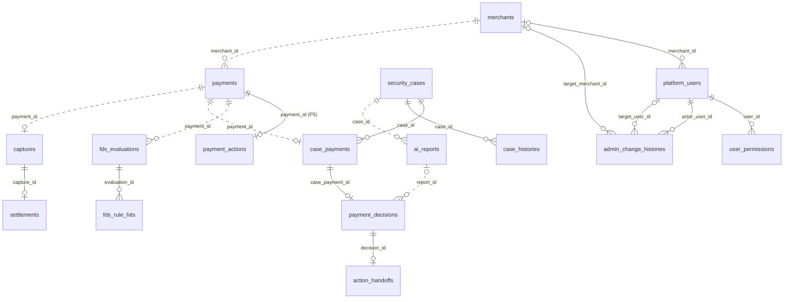

# ERD

> **상태: 1차 MVP 반영** — Notion 팀페이지 / ERD(P1~P6 담당별 페이지) 기준 업무 테이블 14개를 Flyway로 생성했습니다 (Issue #56).

## 목차

1. [범위와 정본](#1-범위와-정본)
2. [테이블 소유](#2-테이블-소유)
3. [ERD 그림](#3-erd-그림)
4. [테이블별 컬럼](#4-테이블별-컬럼)
5. [모듈 간 참조 규칙](#5-모듈-간-참조-규칙)
6. [변경 절차](#6-변경-절차)

## 1. 범위와 정본

- 합의 정본(무엇을 만들지)은 Notion **팀페이지 / ERD**의 담당별 페이지(P1~P6)입니다
- 실제 DB의 기준(지금 무엇이 있는지)은 `backend/src/main/resources/db/migration/`의 SQL입니다. 이 문서는 소유 · 관계만 요약하고 컬럼은 복사하지 않습니다
- DB 원칙과 INSERT/UPDATE 예시는 Notion fds 정본 **04 DB 설계 및 데이터 매핑**에 있습니다 (구현 가이드)
- 2026-10-22 제공된 P1~P6 담당 ERD를 대조했습니다. [담당별 원문 링크와 차이](../README.md)를 함께 봅니다. 특히 P6의 픽업·정산 완료용 테이블·컬럼은 2차 범위이며 현재 SQL에 없습니다

### 공통 규칙

| 대상 | 규칙 | 예 |
| --- | --- | --- |
| 테이블 이름 | 복수 · snake_case | `payments`, `security_cases` |
| PK | `BIGINT AUTO_INCREMENT` 단일 컬럼 | `payment_id` |
| 다른 테이블 ID | `BIGINT` (가리키는 PK와 같은 타입) | `merchant_id` |
| 상태 · 유형 | `VARCHAR` + JPA `EnumType.STRING` (enum을 이름 문자열로 저장) | `status VARCHAR(30)` |
| 시각 | `DATETIME(6)`, UTC로 저장 (`hibernate.jdbc.time_zone: UTC`) | `created_at` |
| 금액 | `BIGINT`, 원(KRW) 정수 | `amount` |
| 비율 | `DECIMAL(9,6)`, 0~1 | `pg_fee_rate` |
| 구조가 자유로운 값 | `JSON` (MariaDB가 형식을 검사) | `report_body` |
| 중복 방지 키 | MariaDB `UUID` | `idempotency_key` |
| 제약 · 인덱스 이름 | `uk_<테이블>_<컬럼>` · `fk_<테이블>_<대상>` · `idx_<테이블>_<용도>` | `uk_ai_reports_case_version` |

### 1차 생성 때 Notion 양식과 다르게 적용한 것

| 대상 | 양식 | migration | 이유 |
| --- | --- | --- | --- |
| P1 테이블 이름 | `merchant` · `platform_user` · `user_permission` | `merchants` · `platform_users` · `user_permissions` | 테이블 이름은 복수 |
| `user_permissions` PK | `(user_id, permission_code)` 복합 PK | `permission_id` 단일 PK + `UNIQUE(user_id, permission_code)` | PK는 `BIGINT` |
| `fds_rule_hits.applied_score` | 기본값 0 검토 | `DEFAULT 0` | 미적중이면 0 |
| `security_cases.evidence_version` | 초기값 1 검토 | `DEFAULT 1` | 양식 제안값 |

위 표는 최초 생성 당시 차이를 기록합니다. 현재 제공된 P1 ERD 본문에는 `permission_id` 단일 PK가 반영되어 있으나 아래 표에는 이전 복합 PK 표시가 남아 있습니다. 실제 구조는 SQL을 따릅니다.

## 2. 테이블 소유

| 모듈 | 담당 | 테이블 | migration (테이블 순서대로, 테이블당 1개) |
| --- | --- | --- | --- |
| `identity` | P1 주환 | `merchants`, `platform_users`, `user_permissions` | [20261022_145055](../../backend/src/main/resources/db/migration/V20261022_145055__create_merchants_table.sql) · [20261022_145057](../../backend/src/main/resources/db/migration/V20261022_145057__create_platform_users_table.sql) · [20261022_145059](../../backend/src/main/resources/db/migration/V20261022_145059__create_user_permissions_table.sql) |
| `identity` (#129) | P1 주환 | `platform_users` 강제 변경·역할 CHECK, `admin_change_histories` | [강제 변경](../../backend/src/main/resources/db/migration/V20261025_121650__add_password_change_required.sql) · [역할 CHECK](../../backend/src/main/resources/db/migration/V20261025_121656__add_user_role_merchant_check.sql) · [관리 이력](../../backend/src/main/resources/db/migration/V20261025_121657__create_admin_change_histories.sql) |
| `payment` | P5 시은 | `payments` | [20261022_145100](../../backend/src/main/resources/db/migration/V20261022_145100__create_payments_table.sql) |
| `payment` (#141) | P5 시은 | `payment_actions` | [조치 저장](../../backend/src/main/resources/db/migration/V20261025_160810__create_payment_actions_table.sql) |
| `fds` | P2 정후 | `fds_evaluations`, `fds_rule_hits` | [20261022_145102](../../backend/src/main/resources/db/migration/V20261022_145102__create_fds_evaluations_table.sql) · [20261022_145104](../../backend/src/main/resources/db/migration/V20261022_145104__create_fds_rule_hits_table.sql) · [20261022_174140](../../backend/src/main/resources/db/migration/V20261022_174140__add_fds_evaluation_request_fields.sql) |
| `investigation` | P3 수민 | `security_cases`, `case_payments`, `payment_decisions`, `action_handoffs`, `case_histories` | [20261022_145106](../../backend/src/main/resources/db/migration/V20261022_145106__create_security_cases_table.sql) · [20261022_145108](../../backend/src/main/resources/db/migration/V20261022_145108__create_case_payments_table.sql) · [20261022_145111](../../backend/src/main/resources/db/migration/V20261022_145111__create_payment_decisions_table.sql) · [20261022_145112](../../backend/src/main/resources/db/migration/V20261022_145112__create_action_handoffs_table.sql) · [20261022_145115](../../backend/src/main/resources/db/migration/V20261022_145115__create_case_histories_table.sql) |
| `investigation/report` | P4 현규 | `ai_reports` | [20261022_145116](../../backend/src/main/resources/db/migration/V20261022_145116__create_ai_reports_table.sql) |
| `settlement` | P6 민정 | `captures`, `settlements` | [20261022_145118](../../backend/src/main/resources/db/migration/V20261022_145118__create_captures_table.sql) · [20261022_145120](../../backend/src/main/resources/db/migration/V20261022_145120__create_settlements_table.sql) |
| (공통) | — | `EVENT_PUBLICATION` (Modulith 이벤트 기록) | [create_event_publication_table](../../backend/src/main/resources/db/migration/V20261021_215412__create_event_publication_table.sql) |

## 3. ERD 그림

실선은 물리 FK(DB가 검사), 점선은 논리 참조(ID 값만 저장, FK 없음)입니다. `|o`는 0 또는 1(NULL 허용), `||`는 정확히 1입니다.

그림에 없는 논리 참조: `security_cases` · `captures` · `settlements`의 `merchant_id`(→ `merchants`), `payment_decisions.staff_id` · `case_histories.actor_id`(→ `platform_users`), `settlements.payment_id`(→ `payments`), `action_handoffs.target_operation_id`(P5 · P6 작업 ID).

## 4. 테이블별 컬럼

컬럼 · 타입 · 제약은 2절 표의 migration 파일을 봅니다. 설명과 업무 제약(예: "재시도 시 `requested_at` 유지")은 Notion 담당 페이지를 봅니다. 로컬 DB에서는 `SHOW CREATE TABLE <테이블>;`로 확인합니다 ([Flyway 05 5절](../flyway/05-guide.md#5-기존-스키마-확인하는-법)).

## 5. 모듈 간 참조 규칙

[AGENTS.md 4절](../../AGENTS.md#4-backend-규칙)의 규칙을 그대로 따릅니다.

| 관계 | 참조 방식 | 예시 |
| --- | --- | --- |
| 같은 소유 담당의 테이블끼리 | 물리 FK(외래 키 제약을 DB에 건다) | `security_cases` ↔ `case_payments` (둘 다 P3) |
| 소유 담당이 다른 테이블 | 논리 참조(ID 값만 저장, FK 없음) | `fds_evaluations.payment_id` (P2 → P5) |
| 같은 `investigation` 모듈 안의 P3 ↔ P4 | 논리 참조 (예외) | `ai_reports` ↔ `security_cases` · `payment_decisions` |

- 논리 참조 대상의 존재 확인은 DB가 아니라 소유 담당 모듈의 공개 `api/`로 합니다
- 참조되는 금융·조사 기록(결제·평가·Case·판정·인계·보고서)은 물리 삭제하지 않습니다. 그래서 FK에 `ON DELETE` 옵션을 두지 않습니다 (참조 중이면 삭제 거부)

## 6. 변경 절차

### #129 P1 변경 계약 (2026-10-25)

사용자는 이번 작업에 한해 Notion 선행 반영 대신 저장소 ERD·ADR에 기록하고 구현하도록 승인했다. Notion 최신 내용은 확인하지 못했으며 동기화는 남아 있다. 소유는 모두 P1이고 다른 담당 테이블은 변경하지 않는다.

- `platform_users.password_change_required`: BOOLEAN NOT NULL DEFAULT FALSE. 신규·초기화 계정 TRUE, 본인 비밀번호 변경 후 FALSE.
- `platform_users` CHECK: OPERATOR는 merchant_id 필수, ADMIN·SECURITY_STAFF는 NULL.
- 신규 `admin_change_histories`: history_id BIGINT AUTO_INCREMENT PK, actor_user_id BIGINT NOT NULL FK platform_users, target_user_id BIGINT NULL FK platform_users, target_merchant_id BIGINT NULL FK merchants, change_type VARCHAR(40), before_data·after_data JSON NULL, created_at DATETIME(6) UTC. 대상 계정·가맹점 중 하나만 지정한다. INSERT 전용이며 비밀번호·해시는 저장하지 않는다.
- 관계: platform_users → admin_change_histories(수행 관리자·대상 계정), merchants → admin_change_histories(대상 가맹점). 모두 P1 물리 FK이며 삭제 연쇄는 없다.
- 상세 계약: [#129 설계](../identity/129-admin-account-design.md), [ADR-0024](../decisions/0024-admin-account-management.md).

### 일반 절차

1. Notion 팀페이지 / ERD의 담당 페이지에서 먼저 합의·수정합니다. 페이지에 없는 테이블·컬럼은 추가하지 않습니다
2. 소유 담당이 새 Flyway 마이그레이션(`ALTER` 등)을 추가합니다. 병합된 파일은 고치지 않습니다 → [Flyway 작업 가이드 1절](../flyway/05-guide.md#1-테이블-추가-순서)
3. 테이블이 늘거나 관계가 바뀌면 같은 PR에서 이 문서의 2·3절을 갱신합니다

### #141 P5 직원 조치 저장 설계 초안

2026-10-25 사용자는 아래 상세 스키마를 저장소 ERD·ADR 기준으로 구현하고 Notion은 후속 반영하도록 승인했다. 4번 단계에서 migration·Entity를 추가했다. Notion 동기화는 아직 하지 않았다. [ADR-0027](../decisions/0027-payment-actions.md), [처리 설계](../payment/141-payment-actions.md)를 함께 본다.

추가 테이블: `payment_actions`, 소유: P5. 직원 판정 조치만 저장하며 ALLOW 자동 매입·최초 승인에는 행을 만들지 않는다.

| 컬럼 | 타입 | NULL | 의미 |
| --- | --- | --- | --- |
| action_id | BIGINT AUTO_INCREMENT | 불가 | PK, VOID 성공 결과의 targetOperationId |
| payment_id | BIGINT | 불가 | P5 payments FK, 결제별 조치 최대 한 건 |
| decision_id | BIGINT | 불가 | P3 판정 ID 논리 참조, FK 없음 |
| action_type | VARCHAR(20) | 불가 | CAPTURE / VOID |
| idempotency_key | UUID | 불가 | 최초 요청 키, 재시도 시 유지 |
| status | VARCHAR(20) | 불가 | PENDING / SUCCEEDED / FAILED |
| capture_id | BIGINT | 허용 | CAPTURE 성공 때 P6 ID 논리 참조, FK 없음 |
| error_code | VARCHAR(100) | 허용 | 확정 업무 실패 코드, 기술 장애는 저장하지 않음 |
| requested_at | DATETIME(6) | 불가 | P5 최초 요청 저장 시각, UTC |
| completed_at | DATETIME(6) | 허용 | CAPTURE 성공은 capturedAt, VOID 성공/업무 실패는 P5 결과 시각, UTC |

구현한 DB 제약 및 서비스 규칙:

- PK(action_id), `uk_payment_actions_payment` UNIQUE(payment_id), `uk_payment_actions_decision` UNIQUE(decision_id), `uk_payment_actions_idempotency_key` UNIQUE(idempotency_key).
- `fk_payment_actions_payment`: payment_id → payments.payment_id. 같은 P5 소유의 물리 FK이며 삭제 연쇄 없음. 업무 행을 물리 삭제하지 않는다.
- capture_id는 양수 또는 NULL, decision_id는 양수. action_type·status는 위 허용값만 CHECK로 제한한다.
- `chk_payment_actions_result`: PENDING은 capture_id·error_code·completed_at 모두 NULL. SUCCEEDED는 completed_at 필수·error_code NULL이며 CAPTURE이면 capture_id 필수, VOID이면 capture_id NULL. FAILED는 completed_at·error_code 필수, capture_id NULL.
- 완료 상태 불변·원 요청 4필드 불변·requested_at 유지 및 결제 상태와의 일치는 서비스/Entity 전이로 보장하고 테스트한다. 단일 행 CHECK만으로 다른 테이블 상태까지 보장한다고 보지 않는다.
- 상태별 운영 목록·자동 복구 스케줄러는 범위 밖이므로 추가 조회 인덱스는 우선 만들지 않는다. 결제·키·판정 조회는 UNIQUE 인덱스를 쓴다.

현재 SQL의 payments·action_handoffs·captures는 변경하지 않는 안이다. P3 결과의 targetOperationId는 actionType=CAPTURE일 때 capture_id, VOID일 때 action_id로 해석한다. VOID 식별자 추가 공유·확인은 남아 있다.
