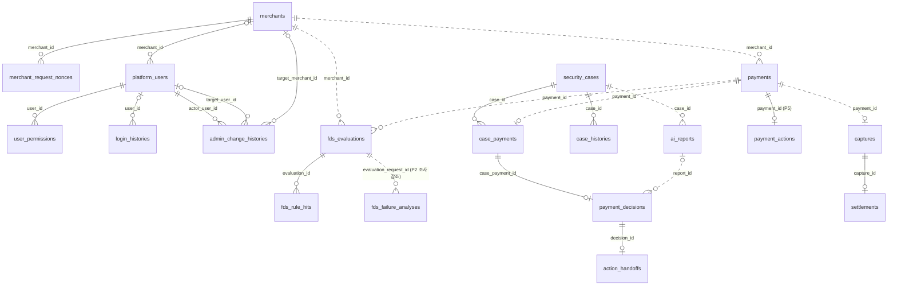

# ERD

> **상태: 1차 MVP 반영** — Notion 팀페이지 / ERD(P1~P6 담당별 페이지) 기준 업무 테이블 14개를 Flyway로 생성했습니다 (Issue #56).

## 목차

1. [범위와 정본](#1-범위와-정본)
2. [테이블 소유](#2-테이블-소유)
3. [ERD 그림](#3-erd-그림)
4. [테이블별 컬럼](#4-테이블별-컬럼)
5. [모듈 간 참조 규칙](#5-모듈-간-참조-규칙)
6. [변경 절차](#6-변경-절차)

## 1. 범위와 정본

- 합의 정본(무엇을 만들지)은 Notion **팀페이지 / ERD**의 담당별 페이지(P1~P6)입니다
- 실제 DB의 기준(지금 무엇이 있는지)은 `backend/src/main/resources/db/migration/`의 SQL입니다. 이 문서는 소유 · 관계만 요약하고 컬럼은 복사하지 않습니다
- DB 원칙과 INSERT/UPDATE 예시는 Notion fds 정본 **04 DB 설계 및 데이터 매핑**에 있습니다 (구현 가이드)
- 2026-10-22 제공된 P1~P6 담당 ERD를 대조했습니다. [담당별 원문 링크와 차이](../README.md)를 함께 봅니다. 특히 P6의 픽업·정산 완료용 테이블·컬럼은 2차 범위이며 현재 SQL에 없습니다

### 공통 규칙

| 대상 | 규칙 | 예 |
| --- | --- | --- |
| 테이블 이름 | 복수 · snake_case | `payments`, `security_cases` |
| PK | `BIGINT AUTO_INCREMENT` 단일 컬럼 | `payment_id` |
| 다른 테이블 ID | `BIGINT` (가리키는 PK와 같은 타입) | `merchant_id` |
| 상태 · 유형 | `VARCHAR` + JPA `EnumType.STRING` (enum을 이름 문자열로 저장) | `status VARCHAR(30)` |
| 시각 | `DATETIME(6)`, UTC로 저장 (`hibernate.jdbc.time_zone: UTC`) | `created_at` |
| 금액 | `BIGINT`, 원(KRW) 정수 | `amount` |
| 비율 | `DECIMAL(9,6)`, 0~1 | `pg_fee_rate` |
| 구조가 자유로운 값 | `JSON` (MariaDB가 형식을 검사) | `report_body` |
| 중복 방지 키 | MariaDB `UUID` | `idempotency_key` |
| 제약 · 인덱스 이름 | `uk_<테이블>_<컬럼>` · `fk_<테이블>_<대상>` · `idx_<테이블>_<용도>` | `uk_ai_reports_case_version` |

### 1차 생성 때 Notion 양식과 다르게 적용한 것

| 대상 | 양식 | migration | 이유 |
| --- | --- | --- | --- |
| P1 테이블 이름 | `merchant` · `platform_user` · `user_permission` | `merchants` · `platform_users` · `user_permissions` | 테이블 이름은 복수 |
| `user_permissions` PK | `(user_id, permission_code)` 복합 PK | `permission_id` 단일 PK + `UNIQUE(user_id, permission_code)` | PK는 `BIGINT` |
| `fds_rule_hits.applied_score` | 기본값 0 검토 | `DEFAULT 0` | 미적중이면 0 |
| `security_cases.evidence_version` | 초기값 1 검토 | `DEFAULT 1` | 양식 제안값 |

위 표는 최초 생성 당시 차이를 기록합니다. 현재 제공된 P1 ERD 본문에는 `permission_id` 단일 PK가 반영되어 있으나 아래 표에는 이전 복합 PK 표시가 남아 있습니다. 실제 구조는 SQL을 따릅니다.

## 2. 테이블 소유

| 모듈 | 담당 | 테이블 | migration (테이블 순서대로, 테이블당 1개) |
| --- | --- | --- | --- |
| `identity` | P1 주환 | `merchants`, `platform_users`, `user_permissions` | [20261022_145055](../../backend/src/main/resources/db/migration/V20261022_145055__create_merchants_table.sql) · [20261022_145057](../../backend/src/main/resources/db/migration/V20261022_145057__create_platform_users_table.sql) · [20261022_145059](../../backend/src/main/resources/db/migration/V20261022_145059__create_user_permissions_table.sql) |
| `identity` (#129) | P1 주환 | `platform_users` 강제 변경·역할 CHECK, `admin_change_histories` | [강제 변경](../../backend/src/main/resources/db/migration/V20261025_121650__add_password_change_required.sql) · [역할 CHECK](../../backend/src/main/resources/db/migration/V20261025_121656__add_user_role_merchant_check.sql) · [관리 이력](../../backend/src/main/resources/db/migration/V20261025_121657__create_admin_change_histories.sql) |
| `identity` (#127) | P1 주환 | `platform_users` 연속 로그인 실패 횟수·잠금 종료 시각 | [로그인 잠금](../../backend/src/main/resources/db/migration/V20261025_165712__add_login_attempt_lock.sql) |
| `identity` (#219) | P1 주환 | `merchant_request_nonces` | [HMAC nonce](../../backend/src/main/resources/db/migration/V20261027_144924__create_merchant_request_nonces.sql) |
| `identity` (#147) | P1 주환 | `login_histories` | [로그인 이력](../../backend/src/main/resources/db/migration/V20261025_201559__create_login_histories.sql) |
| `payment` | P5 시은 | `payments` | [20261022_145100](../../backend/src/main/resources/db/migration/V20261022_145100__create_payments_table.sql) |
| `payment` (#141) | P5 시은 | `payment_actions` | [조치 저장](../../backend/src/main/resources/db/migration/V20261025_160810__create_payment_actions_table.sql) |
| `fds` | P2 정후 | `fds_evaluations`, `fds_rule_hits`, `fds_failure_analyses`, `fds_high_risk_countries`, `fds_blocklist_entries` | [20261022_145102](../../backend/src/main/resources/db/migration/V20261022_145102__create_fds_evaluations_table.sql) · [20261022_145104](../../backend/src/main/resources/db/migration/V20261022_145104__create_fds_rule_hits_table.sql) · [20261022_174140](../../backend/src/main/resources/db/migration/V20261022_174140__add_fds_evaluation_request_fields.sql) · [20261023_135302](../../backend/src/main/resources/db/migration/V20261023_135302__add_fds_requested_amount.sql) · [20261026_174910](../../backend/src/main/resources/db/migration/V20261026_174910__add_fds_evaluation_merchant_id.sql) · [20261027_101722](../../backend/src/main/resources/db/migration/V20261027_101722__create_fds_failure_analyses.sql) · [20261027_101804](../../backend/src/main/resources/db/migration/V20261027_101804__add_fds_reevaluation_lineage.sql) · [FDS v0.2](../../backend/src/main/resources/db/migration/V20261028_092416__add_fds_rule_inputs_and_policy_tables.sql) |
| `investigation` | P3 수민 | `security_cases`, `case_payments`, `payment_decisions`, `action_handoffs`, `case_histories` | [20261022_145106](../../backend/src/main/resources/db/migration/V20261022_145106__create_security_cases_table.sql) · [20261022_145108](../../backend/src/main/resources/db/migration/V20261022_145108__create_case_payments_table.sql) · [20261022_145111](../../backend/src/main/resources/db/migration/V20261022_145111__create_payment_decisions_table.sql) · [20261022_145112](../../backend/src/main/resources/db/migration/V20261022_145112__create_action_handoffs_table.sql) · [20261022_145115](../../backend/src/main/resources/db/migration/V20261022_145115__create_case_histories_table.sql) |
| `investigation/report` | P4 현규 | `ai_reports` | [20261022_145116](../../backend/src/main/resources/db/migration/V20261022_145116__create_ai_reports_table.sql) |
| `settlement` | P6 민정 | `captures`, `settlements` | [20261022_145118](../../backend/src/main/resources/db/migration/V20261022_145118__create_captures_table.sql) · [20261022_145120](../../backend/src/main/resources/db/migration/V20261022_145120__create_settlements_table.sql) |
| (공통) | — | `EVENT_PUBLICATION` (Modulith 이벤트 기록) | [create_event_publication_table](../../backend/src/main/resources/db/migration/V20261021_215412__create_event_publication_table.sql) |

## 3. ERD 그림

실선은 물리 FK(DB가 검사), 점선은 논리 참조(ID 값만 저장, FK 없음)입니다. `|o`는 0 또는 1(NULL 허용), `||`는 정확히 1입니다.

그림에 없는 논리 참조: `security_cases` · `captures` · `settlements`의 `merchant_id`(→ `merchants`), `payment_decisions.staff_id` · `case_histories.actor_id`(→ `platform_users`), `settlements.payment_id`(→ `payments`), `action_handoffs.target_operation_id`(P5 · P6 작업 ID).

## 4. 테이블별 컬럼

컬럼 · 타입 · 제약은 2절 표의 migration 파일을 봅니다. 설명과 업무 제약(예: "재시도 시 `requested_at` 유지")은 Notion 담당 페이지를 봅니다. 로컬 DB에서는 `SHOW CREATE TABLE <테이블>;`로 확인합니다 ([Flyway 05 5절](../flyway/05-guide.md#5-기존-스키마-확인하는-법)).

## 5. 모듈 간 참조 규칙

[AGENTS.md 4절](../../AGENTS.md#4-backend-규칙)의 규칙을 그대로 따릅니다.

| 관계 | 참조 방식 | 예시 |
| --- | --- | --- |
| 같은 소유 담당의 테이블끼리 | 물리 FK(외래 키 제약을 DB에 건다) | `security_cases` ↔ `case_payments` (둘 다 P3) |
| 소유 담당이 다른 테이블 | 논리 참조(ID 값만 저장, FK 없음) | `fds_evaluations.payment_id`, `fds_evaluations.merchant_id` (P2 → P5) |
| 같은 `investigation` 모듈 안의 P3 ↔ P4 | 논리 참조 (예외) | `ai_reports` ↔ `security_cases` · `payment_decisions` |

- 논리 참조 대상의 존재 확인은 DB가 아니라 소유 담당 모듈의 공개 `api/`로 합니다
- 참조되는 금융·조사 기록(결제·평가·Case·판정·인계·보고서)은 물리 삭제하지 않습니다. 그래서 FK에 `ON DELETE` 옵션을 두지 않습니다 (참조 중이면 삭제 거부)

## 6. 변경 절차

### #246 P1 CakeShop 시드 (2026-10-27)

기존 P1 `merchants`·`platform_users`·`user_permissions`에 [새 시드](../../backend/src/main/resources/db/migration/V20261027_221311__seed_cakeshop_merchant_and_owner.sql)로 `CAKESHOP`과 사장님 계정을 등록한다.
테이블·컬럼·타입·관계 변경은 없다. 수수료율 2%는 P6 확인 전 임시값이며, 키는 환경변수 이름만 저장한다. [결정과 실행 절차](../identity/246-cakeshop-provisioning.md)를 따른다.

### #129 P1 변경 계약 (2026-10-25)

사용자는 이번 작업에 한해 Notion 선행 반영 대신 저장소 ERD·ADR에 기록하고 구현하도록 승인했다. Notion 최신 내용은 확인하지 못했으며 동기화는 남아 있다. 소유는 모두 P1이고 다른 담당 테이블은 변경하지 않는다.

- `platform_users.password_change_required`: BOOLEAN NOT NULL DEFAULT FALSE. 신규·초기화 계정 TRUE, 본인 비밀번호 변경 후 FALSE.
- `platform_users` CHECK: OPERATOR는 merchant_id 필수, ADMIN·SECURITY_STAFF는 NULL.
- 신규 `admin_change_histories`: history_id BIGINT AUTO_INCREMENT PK, actor_user_id BIGINT NOT NULL FK platform_users, target_user_id BIGINT NULL FK platform_users, target_merchant_id BIGINT NULL FK merchants, change_type VARCHAR(40), before_data·after_data JSON NULL, created_at DATETIME(6) UTC. 대상 계정·가맹점 중 하나만 지정한다. INSERT 전용이며 비밀번호·해시는 저장하지 않는다.
- 관계: platform_users → admin_change_histories(수행 관리자·대상 계정), merchants → admin_change_histories(대상 가맹점). 모두 P1 물리 FK이며 삭제 연쇄는 없다.
- 상세 계약: [#129 설계](../identity/129-admin-account-design.md), [ADR-0024](../decisions/0024-admin-account-management.md).

### #127 P1 로그인 잠금 스키마 계약 (2026-10-25)

사용자가 고정 15분 잠금 정책과 아래 컬럼 이름을 승인했으며, 이번 작업은 저장소 ERD·ADR을 기준으로 구현하고 Notion은 후속 반영하도록 승인했다. Notion 연결 도구가 없고 Chrome 사용이 자동 승인 검토에서 거부되어 최신 Notion P1 ERD 확인·동기화는 미수행이다.

- 소유: P1 `platform_users`만 변경. 다른 담당 테이블·공개 Java 계약·FK·인덱스 변경 없음.
- `login_failure_count`: INT NOT NULL DEFAULT 0. 앱 저장 범위 0~5, 성공 시 0.
- `login_locked_until`: UTC DATETIME(6) NULL DEFAULT NULL. 다섯 번째 실패 시 현재 시각 +15분, 성공 시 NULL.
- 잠금 중 재시도로 값을 바꾸지 않는다. 만료 후 오답은 1회부터 다시 센다. `status`와 분리하며 비밀번호 변경·초기화·재활성화는 잠금을 해제하지 않는다.
- 기존 계정은 0·NULL로 보존하며 [새 migration](../../backend/src/main/resources/db/migration/V20261025_165712__add_login_attempt_lock.sql) 하나로 추가한다. 세부 정책·대안·검증 계획은 [#127 설계](../identity/127-login-attempt-design.md)와 [ADR-0029](../decisions/0029-login-attempt-lock.md)를 따른다.

### #147 P1 로그인 이력 계약 (2026-10-25)

사용자는 #147 상세 설계 초안을 승인하고 이번 작업은 저장소 ERD·ADR부터 반영해 구현한 뒤
Notion P1 ERD를 후속 반영하도록 승인했다. Notion 최신 내용 확인·반영은 미수행이다.
정확한 컬럼·NULL·제약·인덱스는 [승인한 스키마](../identity/147-login-history-design.md#2-p1-스키마-계약)를 따른다.
P1 `login_histories`만 추가하고 같은 P1 `platform_users.user_id`를 물리 FK로 참조한다.
기존 계정·관리자 변경 이력·다른 담당 테이블은 바꾸지 않는다.
이력은 90일 후 물리 삭제하며 금융·조사 기록의 삭제 금지와는 별개다.
상세 정책·대안·영향은 [ADR-0033](../decisions/0033-login-history.md)에 기록한다.

### 일반 절차

1. Notion 팀페이지 / ERD의 담당 페이지에서 먼저 합의·수정합니다. 페이지에 없는 테이블·컬럼은 추가하지 않습니다
2. 소유 담당이 새 Flyway 마이그레이션(`ALTER` 등)을 추가합니다. 병합된 파일은 고치지 않습니다 → [Flyway 작업 가이드 1절](../flyway/05-guide.md#1-테이블-추가-순서)
3. 테이블이 늘거나 관계가 바뀌면 같은 PR에서 이 문서의 2·3절을 갱신합니다

### #141 P5 직원 조치 저장 설계 초안

2026-10-25 사용자는 아래 상세 스키마를 저장소 ERD·ADR 기준으로 구현하고 Notion은 후속 반영하도록 승인했다. 4번 단계에서 migration·Entity를 추가했다. Notion 동기화는 아직 하지 않았다. [ADR-0027](../decisions/0027-payment-actions.md), [처리 설계](../payment/141-payment-actions.md)를 함께 본다.

추가 테이블: `payment_actions`, 소유: P5. 직원 판정 조치만 저장하며 ALLOW 자동 매입·최초 승인에는 행을 만들지 않는다.

| 컬럼 | 타입 | NULL | 의미 |
| --- | --- | --- | --- |
| action_id | BIGINT AUTO_INCREMENT | 불가 | PK, VOID 성공 결과의 targetOperationId |
| payment_id | BIGINT | 불가 | P5 payments FK, 결제별 조치 최대 한 건 |
| decision_id | BIGINT | 불가 | P3 판정 ID 논리 참조, FK 없음 |
| action_type | VARCHAR(20) | 불가 | CAPTURE / VOID |
| idempotency_key | UUID | 불가 | 최초 요청 키, 재시도 시 유지 |
| status | VARCHAR(20) | 불가 | PENDING / SUCCEEDED / FAILED |
| capture_id | BIGINT | 허용 | CAPTURE 성공 때 P6 ID 논리 참조, FK 없음 |
| error_code | VARCHAR(100) | 허용 | 확정 업무 실패 코드, 기술 장애는 저장하지 않음 |
| requested_at | DATETIME(6) | 불가 | P5 최초 요청 저장 시각, UTC |
| completed_at | DATETIME(6) | 허용 | CAPTURE 성공은 capturedAt, VOID 성공/업무 실패는 P5 결과 시각, UTC |

구현한 DB 제약 및 서비스 규칙:

- PK(action_id), `uk_payment_actions_payment` UNIQUE(payment_id), `uk_payment_actions_decision` UNIQUE(decision_id), `uk_payment_actions_idempotency_key` UNIQUE(idempotency_key).
- `fk_payment_actions_payment`: payment_id → payments.payment_id. 같은 P5 소유의 물리 FK이며 삭제 연쇄 없음. 업무 행을 물리 삭제하지 않는다.
- capture_id는 양수 또는 NULL, decision_id는 양수. action_type·status는 위 허용값만 CHECK로 제한한다.
- `chk_payment_actions_result`: PENDING은 capture_id·error_code·completed_at 모두 NULL. SUCCEEDED는 completed_at 필수·error_code NULL이며 CAPTURE이면 capture_id 필수, VOID이면 capture_id NULL. FAILED는 completed_at·error_code 필수, capture_id NULL.
- 완료 상태 불변·원 요청 4필드 불변·requested_at 유지 및 결제 상태와의 일치는 서비스/Entity 전이로 보장하고 테스트한다. 단일 행 CHECK만으로 다른 테이블 상태까지 보장한다고 보지 않는다.
- 상태별 운영 목록·자동 복구 스케줄러는 범위 밖이므로 추가 조회 인덱스는 우선 만들지 않는다. 결제·키·판정 조회는 UNIQUE 인덱스를 쓴다.

현재 SQL의 payments·action_handoffs·captures는 변경하지 않는 안이다. P3 결과의 targetOperationId는 actionType=CAPTURE일 때 capture_id, VOID일 때 action_id로 해석한다. VOID 식별자 추가 공유·확인은 남아 있다.

### #149 P5 CakeShop 결제 저장 제안

**저장 구조 방향 사용자 승인·저장 기반 구현.** 기준 dev 84698bb, 2026-10-25. 사용자는 payment_orders·payment_requests 신규와 payments.status_changed_at·decline_code 추가 방향에 동의했다. 작업 브랜치에 migration·Entity·Repository를 추가했다. 운영 DB 적용·Notion 동기화·HTTP 연동은 미수행이다. [처리 설계](../payment/149-cakeshop-payment-api.md), [ADR-0030](../decisions/0030-cakeshop-payment-attempts.md)을 함께 확인한다.

추가 migration: `V20261025_210954` (결제 메타데이터·주문 조회 인덱스), `V20261025_210955` (주문), `V20261025_210956` (시도). 같은 PR에 포함하며 기존 migration은 변경하지 않는다. 아래 입력 일치·동시 요청 제어 중 Entity/DB 제약 외 서비스 정책은 후속 구현이다.

모두 P5 소유로 제안한다. 새 결제 시도마다 기존 payments 한 행을 만들고 P2/P3/P6는 그 paymentId를 계속 사용한다. PK는 BIGINT AUTO_INCREMENT, 시각은 UTC DATETIME(6), 금액 BIGINT, 상태 VARCHAR다. 참조되는 행은 물리 삭제하지 않는다.

#### payment_orders — 주문 단위 접수·직렬화 기준

| 컬럼 | 타입·NULL | 의미 |
| --- | --- | --- |
| payment_order_id | BIGINT AUTO_INCREMENT PK | P5 내부 주문 접수 ID |
| merchant_id | BIGINT NOT NULL | 인증된 P1 가맹점 논리 참조 |
| order_ref | VARCHAR(100) NOT NULL | CakeShop 주문번호, 대소문자 구분 collation 제안 |
| customer_ref | VARCHAR(100) NOT NULL | 합의 후 사용할 내부 고객 참조 |
| amount | BIGINT NOT NULL | 주문의 확정 결제 금액, 양수 |
| order_created_at | DATETIME(6) NOT NULL | CakeShop 최초 주문 생성 시각 |
| payment_deadline_at | DATETIME(6) NOT NULL | 최초 주문 생성 +10분, 새 시도 접수 제한 |
| last_attempt_no | BIGINT NOT NULL DEFAULT 0 | 마지막으로 발급한 시도 순번 |
| created_at | DATETIME(6) NOT NULL | P5 주문 접수 기준행 생성 시각 |

UNIQUE(merchant_id, order_ref), 요청행 복합 FK를 위한 UNIQUE(payment_order_id, merchant_id). CHECK: merchant_id/amount >0, last_attempt_no >=0, payment_deadline_at > order_created_at. 정확한 +10분과 주문 불변 입력은 서비스에서 검사한다. 다른 담당 merchants로 FK를 걸지 않는다. PK 행 잠금으로 같은 주문의 요청들을 직렬화한다. 최신 결제 포인터/상태를 복제하지 않고 요청행의 최대 attempt_no로 찾는다.

#### payment_requests — 결제 시도별 식별·재개 정보

| 컬럼 | 타입·NULL | 의미 |
| --- | --- | --- |
| request_id | BIGINT AUTO_INCREMENT PK | 요청 기록 ID |
| payment_order_id | BIGINT NOT NULL | P5 payment_orders 참조 |
| merchant_id | BIGINT NOT NULL | 가맹점별 키 UNIQUE를 위한 값, 주문과 일치 |
| payment_id | BIGINT NOT NULL | P5 payments FK, 시도당 하나 |
| attempt_no | BIGINT NOT NULL | 주문별 1부터 증가하는 순번 |
| idempotency_key | UUID NOT NULL | CakeShop이 시도별로 보존하는 키 |
| evaluation_request_id | UUID NOT NULL | P5가 최초 생성·고정하는 P2 요청 키 |
| processing_stage | VARCHAR(30) NOT NULL | RECEIVED / EVALUATED / AUTHORIZED / NEEDS_REVIEW |
| evaluation_id | BIGINT NULL | P2 응답 논리 참조, FK 없음 |
| evaluation_result | VARCHAR(20) NULL | P2 응답 ALLOW/REVIEW/DENY/ERROR |
| evaluation_risk_score | INT NULL | P2 응답 점수, ERROR이면 NULL |
| evaluation_error_code | VARCHAR(100) NULL | P2 ERROR 코드, 외부 거절 코드와 별개 |
| evaluated_at | DATETIME(6) NULL | P2 응답 시각 |
| created_at | DATETIME(6) NOT NULL | 시도 저장 시각, payments.created_at과 동일 |

- UNIQUE(merchant_id, idempotency_key), UNIQUE(payment_order_id, attempt_no), UNIQUE(payment_id), UNIQUE(evaluation_request_id).
- 복합 FK(payment_order_id, merchant_id) → payment_orders(payment_order_id, merchant_id); FK(payment_id) → payments(payment_id). 같은 P5 소유, 삭제 연쇄 없음.
- CHECK: attempt_no >0, processing_stage 허용값. RECEIVED는 평가 필드 전부 NULL. EVALUATED/AUTHORIZED는 양수 evaluation_id·evaluated_at·ALLOW/REVIEW/DENY·0 이상 점수 필수, 오류 NULL. NEEDS_REVIEW는 양수 evaluation_id·evaluated_at·ERROR·비어 있지 않은 오류 필수, 점수 NULL.
- AUTHORIZED는 초기 승인 판단이 끝났다는 내부 단계다. 결제 최종 성공이 아니며 DENIED/DECLINED도 포함한다. 실제 상태는 payments에서 읽는다.
- payment와 주문의 가맹점·주문번호·금액·고객 일치는 같은 트랜잭션의 저장 서비스와 테스트로 보장한다. 행 CHECK로 타 테이블 일치까지 보장한다고 주장하지 않는다.
- 요청 재전송 내용은 주문 불변 필드와 키로 대조한다. 요청 raw JSON·API Key·카드 정보는 저장하지 않는다. 평가 응답 사본은 재개에 필요한 최소 6필드이며 룰·보고서 사본은 두지 않는다.

#### payments 추가 제안

| 컬럼 | 타입·NULL | 의미 |
| --- | --- | --- |
| status_changed_at | DATETIME(6) NULL | 현재 상태로 전이한 P5 시각. 과거 행은 알 수 없으면 NULL |
| decline_code | VARCHAR(100) NULL | 외부용 최종 DENIED/DECLINED 사유 |

신규 결제는 생성 시 status_changed_at=created_at. 기존 상태 메서드와 ALLOW/직원 CAPTURE·VOID 완료까지 모두 반영한다. 동일 상태 재전달은 기존 시각 보존. decline_code는 FDS_REJECTED/AUTHORIZATION_DECLINED 제안이며 그 외 상태 NULL. 기존 행은 사유를 추정 백필하지 않으므로 거절 상태에서도 NULL 허용한다. 해당 상태/코드 조합 CHECK를 추가하는 안이다.

기존 조회·거절·완료 API의 원래 시각을 대체하지 않는다. 주문·키 신규 구조는 과거 데이터 자동 편입 없이 도입하고 동일 가맹점/주문번호 과거 결제가 있으면 새 HTTP 접수를 막는다. 기존 조회를 위한 payments(merchant_id, order_ref) 비고유 인덱스도 제안한다. 기존 orders 중복 데이터를 삭제하거나 UNIQUE로 강제하지 않는다.

현재 SQL은 변경하지 않았다. 물리 스키마 적용 전 타입·collation·제약·순번 상한·기존 데이터 호환 및 후속 migration 배포 순서를 구현 단계에서 검증한다.

### #219 P1 HMAC nonce 계약 (2026-10-27)

사용자는 P6를 제외한 HMAC 구현과 아래 신규 P1 테이블을 승인했다. 저장소 ERD·ADR에 먼저 반영하고 Notion은 후속 반영한다.

| 컬럼 | 타입·조건 | 의미 |
| --- | --- | --- |
| request_nonce_id | BIGINT AUTO_INCREMENT PK | 내부 기록 ID |
| merchant_id | BIGINT NOT NULL FK merchants | 인증한 P1 가맹점 |
| nonce | UUID NOT NULL | HTTP 전송별 UUID v4 |
| expires_at | DATETIME(6) NOT NULL | 서명 시각+301초, UTC |

`UNIQUE(merchant_id, nonce)`로 동시 재전송을 한 번만 소비한다. `INDEX(expires_at, request_nonce_id)`로 만료 행만 배치 삭제한다.
가맹점 FK는 같은 P1 소유이고 삭제 연쇄는 없다. 원문 키·서명·요청 본문을 저장하지 않는다.
서명 확인 후 업무 실행 전에 독립 커밋하므로 업무 롤백·서버 재시작으로 nonce가 복구되지 않는다. 만료 행은 금융·조사 이력이 아닌 단기 보안 기록으로 물리 삭제한다.
기존 `merchants.secret_reference`는 Entity 매핑만 추가한다. 기존 migration·다른 담당 테이블은 변경하지 않는다.
세부 계약과 검증은 [#219 설계](../identity/219-merchant-hmac.md)와 [ADR-0037](../decisions/0037-merchant-hmac-authentication.md)을 따른다.

### #190 P5 FDS 복구 저장 설계 — 미구현

2026-10-28, `dev ceb4544` 기준으로 사용자가 단일 복구 테이블 설계안을 선택하고 문서화를 요청했다. 상세 필드·상태·제약은 [#190 저장·API 계약](../payment/190-fds-recovery-contract.md)에 기록한다.

- P5 소유 신규 `payment_fds_recoveries` 제안: 결제당 원본 ERROR·오류 보고·P2 분석·직원 재탐지 작업 1행.
- 기존 `payments`는 결제 정본, `payment_requests`는 현재 적용 평가·처리 단계다. 기존 ERROR는 복구 행에 보존하고 제한된 새 결과 적용 전이를 추가할 계획이다.
- 같은 P5 payments 참조에만 물리 FK를 사용하고, P2 평가·분석 ID와 P1 직원 ID는 논리 참조한다. 원본/작업 키 불변·물리 삭제 금지·중복 방지는 상세 계약을 따른다.
- **현재 DB에 존재하는 테이블이 아니다.** migration·Entity·DB 변경은 없으며, Notion 담당 ERD 반영·소유 담당 확인과 상세 제약 검토 후 별도 구현한다. 이번 사용자 설계 승인을 이미 운영 적용·다른 담당 상세 검토까지 마친 것으로 해석하지 않는다.
