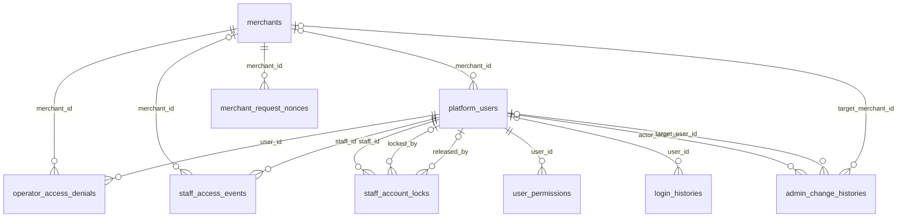
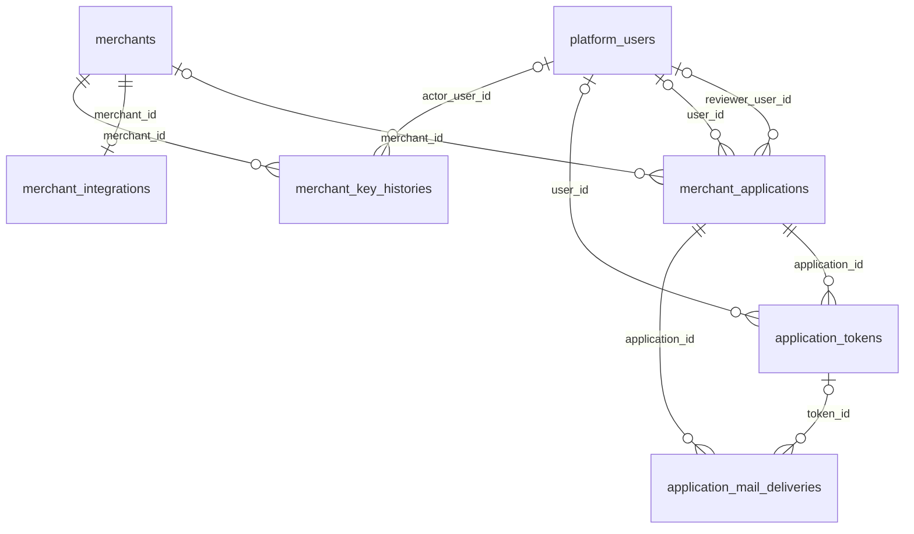
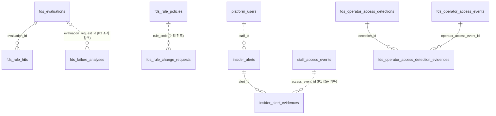
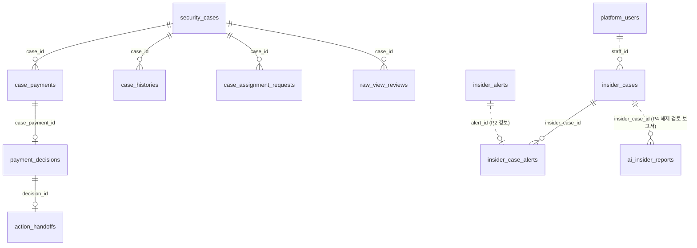
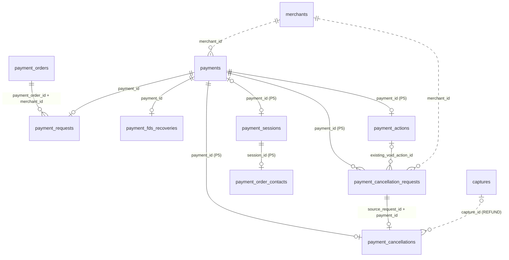
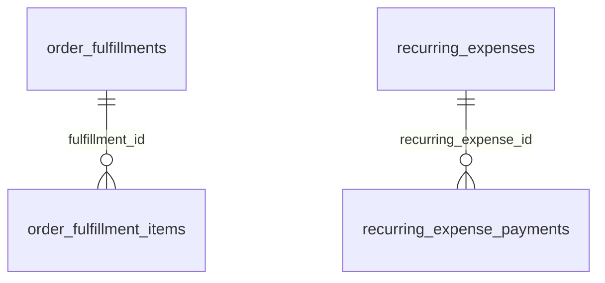
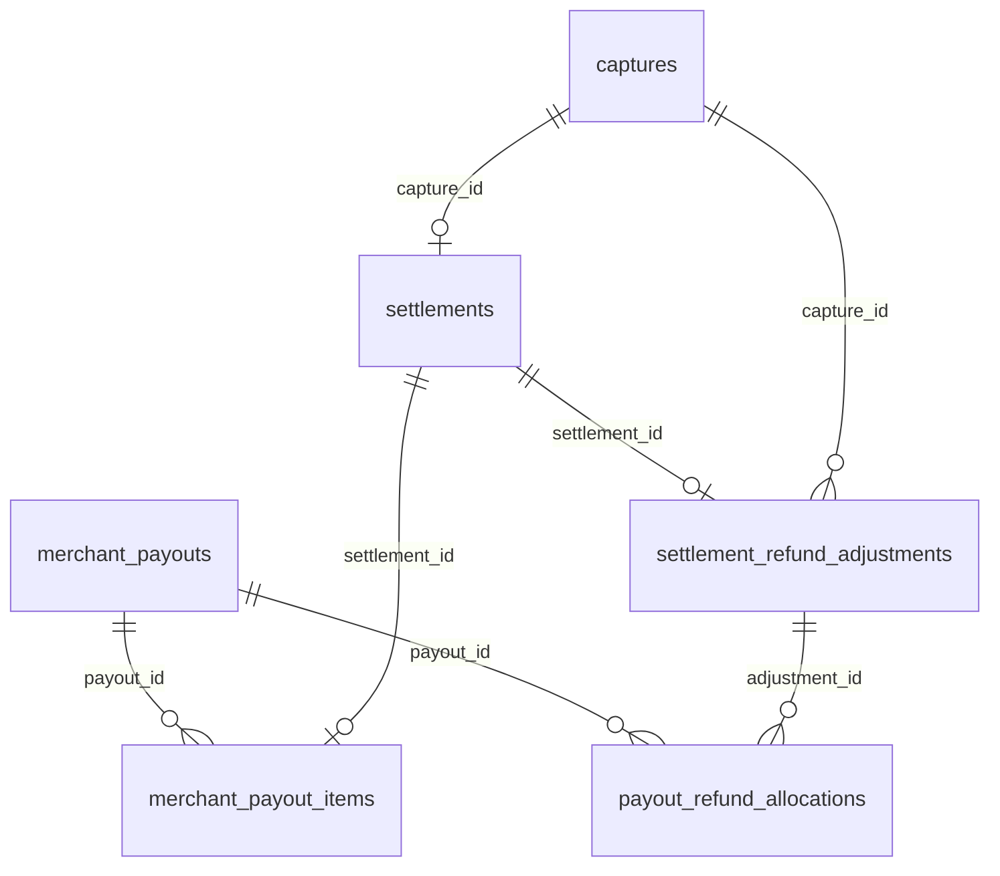
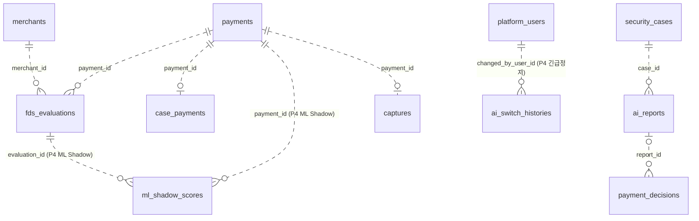

# ERD 관계 그림

[← ERD 안내](README.md) · [저장 계약](contracts.md) · [승인·변경 기록](history.md)

기준: `f7db9cd307067dcaa6a71673f0ad02b3115a8754`의 migration 85개. CREATE와 이후 ALTER를 합쳐 물리 FK 54개를 아래 그림과 대조했습니다. 각 FK는 한 선으로 표시합니다. 독립 테이블까지 모두 그리지는 않으며 전체 소유 목록은 [README 2절](README.md#2-테이블-소유)을 봅니다.

논리 참조는 기존 그림의 점선과 아래 표로 정리했습니다. 전체 시스템의 논리 참조·서비스 경로를 모두 검증한 목록은 아닙니다. 실제 DB 적용·애플리케이션 실행 결과는 포함하지 않습니다.
실제 물리 FK는 CREATE와 이후 ALTER를 확인하고, 담당 간 참조 원칙은 [README 5절](README.md#5-모듈-간-참조-규칙)을 따릅니다.

## 그림과 범례

실선=물리 FK, 점선=논리 참조는 **이 문서의 표기 약속**입니다. Mermaid 자체의 선 모양은 [식별·비식별 관계 구분](https://mermaid.js.org/syntax/entityRelationshipDiagram.html#identification)이므로 일반 문법의 의미와 구분합니다. 표기 변경은 DB 제약 변경이 아닙니다.

- 왼쪽은 참조 대상, 오른쪽은 ID를 저장한 테이블입니다. 선의 설명은 오른쪽 테이블의 참조 컬럼입니다.
- `||`는 정확히 1, `|o`/`o|`는 0 또는 1, `o{`는 0 이상입니다. 물리 FK의 최대 수는 해당 FK 컬럼의 UNIQUE/PK를 기준으로 합니다. 서비스가 더 좁게 제한하는 경우와 구분합니다.
- NULL 허용 FK이면 왼쪽 대상이 없을 수 있습니다. 논리 참조는 ID가 NOT NULL이어도 대상 행이 없을 수 있으므로 NULL 여부만으로 선택성을 판단하지 않습니다. 점선은 업무상 참조 방향을 설명하며 DB의 존재 보장을 뜻하지 않습니다.

## P1 계정·접근 기록

물리 FK 14개입니다. `locked_by`와 `released_by`는 각각 별도 FK입니다.

`admin_change_histories.actor_user_id`는 [후속 ALTER](../../backend/src/main/resources/db/migration/V20261104_134638__add_admin_change_history_actor_type.sql)에서 NULL 허용으로 바뀌었습니다. STAFF는 ID 필수, SYSTEM은 ID 없음입니다. 나머지 CREATE는 [소유 표](README.md#2-테이블-소유)에 연결되어 있습니다.

## P1 신청·키 관리

기존 그림에서 빠졌던 물리 FK 10개입니다.

근거: [신청](../../backend/src/main/resources/db/migration/V20261029_140200__create_merchant_applications.sql) · [토큰](../../backend/src/main/resources/db/migration/V20261029_140208__create_application_tokens.sql) · [메일](../../backend/src/main/resources/db/migration/V20261029_140209__create_application_mail_deliveries.sql) · [연동](../../backend/src/main/resources/db/migration/V20261031_151333__create_merchant_integrations.sql) · [키 이력](../../backend/src/main/resources/db/migration/V20261031_151342__create_merchant_key_histories.sql). 신청의 로그인 ID·주소·상태 후속 ALTER는 [소유 표](README.md#2-테이블-소유)를 봅니다. 위 FK의 NULL·UNIQUE는 바꾸지 않습니다.

## P2 평가·탐지

물리 FK 4개와 주요 논리 참조입니다.

- [오류 분석 SQL](../../backend/src/main/resources/db/migration/V20261027_101722__create_fds_failure_analyses.sql)의 요청 UUID는 NOT NULL이지만 FK가 없습니다. [서비스](../../backend/src/main/java/com/donworry/fds/service/FdsFailureAnalysisService.java)는 평가 미발견에도 분석을 저장하고 `EVALUATION_NOT_FOUND`를 발행하므로 실제 평가가 0 또는 1개입니다.
- [룰 관리 SQL](../../backend/src/main/resources/db/migration/V20261028_155511__create_fds_rule_management_tables.sql)에 `rule_code` FK는 없습니다. [정상 요청 경로](../../backend/src/main/java/com/donworry/fds/service/FdsRuleManagementService.java)가 정책을 조회한 뒤 요청을 저장합니다.
- [접근 탐지 SQL](../../backend/src/main/resources/db/migration/V20261104_152441__create_operator_access_detection_tables.sql)은 증거 FK 2개를 만들고 룰 코드 길이를 변경합니다. 룰 정책과 요청 사이에 FK를 추가하지는 않습니다.

## P3 사건·판정과 P4 보고서

물리 FK 7개와 주요 논리 참조입니다. P3 ↔ P4는 같은 `investigation` 안에서도 논리 참조입니다.

각 CREATE는 [소유 표](README.md#2-테이블-소유)에 연결되어 있습니다. 담당 변경 요청의 `pending_case_id` UNIQUE는 사건당 **대기 요청** 한 건을 제한하며, 전체 요청 이력이 한 건이라는 뜻은 아닙니다.

## P5 결제·취소

물리 FK 10개와 주요 논리 참조입니다.

- [결제 세션 SQL](../../backend/src/main/resources/db/migration/V20261102_142818__create_payment_sessions.sql)의 `payment_id`는 NULL 허용·UNIQUE입니다. OPEN에는 결제가 없고 SUBMITTED에는 결제가 있어야 한다는 CHECK가 있습니다. [알림 ID ALTER](../../backend/src/main/resources/db/migration/V20261103_093050__add_payment_session_notify_event_id.sql)는 이 관계를 바꾸지 않습니다.
- [결제 요청](../../backend/src/main/resources/db/migration/V20261025_210956__create_payment_requests_table.sql)의 주문 FK와 [취소 결과](../../backend/src/main/resources/db/migration/V20261031_183416__create_payment_cancellations.sql)의 요청 FK는 복합 키입니다. 컬럼별 별도 FK가 아닙니다.
- [FDS 복구](../../backend/src/main/resources/db/migration/V20261028_155021__create_payment_fds_recoveries_table.sql)는 `payment_id` UNIQUE로 결제당 최대 한 행입니다.

## P6 픽업·지출·정산

### 픽업 상품과 정기 지출 — FK 2개

근거: [픽업 상품](../../backend/src/main/resources/db/migration/V20261029_143636__create_order_fulfillment_items.sql) · [정기 지출](../../backend/src/main/resources/db/migration/V20261030_181043__create_recurring_expenses_with_payments.sql). [픽업 UNIQUE 변경](../../backend/src/main/resources/db/migration/V20261029_155634__scope_order_fulfillments_by_merchant.sql)은 `order_id`를 가맹점과 묶어 유일하게 만들며 상품 FK는 유지합니다.

### 매입·정산·지급·환불 — FK 7개

근거: [정산](../../backend/src/main/resources/db/migration/V20261022_145120__create_settlements_table.sql) · [지급 원장](../../backend/src/main/resources/db/migration/V20261103_144056__create_merchant_daily_payouts.sql) · [환불 조정](../../backend/src/main/resources/db/migration/V20261103_154941__create_settlement_refund_adjustments.sql) · [회수 배분](../../backend/src/main/resources/db/migration/V20261103_174335__create_payout_refund_allocations.sql). 환불 조정의 `settlement_id`에는 UNIQUE가 있지만 `capture_id` 자체에는 UNIQUE가 없어 최대 수를 구분했습니다.

## 모듈 간 주요 논리 참조

아래는 모두 FK 없는 참조입니다. 가맹점·수행자·조건부 작업 ID는 다음 표를 함께 봅니다.

## 그림에 없는 논리 참조

기존의 긴 문단을 출발 컬럼·대상·조건별로 나눴습니다. FK 없는 참조의 대상 존재 여부는 별도 업무 경로에서 확인해야 합니다.

| 출발 테이블·컬럼 | 참조 대상 | 조건·근거 |
| --- | --- | --- |
| `security_cases.merchant_id`; `captures.merchant_id`; `settlements.merchant_id` | `merchants` | P3·P6의 P1 가맹점 참조. [소유·SQL](README.md#2-테이블-소유) |
| `payment_decisions.staff_id`; `security_cases.assignee_staff_id` | `platform_users` | 판정 직원·담당 직원. 담당은 미배정이면 NULL. [저장 계약](contracts.md#608-p3-fds-사건-자동-배정과-담당-변경-2026-11-06) |
| `case_histories.actor_id` | `platform_users` | [CaseHistory](../../backend/src/main/java/com/donworry/investigation/entity/CaseHistory.java)의 STAFF 생성은 직원 ID 필수, SYSTEM 생성은 NULL |
| `case_assignment_requests.requested_by_staff_id`, `reviewed_by_admin_id`, `new_assignee_staff_id` | `platform_users` | 요청 직원·처리 관리자·새 담당. 뒤 두 컬럼은 NULL 허용. [저장 계약](contracts.md#608-p3-fds-사건-자동-배정과-담당-변경-2026-11-06) |
| `raw_view_reviews.staff_id`, `reviewed_by_admin_id`, `payment_id` | 직원·관리자는 `platform_users`, 결제는 `payments` | 검토 관리자 ID는 NULL 허용. [저장 계약](contracts.md#608-p3-fds-사건-자동-배정과-담당-변경-2026-11-06) |
| `insider_alerts.closed_by_admin_id`; `insider_detection_states.staff_id` | `platform_users` | 종결 관리자·탐지 직원. 종결 관리자 ID는 NULL 허용. [경보 SQL](../../backend/src/main/resources/db/migration/V20261107_082223__create_insider_alerts.sql) |
| `staff_account_locks.source_alert_id`, `release_case_id` | `insider_alerts`, `insider_cases` | 근거 경보·해제 사건은 NULL 허용. [저장 계약](contracts.md#647-p1-보안-직원-계정-보안-정지-2026-11-07) |
| `insider_cases.decided_by_admin_id`, `lock_released_by_admin_id` | `platform_users` | 판정·해제 관리자. 처리 상태별 조건은 [저장 계약](contracts.md#670-p3-내부자-사건--관리자-판정--징계-사건-정지-해제-2026-11-08) |
| `settlements.payment_id` | `payments` | payment_id UNIQUE. [정산 SQL](../../backend/src/main/resources/db/migration/V20261022_145120__create_settlements_table.sql) |
| `action_handoffs.target_operation_id` | CAPTURE 성공: `captures.capture_id`; VOID 성공: `payment_actions.action_id` | 결과 종류별로 대상이 다름. [PaymentActionMapping](../../backend/src/main/java/com/donworry/payment/service/PaymentActionMapping.java)의 성공 결과 변환 기준 |
| `staff_access_events.case_id`, `payment_id`, `login_reference` | `security_cases`, `payments`, `login_histories.login_reference` | 모두 NULL 허용. 로그인 참조는 행 PK가 아니라 같은 로그인 흐름을 묶는 UUID. [저장 계약](contracts.md#604-p1-보안-직원-접근-기록-2026-11-06) |
| `ai_insider_reports.trigger_alert_id` | `insider_alerts` | 보고서 생성 계기의 경보. [저장 계약](contracts.md#675-p4-내부자-사건-해제-검토-보고서-2026-11-08) |
| `payment_actions.decision_id`, `capture_id` | `payment_decisions`, `captures` | 판정 ID는 UNIQUE, capture ID는 CAPTURE 성공 때 저장. [조치 계약](contracts.md#141-p5-직원-조치-저장-설계-초안) |
| `payment_order_contacts.merchant_id` | `merchants` | P5 연락처 암호화 AAD의 가맹점. [연락처 계약](contracts.md#602-p5-주문자-연락처-2026-11-06) |

새 참조를 구현할 때 이 목록의 누락 여부로 허용·금지를 판단하지 않습니다. SQL·공개 API·채택된 계약을 함께 확인하며, 업무 정책과 소유가 불명확하면 담당자에게 확인합니다.
