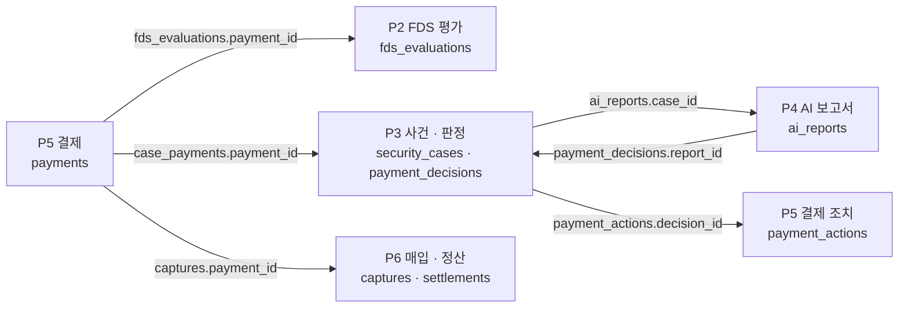
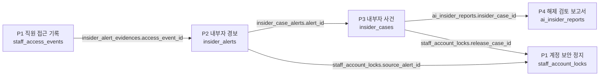
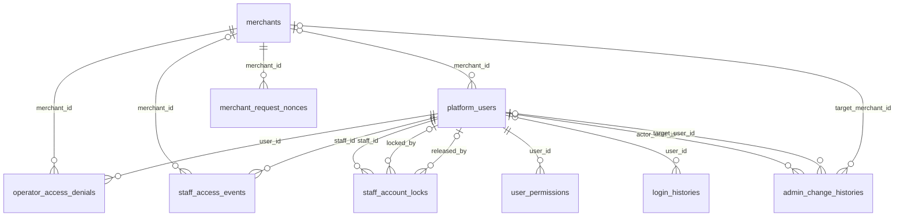
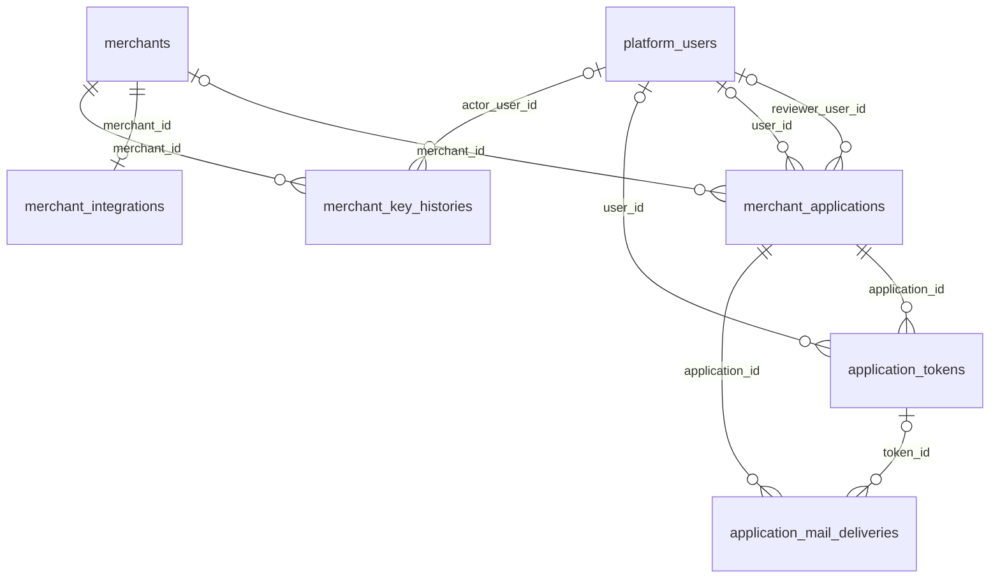
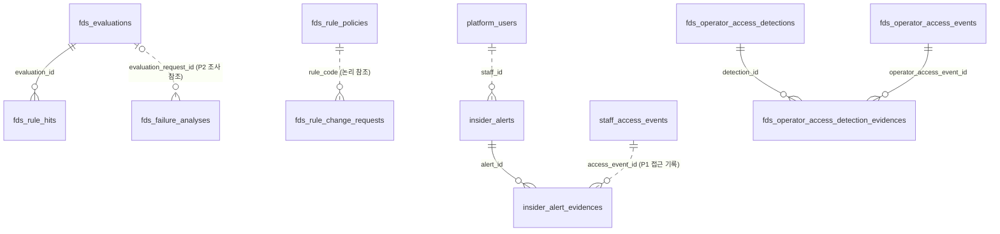
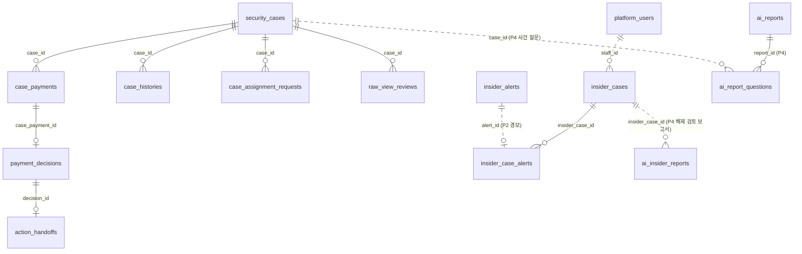
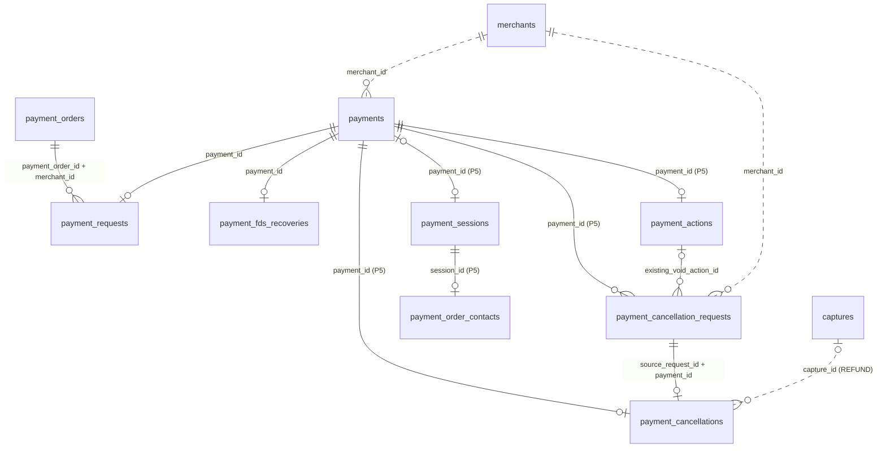
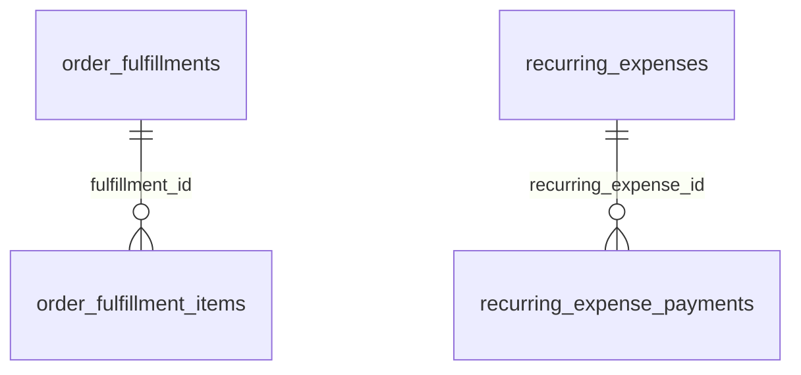
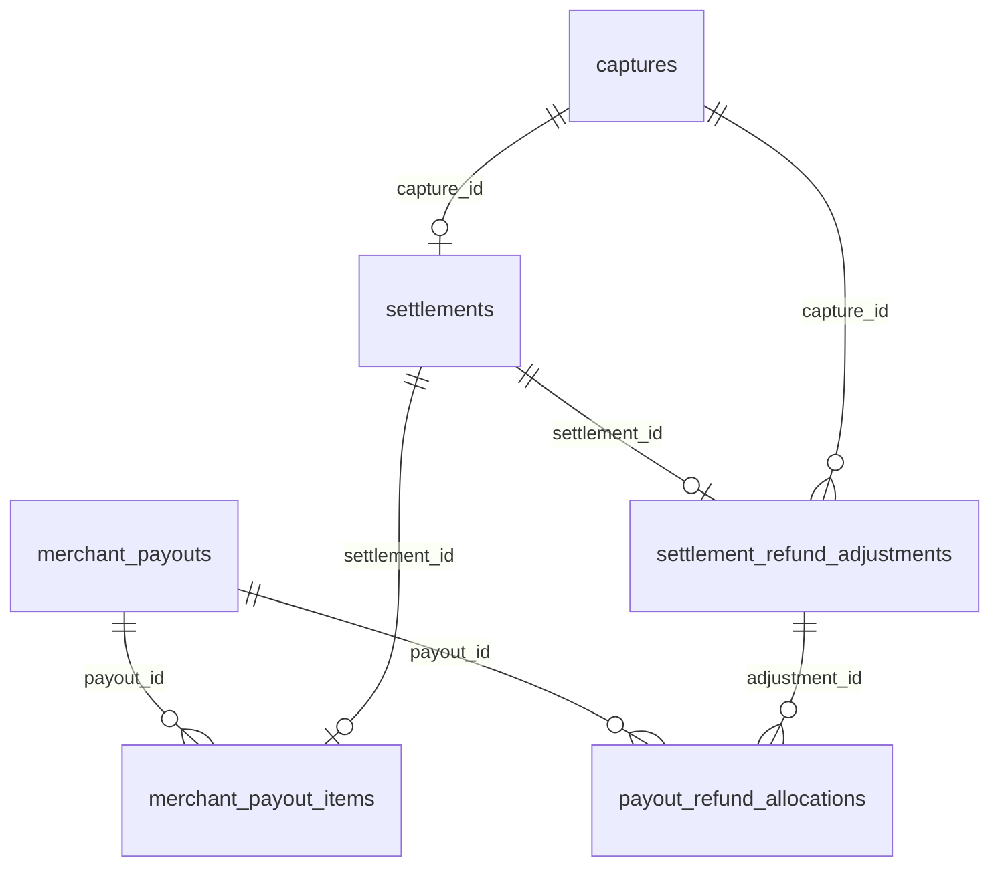
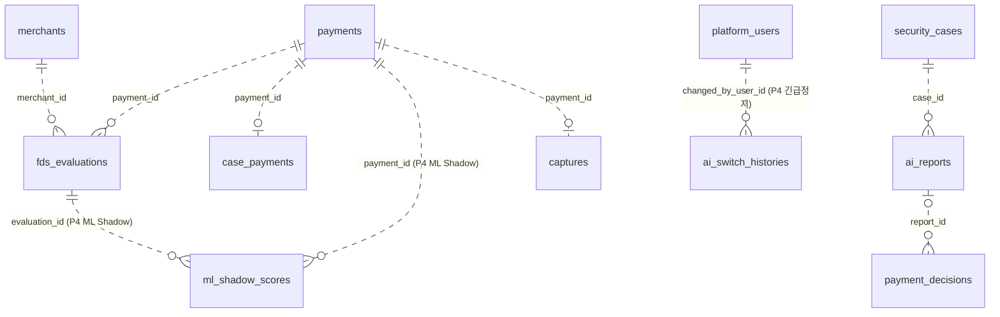

# ERD 관계 그림

[← ERD 안내](README.md) · [저장 계약](contracts.md) · [승인·변경 기록](history.md)

표끼리 어떻게 이어지는지 그림으로 봅니다. 먼저 전체 지도로 큰 흐름을 보고, 담당별 그림에서 표 단위 연결을 봅니다.

## 읽는 법

- **실선**은 DB에 건 외래 키(물리 FK), **점선**은 ID 값만 저장한 논리 참조입니다. 이 문서만의 약속이며, Mermaid 문법의 [원래 뜻](https://mermaid.js.org/syntax/entityRelationshipDiagram.html#identification)과는 다릅니다.
- 선의 **왼쪽은 가리켜지는 표, 오른쪽은 ID를 저장한 표**입니다. 선 위 글자는 오른쪽 표의 칸 이름입니다.
- 끝 기호: `||` 정확히 1 · `|o` / `o|` 0 또는 1 · `o{` 0개 이상. 실선의 기호는 SQL의 UNIQUE · NULL 허용으로 정했고, 서비스가 더 좁게 막는 경우는 따로 적었습니다.
- 점선(논리 참조)은 DB가 대상의 존재를 보장하지 않습니다. 확인은 소유 담당의 공개 `api/`로 합니다 ([README 5절](README.md#5-모듈-간-참조-규칙)).

## 전체 지도

담당 사이에 어떤 ID가 오가는지 업무 흐름 순서로 보여 줍니다. 화살표 끝의 담당이 앞 담당의 ID를 저장합니다. 모두 논리 참조입니다.

### 결제 사건 흐름

### 내부자 사건 흐름

가맹점 ID(`merchant_id`)와 직원 ID(`staff_id` 등)는 P1 표를 가리키며 거의 모든 담당이 저장합니다. 그림에서는 생략했고 [맨 아래 표](#그림에-없는-논리-참조)에 모았습니다.

## P1 계정·접근 기록

물리 FK 14개입니다. `locked_by`와 `released_by`는 각각 별도 FK입니다.

`admin_change_histories.actor_user_id`는 [후속 ALTER](../../backend/src/main/resources/db/migration/V20261104_134638__add_admin_change_history_actor_type.sql)에서 NULL 허용으로 바뀌었습니다. STAFF는 ID 필수, SYSTEM은 ID 없음입니다. 나머지 CREATE는 [소유 표](README.md#2-테이블-소유)에 연결되어 있습니다.

## P1 신청·키 관리

기존 그림에서 빠졌던 물리 FK 10개입니다.

근거: [신청](../../backend/src/main/resources/db/migration/V20261029_140200__create_merchant_applications.sql) · [토큰](../../backend/src/main/resources/db/migration/V20261029_140208__create_application_tokens.sql) · [메일](../../backend/src/main/resources/db/migration/V20261029_140209__create_application_mail_deliveries.sql) · [연동](../../backend/src/main/resources/db/migration/V20261031_151333__create_merchant_integrations.sql) · [키 이력](../../backend/src/main/resources/db/migration/V20261031_151342__create_merchant_key_histories.sql). 신청의 로그인 ID·주소·상태 후속 ALTER는 [소유 표](README.md#2-테이블-소유)를 봅니다. 위 FK의 NULL·UNIQUE는 바꾸지 않습니다.

## P2 평가·탐지

물리 FK 4개와 주요 논리 참조입니다.

- [오류 분석 SQL](../../backend/src/main/resources/db/migration/V20261027_101722__create_fds_failure_analyses.sql)의 요청 UUID는 NOT NULL이지만 FK가 없습니다. [서비스](../../backend/src/main/java/com/donworry/fds/service/FdsFailureAnalysisService.java)는 평가 미발견에도 분석을 저장하고 `EVALUATION_NOT_FOUND`를 발행하므로 실제 평가가 0 또는 1개입니다.
- [룰 관리 SQL](../../backend/src/main/resources/db/migration/V20261028_155511__create_fds_rule_management_tables.sql)에 `rule_code` FK는 없습니다. [정상 요청 경로](../../backend/src/main/java/com/donworry/fds/service/FdsRuleManagementService.java)가 정책을 조회한 뒤 요청을 저장합니다.
- [접근 탐지 SQL](../../backend/src/main/resources/db/migration/V20261104_152441__create_operator_access_detection_tables.sql)은 증거 FK 2개를 만들고 룰 코드 길이를 변경합니다. 룰 정책과 요청 사이에 FK를 추가하지는 않습니다.

## P3 사건·판정과 P4 보고서

물리 FK 8개와 주요 논리 참조입니다. P3 ↔ P4는 같은 `investigation` 안에서도 논리 참조입니다.

각 CREATE는 [소유 표](README.md#2-테이블-소유)에 연결되어 있습니다. 담당 변경 요청의 `pending_case_id` UNIQUE는 사건당 **대기 요청** 한 건을 제한하며, 전체 요청 이력이 한 건이라는 뜻은 아닙니다.

## P5 결제·취소

물리 FK 10개와 주요 논리 참조입니다.

- [결제 세션 SQL](../../backend/src/main/resources/db/migration/V20261102_142818__create_payment_sessions.sql)의 `payment_id`는 NULL 허용·UNIQUE입니다. OPEN에는 결제가 없고 SUBMITTED에는 결제가 있어야 한다는 CHECK가 있습니다. [알림 ID ALTER](../../backend/src/main/resources/db/migration/V20261103_093050__add_payment_session_notify_event_id.sql)는 이 관계를 바꾸지 않습니다.
- [결제 요청](../../backend/src/main/resources/db/migration/V20261025_210956__create_payment_requests_table.sql)의 주문 FK와 [취소 결과](../../backend/src/main/resources/db/migration/V20261031_183416__create_payment_cancellations.sql)의 요청 FK는 복합 키입니다. 컬럼별 별도 FK가 아닙니다.
- [FDS 복구](../../backend/src/main/resources/db/migration/V20261028_155021__create_payment_fds_recoveries_table.sql)는 `payment_id` UNIQUE로 결제당 최대 한 행입니다.

## P6 픽업·지출·정산

### 픽업 상품과 정기 지출 — FK 2개

근거: [픽업 상품](../../backend/src/main/resources/db/migration/V20261029_143636__create_order_fulfillment_items.sql) · [정기 지출](../../backend/src/main/resources/db/migration/V20261030_181043__create_recurring_expenses_with_payments.sql). [픽업 UNIQUE 변경](../../backend/src/main/resources/db/migration/V20261029_155634__scope_order_fulfillments_by_merchant.sql)은 `order_id`를 가맹점과 묶어 유일하게 만들며 상품 FK는 유지합니다.

### 매입·정산·지급·환불 — FK 7개

근거: [정산](../../backend/src/main/resources/db/migration/V20261022_145120__create_settlements_table.sql) · [지급 원장](../../backend/src/main/resources/db/migration/V20261103_144056__create_merchant_daily_payouts.sql) · [환불 조정](../../backend/src/main/resources/db/migration/V20261103_154941__create_settlement_refund_adjustments.sql) · [회수 배분](../../backend/src/main/resources/db/migration/V20261103_174335__create_payout_refund_allocations.sql). 환불 조정의 `settlement_id`에는 UNIQUE가 있지만 `capture_id` 자체에는 UNIQUE가 없어 최대 수를 구분했습니다.

## 모듈 간 주요 논리 참조

아래는 모두 FK 없는 참조입니다. 가맹점·수행자·조건부 작업 ID는 다음 표를 함께 봅니다.

## 그림에 없는 논리 참조

위 그림에 그리지 않은 FK 없는 참조입니다. 대상이 실제로 있는지는 DB가 아니라 업무 경로에서 확인합니다.

| 출발 테이블·컬럼 | 참조 대상 | 조건·근거 |
| --- | --- | --- |
| `security_cases.merchant_id`; `captures.merchant_id`; `settlements.merchant_id` | `merchants` | P3·P6의 P1 가맹점 참조. [소유·SQL](README.md#2-테이블-소유) |
| `payment_decisions.staff_id`; `security_cases.assignee_staff_id` | `platform_users` | 판정 직원·담당 직원. 담당은 미배정이면 NULL. [저장 계약](contracts.md#608-p3-fds-사건-자동-배정과-담당-변경-2026-11-06) |
| `case_histories.actor_id` | `platform_users` | [CaseHistory](../../backend/src/main/java/com/donworry/investigation/entity/CaseHistory.java)의 STAFF 생성은 직원 ID 필수, SYSTEM 생성은 NULL |
| `case_assignment_requests.requested_by_staff_id`, `reviewed_by_admin_id`, `new_assignee_staff_id` | `platform_users` | 요청 직원·처리 관리자·새 담당. 뒤 두 컬럼은 NULL 허용. [저장 계약](contracts.md#608-p3-fds-사건-자동-배정과-담당-변경-2026-11-06) |
| `raw_view_reviews.staff_id`, `reviewed_by_admin_id`, `payment_id` | 직원·관리자는 `platform_users`, 결제는 `payments` | 검토 관리자 ID는 NULL 허용. [저장 계약](contracts.md#608-p3-fds-사건-자동-배정과-담당-변경-2026-11-06) |
| `insider_alerts.closed_by_admin_id`; `insider_detection_states.staff_id` | `platform_users` | 종결 관리자·탐지 직원. 종결 관리자 ID는 NULL 허용. [경보 SQL](../../backend/src/main/resources/db/migration/V20261107_082223__create_insider_alerts.sql) |
| `staff_account_locks.source_alert_id`, `release_case_id` | `insider_alerts`, `insider_cases` | 근거 경보·해제 사건은 NULL 허용. [저장 계약](contracts.md#647-p1-보안-직원-계정-보안-정지-2026-11-07) |
| `insider_cases.decided_by_admin_id`, `lock_released_by_admin_id` | `platform_users` | 판정·해제 관리자. 처리 상태별 조건은 [저장 계약](contracts.md#670-p3-내부자-사건--관리자-판정--징계-사건-정지-해제-2026-11-08) |
| `settlements.payment_id` | `payments` | payment_id UNIQUE. [정산 SQL](../../backend/src/main/resources/db/migration/V20261022_145120__create_settlements_table.sql) |
| `action_handoffs.target_operation_id` | CAPTURE 성공: `captures.capture_id`; VOID 성공: `payment_actions.action_id` | 결과 종류별로 대상이 다름. [PaymentActionMapping](../../backend/src/main/java/com/donworry/payment/service/PaymentActionMapping.java)의 성공 결과 변환 기준 |
| `staff_access_events.case_id`, `payment_id`, `login_reference` | `security_cases`, `payments`, `login_histories.login_reference` | 모두 NULL 허용. 로그인 참조는 행 PK가 아니라 같은 로그인 흐름을 묶는 UUID. [저장 계약](contracts.md#604-p1-보안-직원-접근-기록-2026-11-06) |
| `ai_report_questions.staff_id` | `platform_users` | 질문한 직원. [저장 계약](contracts.md#752-p4-보고서-뒤-사건-질문--답변-2026-11-10) |
| `ai_insider_reports.trigger_alert_id` | `insider_alerts` | 보고서 생성 계기의 경보. [저장 계약](contracts.md#675-p4-내부자-사건-해제-검토-보고서-2026-11-08) |
| `payment_actions.decision_id`, `capture_id` | `payment_decisions`, `captures` | 판정 ID는 UNIQUE, capture ID는 CAPTURE 성공 때 저장. [조치 계약](contracts.md#141-p5-직원-조치-저장-설계-초안) |
| `payment_order_contacts.merchant_id` | `merchants` | P5 연락처 암호화 AAD의 가맹점. [연락처 계약](contracts.md#602-p5-주문자-연락처-2026-11-06) |

새 참조를 구현할 때 이 목록의 누락 여부로 허용·금지를 판단하지 않습니다. SQL·공개 API·채택된 계약을 함께 확인하며, 업무 정책과 소유가 불명확하면 담당자에게 확인합니다.

## 이 문서의 기준

- `7e8a1ab1`(2026-11-16 dev)의 migration 91개에서 `CREATE`와 이후 `ALTER`를 합쳐 물리 FK 55개를 셌고, 담당별 그림에 FK 하나당 실선 하나로 모두 그렸습니다. 다른 표와 연결이 없는 표는 그리지 않았으며 전체 목록은 [README 2절](README.md#2-테이블-소유)에 있습니다.
- 논리 참조(점선 · 표)는 주요 경로만 모은 것입니다. 시스템의 모든 논리 참조를 검증한 목록은 아닙니다.
- SQL 파일을 읽은 결과이며 실제 DB 적용 · 앱 실행 결과가 아닙니다. 이전 대조 경위는 [작업 계획](plan.md)에 있습니다.
