# ERD 관계 그림

[← ERD 안내](README.md) · [저장 계약](contracts.md) · [승인·변경 기록](history.md)

`ea5294e9ece7feb1e1f454fd00c103372a1aecdb`의 기존 그림과 관계 설명을 옮겼습니다.
이번 구조 정리에서는 관계선을 바꾸지 않았습니다. 전체 테이블·FK·논리 참조 대조와 누락·표기 보완은 후속 작업입니다.
실제 물리 FK는 CREATE와 이후 ALTER를 확인하고, 담당 간 참조 원칙은 [README 5절](README.md#5-모듈-간-참조-규칙)을 따릅니다.

## 그림과 범례

실선은 물리 FK(DB가 검사), 점선은 논리 참조(ID 값만 저장, FK 없음)입니다. `|o`는 0 또는 1(NULL 허용), `||`는 정확히 1입니다.

```mermaid
erDiagram
    merchants ||--o{ operator_access_denials : "merchant_id"
    platform_users ||--o{ operator_access_denials : "user_id"
    platform_users ||--o{ staff_access_events : "staff_id"
    platform_users ||--o{ staff_account_locks : "staff_id"
    platform_users |o--o{ staff_account_locks : "locked_by · released_by"
    merchants |o--o{ staff_access_events : "merchant_id"
    merchants ||--o{ merchant_request_nonces : "merchant_id"
    merchants |o--o{ platform_users : "merchant_id"
    platform_users ||--o{ user_permissions : "user_id"
    platform_users |o--o{ login_histories : "user_id"
    platform_users |o--o{ admin_change_histories : "actor_user_id"
    platform_users |o--o{ admin_change_histories : "target_user_id"
    merchants |o--o{ admin_change_histories : "target_merchant_id"

    fds_evaluations ||--o{ fds_rule_hits : "evaluation_id"
    fds_evaluations ||..o{ fds_failure_analyses : "evaluation_request_id (P2 조사 참조)"
    fds_rule_policies ||--o{ fds_rule_change_requests : "rule_code (논리 참조)"
    insider_alerts ||--o{ insider_alert_evidences : "alert_id"
    staff_access_events ||..o{ insider_alert_evidences : "access_event_id (P1 접근 기록)"
    platform_users ||..o{ insider_alerts : "staff_id"

    security_cases ||--o{ case_payments : "case_id"
    case_payments ||--o| payment_decisions : "case_payment_id"
    payment_decisions ||--o| action_handoffs : "decision_id"
    security_cases ||--o{ case_histories : "case_id"
    security_cases ||--o{ case_assignment_requests : "case_id"
    security_cases ||--o{ raw_view_reviews : "case_id"
    insider_cases ||--o{ insider_case_alerts : "insider_case_id"
    insider_alerts ||..o| insider_case_alerts : "alert_id (P2 경보)"
    platform_users ||..o{ insider_cases : "staff_id"
    insider_cases ||..o{ ai_insider_reports : "insider_case_id (P4 해제 검토 보고서)"

    captures ||--o| settlements : "capture_id"

    merchants ||..o{ payments : "merchant_id"
    payments ||--o| payment_actions : "payment_id (P5)"
    payments ||--o{ payment_cancellation_requests : "payment_id (P5)"
    payments ||--o| payment_sessions : "payment_id (P5)"
    payment_sessions ||--o| payment_order_contacts : "session_id (P5)"
    payments ||--o| payment_cancellations : "payment_id (P5)"
    payment_cancellation_requests ||--o| payment_cancellations : "source_request_id + payment_id"
    payment_actions |o--o{ payment_cancellation_requests : "existing_void_action_id"
    merchants ||..o{ payment_cancellation_requests : "merchant_id"
    captures |o..o{ payment_cancellations : "capture_id (REFUND)"
    merchants ||..o{ fds_evaluations : "merchant_id"
    payments ||..o{ fds_evaluations : "payment_id"
    payments ||..o| case_payments : "payment_id"
    security_cases ||..o{ ai_reports : "case_id"
    ai_reports |o..o{ payment_decisions : "report_id"
    payments ||..o{ ml_shadow_scores : "payment_id (P4 ML Shadow)"
    fds_evaluations ||..o{ ml_shadow_scores : "evaluation_id (P4 ML Shadow)"
    platform_users ||..o{ ai_switch_histories : "changed_by_user_id (P4 긴급정지)"
    payments ||..o| captures : "payment_id"
```

## 그림에 없는 논리 참조

그림에 없는 논리 참조: `security_cases` · `captures` · `settlements`의 `merchant_id`(→ `merchants`), `payment_decisions.staff_id` · `case_histories.actor_id` · `security_cases.assignee_staff_id` · `case_assignment_requests` · `raw_view_reviews`의 직원 · ADMIN ID(→ `platform_users`), `raw_view_reviews.payment_id`(→ `payments`), `insider_alerts.closed_by_admin_id` · `insider_detection_states.staff_id`(→ `platform_users`), `staff_account_locks.source_alert_id`(→ `insider_alerts`) · `release_case_id`(→ `insider_cases`), `insider_cases`의 판정 · 해제 ADMIN ID(→ `platform_users`), `settlements.payment_id`(→ `payments`), `action_handoffs.target_operation_id`(P5 · P6 작업 ID).
