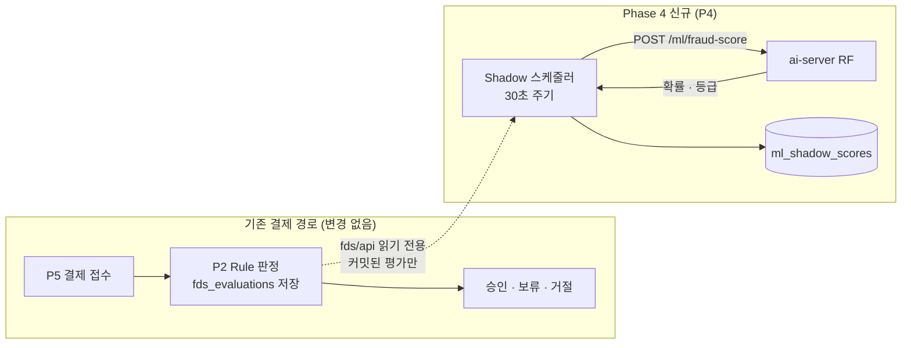

# #375 FDS ML Shadow — Spring 연결 설계 (Phase 4-0)

상태: **P2(정후님) 허락 (2026-11-02) — P2 조회 #409 병합(PR #411), P4 저장 #412 병합(PR #413), P4 ai-server 호출 #414 병합(PR #433), 실행(스케줄러) #415 진행 중**. 기준 `dev 78bdd50`. 작성 P4 현규.
결정 요약은 [ADR-0062](../decisions/0062-fds-ml-shadow-spring-connection.md). 앞 단계는 [ADR-0061](../decisions/0061-fds-ml-shadow-inference.md) (ai-server `POST /ml/fraud-score`, PR #406 병합).

- **정후님(P2) 허락 받음:** 10절 (fds/api 새 조회 인터페이스 · 식별값 별칭 · 같은 카드 범위 · 80점 경계 공유)
- `investigation/report`는 P4 범위라 실행 위치 · 새 테이블은 P4가 정한다. investigation 모듈의 의존 규칙(`package-info`)은 바꾸지 않는다

## 0. 한눈에 — 예시로 보는 흐름

손님이 케이크샵에서 3만 원을 결제한다.

1. P5가 결제를 받고 P2 Rule Engine이 지금처럼 점수를 매겨 승인 · 보류 · 거절을 정한다. 평가는 `fds_evaluations`에 저장된다 → **여기까지 기존 코드 그대로**
2. 약 30초 뒤 P4 Shadow 스케줄러가 fds/api로 "새로 커밋된 평가"와 그 결제의 이전 이력을 읽는다
3. ai-server `POST /ml/fraud-score`에 보내 `fraudProbability 0.66 · mlRiskLevel HIGH` 같은 답을 받는다
4. P4 새 테이블 `ml_shadow_scores`에 Rule 결과(예: ALLOW 35점)와 ML 결과를 나란히 적는다

결제 결과는 1에서 이미 정해졌다. ML은 결과를 바꾸지 않고 "Rule이 놓친 사기를 ML이 잡았는지"를 나중에 비교하기 위한 기록만 남긴다.



## 1. 범위

이번 설계에 넣는 것

- P2 `fds/api` 읽기 전용 조회 인터페이스 (Shadow 대상 목록 · ML 입력 묶음)
- P4 Shadow 결과 테이블 `ml_shadow_scores`
- P4 스케줄러 · ai-server 호출 · 실패 처리 · 켜기 설정

범위 밖 (후속)

- Shadow 결과 조회 API · 화면 (거래 내역 화면 `/security/transactions`에 "ML 참고" 칸 등) — 보는 사람 · 권한을 정한 뒤 별도 이슈
- 가맹점 번호를 뺀 v2 모델 (`rf-v2.joblib`, v1 덮어쓰기 금지)
- Rule과 ML 성능 비교 방법 (정답은 직원 판정 `payment_decisions` 등 — Rule 결과를 정답으로 쓰지 않는다)
- ML 결과를 결제 판정에 반영하는 것 (Shadow 기록을 근거로 별도 ADR)

## 2. 지금 코드에서 확인한 사실 (dev 78bdd50)

| 대상 | 확인한 사실 | 설계에 주는 영향 |
| --- | --- | --- |
| 결제 → Rule 경로 | `PaymentEvaluationFlowService` → `FdsEvaluator.evaluate` → `FdsEvaluationTransactionService.evaluate`(@Transactional, `fds_evaluations` 저장, `evaluated_at = Instant.now()`) | 이 경로를 고치지 않고, 커밋된 평가를 나중에 읽는다 |
| 재평가 | `FdsReevaluationService`는 ERROR 평가만 재평가한다 (같은 `payment_id`에 새 평가 행) | 결제마다 **처음 나온 비오류 평가**가 곧 최종 Rule 판정이다 |
| `fds_evaluations` 인덱스 | `(merchant_id, customer_ref, payment_requested_at)` · `(merchant_id, customer_ref, card_token)` 등. `card_token` 단독 인덱스 없음 | 같은 가맹점 안 조회는 기존 인덱스 · 쿼리(`findByMerchantIdAndCardTokenIn...`)로 된다 |
| P2 공개 조회 선례 | `FdsLinkedPaymentReader`(#352) · `FdsEvidenceReader`(#346)는 카드 토큰 · 기기 ID · IP · 다른 고객 번호 원문을 밖으로 내보내지 않는다 | ML 입력도 원문 대신 별칭으로 받는다 (5절) |
| 학습 데이터 | `fds-ml/scenarios.py` 도난 카드 시나리오는 **같은 가맹점**의 다른 고객 카드만 고른다 | 같은 카드 조회도 같은 가맹점으로 제한하면 학습과 뜻이 같다 (6절) |
| Feature 계산 | `features.py`: 고객 전체 이전 이력(건수 · 평균 · 본 적 있는 카드 · 기기), 5분 · 30분 · 24시간 건수, 같은 카드를 앞서 쓴 다른 고객 여부 | 고객 이력은 기간을 자르지 않고 전부 보낸다. 자르면 값이 달라진다 |
| ai-server 계약 | 이력 2,000건 상한, 대상보다 뒤 시각 · `paymentId` 중복 · 다른 고객 섞임은 422, 모델 없음 503 | P2가 이 조건에 맞는 묶음을 만들어 준다 |
| 의존 규칙 | investigation은 이미 `fds :: api` 허용 | ADR-0012 · `allowedDependencies` 변경 없음 |
| 스케줄러 선례 | `AiReportTimeoutChecker`: `@Scheduled(fixedDelay)` + `@ConditionalOnProperty(ai.server.enabled)`, 테스트는 `donworry.scheduling.enabled=false` | 같은 모양, 별도 켜기 설정 |
| ai-server 연결 선례 | `AiServerClient`(RestClient, `X-Internal-Api-Key`, HTTP/1.1 고정) · `AiServerProperties`(`ai.server.*`) | 같은 연결 설정으로 ML 호출 추가 |

## 3. 결정 1 — 실행 방식: P4 스케줄러가 주기적으로 읽는다

- P4 스케줄러가 30초마다 "아직 채점하지 않은 커밋된 평가"를 fds/api로 읽어 ai-server에 보낸다
- 결제 · Rule 코드는 한 줄도 바꾸지 않는다. ML이 느리거나 꺼져도 결제는 영향이 없다
- 지연: 결제 뒤 30초 ~ 1분 안에 기록된다. Shadow는 비교 기록이라 실시간일 필요가 없다

버린 대안

| 대안 | 버린 이유 |
| --- | --- |
| P2가 평가 저장 후 이벤트 발행 → P4가 구독 | P2 평가 경로를 고쳐야 한다. 이벤트 유실 · 재처리 설계가 따로 필요하다 |
| 결제 중 동기 호출 | 결제 응답이 ML 지연 · 장애에 묶인다 (ADR-0061에서 이미 버림) |
| ai-server가 DB를 직접 읽음 | ADR-0009 위반 (ai-server는 DB에 직접 접속하지 않는다) |

## 4. 결정 2 — fds/api 새 조회 인터페이스 (P2 합의 필요)

P2 `fds/api`에 읽기 전용 인터페이스 하나와 record 셋을 추가한다. 구현은 `fds/service`의 새 조회 서비스(`@Transactional(readOnly = true)`)에 두고 평가 저장 경로는 건드리지 않는다.

```java
// ML Shadow 입력 조회 (#375) — 읽기 전용. 카드 · 기기 · 고객 번호는 응답 안에서만 통하는 별칭으로 내보낸다
public interface FdsMlInputReader {

    // afterEvaluationId보다 큰 평가 중 settledBefore 이전에 평가된 것, 결제마다 처음 나온 비오류 평가만, 오래된 순 limit개
    List<FdsMlTarget> findNewTargets(long afterEvaluationId, Instant settledBefore, int limit);

    // 대상 평가 하나의 ML 입력 묶음. 평가가 없거나 ERROR면 빈 값
    Optional<FdsMlInput> findInput(long evaluationId, int historyLimit);
}

// 비교용 Rule 결과 스냅샷 (5칸 → @Builder)
@Builder
public record FdsMlTarget(Long evaluationId, Long paymentId, FdsResult result, Integer riskScore, Instant evaluatedAt) {}

// historyOverLimit이 true면 두 이력은 비어 있다 — P4는 호출하지 않고 SKIPPED로 남긴다
@Builder
public record FdsMlInput(
        FdsMlTransaction target,
        List<FdsMlTransaction> customerHistory,
        List<FdsMlTransaction> sharedCardHistory,
        boolean historyOverLimit) {}

// ai-server 거래 행과 같은 칸. customerKey · deviceKey · cardKey는 별칭 (5절)
@Builder
public record FdsMlTransaction(
        Long paymentId,
        Long merchantId,
        String customerKey,
        long amount,
        Instant paymentRequestedAt,
        String deviceKey,
        String cardKey) {}
```

`findNewTargets` 규칙

- **결제마다 처음 나온 비오류 평가만** 돌려준다. 재평가는 ERROR에서만 생기므로 이것이 최종 Rule 판정이다. ERROR만 있는 결제는 비교할 Rule 결과가 없어 대상이 아니다 (나중에 재평가되면 새 평가 ID로 잡힌다)
- `settledBefore` = 지금 − 30초. 커밋이 늦게 끝난 작은 ID를 건너뛰지 않게 한다 (8절)
- 걸러내기는 **SQL 안에서** 한다 (`NOT EXISTS`: 같은 결제에 더 앞선 비오류 평가가 없을 것). Java에서 받은 뒤 거르면, 한 번에 읽은 행이 모두 걸러질 때 P4에 기록이 안 생겨 커서가 같은 자리를 계속 읽는다

`findInput` 규칙

- `customerHistory`: 같은 `merchant_id` + `customer_ref`, `payment_requested_at` ≤ 대상 시각, 대상 결제 제외
- `sharedCardHistory`: 대상 카드가 있을 때만. **같은 가맹점**, 같은 `card_token`, 다른 `customer_ref`, 시각 ≤ 대상 (6절)
- 두 이력 모두 **결제당 1행**이다. 재평가로 같은 `payment_id`의 평가가 여러 개면 하나만 넣는다. 금액 · 시각 · 카드 · 기기는 결제 입력이라 어느 평가 행이든 같다
- Rule 결과와 상관없이 모든 결제를 이력에 넣는다 (ERROR · DENY도 결제 시도는 있었다). 학습 데이터도 결과와 상관없이 모든 거래를 이력으로 셌다
- 고객 · 카드가 같은지는 **원문이 정확히 같은지**로 본다. DB 비교는 대소문자를 무시하므로(`utf8mb4_unicode_ci`) 조회 결과를 Java에서 한 번 더 거른다 (`TOK_A`와 `tok_a`는 다른 카드, `MEMBER-77`과 `member-77`은 다른 고객 — ai-server · 학습 코드와 같은 기준, Codex 리뷰 반영)
- 이력 합계가 `historyLimit`(2,000, ai-server 상한과 같은 값)을 넘으면 `historyOverLimit = true`. 최근 2,000건으로 자르면 고객 건수 · 평균이 학습과 달라지므로 자르지 않는다

## 5. 결정 3 — 식별값은 응답 안에서만 통하는 별칭으로

- Feature는 카드 · 기기 · 고객이 **같은지만** 본다 (ADR-0061). 그래서 원문 대신 별칭을 보내도 확률이 같다
- P2가 응답 하나를 만들 때 처음 나온 순서대로 별칭을 붙인다
  - 고객: 대상 고객 `T`, 다른 고객 `O1`, `O2` …
  - 카드: `C1`, `C2` … / 기기: `D1`, `D2` … / 값이 없으면 `null` 그대로
- 같은 응답 안에서는 같은 원문 = 같은 별칭이다. 다른 응답과는 이어지지 않는다
- 예: 대상이 카드 `tok_abc`를 쓰고, 다른 고객 한 명이 예전에 같은 카드를 썼다 → 대상 `cardKey C1, customerKey T`, 그 고객 행 `cardKey C1, customerKey O1` → ai-server는 `cardUsedByOtherCustomer = 1`

버린 대안

| 대안 | 버린 이유 |
| --- | --- |
| 원문 그대로 P4 · ai-server로 전달 | #346 · #352에서 원문을 P2 밖으로 내보내지 않기로 한 선례와 어긋난다 |
| 고정 해시(HMAC) | 응답끼리 이어 볼 수 있어 사실상 식별자가 된다. 키 관리도 필요하다 |
| P4가 `fds_evaluations` 행을 받아 직접 이력 구성 | 원문이 노출되고, 같은 조회 규칙을 P2 · P4가 따로 갖게 된다 |

## 6. 결정 4 — 같은 카드 조회는 같은 가맹점 안에서만

- 학습 데이터의 도난 카드는 같은 가맹점 다른 고객 카드에서만 만들어졌다 (`fds-ml/scenarios.py`). 운영도 같은 가맹점으로 제한하면 `cardUsedByOtherCustomer`의 뜻이 학습과 같아진다
- 기존 쿼리 · 인덱스로 된다 → **P2 테이블 마이그레이션이 필요 없다**
- #352 연관 결제 조회 · Rule Engine 이력 조회도 같은 가맹점 기준이다
- 버린 대안: 가맹점을 넘는 조회 — `card_token` 인덱스 추가(P2 마이그레이션)가 필요하고, 학습에 없던 경우라 모델이 해석할 근거가 없다. 같은 사람이 두 가맹점에서 결제해도 "다른 고객"으로 잡히는 문제(ADR-0061)도 커진다. 필요하면 v2 모델 학습 때 다시 본다

## 7. 결정 5 — P4 저장 테이블 `ml_shadow_scores`

- P4 소유 (`investigation/report`). 이름에 `fds_`를 붙이지 않는다 (P2 테이블로 보이지 않게)
- `payment_id`(P5) · `evaluation_id`(P2)는 소유 담당이 달라 FK 없는 논리 참조다 (AGENTS.md 4절)
- 기록은 지우지 않는다. 모델을 바꾸면 새 `model_version` 행이 쌓인다

| 칸 | 타입 · NULL | 뜻 |
| --- | --- | --- |
| `shadow_score_id` | BIGINT AUTO_INCREMENT PK | |
| `payment_id` | BIGINT NOT NULL | P5 결제, 논리 참조 |
| `evaluation_id` | BIGINT NOT NULL | 비교한 P2 평가 (결제의 첫 비오류 평가), 논리 참조. 커서 기준 |
| `model_version` | VARCHAR(50) NOT NULL | 설정의 기대 모델 버전 (예: `rf-v1`). 성공 시 응답 `modelVersion`과 같다 |
| `status` | VARCHAR(20) NOT NULL | `SUCCEEDED` · `FAILED` · `SKIPPED` |
| `rule_result` | VARCHAR(20) NOT NULL | 평가 당시 Rule 결과 스냅샷 (ALLOW · REVIEW · DENY) |
| `rule_risk_score` | INT NULL | 평가 당시 Rule 점수 스냅샷 |
| `fraud_probability` | DECIMAL(9,6) NULL | ML 확률 0~1 (ERD 비율 규칙). 성공일 때만 |
| `threshold` | DECIMAL(9,6) NULL | 응답 기준값. 학습 코드 부동소수 오차(0.30000000000000004)는 0.300000으로 저장 |
| `ml_risk_level` | VARCHAR(10) NULL | 응답 `HIGH` · `LOW` 그대로 (Spring이 다시 계산하지 않음) |
| `features` | JSON NULL | 모델 입력 13개 (확률 근거 확인용) |
| `latency_ms` | INT NULL | ai-server 응답 `latencyMs` |
| `failure_code` | VARCHAR(100) NULL | 8절 표 |
| `attempt_count` | INT NOT NULL | 호출 시도 수 (SKIPPED는 0) |
| `scored_at` | DATETIME(6) NULL | 성공 시각 |
| `created_at` · `updated_at` | DATETIME(6) NOT NULL | |

- `UNIQUE uk_ml_shadow_scores_payment_model (payment_id, model_version)` — 같은 결제를 같은 모델로 두 번 채점하지 않는다 (스케줄러가 겹쳐 돌아도 막힌다)
- `INDEX idx_ml_shadow_scores_model_evaluation (model_version, evaluation_id)` — 커서(가장 큰 `evaluation_id`) 조회
- Rule 결과를 스냅샷으로 두는 이유: 평가 행은 바뀌지 않고, 비교 조회를 이 테이블 하나로 할 수 있다. 원본은 `evaluation_id`로 언제든 대조한다

## 8. 결정 6 — 한 주기의 처리 순서 · 실패 처리

한 주기 (기본 30초 간격, 한 번에 최대 50건)

1. 커서 = 이 테이블에서 현재 `model_version`의 가장 큰 `evaluation_id` (없으면 0)
2. `FAILED`이면서 `attempt_count < 3`인 행부터 다시 시도한다 (`ML_REQUEST_REJECTED`는 빼고, 재시도 몫도 50건에 포함)
3. `findNewTargets(커서, 지금, 50)`을 번호 순서로 받아, 평가 시각이 30초 안 된 첫 대상에서 멈춘다 → 대상마다 `findInput` → ai-server 호출 → 행 저장 (대상마다 짧은 트랜잭션, HTTP 호출은 트랜잭션 밖)
   - 시각으로 미리 거르지 않는 이유 (#415 리뷰): P2는 평가 시각을 정한 뒤 저장할 때 번호를 받아서, 동시에 들어온 결제는 "번호는 작은데 시각은 늦은" 평가가 생긴다. `지금 − 30초`로 거르면 그 평가만 빠지고 더 큰 번호가 기록되어 커서가 영영 건너뛴다

대상은 결제당 한 번만 나오고 결과(성공 · 실패 · 건너뜀)마다 행이 생기므로 커서는 항상 앞으로 간다. 별도 커서 테이블은 두지 않는다.

| 상황 | 기록 | 다음 |
| --- | --- | --- |
| 200 응답 | `SUCCEEDED` | 끝 |
| 이력 2,000건 초과 (`historyOverLimit`) | `SKIPPED` · `HISTORY_LIMIT_EXCEEDED`, 호출 안 함 | 끝 (Shadow 기록으로 빈도를 본다) |
| 입력을 찾지 못함 (`findInput` 빈 값) | `SKIPPED` · `INPUT_NOT_FOUND`, 호출 안 함 | 끝 (기록하지 않으면 커서가 그 자리에 멈춘다, #415) |
| 422 (요청 검사 실패) | `FAILED` · `ML_REQUEST_REJECTED` | 다시 해도 같으므로 재시도 안 함 (재시도 조회에서 이 코드를 뺀다) — P2 조회 규칙 버그 신호 |
| 500 `ML_INFERENCE_FAILED` | `FAILED` · 해당 코드, `attempt_count + 1` | 3번까지 다음 주기에 재시도 |
| 응답 시간 초과 (`ai.server.read-timeout` 10초 공용) | `FAILED` · `ML_TIMEOUT`, `attempt_count + 1` | 3번까지 재시도. **이번 주기는 여기서 멈춘다** — 예약 작업 스레드가 1개라 시간 초과가 이어지면 다른 예약 작업이 막힌다 (#415) |
| 연결 실패 · 503 `ML_MODEL_UNAVAILABLE` · 응답 `modelVersion`이 설정과 다름 | **기록 안 함**, 이번 주기 중단, 경고 로그 | 다음 주기에 그 자리부터 다시 (서버 · 모델 문제라 결제마다 실패로 굳히지 않는다) |

- 처음 켜면 커서 0부터 기존 평가를 모두 채운다 (주기당 50건 → 분당 약 100건). 시연 데이터 규모에서는 몇 분 안에 끝난다
- 30초 안정 지연은 커밋이 늦게 끝나 작은 ID가 뒤늦게 보이는 경우를 막는다 (번호 순서로 멈추므로 평가 시각 · 번호 순서가 엇갈려도 건너뛰지 않는다). 평가 트랜잭션은 짧아 충분하다고 본다. 두 VM의 시계 차가 크면 지연을 늘린다 (미검증)
- Spring이 두 대에서 동시에 돌아도 UNIQUE 위반은 "이미 채점됨"으로 보고 넘어간다. 재시도 결과는 행을 잠그고(`PESSIMISTIC_WRITE`) 다시 읽어 FAILED일 때만 고친다 — 한쪽 성공을 다른 쪽 실패가 덮어쓰지 않게 (#415 리뷰, `@Version`은 칸 추가가 필요해 쓰지 않음)
- 상태 이름에 `REJECTED`를 따로 두지 않는다 — 직원 판정 `Decision.REJECT`(승인 취소) 등과 같은 단어라 판정처럼 읽힌다 (#415)

## 9. 결정 7 — 위치 · 설정 (P4 `investigation/report`)

기존 계층(client · dto · entity · repository · service)에 그대로 넣는다.

- `report/client/AiServerClient.score(...)` — 같은 연결 설정 · 서비스 키로 `POST /ml/fraud-score` 추가
- `report/dto/MlFraudScoreRequest` · `MlFraudScoreResponse` (4칸 이상 → `@Builder`)
- `report/entity/MlShadowScore` · `MlShadowStatus`, `report/repository/MlShadowScoreRepository`
- `report/service/MlShadowService.runOnce(Instant now)` — 한 주기 처리. 테스트는 이것을 직접 부른다
- `report/service/MlShadowScheduler` — `@Scheduled(fixedDelayString = "${ai.ml-shadow.interval:PT30S}")` + `@ConditionalOnProperty(name = "ai.ml-shadow.enabled", havingValue = "true")`
- `report/service/MlShadowProperties` (`ai.ml-shadow.*`)

```yaml
ai:
  ml-shadow:
    # true면 커밋된 FDS 평가를 ai-server RF로 따로 채점해 기록한다. 결제 판정에는 쓰지 않는다. 기본 꺼짐
    enabled: ${ML_SHADOW_ENABLED:false}
    interval: PT30S
    batch-size: 50
    settle-delay: PT30S
    max-attempts: 3
    # ai-server AI_SERVER_ML_MODEL_PATH의 파일 이름과 같아야 한다 (다르면 기록하지 않고 멈춘다)
    model-version: rf-v1
```

- ai-server 주소 · 서비스 키는 `ai.server.base-url` · `ai.server.api-key`를 그대로 쓴다. `ai.server.enabled`(AI 조사)와는 따로 켠다
- 켜기 값은 `application-local.yml`에 넣지 않고 `run-local.local.ps1` 인자로만 넘긴다 (테스트가 읽어 예약 작업이 도는 문제 방지 — 10/30 정리 방식)
- 새 HTTP API가 없어 `SecurityConfig` 변경은 없다
- 실제 위치 (#415): `MlShadowService.runOnce` · `MlShadowWriter`(건마다 새 트랜잭션으로 저장) · `MlShadowScheduler` · `MlShadowProperties`(`batch-size` · `settle-delay` · `max-attempts` · `model-version`). 이력 상한 2,000은 ai-server `MAX_HISTORY_ROWS`와 같은 상수

### 로컬에서 켜는 법 (#415)

1. ai-server를 켠다 — `ai-server/models/rf-v1.joblib`이 있어야 한다 (`AI_SERVER_ML_MODEL_PATH` 기본값)
2. backend를 `--ai.ml-shadow.enabled=true`로 실행한다. `ai.server.api-key`는 AI 조사와 같은 값을 넘긴다 (AI 조사 `ai.server.enabled`는 꺼도 된다)
   - PowerShell 예: `.\gradlew.bat bootRun "--args=--ai.ml-shadow.enabled=true --ai.server.api-key=<ai-server/.env의 AI_SERVER_INTERNAL_API_KEY>"`
   - `application-local.yml`에는 넣지 않는다 (테스트도 읽는다)
3. 결제 1건 → 약 30 ~ 60초 뒤 `SELECT * FROM ml_shadow_scores ORDER BY shadow_score_id DESC;`에 1행. 처음 켜면 기존 평가부터 주기당 50건씩 채운다
4. 멈췄다면 backend 로그의 `ML Shadow 주기 중단` 경고에서 이유(연결 실패 · 모델 버전 · 시간 초과)를 본다

## 10. 확인 요청 — 정후님(P2) (2026-11-02 허락)

1. `fds/api`에 `FdsMlInputReader`와 record 3개를 추가해도 되는지. 작성은 #352처럼 P4가 하고 정후님이 리뷰하는 방식이면 되는지
2. 식별값 별칭 방식(5절)이 P2의 원문 비공개 원칙에 맞는지
3. 같은 카드 조회를 같은 가맹점으로 제한(6절) — P2 마이그레이션 없음
4. ERROR · DENY 평가도 이력에 넣는 것(4절)과 "결제마다 처음 나온 비오류 평가 = 최종 Rule 판정" 전제
5. (공유) Rule 위험 등급 80점 경계: 코드 `DENY_MIN_SCORE = 80`(`score >= 80` → DENY), 기획은 80점을 REVIEW로 적었다. 이번 작업에서 고치지 않는다

## 11. 구현 순서 (PR 단위)

| 순서 | PR | 내용 | 담당 · 확인 |
| --- | --- | --- | --- |
| 1 | P2 조회 (#409, PR #411 병합) | `FdsMlInputReader` · record · 조회 서비스 · 테스트 (P2 코드, 평가 경로 무수정) · ADR-0062 · 이 문서 | P4 작성, 정후님 허락 · 리뷰 |
| 2 | P4 저장 (#412) | `ml_shadow_scores` 마이그레이션 · Entity · Repository(커서 · 재시도 조회) · ERD 문서. 재시도 때 행을 고치는 메서드는 3번에서 | P4 (`mariaDbTest`) |
| 3 | P4 실행 | client · service · scheduler · 설정 · 로컬 실행 문서 | P4 |
| 이후 | | 조회 API · 거래 내역 ML 참고 칸 → v2 모델 → 통합 확인 | 별도 이슈 |

## 12. 테스트 후보 (구현 PR에서 목록 승인 후 작성)

| 테스트 | 깨지면 무슨 사고? | 등급 |
| --- | --- | --- |
| P2 `findInput_historyAfterTarget_excluded` | 결제 뒤 거래가 섞여 모든 요청이 422로 실패하거나 미래 정보가 들어감 | 🔴 |
| P2 `findInput_reevaluatedPayment_onePerPayment` | 재평가 행이 겹쳐 같은 결제가 두 번 세지거나 422 | 🔴 |
| P2 `findInput_sameRefOtherMerchant_notInCustomerHistory` | 다른 가맹점 같은 번호 고객이 섞여 정상 고객이 의심받음 | 🔴 |
| P2 `findInput_aliases_hideRawIdentifiers` | 카드 토큰 · 기기 ID 원문이 P2 밖으로 나감 (계약) | 🔴 |
| P2 `findInput_aliases_consistentWithinResponse` | 같은 카드가 다른 별칭이 되어 `cardSeenBefore` · 도용 신호가 틀어짐 | 🔴 |
| P2 `findNewTargets_firstNonErrorPerPayment_only` | 재평가 결제가 두 번 나와 커서가 멈추거나 중복 채점 | 🔴 |
| P2 `findInput_sameCardOtherMerchant_notShared` | 학습에 없던 가맹점 간 카드 공유가 들어가 도용 신호 오작동 | 🟡 |
| P2 `findInput_overLimit_flagged` | 큰 이력을 잘라 보내 Feature가 조용히 틀어짐 | 🟡 |
| P4 `runOnce_success_savesProbabilityWithRuleSnapshot` | ai-server 응답을 잘못 옮겨 비교 기록을 못 믿음 (FastAPI 계약) | 🔴 |
| P4 `runOnce_aiServerDown_noRecord_resumesNextCycle` | 장애 동안 결제들이 FAILED로 굳어 영영 비교 못 함 | 🔴 |
| P4 `runOnce_alreadyScored_notDuplicated` | 같은 결제가 두 번 기록되어 비교 통계가 부풀음 | 🔴 |
| P4 `runOnce_inferenceFailed_retriesUpToMax` | 일시 오류 결제가 영구 누락되거나 무한 재시도 | 🟡 |
| P4 `runOnce_historyOverLimit_skippedWithoutCall` | 2,000건 넘는 고객 때문에 매 주기 422 반복 | 🟡 |
| P4 `runOnce_modelVersionMismatch_stopsWithoutRecord` | 다른 모델 결과가 rf-v1 이름으로 섞여 저장됨 | 🟡 |

## 13. 미검증 · 열린 질문

- 이 문서는 코드 · 문서를 읽고 쓴 설계다. 어떤 명령도 실행하지 않았다
- 1코어 VM에서 주기당 50건(약 30ms × 50 + 이력 조회)의 부하 · Spring 두 대 동시 실행 여부는 배포 구성 확인 필요
- 이력 조회는 고객 전체 이력을 읽는다. 상한 확인은 개수를 먼저 세는 쿼리로 할지 구현 PR에서 정한다
- Notion ERD P4 페이지에 `ml_shadow_scores` 추가는 이 문서 합의 뒤 (AGENTS.md 4절)
