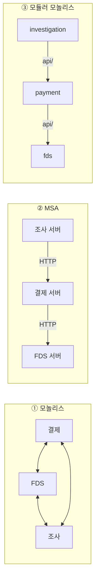

# 01. 모듈러 모놀리스 개념

[← Modulith 문서 목차](README.md)

## 1. 한 문장으로

**모듈러 모놀리스는 "건물 하나에 칸막이로 나뉜 사무실들"입니다.**

- 건물 = 앱 하나 (Spring Boot 하나, 배포도 한 번)
- 사무실 = 모듈 (`payment`, `fds`, `investigation` …)
- 사무실끼리는 **정해진 창구**(`api/` 패키지)로만 소통합니다. 남의 사무실 서랍(`entity/`, `repository/`)을 직접 열지 않습니다

Spring Modulith는 이 칸막이 규칙을 **테스트로 검사**해 주는 Spring 라이브러리입니다.

## 2. 세 가지 방식 비교

| | ① 모놀리스 | ② MSA (마이크로서비스) | ③ 모듈러 모놀리스 |
| --- | --- | --- | --- |
| 앱 개수 | 1개 | 기능마다 1개 (여러 서버) | 1개 |
| 기능 사이 경계 | 없음 — 아무 클래스나 서로 호출 | 서버로 물리적으로 나뉨 | 패키지로 나뉨, **테스트가 경계를 검사** |
| 기능 사이 호출 | Java 메서드 | HTTP · 메시지 큐 (네트워크) | Java 메서드 (`api/`만) · 이벤트 |
| DB 트랜잭션 | 하나로 묶기 쉬움 | 서버마다 따로 — 분산 트랜잭션 문제 | 하나로 묶을 수 있음 |
| 배포·운영 | 쉬움 | 서버마다 배포·모니터링 필요 | 쉬움 |
| 시간이 지나면 | 얽혀서 고치기 어려움 | 경계는 유지되지만 운영 부담 큼 | 경계 유지, 필요하면 모듈 단위로 떼어 MSA로 전환 가능 |

## 3. Spring Modulith가 해 주는 것

| 기능 | 설명 | 우리 프로젝트 |
| --- | --- | --- |
| 모듈 인식 | 최상위 패키지(`com.donworry.payment` 등)를 모듈 하나로 본다 | 5개 모듈 ([03](03-module-structure.md)) |
| 경계 검사 | 다른 모듈의 내부 클래스 사용, 모듈 간 순환을 테스트로 잡는다 | `ModularityTests` ([05](05-verification.md)) |
| 이벤트 발행 기록 | 모듈 간 이벤트를 DB에 기록해 처리 실패 시 다시 보낼 수 있게 한다 | `EVENT_PUBLICATION` 테이블 ([04](04-dependency-and-events.md#5-이벤트-발행-기록-event_publication)) |
| 문서 생성 | 모듈 관계도를 그려 준다 | `build/spring-modulith-docs/` |

다음: [02 채택 이유](02-why.md)
