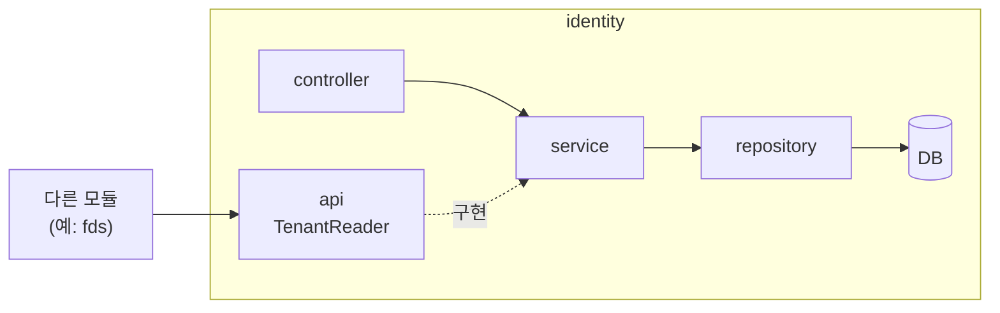

# 03. 우리 모듈 구조

[← Modulith 문서 목차](README.md)

## 1. 모듈 5개

`com.donworry` 바로 아래 패키지 하나가 모듈 하나입니다. 모듈은 5개이고, `investigation` 안에 P3 · P4가 함께 있어 담당은 6명입니다.

| 모듈 (패키지) | 담당 | 하는 일 |
| --- | --- | --- |
| `identity` | P1 주환 | 가맹점 · 직원 계정 · 권한 · 인증, 보안 신호 제공 |
| `fds` | P2 정후 | 위험 점수 · ALLOW/REVIEW/DENY/ERROR · 평가 근거 |
| `investigation` | P3 수민 | Case 생성 · 병합 · 결제별 판정 · 금융 조치 인계 |
| `investigation.report` | P4 현규 | AI 조사 보고서 · 버전 · 재시도, FastAPI 호출, AI Tool API |
| `payment` | P5 시은 | 결제 접수 · 카드 승인 · HELD · VOID · 결제 상태 |
| `settlement` | P6 민정 | CAPTURE 즉시 실행 · 수수료 · 정산 예정금 (픽업·정산 완료 배치는 2차) |

### `investigation.report`(P4)가 별도 모듈이 아닌 이유

`report`는 `investigation` **안의 하위 패키지**라서 Modulith는 둘을 한 모듈로 봅니다.

- P3가 P4에 조사를 요청하고, P4는 P3의 Case · 판정 정보를 읽습니다. 별도 모듈이면 서로를 호출해 **순환**이 됩니다
- 대신 **데이터 소유권은 나눕니다.** P3 코드는 `ai_reports` 리포지토리를 직접 쓰지 않고, `ai_reports` ↔ `security_cases` 사이도 FK 없는 논리 참조입니다 ([AGENTS.md 4절](../../AGENTS.md#4-backend-규칙))

## 2. 모듈 안 패키지 규칙

모든 모듈이 같은 모양입니다.

```text
com.donworry.payment
├── package-info.java   ← "여기가 모듈"이라는 표시 (@ApplicationModule)
├── api/                ← 다른 모듈에 공개하는 창구 (인터페이스 · DTO · 이벤트)  🔓
├── controller/         ← HTTP 요청 수신                                         🔒
├── service/            ← 업무 로직 · 트랜잭션                                    🔒
├── dto/                ← 요청 · 응답 DTO                                         🔒
├── entity/             ← JPA 엔티티                                              🔒
└── repository/         ← Spring Data JPA 리포지토리                              🔒
```

| 패키지 | 다른 모듈이 써도 되나 | 들어가는 것 |
| --- | --- | --- |
| `api/` | ✅ | 공개 인터페이스(예: `FdsEvaluator`), 그 요청 · 응답 record, 이벤트 클래스 |
| `controller/` | ❌ | `@RestController` — Service만 호출 |
| `service/` | ❌ | `api/` 인터페이스의 구현체도 여기 |
| `dto/` | ❌ | 화면 · 외부 HTTP용 DTO |
| `entity/` | ❌ | `@Entity` |
| `repository/` | ❌ | `JpaRepository` |

- 다른 모듈에 기능을 열어 주려면 `api/`에 **인터페이스**를 두고, 구현은 `service/`에 둡니다. 쓰는 쪽은 인터페이스만 주입받습니다
- 모듈 최상위 패키지(`com.donworry.payment` 바로 아래)에도 Modulith는 공개로 취급하므로, 여기에는 `package-info.java` 외의 클래스를 두지 않습니다
- 모듈 안 계층 규칙(Controller → Service → Repository)은 Modulith가 아니라 `ArchitectureTests`가 검사합니다 ([CI 03](../ci/03-backend.md#architecturetests--모듈-안-계층-규칙-archunit))

### 예: identity 모듈의 실제 모양

클래스 이름은 들어갈 내용을 보여주는 예시입니다. `security/`는 identity에만 있는 패키지입니다.

```
identity/
├── package-info.java     # 모듈 선언 (@ApplicationModule) — 담당·책임 주석
├── api/                  # 🔓 다른 모듈에 공개 — 인터페이스·record·이벤트만
│   ├── TenantReader.java        # 예) 가맹점 조회 인터페이스
│   ├── TenantSummary.java       # 예) 조회 결과 record (엔티티 대신 내보내는 모양)
│   └── CurrentUser.java         # 예) 로그인 사용자·역할 조회
├── controller/           # 🔒 HTTP 요청 수신 — Service만 호출
│   └── AuthController.java      # 예) POST /api/auth/login
├── service/              # 🔒 업무 로직·트랜잭션, api 인터페이스의 구현체
│   ├── AuthService.java
│   └── TenantReaderImpl.java    # 예) TenantReader 구현 (다른 모듈은 이 클래스를 모름)
├── repository/           # 🔒 DB 조회·저장 (Spring Data JPA)
│   └── PlatformUserRepository.java
├── entity/               # 🔒 테이블과 1:1 매핑
│   ├── PlatformUser.java
│   └── Tenant.java
├── dto/                  # 🔒 요청·응답 모양
│   ├── LoginRequest.java
│   └── MeResponse.java
└── security/             # 🔒 identity 전용 — SecurityConfig
```

🔓 = 다른 모듈이 import 가능 · 🔒 = 이 모듈 안에서만 사용 (어기면 `./gradlew check` 실패)



- 화면·외부 요청은 `controller → service → repository` 순서로 흐릅니다. Controller는 Repository·Entity를 직접 쓰지 않습니다.
- 다른 모듈은 `api/`의 인터페이스만 주입받아 호출합니다. 실제로 실행되는 것은 `service/`의 구현체이고, Spring이 연결해 줍니다.
- 엔티티는 `api/` 밖으로 내보내지 않습니다. 다른 모듈에 줄 데이터는 `api/`의 record로 만듭니다.

### 예: payment가 fds에 평가를 요청

```java
// fds/api/FdsEvaluator.java — 공개 창구
public interface FdsEvaluator {
    FdsResult evaluate(FdsRequest request);
}

// fds/service/FdsEvaluationService.java — 구현 (비공개)
@Service
class FdsEvaluationService implements FdsEvaluator { ... }

// payment/service/PaymentService.java — 쓰는 쪽
@Service
class PaymentService {
    private final FdsEvaluator fdsEvaluator;   // ✅ fds.api만 import
    // private final FdsEvaluationRepository repo;   ❌ ModularityTests 실패
}
```

이름과 메서드는 예시입니다. 실제 계약은 담당자 간 합의로 정합니다.

## 3. 어노테이션 두 개

실제 파일: `backend/src/main/java/com/donworry/<모듈>/package-info.java`

```java
// payment/package-info.java
// Payment 모듈 (P5 시은) — 결제 접수·카드 승인·HELD·VOID·결제 상태
// 다른 모듈은 api 패키지만 사용한다
@org.springframework.modulith.ApplicationModule(displayName = "Payment")
package com.donworry.payment;
```

```java
// payment/api/package-info.java
// 다른 모듈에 공개하는 인터페이스·이벤트만 둔다
@org.springframework.modulith.NamedInterface("api")
package com.donworry.payment.api;
```

| 어노테이션 | 붙는 곳 | 뜻 |
| --- | --- | --- |
| `@ApplicationModule` | 모듈 최상위 패키지 | 이 패키지가 모듈 하나. `displayName`은 관계도에 표시되는 이름. `allowedDependencies`(허용 의존 목록)도 여기에 적는다 ([05](05-verification.md#3-alloweddependencies--모듈별-허용-의존)) |
| `@NamedInterface("api")` | `api/` 패키지 | 이 패키지를 `api`라는 이름의 공개 창구로 지정. 하위 패키지는 기본으로 비공개라서, 공개하려면 이 표시가 필요 |

다음: [04 의존 방향과 이벤트](04-dependency-and-events.md)
