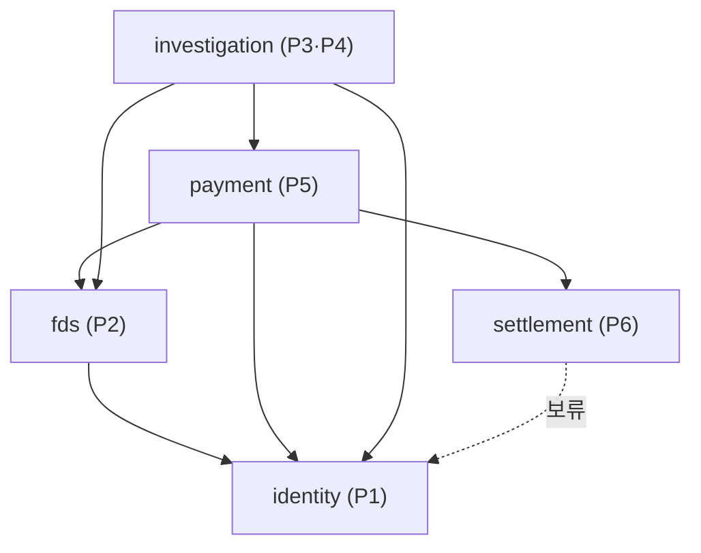

# 04. 의존 방향과 이벤트

[← Modulith 문서 목차](README.md)

결정 기록 원문: [ADR-0012](../decisions/0012-payment-settlement-dependency.md)

## 1. 의존 방향

화살표는 **"import해도 된다(호출해도 된다)"** 는 허락입니다. 화살표 반대 방향의 import는 금지입니다.



| 모듈 | import해도 되는 모듈 |
| --- | --- |
| `identity` | 없음 |
| `fds` | identity |
| `settlement` | 없음 (identity는 보류 — 가맹점 정보가 필요해지면 추가) |
| `payment` | fds, identity, settlement |
| `investigation` | payment, fds, identity |

### 왜 `payment → settlement`인가

P6 정산이 완료된 결제는 취소할 수 없습니다. 취소는 P5 담당이므로 **P5가 취소 전에 P6의 정산 상태를 확인**해야 합니다. 그래서 payment가 settlement를 호출할 수 있는 방향으로 정했습니다 (기존 ADR-0001의 `settlement → payment`를 뒤집음).
정산 완료·매입 후 취소 연동은 P6의 2차 범위이며, 현재 1차는 즉시 매입·정산 예정금 저장까지입니다. Notion의 이전 의존 방향과 남은 계약 차이는 [문서 대조 현황](../README.md)을 봅니다.

## 2. 동기 호출과 이벤트 — 언제 무엇을 쓰나

| | 동기 호출 (`api/` 인터페이스) | 이벤트 |
| --- | --- | --- |
| 방향 | 화살표 방향으로만 | **양방향 가능** (클래스 위치만 지키면) |
| 결과 | 바로 받음 | 받지 않음 (보내고 끝) |
| 트랜잭션 | 호출한 쪽과 같은 흐름 | 보낸 쪽 **커밋 후** 받는 쪽이 따로 처리 |
| 쓰는 때 | 결과가 있어야 다음 단계로 갈 수 있을 때 | "이런 일이 있었다"를 알리기만 할 때, 화살표 반대로 알려야 할 때 |
| 우리 예 | payment → fds 위험 평가, investigation → payment 금융 조치 요청 | `PaymentHeld`, `CaptureRequested`, 매입 결과, 인계 결과 |

**규칙:** 화살표 반대 방향으로 알릴 일은 반드시 이벤트로 보냅니다. 예) settlement가 payment에 "매입 접수됐다"를 알리는 것.

## 3. 이벤트는 양방향, 코드 의존은 한 방향

이벤트를 **보내는 쪽과 받는 쪽 모두 그 이벤트 클래스를 import**해야 합니다. 그러니 클래스가 어느 모듈에 있느냐가 의존 방향을 결정합니다.

> **이벤트 클래스는 두 모듈 중 상대가 import해도 되는 쪽(의존 화살표를 받는 쪽)의 `api/`에 둔다.**

### 예: `CaptureRequested` — payment가 보내고 settlement가 받음

```java
// ❌ payment.api에 두면
package com.donworry.payment.api;
public record CaptureRequested(...) {}

// settlement가 받으려면
import com.donworry.payment.api.CaptureRequested;   // settlement → payment 생김
// payment → settlement 와 합쳐져 순환 → ModularityTests 실패
```

```java
// ✅ settlement.api에 두면
package com.donworry.settlement.api;
public record CaptureRequested(...) {}

// payment (보내는 쪽)
import com.donworry.settlement.api.CaptureRequested;   // payment → settlement ✅ 허용된 방향
events.publishEvent(new CaptureRequested(...));

// settlement (받는 쪽)
@ApplicationModuleListener
void on(CaptureRequested event) { ... }                // 자기 모듈 클래스 — import 없음
```

### 우리 이벤트 위치

| 이벤트 | 보내는 쪽 → 받는 쪽 | 클래스 위치 |
| --- | --- | --- |
| `PaymentHeld` (HELD 발생) | payment → investigation | `payment.api` |
| `HandoffResult` (금융 조치 인계 결과) | payment → investigation | `payment.api` |
| `CaptureRequested` (매입 요청) | payment → settlement | `settlement.api` |
| 매입 접수 결과 (예: `CaptureIntakeAccepted` · `CaptureIntakeRejected`) | settlement → payment | `settlement.api` |
| 매입 실행 결과 (예: `CaptureCompleted` · `CaptureFailed`) | settlement → payment | `settlement.api` |

위 표는 ADR-0012의 기존 접수·실행 분리안입니다. #104의 [완료 통지 기반 접수 확인 제안](../decisions/0016-payment-mvp-capture-completion.md)은 P3·P6 합의 전이며 의존 방향·타입 위치는 유지합니다.

이름 · 필드는 아직 합의 중입니다 ([ADR-0012 합의가 필요한 것](../decisions/0012-payment-settlement-dependency.md#합의가-필요한-것)).

### 받는 쪽이 꼭 할 일 — 멱등

이벤트는 재발행될 수 있어서 **같은 이벤트가 두 번 올 수 있습니다.** 받는 쪽은 이미 처리한 이벤트인지 확인하고 한 번만 반영합니다.

```text
CaptureRequested(paymentId=101) 도착 → captures에 저장
CaptureRequested(paymentId=101) 또 도착 → 이미 있음 → 저장하지 않고 넘어감
```

## 4. 리스너 — `@ApplicationModuleListener`

받는 쪽은 Modulith가 제공하는 `@ApplicationModuleListener`를 붙입니다. 이 어노테이션 하나가 아래 세 가지를 합친 것입니다.

| 포함된 것 | 뜻 |
| --- | --- |
| `@TransactionalEventListener` | 보낸 쪽 트랜잭션이 **커밋된 뒤에만** 실행 (롤백되면 이벤트도 없던 일) |
| `@Transactional(propagation = REQUIRES_NEW)` | 받는 쪽은 **새 트랜잭션**에서 처리. 받는 쪽이 실패해도 보낸 쪽 저장은 유지 |
| `@Async` | 별도 스레드에서 실행 |

```text
P5: payment HELD 저장 + PaymentHeld 발행 ─ 커밋 ─┐
                                                 └▶ P3: (새 트랜잭션) Case 생성 ─ 커밋
P3가 실패해도 P5의 HELD는 그대로. P3 처리는 아래 발행 기록으로 다시 시도할 수 있음
```

- `@Async`는 비동기 실행이 켜져 있어야 별도 스레드로 동작합니다. 우리 코드에는 `@EnableAsync`가 없으므로, 실제로 별도 스레드에서 도는지(Modulith 자동 설정 포함)는 첫 이벤트를 구현할 때 확인하고 이벤트 공통 설정 작업에서 정합니다

## 5. 이벤트 발행 기록 (`EVENT_PUBLICATION`)

`spring-modulith-starter-jdbc`가 이벤트를 **DB 테이블에 기록**합니다. 테이블은 Flyway가 만듭니다 ([Flyway 03 4절](../flyway/03-how-we-use.md#4-첫-migration--event_publication)).

```text
① P5 트랜잭션 안에서: payment 저장 + EVENT_PUBLICATION에 "PaymentHeld → P3 리스너" 행 저장
② 커밋
③ P3 리스너 실행
   성공 → 그 행에 완료 시각(COMPLETION_DATE) 기록
   실패 → 완료 시각이 비어 있는 채로 남음 = "아직 처리 안 된 이벤트"
④ 남은 행은 다시 보낼 수 있음 (재발행)
```

| 장점 | 설명 |
| --- | --- |
| 이벤트가 사라지지 않음 | 발행 기록이 업무 데이터와 **같은 트랜잭션**에 저장되므로, 커밋됐는데 이벤트만 사라지는 일이 없다 |
| 실패 추적 | 완료 시각이 빈 행을 조회하면 처리 안 된 이벤트를 알 수 있다 |

- 재발행 방식(앱 재시작 시 자동 재발행 설정, 주기적 재시도 등)은 아직 설정하지 않았습니다. 이벤트 공통 설정 작업에서 정합니다
- 재발행이 있으므로 받는 쪽 **멱등 처리**가 필수입니다 ([3절](#받는-쪽이-꼭-할-일--멱등))

다음: [05 검사](05-verification.md)
