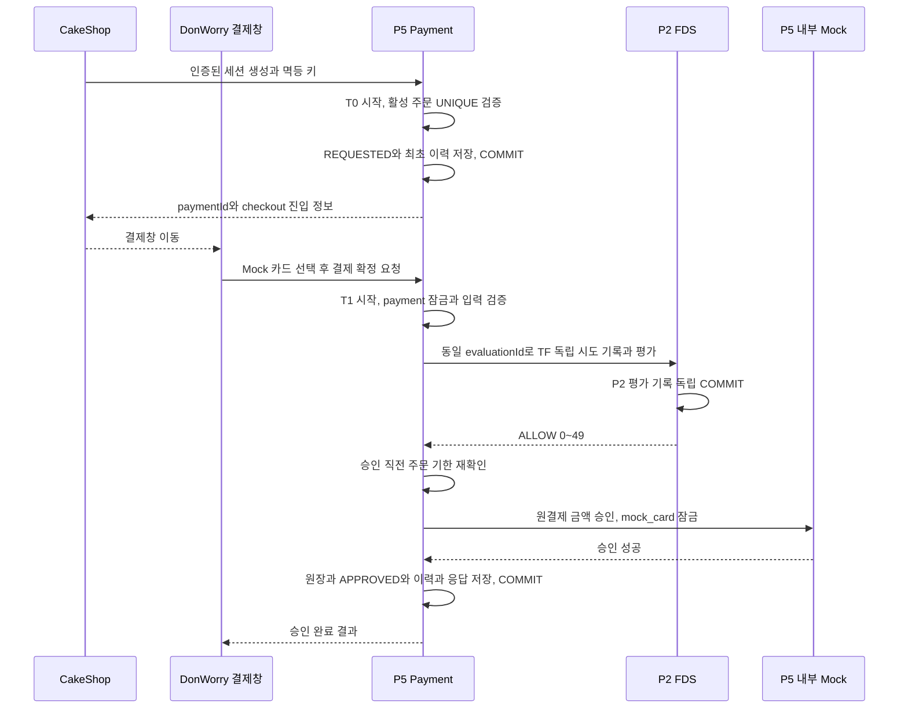
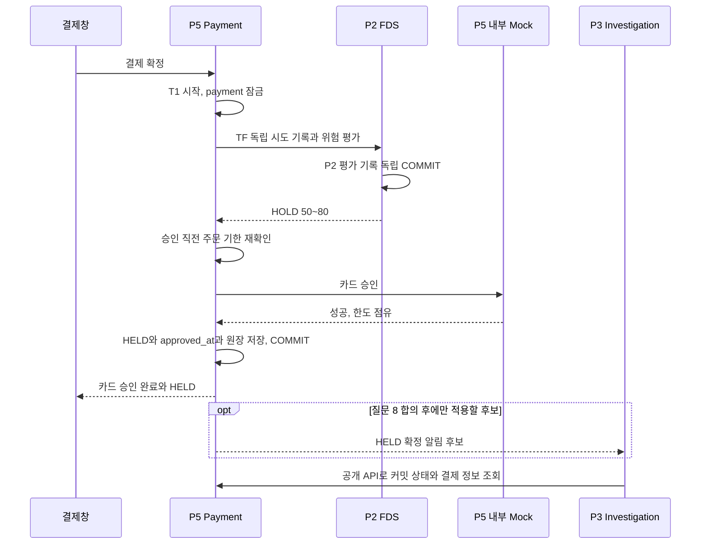
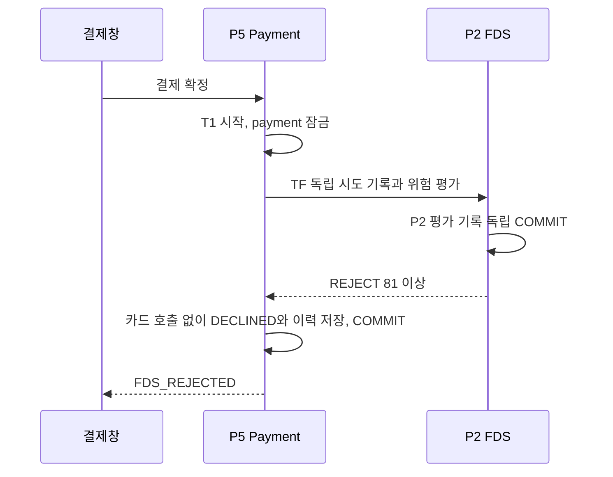
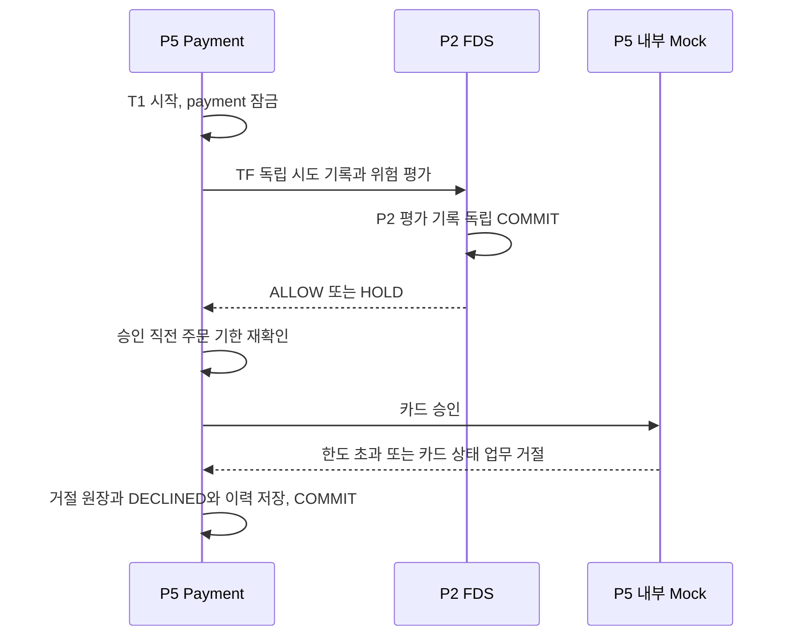
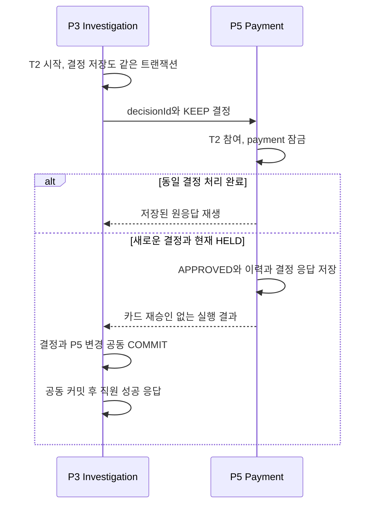
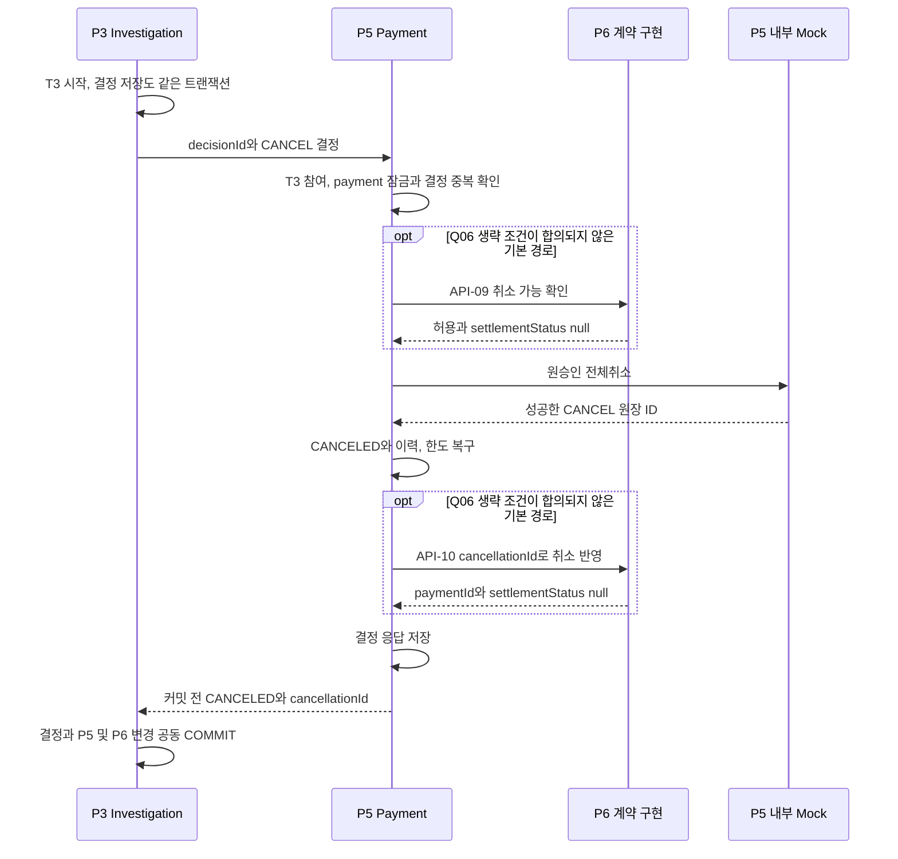
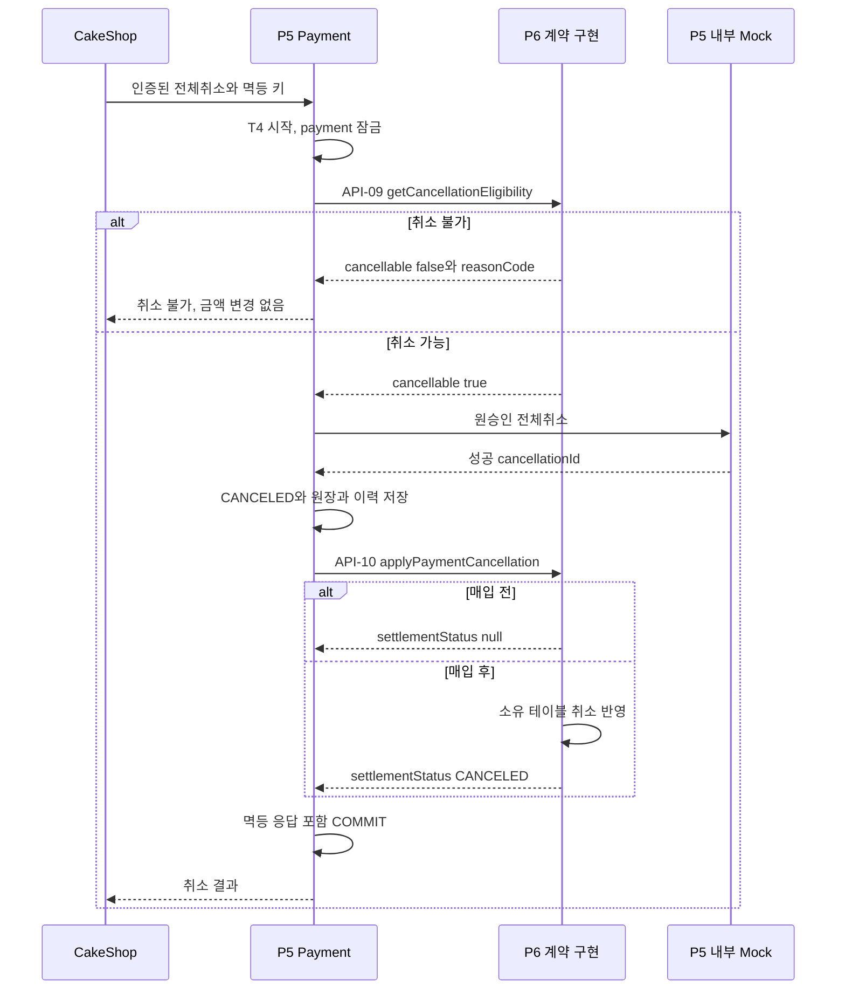
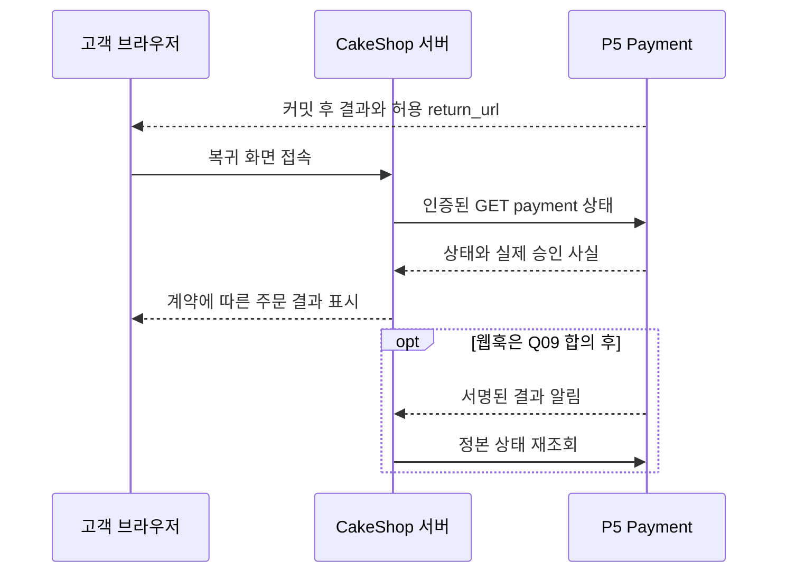
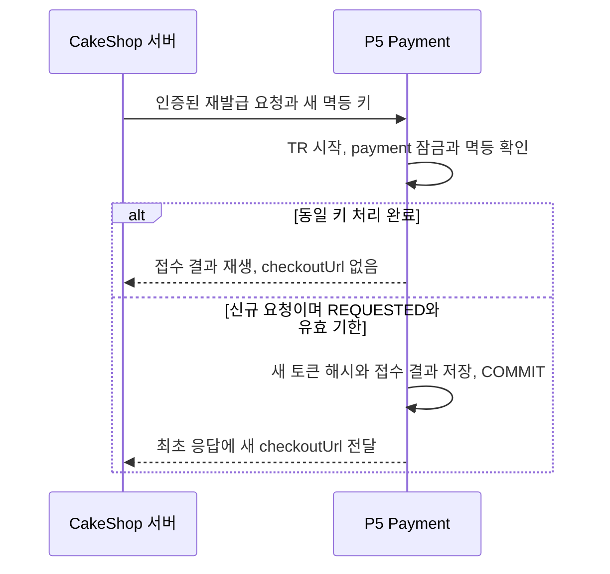
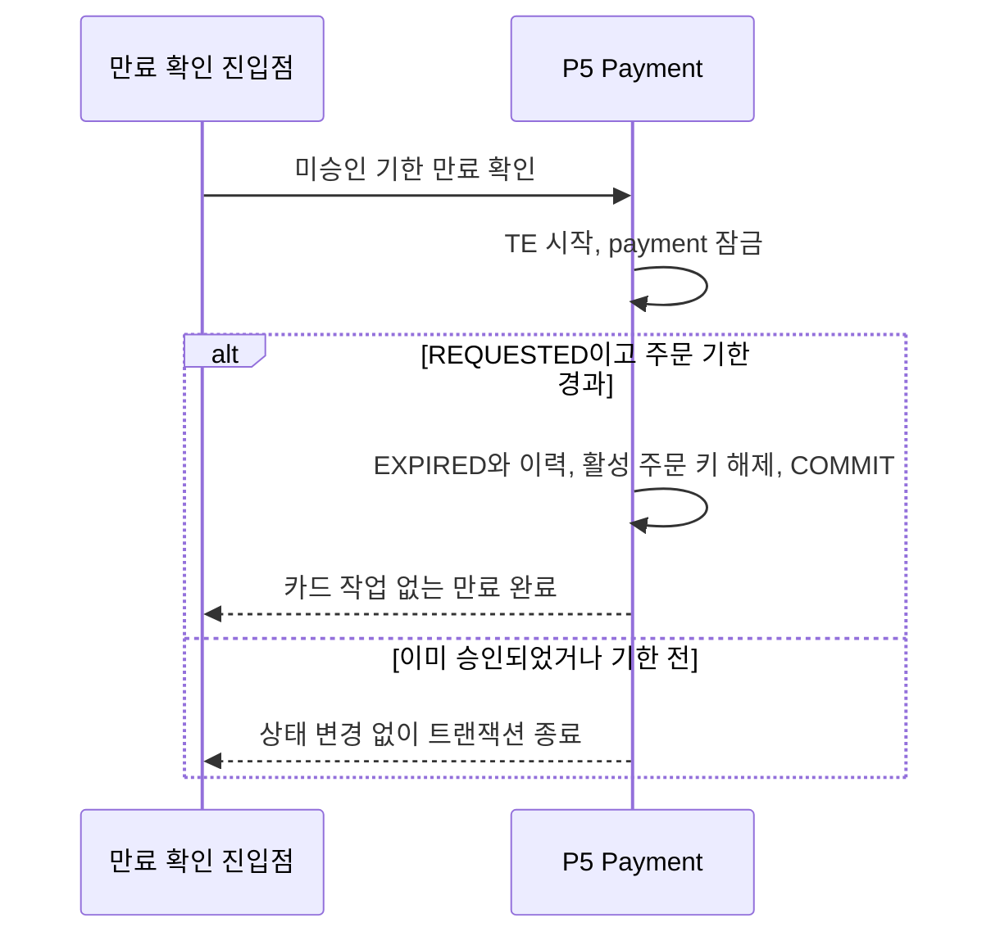

# 결제·취소 시퀀스

상태 기준은 [04](04-state-machine.md), 트랜잭션 T0~T5·TF·TR·TE는 [06](06-transaction-locking.md). CONFIRMED(S6) 정책과 S8 사용자 선택을 적용한 **미구현 설계**다. 선택한 1·2·3·4·5·7번은 팀 합의 대기, 질문 6·8은 OPEN이다. P6 호출은 Q01 승인 후 원자성 검증을 전제로 한 계약 수준 표현이며 양방향 import를 지시하지 않는다. Mermaid의 P5 내부 Mock 참여자는 별도 서버가 아니다.

## 1. 세션 생성과 정상 결제

책임: CakeShop은 주문·금액의 서버 원천, P5는 가맹점 검증·세션·카드 선택 계약·결제 상태, P2는 위험 점수. 결제창의 금액·고객 입력으로 서버 세션 금액을 덮어쓰지 않는다. 승인 완료 응답은 커밋 후 반환한다. 세션 재생은 안정적인 접수 결과만 반환하고 토큰이 필요하면 인증된 CakeShop 서버가 재발급한다(질문 3-A, 팀 합의 대기).

## 2. HOLD → Mock 승인 → HELD

P2 위험 경보는 카드 승인 이전에도 발생할 수 있다. P3는 위험 경보만 보고 HELD를 가정하지 않는다. HELD 확정 알림의 이름·발행 책임·내구성은 Q07 OPEN. 질문 8이 미결이므로 이 흐름을 케이스 생성 확정 계약으로 사용하지 않는다. 후속 조사 실패가 카드 승인 커밋을 자동 취소하지 않는다. 재전달·중복 케이스 방지는 P3 계약 필요. P6는 HELD를 매입에서 제외한다.

## 3. FDS REJECT

카드 원장·한도 변경 없음. FDS 장애·타임아웃은 이 흐름이 아니다. 기술 오류면 P5 T1 롤백, REQUESTED 유지, 승인 0회, 재시도 가능 오류 반환. 별도 커밋된 P2 실제 평가 시도 기록은 남는다. 평가 중복 규격 Q05가 먼저 필요하다.

## 4. Mock 카드 승인 거절

ALLOW/HOLD 모두 DECLINED가 된다. 한도는 불변. DB 오류 등 기술 실패는 거절 원장을 성공적으로 저장했다고 응답하지 않고 P5 T1을 롤백한다. 별도 P2 평가 기록은 유지한다.

## 5. HELD → APPROVED 유지

승인 시각·한도 불변. 원응답 재생 경로도 트랜잭션을 정상 종료한다. 다른 결정으로 이미 전이했으면 STATE_CONFLICT, 추가 상태 변경 없음. 질문 5-A에 따라 P3 결정 저장과 P5 실행은 같은 트랜잭션으로 커밋한다(팀 합의 대기). P5 반환은 커밋 전 내부 결과이며 직원 성공 응답은 P3 외부 경계의 공동 커밋 후에만 보낸다. 결정 저장·실행 어느 쪽 실패든 모두 롤백한다.

## 6. HELD → CANCELED

HELD는 이미 승인됐으므로 원장 없는 단순 상태 변경 금지. P6 허용 거절 또는 Mock/P6 기술 실패면 전체 롤백, HELD 유지. 생략 여부는 무매입 불변식·P6 동의가 전제다.

## 7. APPROVED → CANCELED, 매입 전·후

취소 불가 분기는 트랜잭션을 종료하고 카드 호출 없이 반환한다. 구체 HTTP 오류·불가 결과 캐시 여부는 [API](03-api-contracts.md). 매입 후 captures는 있지만 settlements가 아직 없는 경우에도 API-10의 계약상 CANCELED를 어떻게 표현·저장하는지는 P6 확인 필요(Q13). P5가 settlements 행을 임의 생성하지 않는다. 같은 cancellationId 재호출은 중복 변경 금지, applied 필드 없음.

## 8. CakeShop 결과 전달

조회는 기본 권장안, 웹훅은 OPEN. HELD의 카드 승인 사실은 반드시 전달하되 “주문 완료/조사 중” 문구와 주문·재고 처리는 별도 계약이다. 복귀 URL 쿼리를 승인 증거로 쓰지 않는다. 통신 실패로 고객이 응답을 못 받아도 결제를 재승인하지 않고 paymentId로 조회한다.

## 실패·동시 실행 연결

모든 승인/취소는 [06의 경합 표](06-transaction-locking.md)에 따라 payment 잠금을 공유한다. 매입 후보 조회 자체는 락 보장이 아니며 P6 T5에서 재검증한다. P3에 전달하는 내부 실행 반환값은 공동 커밋 이전일 수 있다. 직원·CakeShop에 최종 성공 응답은 외부 트랜잭션 커밋 후에만 보낸다. 기술 실패 재시도는 같은 업무 키·새 인증 nonce, 다른 본문은 충돌. 상세 실패 정책·이벤트 재전달은 OPEN으로 남긴다.

## 9. 결제창 토큰 재발급 (질문 3-A, 팀 합의 대기)

원문 토큰은 저장하지 않는다. 새 해시 커밋 시 이전 토큰은 무효다. 재발급 응답도 유실되면 CakeShop이 새 키로 다시 재발급한다. 같은 키 반복으로 토큰을 회전시키지 않는다. 기존 결제창이 무효화될 수 있으며 동시 요청·응답 역전 처리는 계약 확인이 필요하다.

## 10. 미승인 결제 만료 (질문 2-B, 팀 합의 대기)

만료 진입점의 배치/요청 시점은 제안이며 팀 합의 대기다. EXPIRED 상태명도 제안이다. HELD에 이 흐름을 적용하지 않는다. P6 매입은 실행마다 APPROVED를 처음부터 재조회하고 기매입을 제외하므로, 최초 승인 시각이 오래된 HELD 해제 거래도 다음 실행에서 확인한다(질문 7-A, 팀 합의 대기).
