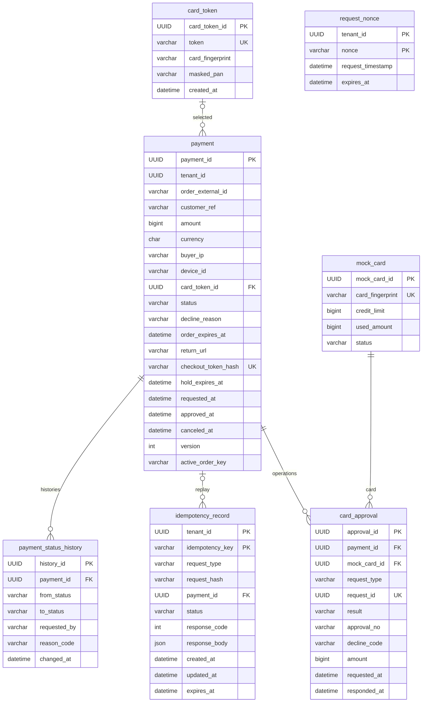

# P5 상세 ERD — 물리 설계 제안

출처: [S5 Notion 관련 초안·S6 요청](README.md). 테이블 7개와 아래 컬럼 이름은 해당 자료에서 확인했다. **길이·UUID 저장 방식·기본값·CHECK·인덱스·물리 FK는 PROPOSED**이며 SQL 마이그레이션으로 확정하지 않는다. 추가 review/decision/cancellation 컬럼은 만들지 않는다.

## 공통 규약

UUID는 논리 타입이고 물리 타입은 `BINARY(16)` 권장안(Q08). Java UUID와 바이트 순서 변환을 통일하며 MariaDB native UUID/CHAR(36)와 비교 후 결정한다. 날짜는 UTC `DATETIME(6)`, API는 UTC ISO-8601. 금액은 최소 화폐 단위 `BIGINT`, Java long, 실수 금지. 지원 통화·최대 금액은 Q17 OPEN.

표의 N은 NOT NULL, Y는 NULL 허용. 기본값 `없음`은 호출자가 반드시 명시한다는 뜻이다. 문자열 길이는 임의 확정이 아닌 검토 상한이다. 식별자·키·주문번호는 대소문자/공백 정규화 규칙과 binary collation을 합의해야 한다. 개발 DB의 기본 대소문자 비구분 collation을 그대로 사용하면 다른 키가 충돌할 수 있다.

## 관계도

아래 실선 관계는 P5 내부 물리 FK 제안만 나타낸다. tenant·P3 결정·P6 테이블은 별도 모듈이므로 물리 FK를 그리지 않는다.

## 1. payment

| 컬럼 | 물리 타입 제안 | NULL | 기본값 | 제약·의미 |
|---|---|---|---|---|
| payment_id | BINARY(16) | N | 없음 | PK, 서버 UUID |
| tenant_id | BINARY(16) | N | 없음 | P1 가맹점 UUID 논리 참조, FK 금지 |
| order_external_id | VARCHAR(128) | N | 없음 | 가맹점 주문번호, 공백 금지 |
| customer_ref | VARCHAR(128) | N | 없음 | CakeShop 고객 참조, 주민번호 등 민감 식별자 금지 |
| amount | BIGINT | N | 없음 | CHECK amount > 0 |
| currency | CHAR(3) | N | 없음 | 대문자 통화 코드, 허용 목록 Q17 |
| buyer_ip | VARCHAR(45) | N | 없음 | IPv4/IPv6, 신뢰한 프록시·요청 경로에서 수집 |
| device_id | VARCHAR(128) | Y | NULL | 결제 입력; 누락 FDS 처리 계약 필요 |
| card_token_id | BINARY(16) | Y | NULL | card_token 내부 FK, 선택 전 NULL |
| status | VARCHAR(16) | N | REQUESTED | 기존 5개 + EXPIRED 제안 CHECK, 팀 합의 대기, Enum STRING |
| decline_reason | VARCHAR(64) | Y | NULL | DECLINED에만 사유 |
| order_expires_at | DATETIME(6) | N | 없음 | 주문 유효기한, HELD 기한과 다름 |
| return_url | VARCHAR(2048) | N | 없음 | 가맹점 허용 URL, 토큰·상태 정본 아님 |
| checkout_token_hash | CHAR(64) | N | 없음 | UNIQUE, 고엔트로피 checkout 비밀값의 SHA-256 제안 |
| hold_expires_at | DATETIME(6) | Y | NULL | 정책 OPEN, 기본 자동 만료 없음 |
| requested_at | DATETIME(6) | N | 없음 | 서버 접수 시각 |
| approved_at | DATETIME(6) | Y | NULL | Mock 최초 성공 시각. HELD에도 저장 |
| canceled_at | DATETIME(6) | Y | NULL | 성공 취소 시각 |
| version | INT | N | 0 | JPA @Version 제안, 음수 금지 |
| active_order_key | VARCHAR(128) 생성 컬럼 | Y | 생성식 | 직접 입력·수정 금지 |

생성식 제안: `CASE WHEN status IN ('REQUESTED','HELD','APPROVED') THEN order_external_id ELSE NULL END`, PERSISTENT 저장 방식 검토. `UNIQUE(tenant_id, active_order_key)`로 같은 가맹점·주문에는 활성 결제 1개만 허용한다. DECLINED/CANCELED/EXPIRED는 NULL이므로 과거 행을 유지하면서 새 활성 결제를 허용할 수 있다. **UNIQUE는 재결제 업무 허용을 자동 결정하지 않는다**(Q12). 동일 주문 다른 가맹점은 허용. 같은 키 동시 생성은 DB가 최종 방어하며 충돌 후 새 트랜잭션에서 조회한다.

JPA generated column은 insertable=false/updatable=false 제안. `@Version`은 비관적 락의 대체가 아니다. HELD 유지 시 active_order_key 불변, 취소 성공 또는 미승인 만료 확정 때 NULL. EXPIRED는 카드 승인·취소 원장을 만들지 않고 canceled_at도 채우지 않는다. 만료 처리 시각은 history.changed_at, 기한은 order_expires_at으로 구분한다. 상태명·만료 실행 방식은 Q12 팀 합의 대기다.

MariaDB는 생성 컬럼 인덱스와 UNIQUE의 NULL 허용을 지원하지만 실제 11.8 DDL·JPA 매핑은 미검증이다. [생성 컬럼](https://mariadb.com/docs/server/reference/sql-statements/data-definition/create/generated-columns), [CREATE TABLE](https://mariadb.com/docs/server/server-usage/tables/create-table).

인덱스 제안: UNIQUE checkout_token_hash, UNIQUE(tenant_id, active_order_key), INDEX(status, approved_at, payment_id) 매입 후보, INDEX(status, requested_at, payment_id) HELD 목록, INDEX(tenant_id, order_external_id, requested_at) 주문 이력. 미승인 만료 탐색용 INDEX(status, order_expires_at, payment_id)는 추가 제안이며 배치/요청 시 처리 방식 합의 후 결정한다. HELD 만료 정책 미정이므로 hold_expires_at 배치 인덱스는 보류.

## 2. payment_status_history

| 컬럼 | 타입 | NULL | 기본값 | 제약·의미 |
|---|---|---|---|---|
| history_id | BINARY(16) | N | 없음 | PK |
| payment_id | BINARY(16) | N | 없음 | payment 내부 FK |
| from_status | VARCHAR(16) | Y | NULL | 생성 때만 NULL |
| to_status | VARCHAR(16) | N | 없음 | 허용 Enum 값 |
| requested_by | VARCHAR(128) | N | 없음 | 서버가 만든 행위자 표기, UUID 표현은 Q03 |
| reason_code | VARCHAR(64) | Y | NULL | 전이 원인 코드 |
| changed_at | DATETIME(6) | N | 없음 | 상태 변경과 같은 서버 시각 |

INDEX(payment_id, changed_at, history_id). 삭제 cascade 금지, 감사 이력 보존. 정확한 순번이 필요하면 현재 timestamp+UUID가 업무 순서를 완전히 표현하지 못하므로 version 기반 식별 확장은 별도 합의한다. 여기에는 추가 컬럼을 확정하지 않는다.

## 3. card_token

| 컬럼 | 타입 | NULL | 기본값 | 제약·의미 |
|---|---|---|---|---|
| card_token_id | BINARY(16) | N | 없음 | PK |
| token | VARCHAR(128) | N | 없음 | UNIQUE, Mock 선택용 불투명 식별자 |
| card_fingerprint | CHAR(64) | N | 없음 | 안정적인 카드 참조 |
| masked_pan | VARCHAR(32) | N | 없음 | 화면 표시만 |
| created_at | DATETIME(6) | N | 없음 | 생성 시각 |

INDEX(card_fingerprint). fingerprint는 mock_card.card_fingerprint로 해결하는 내부 논리 관계 제안. 물리 FK는 이번 도식에 추가하지 않았고, 토큰 생성/승인 시 대상 존재를 검증한다. 1카드 여러 토큰 허용 여부는 Q08. token 소유 고객/세션 범위는 현재 컬럼만으로 표현되지 않으므로 Mock 공용 시연 카드만 전제하며 실제 저장 카드 기능을 제공한다고 주장하지 않는다.

## 4. idempotency_record

| 컬럼 | 타입 | NULL | 기본값 | 제약·의미 |
|---|---|---|---|---|
| tenant_id | BINARY(16) | N | 없음 | 복합 PK, P1 논리 참조 |
| idempotency_key | VARCHAR(200) | N | 없음 | 복합 PK, namespace 포함 |
| request_type | VARCHAR(32) | N | 없음 | SESSION_CREATE/PAYMENT_CONFIRM/PAYMENT_CANCEL/REVIEW_DECISION/CHECKOUT_REISSUE 제안 |
| request_hash | CHAR(64) | N | 없음 | 정규화 본문+업무 종류+대상 해시 |
| payment_id | BINARY(16) | Y | NULL | payment 내부 FK, 세션 삽입 전에는 NULL 가능 |
| status | VARCHAR(16) | N | IN_PROGRESS | IN_PROGRESS/COMPLETED 제안, P5 업무 커밋 시 완료 |
| response_code | INT | Y | NULL | HTTP 코드 또는 내부 성공 코드의 규격 Q15 |
| response_body | JSON | Y | NULL | 원응답, 비밀값·개인정보 최소화 |
| created_at | DATETIME(6) | N | 없음 | 생성 시각 |
| updated_at | DATETIME(6) | N | 없음 | 완료 시각 |
| expires_at | DATETIME(6) | N | 없음 | 보존기간 Q10 합의 필요, 임의 자동 삭제 금지 |

PK(tenant_id, idempotency_key), INDEX(expires_at), INDEX(payment_id). 같은 키 다른 request_type/hash는 충돌. P3 decisionId는 키로 인코딩하는 제안이며 직원 유지 결정도 이 행으로 재생한다. COMPLETED 기록에는 response_body가 있어야 한다. **S8 질문 3-A 사용자 선택 / 팀 합의 대기:** 원문 checkout 토큰은 JSON에 저장하지 않는다. 세션 생성·재발급의 안정적인 접수 결과만 저장하고, 최초 성공 응답에만 일시적 checkoutUrl을 추가한다. 응답 유실 시 인증된 CakeShop 서버가 재발급 API를 호출한다. 재발급은 기존 checkout_token_hash를 교체해 이전 토큰을 무효화한다. 같은 키 재생은 토큰을 다시 회전시키지 않으며, 진입 정보가 필요하면 새 재발급 키를 사용한다. 이는 전체 원응답 재생의 명시적 예외다. 요청 키 수명·동시 재발급·정확한 헤더는 Q11 팀 합의 대기다.

## 5. request_nonce

| 컬럼 | 타입 | NULL | 기본값 | 제약·의미 |
|---|---|---|---|---|
| tenant_id | BINARY(16) | N | 없음 | 복합 PK, P1 논리 참조 |
| nonce | VARCHAR(128) | N | 없음 | 복합 PK, 요청마다 새 값 |
| request_timestamp | DATETIME(6) | N | 없음 | 검증된 요청 시각 |
| expires_at | DATETIME(6) | N | 없음 | 허용 시계 오차·재전송 창보다 짧으면 안 됨 |

INDEX(expires_at). 같은 nonce 재사용 거부, 업무 멱등 키와 별개. 서명 규격·만료 기간 Q11. 인증되지 않은 요청을 먼저 저장해 저장소를 채우지 않는다.

## 6. mock_card

| 컬럼 | 타입 | NULL | 기본값 | 제약·의미 |
|---|---|---|---|---|
| mock_card_id | BINARY(16) | N | 없음 | PK |
| card_fingerprint | CHAR(64) | N | 없음 | UNIQUE |
| credit_limit | BIGINT | N | 없음 | CHECK >= 0 |
| used_amount | BIGINT | N | 0 | CHECK 0 <= used_amount <= credit_limit |
| status | VARCHAR(16) | N | ACTIVE | ACTIVE/STOLEN/SUSPENDED 제안 |

카드 잠금으로 한도를 직렬화한다. 상태 변경 역시 같은 행 잠금에 참여해야 한다. 초기 금액·시드 정책 OPEN.

## 7. card_approval

| 컬럼 | 타입 | NULL | 기본값 | 제약·의미 |
|---|---|---|---|---|
| approval_id | BINARY(16) | N | 없음 | PK; 성공 CANCEL ID를 cancellationId로 활용하는 제안 |
| payment_id | BINARY(16) | N | 없음 | payment 내부 FK |
| mock_card_id | BINARY(16) | N | 없음 | mock_card 내부 FK |
| request_type | VARCHAR(16) | N | 없음 | APPROVE/CANCEL |
| request_id | BINARY(16) | N | 없음 | UNIQUE, 안정적인 업무 실행 키 |
| result | VARCHAR(16) | Y | NULL | SUCCEEDED/DECLINED 제안; 정상 커밋 시 채움 |
| approval_no | VARCHAR(64) | Y | NULL | 성공 APPROVE에만 번호, UNIQUE 제안 |
| decline_code | VARCHAR(64) | Y | NULL | 업무 거절 상세 |
| amount | BIGINT | N | 없음 | CHECK > 0, 결제 금액과 같음 |
| requested_at | DATETIME(6) | N | 없음 | 카드 작업 요청 시각 |
| responded_at | DATETIME(6) | Y | NULL | 완료 시 채움 |

INDEX(payment_id, request_type, result), INDEX(mock_card_id, requested_at). request_id UNIQUE만으로 서로 다른 키의 이중 취소는 막을 수 없으므로 payment 잠금·상태·성공 원장 검증이 필수다. 다른 본문으로 request_id 재사용 시 payment/card/type/amount를 모두 비교한다.

## 다른 모듈과 Flyway

CONFLICT: S5의 tenant_id FK 표시는 S1과 충돌한다. 본 제안에서는 payment/idempotency_record/request_nonce의 tenant_id 모두 UUID 논리 참조이며 P1 공개 API로 검증한다. P3 decisionId는 namespace 키, P6 captures/order_fulfillments/settlements는 P6 소유다. P5에서 FK·직접 수정하지 않는다. `settlement_item`은 없다.

이번에는 DDL을 생성하지 않는다. ERD 확정 후 main 최신 번호를 확인해 새 Flyway 파일을 추가하고, 기존 적용 파일은 수정하지 않는다. validate 전환·이벤트 테이블 초기화 전환은 별도 승인 작업이다. MariaDB 11.8에서 UUID 매핑, 생성 컬럼 UNIQUE(활성 2건 실패/비활성 다건 성공/가맹점 분리), NULL·CHECK, collation, UTC, 인덱스 실행계획을 검증해야 한다. ddl-auto update로 생성 컬럼·제약을 검증했다고 간주하지 않는다.

## 후속 선택의 저장 경계

P3 결정 저장은 P3 소유 테이블과 P5 payment/history/idempotency_record를 같은 트랜잭션으로 묶는다(질문 5-A, 팀 합의 대기). P5에 결정 테이블을 추가하지 않는다. P2의 실제 평가 시도·evaluationId·입력 snapshot 보존은 **P2 소유 별도 트랜잭션**이며, P5 롤백으로 삭제하지 않는다(질문 4-A, 팀 합의 대기). P2의 구체 컬럼·테이블은 미확인으로 이 ERD에 만들지 않는다.

질문 6은 OPEN: P6 정산 단위·매입 후 정산행 부재·cancellationId 저장 위치를 가정하지 않는다. 질문 8도 OPEN: 케이스 생성 규칙은 이 ERD로 확정하지 않는다.
