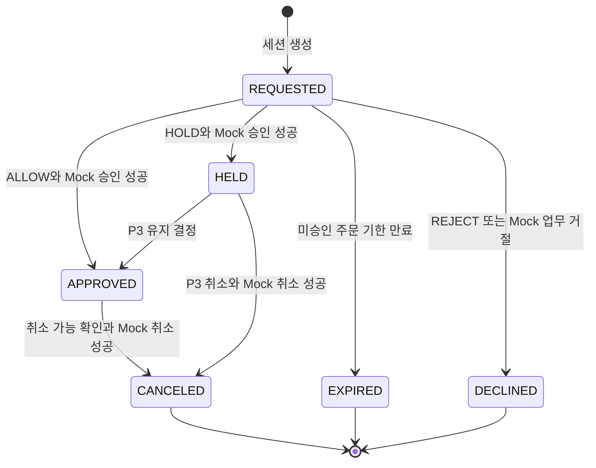

# 결제 상태 전이

출처: [S6 최신 요청과 S1/S5 충돌](README.md), [미결 Q02·Q12·Q17](12-open-questions.md).
CONFIRMED(S6): 기존 5개 상태와 승인 후 HELD 정책. **S8 질문 2-B 사용자 선택 / 팀 합의 대기:** 미승인 만료 상태를 별도로 추가한다. 아래에서는 이름을 EXPIRED로 제안하며 총 6개 상태의 초안을 사용한다. Notion 상태값은 아직 변경하지 않았다.
PROPOSED: 향후 `payment.entity.PaymentStatus`를 문자열 Enum 매핑한다. 클래스는 현재 없다.

| 상태 | 의미 | 카드 승인 여부 | P6 매입 가능 |
|---|---|---|---|
| REQUESTED | 세션 접수, 카드 선택·FDS·승인 완료 전 | 성공 승인 없음 | 아니오 |
| HELD | Mock 승인 완료, 보안 조사·매입 보류 | 승인 유효, 한도 점유 | 아니오 |
| APPROVED | Mock 승인 완료, 결제 보류 해제 | 승인 유효, 한도 점유 | 예, P6의 다른 조건도 충족해야 함 |
| DECLINED | FDS REJECT 또는 Mock 업무 거절 | 성공 승인 없음 | 아니오 |
| EXPIRED | REQUESTED인 동안 주문 기한이 지나 승인 없이 종료 | 성공 승인 없음 | 아니오 |
| CANCELED | 이 초안의 승인 후 전체취소 완료 | 과거 승인은 존재, 취소로 효력 종료 | 아니오 |

주문 기한 만료는 REQUESTED → EXPIRED로 분리하는 선택 방향이다. 고객 자발적 중단을 EXPIRED로 처리할지는 미결이므로 포함하지 않는다. 만료 조건 `now >= order_expires_at`과 처리 방식은 PROPOSED / 팀 합의 대기다. 기존 Notion의 “보류 시간 초과”는 이번 초안에서 자동 실행하지 않는다. APPROVED는 매입·정산 완료를 뜻하지 않는다.

## 전이별 DB 처리

아래 쓰기는 [T0~T4·TE](06-transaction-locking.md)의 단일 커밋에 포함한다. DB 처리 세부는 PROPOSED.

| 전이 | 결정/실행 주체 | 조건 | 같은 트랜잭션 DB 쓰기 |
|---|---|---|---|
| 없음 → REQUESTED | CakeShop 요청/P5 | 인증·금액·주문 활성 UNIQUE 통과 | payment, 최초 history(from NULL), 멱등 응답 |
| REQUESTED → EXPIRED | P5 만료 처리 | payment 잠금 후 REQUESTED 및 기한 재확인 | status EXPIRED, version, history(ORDER_EXPIRED 제안), active_order_key NULL. 원장·한도·approved_at·canceled_at 변경 없음 |
| REQUESTED → APPROVED | P2 ALLOW/P5 | 평가 입력 일치, Mock 성공 | APPROVE 성공 원장, used_amount 증가, approved_at, history, 멱등 응답 |
| REQUESTED → HELD | P2 HOLD/P5 | 평가 입력 일치, Mock 성공 | 위 승인과 동일 + status HELD; hold_expires_at NULL |
| REQUESTED → DECLINED | P2 REJECT 또는 Mock/P5 | 업무 거절 | FDS REJECT는 카드 원장 없음; Mock 거절은 APPROVE 거절 원장; decline_reason, history, 멱등 응답. 한도 불변 |
| HELD → APPROVED | P3 유지/P5 | 불변 decisionId, 현재 HELD | status, version, history, 결정 멱등 응답. approved_at·원장·한도 불변 |
| HELD → CANCELED | P3 취소/P5 | 원승인 존재, 취소 성공, Q06 정책 | CANCEL 성공 원장, used_amount 복구, canceled_at, history, 결정 멱등 응답; P6 필요 시 동시 반영 |
| APPROVED → CANCELED | CakeShop 등 권한 있는 요청/P5 | P6 API-09 허용, Mock 취소 성공 | 위 취소 + P6 API-10; 전체 롤백 가능해야 함 |

`approved_at`은 최초 Mock 승인 시각이며 HELD에도 저장한다(PROPOSED Q17). 조사 완료 시각으로 덮어쓰지 않는다. 조사 완료는 history.changed_at에서 추적한다. `decline_reason`은 DECLINED만 채우고 `FDS_REJECTED`/`CARD_DECLINED`를 제안한다. 상세 카드 거절 사유는 card_approval.decline_code에 둔다.

## 불변식·금지 전이

- HELD/APPROVED에는 해당 payment의 성공 APPROVE 원장 1건이 있어야 한다. CANCELED에는 성공 CANCEL 1건이 추가된다. 별도 요청 ID로 우회하더라도 payment 잠금과 상태 검증으로 성공 중복을 차단한다.
- APPROVED → HELD, HELD → DECLINED, DECLINED/CANCELED/EXPIRED → REQUESTED/APPROVED는 금지한다. 재결제는 새 payment_id와 세션으로 수행하는 안이며 허용 시점은 Q12 확인 대상이다.
- FDS 오류/타임아웃, 잠금 오류, Mock 기술 장애는 상태 전이가 아니다. P5 변경은 롤백하고 기술 오류를 반환한다. 별도로 커밋된 P2 실제 시도 기록은 유지한다. 주문 기한 만료는 별도 EXPIRED 업무 전이로 처리하며 기술 실패와 혼동하지 않는다. 타임아웃을 DECLINED로 저장하지 않는다.
- 승인 후 취소 실패는 HELD/APPROVED를 유지한다. 취소 성공 전에 CANCELED를 커밋하지 않는다.
- 유지 결정은 Mock 재승인을 호출하지 않는다. P3 결정 재시도는 저장된 원응답을 반환하고 history를 추가하지 않는다.
- 모든 실제 상태 변경마다 history 1건, payment.version 증가. 같은 상태 조회·재전송에는 이력을 추가하지 않는다. 최초 생성은 from_status NULL.
- 요청자 식별은 서버 인증 컨텍스트로 만든다. 클라이언트의 requestedBy 문자열을 신뢰하지 않는다. P3 직원 UUID의 구체 저장 형식은 Q03에서 정한다.

## 전이 실패·검증 기준

인증·권한 확인 후 잠금 아래 완료된 동일 업무 키를 먼저 재생한다. 신규 실행에만 최신 상태·주문 기한을 검사한다. 서로 다른 유지·취소 결정이 경합하면 첫 커밋 이후 두 번째는 `STATE_CONFLICT`를 반환한다(PROPOSED). 같은 decisionId+같은 본문은 첫 결과를 재생한다. 같은 ID에 다른 action/payment는 `IDEMPOTENCY_CONFLICT`다. 나중에 APPROVED가 취소되었더라도 이전 유지 요청 재생은 당시 APPROVED 응답이며, 현재 상태는 별도 GET으로 읽는다.

미실행 수용 테스트: 점수 0/49/50/80/81 분기, FDS 장애 시 승인 0회, HOLD 카드 거절 시 HELD 미발생, 유지 시 한도 불변, 실패 취소 시 원장·상태·한도 롤백, 승인/취소 동시 요청에서 전이·이력 1회, HELD 매입 거부, HELD 자동 만료 없음, REQUESTED 기한 만료 시 EXPIRED·원장 없음·활성 키 해제. P3 결정 저장 실패 또는 P5 실행 실패 시 결정·상태·원장·멱등 결과 모두 롤백.

## EXPIRED와 재결제의 경계

EXPIRED의 approved_at/canceled_at은 NULL이며 cancellationId가 없다. 활성 키가 해제되어도 기한이 지난 동일 주문을 자동으로 다시 결제할 수 있다는 뜻은 아니다. 새 세션에는 CakeShop이 확인한 유효 주문 기한이 필요하고, 주문 연장·새 주문 발급 정책은 Q12에서 확인한다. 승인과 만료가 경합하면 같은 payment 잠금 아래 신규 승인 직전 기한을 확인한다. 이미 HELD/APPROVED로 커밋된 결제를 만료 처리하지 않는다.
