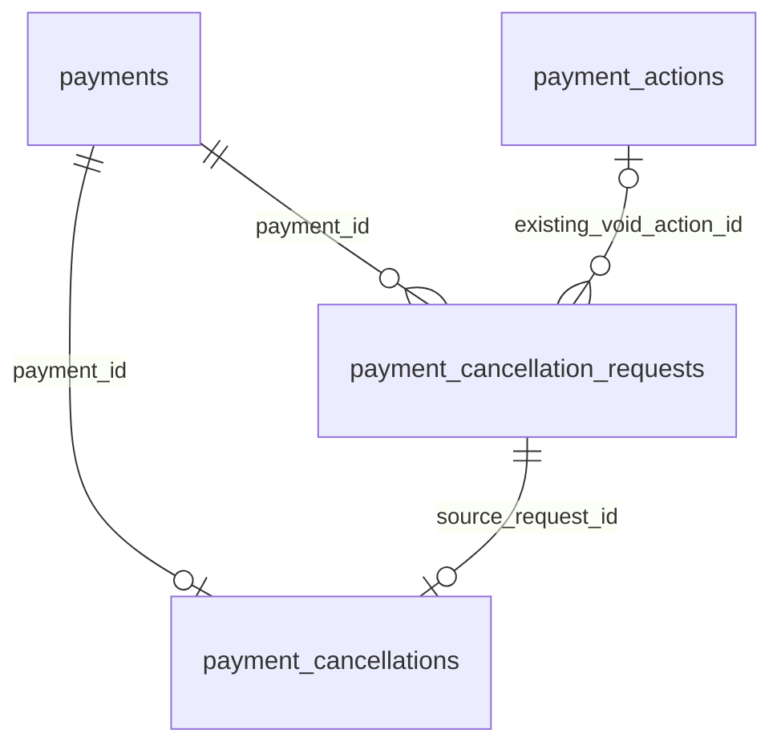

# #381 고객 취소 저장 구조

상태: **설계 PR #385 병합 후 저장 기반 구현·검증(2026-10-31)**. 기준 `dev 476b5ee`, 작업 브랜치 `feature/381-cancellation-storage`. SQL·Entity·Repository와 저장 검증을 추가하며 API·업무 실행은 후속이다.

[API 초안](381-cancellation-api-contract.md), [ADR-0056](../decisions/0056-cancellation-request-contract.md), [진행 단계 정책](380-cancellation-stage-policy.md)을 함께 본다. 사용자가 두 기록 분리 방향에 동의하고 설계 PR #385를 병합한 뒤 다음 단계 진행을 요청했다. 아래 명세로 저장 기반을 구현하며, 운영 DB 적용·Notion 동기화·다른 담당의 상세 계약 확인까지 완료된 것으로 해석하지 않는다.

## 1. 기존 스키마 대조

migration 디렉터리의 SQL을 버전 순으로 읽고 CREATE 이후 ALTER를 대조했다. 실제 DB에 접속하거나 migration을 실행하지 않았다.

| 현재 테이블 | 확인한 사실 | 이번 설계에서의 역할 |
| --- | --- | --- |
| payments | P5, payment_id PK·merchant_id 논리 참조·amount·status·authorization_ref. 이후 status_changed_at·decline_code와 merchant/order 인덱스 추가 | 소유·전액 금액·결제 잠금의 기준 |
| payment_orders / payment_requests | P5, 최초 결제 시도용. 요청 키는 UNIQUE(merchant_id, idempotency_key), 이후 FDS 입력 추가 | 최초 결제 요청 기록으로 유지 |
| payment_actions | P5, decision_id 필수, payment_id/decision_id/idempotency_key 각각 UNIQUE. CAPTURE/VOID, PENDING/SUCCEEDED/FAILED | 기존 직원 판정 결과 근거. 고객 요청을 여기에 추가하지 않음 |
| payment_fds_recoveries | P5, 결제별 하나의 평가 오류 복구 기록 | 취소 기록과 별개로 유지 |
| captures / settlements | P6, 매입·정산 각각 결제별 최대 하나. 정산 일정·완료 시각 및 매입 조회 인덱스 추가 | 공개 경계로 확인. P5에서 수정하거나 물리 FK를 걸지 않음 |
| EVENT_PUBLICATION | 공통 Modulith 이벤트 기록 | 합의된 성공 이벤트의 전달 복구. 취소 결과 원장 자체로 사용하지 않음 |

관련 SQL: [payments](../../backend/src/main/resources/db/migration/V20261022_145100__create_payments_table.sql), [상태 메타데이터](../../backend/src/main/resources/db/migration/V20261025_210954__add_payment_status_metadata.sql), [직원 조치](../../backend/src/main/resources/db/migration/V20261025_160810__create_payment_actions_table.sql), [최초 요청](../../backend/src/main/resources/db/migration/V20261025_210956__create_payment_requests_table.sql), [요청 입력 확장](../../backend/src/main/resources/db/migration/V20261029_141011__add_payment_request_risk_signals.sql).

## 2. 승인된 두 기록 분리 방향

- `payment_cancellation_requests`: 가맹점이 보낸 키별 최초 내용과 최근 접수 판단. 일시 거절도 보존한다. 실행 예약 큐가 아니다.
- `payment_cancellations`: 실제 금융 취소 접수·결과. 결제당 최대 한 행이다. 확정 실패나 미확정이어도 삭제 후 새 작업을 만들지 않는다.
- 두 테이블 모두 P5 소유다. 기존 직원 조치·P6 매입·정산 데이터는 보존한다.

실제 취소를 시작한 요청은 하나다. 다른 키의 요청은 자기 payment_id로 같은 작업을 조회하되, 아래 LINKED 판단을 저장한 경우에만 그 결과를 외부에 연결한다. 일시 거절된 요청을 GET만으로 실행 접수된 것처럼 바꾸지 않는다.

## 3. 요청 기록 필드

| 컬럼 | 타입·NULL | 의미 |
| --- | --- | --- |
| request_id | BIGINT AUTO_INCREMENT PK | 내부 요청 기록 ID. 외부 조회는 request_key 사용 |
| merchant_id | BIGINT NOT NULL | 인증 가맹점, P1 논리 참조 |
| request_key | UUID NOT NULL | 최초 요청 키 |
| payment_id | BIGINT NOT NULL | P5 payments FK |
| reason | VARCHAR(200) NOT NULL | 최초 사유 원문. 변경 불가 |
| resolution | VARCHAR(30) NOT NULL | DEFERRED / REVIEW_REQUIRED / REJECTED / ACCEPTED / LINKED / LEGACY_VOID |
| response_code | VARCHAR(100) NULL | 접수 전 판단 코드. 원시 예외·FDS 내부 코드 저장 금지 |
| existing_void_action_id | BIGINT NULL | 기존 직원 VOID 근거, P5 payment_actions FK |
| created_at | DATETIME(6) NOT NULL | 최초 기록 시각, UTC |
| updated_at | DATETIME(6) NOT NULL | 실제 접수 판단 변경 시각, UTC |

- UNIQUE(merchant_id, request_key): 가맹점별 키 충돌 방지. 키에 대응하는 payment_id·reason은 불변이다. 사유 비교는 Java 문자열의 정확한 값 비교로 수행하며 DB의 대소문자 무시 비교에 의존하지 않는다.
- UNIQUE(request_id, payment_id): 아래 작업의 복합 FK 대상. INDEX(payment_id)는 기존 요청 탐색과 FK용으로 둔다. 키 조회는 UNIQUE 인덱스를 사용한다.
- FK(payment_id) → payments(payment_id). FK(existing_void_action_id) → payment_actions(action_id). 둘 다 P5이므로 물리 참조 가능, 삭제 연쇄 없음. merchant_id → P1 FK는 만들지 않는다.
- merchant_id 양수, 사유 길이 1~200·공백만 금지, 시간 updated_at >= created_at, resolution 허용값을 검사한다. 입력의 양끝 Unicode 공백 규칙과 엄밀한 문자열 비교는 서비스에서 추가 검사한다.
- DEFERRED/REVIEW_REQUIRED/REJECTED는 각각 허용된 response_code 필수, existing_void_action_id NULL. ACCEPTED/LINKED는 response_code·existing_void_action_id NULL. LEGACY_VOID는 response_code NULL, 직원 근거 ID는 있을 때만 저장한다.
- FK가 있다고 직원 조치의 payment_id·유형·성공 상태까지 맞는 것은 아니다. 동일 결제 VOID SUCCEEDED인지는 서비스에서 확인한다. payments.merchant_id와 요청 merchant_id 일치도 서비스·통합 검사로 보장한다.

## 4. 실제 취소 작업 필드

| 컬럼 | 타입·NULL | 의미 |
| --- | --- | --- |
| cancellation_id | BIGINT AUTO_INCREMENT PK | 외부 cancellationId, 성공 결과 전달의 안정된 식별자 후보 |
| payment_id | BIGINT NOT NULL | P5 payments FK, 결제별 UNIQUE |
| source_request_id | BIGINT NOT NULL | 이 작업을 최초 접수한 요청 |
| operation | VARCHAR(10) NOT NULL | VOID / REFUND, 접수 시 확정 후 불변 |
| amount | BIGINT NOT NULL | 접수 시 서버 결제 전액. 수수료·정산 차감액 아님 |
| capture_id | BIGINT NULL | REFUND의 확인된 P6 매입 ID, 논리 참조 |
| status | VARCHAR(20) NOT NULL | PROCESSING / UNKNOWN / SUCCEEDED / FAILED |
| error_code | VARCHAR(100) NULL | 확정 업무 실패의 외부용 코드 |
| accepted_at | DATETIME(6) NOT NULL | 금융 작업 접수 시각, UTC |
| updated_at | DATETIME(6) NOT NULL | 작업의 실제 상태 변경 시각, UTC |
| completed_at | DATETIME(6) NULL | 금융 결과가 확정된 시각, UTC |

- UNIQUE(payment_id), UNIQUE(source_request_id). 실패·미확정에서도 UNIQUE를 해제하지 않는다. 같은 결제의 다른 키로 재실행을 우회하지 못하게 한다.
- FK(payment_id) → payments(payment_id). 복합 FK(source_request_id, payment_id) → payment_cancellation_requests(request_id, payment_id)로 최초 요청과 결제 일치를 검사한다. 요청 테이블에서 작업으로 역방향 FK를 두지 않아 생성 순환을 피한다.
- operation·status 허용값, amount > 0, VOID일 때 capture_id NULL / REFUND일 때 양수 capture_id 필수를 CHECK로 검사한다. P6 captures로 FK를 만들지 않는다. P6 공개 정보와 실제 결제 일치는 #383 서비스에서 검사한다.
- PROCESSING/UNKNOWN: completed_at·error_code NULL. SUCCEEDED: completed_at 필수·error_code NULL. FAILED: completed_at·비어 있지 않은 error_code 필수. 시간은 accepted_at <= updated_at, completed_at이 있으면 accepted_at <= completed_at <= updated_at.
- UNKNOWN은 DB 예외를 자동 변환한 상태가 아니다. 접수된 금융 실행의 결과 미확정을 추적할 근거·복구 계약이 있을 때만 사용한다. 현재 모의 VOID는 외부 부작용이 없으므로 기술 예외 시 전체 트랜잭션 롤백으로 처리한다.
- 실제 카드사·PG 요청 ID와 외부 실행 복구는 범위 밖이다. 향후 외부 실행을 붙일 때 이 설계만으로 안전한 재실행이 보장된다고 보지 않는다.

## 5. API 응답으로 조립하는 규칙

요청 테이블에 작업 상태 사본을 매번 전파하지 않고 작업 결과를 읽어 응답을 만든다.

| 저장 resolution | GET requestStatus·식별자 |
| --- | --- |
| DEFERRED / REVIEW_REQUIRED / REJECTED | 해당 값과 저장된 접수 판단 코드, cancellationId null |
| ACCEPTED | source_request_id가 자신인 작업의 status·ID·결과. 작업이 없으면 기술 오류 |
| LINKED | 같은 결제의 작업이 SUCCEEDED면 ALREADY_CANCELED, PROCESSING/UNKNOWN이면 해당 상태와 CANCELLATION_ALREADY_IN_PROGRESS, FAILED면 FAILED와 CANCELLATION_PREVIOUSLY_FAILED |
| LEGACY_VOID | 기존 VOIDED 사실과 직원 VOID 근거를 검증해 ALREADY_CANCELED. cancellationId null. 알 수 없는 완료 시각은 null |

- 다른 키로 기존 작업을 발견하면 LINKED로 기록하고 새 작업은 만들지 않는다. POST는 진행/미확정에 409, 확정 실패에 409, 성공에 200을 반환한다. GET은 모두 200이며 작업 상태와 안내 코드로 의미를 구분한다. 응답 Location은 **현재 요청 키**의 조회 주소로 통일한다.
- ACCEPTED의 POST만 자기 작업 PROCESSING/UNKNOWN에 202, FAILED에 422를 반환한다. LINKED와 ACCEPTED의 차이를 위 코드와 HTTP로 표현한다.
- 아직 DEFERRED인 요청은 다른 요청이 성공했어도 GET에서 그대로 남는다. 명시적 POST를 받았을 때 LINKED 또는 LEGACY_VOID로 바꾼다. 조회가 취소 의사를 새로 접수하지 않도록 한다.
- requestedAt은 요청 created_at, updatedAt은 연결된 경우 max(요청 updated_at, 작업 updated_at), completedAt은 작업의 확정 시각이다. 기존 직원 VOID는 저장된 action.completed_at을 우선한다. 근거 없이 현재 시각을 채우지 않는다.
- 금액은 연결 작업이 있으면 그 amount, 접수 전/기존 직원 취소는 소유를 확인한 payments.amount를 반환한다. 기존 금융 금액 불변이 전제이며 불일치는 자동 보정하지 않는다.
- LEGACY_VOID는 기존 결제 상태와 직원 기록이 모순되면 성공 응답하지 않는다. VOIDED이지만 직원 행이 없는 과거 결제는 확인 가능한 사실만 반환하고 새 고객 작업을 생성하지 않는다.

## 6. 접수 트랜잭션과 중복 방지

1. HTTP 인증·형식·가맹점 소유 확인 뒤, 새 업무 트랜잭션에서 payments 행을 쓰기 잠금하고 소유·최신 상태를 다시 확인한다.
2. `(merchant_id, request_key)`를 조회한다. 기존 키의 payment_id·reason이 다르면 충돌이며 원 기록을 변경하지 않는다. 없는 키만 최초 기록을 만든다.
3. 기존 요청이 ACCEPTED/LINKED/LEGACY_VOID이면 저장된 연결 근거로 결과를 반환한다. REJECTED이면 확정 거절을 보존한다. 신규 요청과 DEFERRED/REVIEW_REQUIRED만 최신 상태를 재판단한다. 같은 결제의 기존 직원 조치·고객 작업을 확인하여 기존 고객 작업이면 LINKED, 기존 직원 VOID면 LEGACY_VOID, 진행 중 결제면 DEFERRED, 확인 필요면 REVIEW_REQUIRED로 결정한다.
4. 신규 금융 실행이 허용되는 요청만 작업을 만들고 요청을 ACCEPTED로 변경한다. source_request_id와 payment_id 일치를 DB·서비스 양쪽에서 검사한다. 직원 조치 경합은 #380 정책을 적용한다.
5. 접수 판단 DTO를 정상 반환하여 트랜잭션 커밋 후 HTTP 계층에서 409/422로 매핑한다. 업무 거절을 예외로 던져 요청 키 기록까지 롤백하지 않는다. 기술 예외는 롤백하고 5xx로 응답한다.
6. 같은 결제의 서로 다른 키는 payment 잠금과 UNIQUE(payment_id)로 직렬화한다. 서로 다른 결제에 같은 가맹점 키가 동시에 오면 키 UNIQUE의 패자 트랜잭션을 종료한 뒤 새 트랜잭션에서 원 내용을 대조한다. 모든 DB 오류를 키 충돌로 바꾸지 않는다.

잠금 순서 제안은 payments → 해당 payment_actions → 해당 취소 요청 → payment_cancellations다. 복구·결과 반영도 payment부터 시작한다. 서로 다른 결제의 키 충돌을 해결하려고 두 결제 잠금을 함께 잡지 않는다. 기존 주문 접수의 order → payment 순서와 역전되지 않도록 취소 흐름에서 order 쓰기 잠금을 추가하지 않는다.

고객 취소가 별도 트랜잭션으로 접수된 뒤 실행되는 형태라면 기존 직원 조치도 고객 작업 존재를 잠금 아래 검사해야 한다. 새 UNIQUE는 기존 payment_actions와의 동시 실행을 막아주지 않는다. 이 연동은 #382·#380 구현/회귀 검증의 필수 조건이다.

## 7. 성공 기록과 전달 실패

- 모의 VOID 성공은 결제 VOIDED·작업 SUCCEEDED·합의된 결과 발행을 같은 트랜잭션에 둔다. 롤백이면 전부 취소된다. 현재 직원 VOID 흐름을 그대로 고객 요청으로 호출하지 않는다.
- REFUND의 금융 실행·결제 상태 반영·P6 성공 이벤트는 #383 계약에서 확정한다. 이번 저장 초안은 환불 성공을 임의로 구현하거나 새 PaymentStatus를 채택하지 않는다.
- 성공 이후 P6 수신 실패는 금융 작업 실패가 아니다. 성공 결과·동일 cancellationId를 유지하고 전달만 복구한다. 이벤트 타입/필드는 settlement.api의 합의된 경계를 따른다.
- Modulith 운영 수신자가 실제 등록되어야 전달 기록을 기대할 수 있다. 실행부·필수 수신부가 없는 상태에서는 CANCELLATION_NOT_READY로 거절한다. PROCESSING 행만 생성해 작업이 시작됐다고 응답하지 않는다.
- PROCESSING을 커밋하는 실행 모델은 실제 처리·재시작 복구 담당 경로가 마련된 경우에만 활성화한다. DEFERRED 요청은 재시도 워커의 실행 대상에 절대 포함하지 않는다.

## 8. 보존·배포·확인 사항

- 최초 범위에서는 두 기록을 물리 삭제하거나 키를 만료시켜 재사용하지 않는다. 이는 법정 보존 기간을 확정한 것이 아니다. 장기 사유 원문·키의 보존/익명화 정책과 용량은 후속 P5 확인 대상이다. 원문 키·사유를 로그로 복제하지 않는다.
- 기존 직원 조치를 고객 작업으로 백필하지 않는다. 기존 테이블·행·이미 병합된 SQL을 수정하지 않는다. 환불 후 조회/주문 차단 등 기존 상태 소비자 영향은 #383에서 함께 점검한다.
- `newMigration`으로 요청 테이블 → 작업 테이블 순서로 생성했다. 의존하는 두 migration은 같은 PR·배포에 포함한다. 다른 담당 테이블과 기존 SQL은 변경하지 않는다.
- 확인 수준: 테이블 2개 분리와 요청은 여러 개/실제 작업은 결제당 하나라는 방향은 사용자 승인이다. 접수 전 키·최초 내용 보존도 기존 사용자 정책이다. 상세 필드·제약·상태 전이·보존/익명화·접수 후 복구 범위는 아래 명세와 함께 검토한다. 다른 담당 계약: P1 인증, P3 직원 조치/Case, P6 매입 ID 확인·성공 전달·정산 반영.

### 상태 전이 명세

| 대상 | 허용 전이 | 금지 사항 |
| --- | --- | --- |
| 새 요청 | 최초 판단 결과로 직접 저장 | 실행 예약용 임시 상태를 커밋하지 않음 |
| DEFERRED / REVIEW_REQUIRED | 명시적 POST에서 DEFERRED·REVIEW_REQUIRED·REJECTED·ACCEPTED·LINKED·LEGACY_VOID로 재판단 | GET·스케줄러가 접수하지 않음 |
| REJECTED | 동일 결과 유지 | 이후 새 실행으로 바꾸지 않음 |
| ACCEPTED / LINKED / LEGACY_VOID | 연결 근거 유지, 조회 결과는 연결된 실제 금융 사실로 구성 | 다른 작업으로 연결을 교체하거나 DEFERRED로 되돌리지 않음 |
| PROCESSING 작업 | 근거에 따라 UNKNOWN / SUCCEEDED / FAILED | 단순 DB 장애·타임아웃만으로 FAILED 확정 금지 |
| UNKNOWN 작업 | 실제 결과 확인 후 SUCCEEDED / FAILED | 새 작업 생성·금융 실행 재시도 금지 |
| SUCCEEDED / FAILED 작업 | 같은 확정 결과의 중복 반영만 허용 | 결과·금액·원 요청·완료 시각 덮어쓰기 금지 |

접수 전 요청의 resolution이 같고 판단 코드도 같으면 updated_at을 바꾸지 않는다. 새 요청 저장 시 created_at=updated_at이다. 작업 accepted_at은 원 요청 created_at보다 늦을 수 있으며 금융 작업이 실제 접수된 때만 생성한다. 작업 결과 전이는 updated_at과 completed_at을 동일한 확정 시각으로 기록한다. 작업·요청의 타 테이블 시간 관계는 서비스에서 검사한다.

### 상태별 코드·근거 조합

| 요청 resolution | response_code | existing_void_action_id / 작업 |
| --- | --- | --- |
| DEFERRED | PAYMENT_IN_PROGRESS | 직원 ID 없음, 이 요청이 시작한 작업 없음 |
| REVIEW_REQUIRED | PAYMENT_REVIEW_REQUIRED | 직원 ID 없음, 이 요청이 시작한 작업 없음 |
| REJECTED | PAYMENT_NOT_CANCELABLE | 직원 ID 없음, 이 요청이 시작한 작업 없음 |
| ACCEPTED | NULL | 직원 ID 없음, source_request_id가 자신인 작업 필수 |
| LINKED | NULL | 직원 ID 없음, 다른 source_request_id의 같은 결제 작업 필수 |
| LEGACY_VOID | NULL | 고객 작업 생성 없음, 확인된 직원 VOID ID만 선택 저장 |

LINKED의 업무 코드는 저장 response_code가 아니라 작업 상태에서 계산한다. 인증·입력·키 충돌·DB 오류·NOT_READY는 위 영속 업무 판단 코드로 바꾸지 않는다. 기술적으로 판단을 완료하지 못하면 신규 요청 저장도 롤백하고 이전 요청은 유지한다. 이후 같은 키 재시도 시 기록 유무부터 확인한다.

DB CHECK는 요청의 코드·직원 ID 조합과 작업의 상태·결과·capture_id 조합을 검사한다. NULL이 필수인 조건은 IS NULL, 값이 필요한 조건은 IS NOT NULL을 명시하여 SQL UNKNOWN 통과를 막는다. ACCEPTED/LINKED의 작업 존재와 source_request_id 관계, LEGACY_VOID의 실제 결제 상태는 행 CHECK로 보장할 수 없으므로 서비스 전이·조회 정합성 검사와 통합 테스트로 보장한다.

### 기록 보존 명세 제안

최초 구현에는 삭제 API·정리 배치·키 만료 기능을 두지 않는다. 취소 결과와 중복 방지 근거를 유지하기 위한 운영 기본안이다. 장기 보존 기한이나 개인정보 정책을 확정한 것은 아니다. 향후 사유 익명화·아카이빙 시 같은 키의 내용 비교와 과거 결과 조회가 깨지지 않는 별도 전환 설계가 필요하다. 키를 지워 과거 취소를 신규 요청으로 받는 방식은 사용하지 않는다.

### 저장 기반 구현 단위

1. 상세 명세 확인 후 ERD의 실제 구현 예정 목록·관계에 반영한다.
2. 요청 테이블 migration·Entity·Repository 및 상태/키 저장 검증을 작성한다.
3. 의존 작업 테이블 migration·Entity·Repository와 복합 FK·결제당 단일 작업 검증을 같은 PR에 포함한다.
4. 접수·조회 Service에서 기존 직원 조치와의 잠금·무결성 조건을 연결한다. 실제 금융 실행 없는 저장 테스트 fixture를 기능 완료로 보고하지 않는다.
5. HTTP 계약·인증 연결과 미연결 실행 차단을 검증한 뒤 #382·#383에서 실제 상태별 실행을 연결한다.

현재 단계는 1~3번 저장 기반이다. 4~5번 서비스·HTTP는 후속이다. 저장 fixture에서 ACCEPTED·PROCESSING 행을 만들 수 있다는 사실은 실제 취소 기능의 접수·복구가 연결됐다는 뜻이 아니다.

## 9. 검증 계획

승인·구현 후 `./gradlew spotlessApply check mariaDbTest`에서 다음을 확인한다.

- 전체 Flyway 적용·JPA validate, NULL 상태 조합 CHECK, 복합 FK 결제 불일치 거절, 가맹점 키 UNIQUE 및 작업 payment UNIQUE.
- 일시 거절 HTTP 409 후 키가 남는지, 같은 키 다른 사유 충돌, 같은 키 정상 재접수와 rollback, 다른 키 동시 접수 한 건, 서로 다른 결제 동일 키의 패자 복구.
- 직원 VOID 과거 사실·없는 시각 보존, 직원 ACCEPT와 고객 취소 동시 실행, GET 부작용 없음, FAILED/UNKNOWN의 새 키 우회 차단.
- 성공 커밋·이벤트 원자성, 실제 수신부 실패 후 재전달이 금융 작업을 재실행하지 않는지, 미연결 실행부 접수 금지.

설계 PR #385에서는 문서 링크·공백·API 예시 JSON만 검사했다. 이번 저장 구현의 실행 결과와 남은 검증은 아래에 별도로 기록한다.

## 10. 저장 기반 구현 (#381 후속)

- [요청 SQL](../../backend/src/main/resources/db/migration/V20261031_183409__create_payment_cancellation_requests.sql), [작업 SQL](../../backend/src/main/resources/db/migration/V20261031_183416__create_payment_cancellations.sql): 가맹점별 키 UNIQUE, 결제당 작업 UNIQUE, 최초 요청·결제 복합 FK, NULL/상태 조합 CHECK를 추가했다.
- `PaymentCancellationRequest`: 결제에서 소유자를 가져오고 최초 키·사유·생성 시각을 유지한다. Unicode 양끝 공백과 200 코드포인트 제한을 검사한다. DEFERRED/REVIEW_REQUIRED만 명시적 재판단이 가능하고 동일 판단에서는 시각을 갱신하지 않는다. 기존 직원 VOID는 결제 상태·직원 작업의 결제/유형/성공을 확인한다.
- `PaymentCancellation`: 전액 금액과 최초 요청·매입 ID를 고정한다. PROCESSING/UNKNOWN에서 결과를 확정하고, 종료 후에는 코드·완료 시각까지 동일한 결과만 재반영한다. DB 예외를 UNKNOWN으로 변환하는 실행 경로는 추가하지 않았다.
- 두 Repository는 저장·조회만 제공한다. 삭제 메서드·키 만료 배치·새 API는 없다.
- 접수 서비스가 보장해야 할 항목: 인증 가맹점 소유, payment 선행 잠금, ACCEPTED/LINKED의 실제 작업 존재·일치, P6 매입 사실, 직원 조치와 상호 배제, 실행 미연결 차단. 이번 Entity·DB 검증만으로 이 기능들이 완료되지 않는다.
- 실행 기준: `dev 476b5ee`에서 분기한 `feature/381-cancellation-storage`의 미커밋 구현. 과거 설계 PR의 검사 결과와 구분한다.
- `./gradlew spotlessApply check mariaDbTest`: 포맷·컴파일·check 통과(단위 검사 1,191건, 실패 0, 기존 skip 1). MariaDB 609건 중 새 저장 검사 6건은 통과했으나 개인 `application-local.yml`의 `ai.server.enabled=true`로 실제 AI 서버에 연결하지 못해 조사·보고서 검사 30건 실패.
- 개인 설정은 변경하지 않았다. 임시 Gradle init script가 Test 작업에 `systemProperty 'ai.server.enabled', 'false'`를 지정하여 저장소 기본값으로 재검사했다. **MariaDB 전체 609건 통과(실패·skip 0)**. 명령: `./gradlew -I /tmp/donworry-381-test-defaults.gradle mariaDbTest`.
- `python3 .github/scripts/check_md_links.py`, `git diff --check` 통과.
- 새 단위 검사 14건: 요청 내용 보존·사유 검증·일시 거절 재판단·직원 VOID 근거·결과 전이 및 확정 결과 보존 통과. 새 MariaDB 검사 6건: 전체 Flyway/JPA 환경에서 저장·가맹점 키 격리·작업 UNIQUE·복합 FK·CHECK·롤백 통과.
- 미검증: 운영 DB 적용·API·동시 요청 접수·실제 금융 실행·이벤트 전달. P1/P3/P6 연동 및 장기 보존 정책·Notion 동기화는 후속이다.
