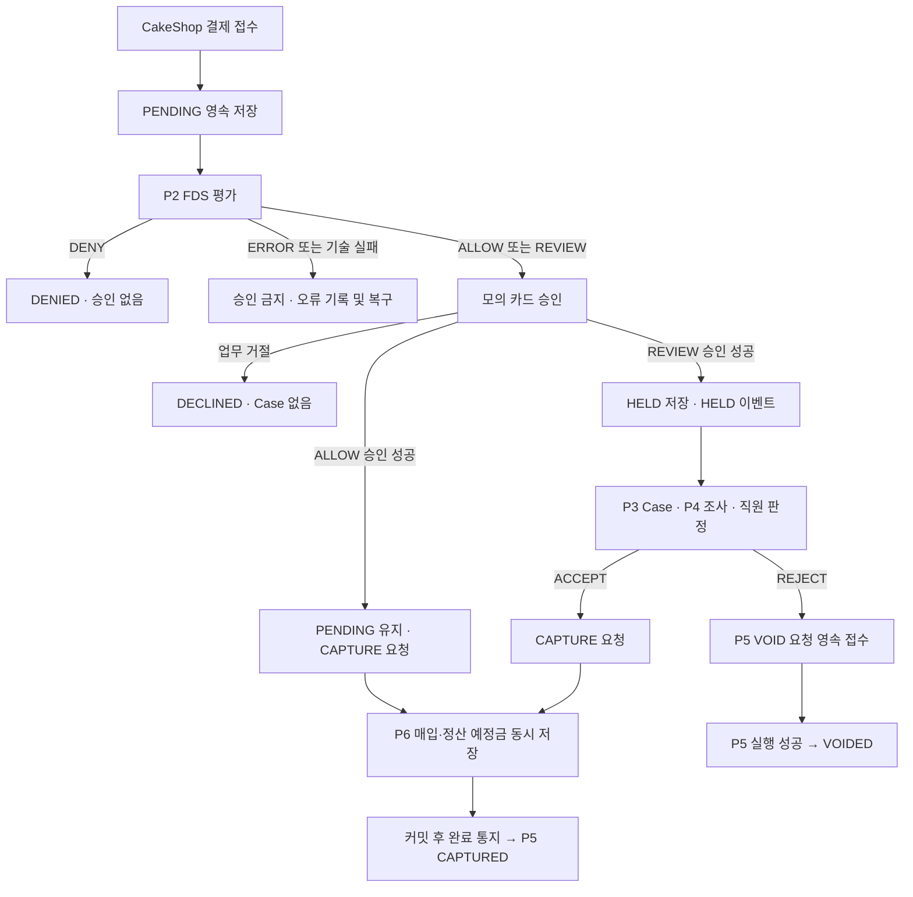

# P5 1차 시연 설계

**#104의 시연 범위 제안과 #100·#118·#122 구현을 구분한다. P6 이벤트는 ADR-0016·0017이 채택됐고, P3 통지·인계 매핑은 합의 전이다.** 기준·범위·미결 C번호는 [README](README.md)를 따른다. 이 문서의 계약은 필요한 정보와 책임을 정의한다.
현재 테이블·컬럼·타입은 migration SQL, 모듈 의존 방향과 이벤트 타입 위치는 ADR-0012를 따른다.
새 보조 저장·DTO 필드명·URL·HTTP 코드·복구 세부는 합의 전 제안이다.

## 1. 결제 흐름과 상태



| 상태 | 의미·진입 조건 |
| --- | --- |
| PENDING | 최초 접수 후 평가·승인·매입 대기. ALLOW 승인 성공만으로 변경하지 않음 |
| DENIED | FDS DENY. 카드 승인 요청 없음 |
| DECLINED | ALLOW/REVIEW지만 카드 승인 업무 거절 |
| HELD | REVIEW + 승인 성공 + 매입 보류. HELD 통지를 통해 즉시 Case 연결 |
| CAPTURED | P6의 실제 매입 성공을 확인하고 P5가 반영 |
| VOIDED | P5의 실제 승인 취소 성공 확인 |
| EXPIRED | 카드 승인 만료 확인. 주문 기한 만료와 다름 |

FDS의 ERROR와 기술 타임아웃은 DENIED/DECLINED가 아니다. 초기 PENDING 기록과 확인 가능한 오류를 남기며,
최종 유효 판정을 얻기 전 승인하지 않는다. 복구·재시도 세부 기준은 C2에서 정한다. 카드 승인 기술 실패도 업무 거절 DECLINED로 바꾸지 않는다. 기존 내부 규칙의 UNKNOWN 판단과 P6 완료 이벤트 계약은 별개다.
P2가 전달한 판정을 사용하며 점수 계산을 P5에 복제하지 않는다. 점수 임계값·경계는 P2 계약과 코드에서 관리한다.

ALLOW의 CAPTURE에는 직원 판정·Case가 필요 없다. REVIEW 승인 실패에는 HELD·Case를 만들지 않는다.
HELD 1건도 통지한다. Case 병합의 30분은 P3 정책이며 P5 만료 시간이 아니다.
직원 ACCEPT는 재승인이 아니며, REJECT는 환불이 아닌 승인 취소 요청이다.
ACCEPT 접수 이후에도 실제 매입 성공 전까지 HELD를 유지하는 안을 제안한다(C3·C4 합의 대기). 별도 APPROVED 상태를 추가하지 않고,
상태만으로 매입을 허용하지 않는다. 해당 승인과 직원 ACCEPT에 연결된 유효 조치 요청이 있어야 한다.

### W1 내부 규칙 구현

- [PaymentStatus](../../backend/src/main/java/com/donworry/payment/entity/PaymentStatus.java): 정본의 결제 상태 7개. JPA Entity가 아닌 enum이다.
- [PaymentRules](../../backend/src/main/java/com/donworry/payment/service/PaymentRules.java): 저장·호출·발행 없이 다음 상태와 다음 단계를 반환하는 순수 규칙이다.
- 입력 State는 결제 상태와 승인 사실(NOT_REQUESTED/SUCCEEDED/DECLINED/UNKNOWN)을 함께 받는다. ALLOW 승인 후의 PENDING을 신규 접수로 오인하지 않는다.
- FDS 결과는 점수가 아닌 내부 FdsVerdict를 입력받는다. P2 DTO·승인 결과의 변환과 채택 평가 고정은 W2에서 연결한다.
- FDS ERROR는 RECORD_FDS_ERROR, 승인 기술 실패는 UNKNOWN과 RECONCILE_AUTHORIZATION을 반환한다. 실제 오류 기록·조회·복구는 아직 수행하지 않는다.
- 직원 판정은 HELD에서 CAPTURE/VOID 요청 종류만 반환한다. 판정 후 상태·영속 접수·실행 결과는 이 메서드로 변경하지 않는다.
- 승인된 결제·승인 불명·종료 결제에서 FDS/신규 승인 단계를 재시작하면 예외로 거절한다. 실제 요청 멱등성과 동시성은 저장 계층 작업이다.
- State와 내부 enum은 payment 내부 구현용이다. 공유 DTO·DB 컬럼·Spring Bean 등록을 추가하지 않는다.

## 2. 데이터 소유권과 최소 저장

현재 P5가 소유하는 테이블은 `payments`이며, [생성 SQL](../../backend/src/main/resources/db/migration/V20261022_145100__create_payments_table.sql)에 8개 컬럼이 있다.
전체 업무 테이블 14개의 소유·관계는 [ERD](../erd/README.md)를 따른다. 초기 FDS Baseline의 테이블·컬럼 합계는 현재 스키마 집계로 사용하지 않는다.

| payments 컬럼 | 의미 |
| --- | --- |
| payment_id | P5 결제 식별자 |
| merchant_id | 가맹점 원천 식별자, 다른 모듈 물리 FK 없음 |
| customer_ref | 고객 참조 |
| order_ref | CakeShop 주문 참조 |
| amount | 결제 금액. 외부 요청 금액의 신뢰 검증은 C1 후속 과제 |
| status | 위 P5 상태 |
| authorization_ref | 성공한 승인 식별자. 승인 전 NULL |
| created_at | 최초 결제 접수 시각 |

`auth_expires_at`은 사용하지 않는다. P2의 `rule_set_version`도 이번 범위에 없다.
기존 컬럼 타입·길이는 SQL 기준이다. PK와 참조 ID는 `BIGINT`, 금액은 원 단위 `BIGINT`, 시각은 UTC `DATETIME(6)`이다.
현재 `payments`에는 주문·요청 키 UNIQUE가 없다. 주문별 중복 접수 정책과 보조 저장 제약은 C1·C6에서 정한다.
같은 소유 담당의 테이블끼리만 물리 FK를 사용하고, 담당이 다르면 ID 논리 참조를 사용한다. 같은 investigation 안의 P3/P4도 논리 참조다. 핵심 기록을 임의 삭제하지 않는다.

### 2.1. 기존 저장 구조를 사용하는 범위

- P5 `payments`: 결제 상태와 승인 참조. P6 매입·P3 판정 데이터를 직접 변경하지 않는다.
- P6 `captures`: `payment_id` UNIQUE인 매입 기록. 기존 `capture_id`와 `captured_at`을 완료 통지에 사용한다.
- P6 `settlements`: `capture_id`·`payment_id` 각각 UNIQUE인 정산 기록. 1차는 SCHEDULED까지다.
- P3 `action_handoffs`: 판정별 인계, 멱등 키, `target_operation_id`, `accepted_at`. 매핑 변경은 P3 합의 대상이다.

보조 테이블 3개는 현재 ERD·SQL에 없다. 이를 전제로 한 상세 설계는 [후속 검토](future-design.md)와 [ADR-0010](../decisions/0010-payment-operation-storage.md)에 분리한다.
기존 테이블만으로 모든 실패·중복·경합 문제가 이미 해결된 것은 아니다. 특히 P5가 CAPTURE 요청과 직원 판정을 재시작 후에도 연결할 방법은 C3·C6에서 정해야 한다. 필요하면 담당 ERD 합의 후 별도 스키마 작업으로 진행한다.

## 3. 모듈 간 계약

P2와 P6 이벤트는 현재 코드 계약이다. P5의 ALLOW 자동 매입 연결과 명시적 미완료 기록 재전달은 #122에서 구현·검증했다. P3·CakeShop 및 운영 자동 복구는 후속 합의·구현 대상이다. ID는 Long, 시각은 Instant(UTC), 금액은 Long(원 단위)을 기준으로 한다.

### 3.1. P2 평가 — fds/api 소유

현재 공개 계약은 [FDS 계약 ADR](../decisions/0014-fds-evaluation-api-contract.md)과 `fds.api` 코드를 따른다. ADR 상태는 제안이며, 재시작 이후 멱등 보장·오류 코드 목록은 별도 합의 대상이다.

| DTO | 필수 필드 | 선택 필드·규칙 |
| --- | --- | --- |
| FdsEvaluationRequest | evaluationRequestId(UUID), paymentId(Long, 양수), customerRef(String, 공백 불가), amount(long, 양수), paymentRequestedAt(Instant) | 모든 필드 필수. paymentRequestedAt은 결제 요청 시각이며 평가 완료 시각과 구분 |
| FdsEvaluationResponse | evaluationRequestId(UUID), evaluationId(Long), result(ALLOW/REVIEW/DENY/ERROR), evaluatedAt(Instant) | 정상 결과는 riskScore(Integer) 0 이상·errorCode null. ERROR는 riskScore null·errorCode 필수 |

기존 초안의 merchantId·orderRef·RiskSignals는 현재 P2 요청 DTO에 없다. 추가가 필요하면 P2와 계약을 먼저 합의한다.
P5 내부 입력은 `payment.service.PaymentEvaluationInput`으로 준비하며 요청 ID와 결제 요청 시각을 전달받아 보존한다. 고정된 모의 값은 테스트 코드에만 둔다.
`PaymentEvaluationService`는 이 입력을 공개 요청 DTO로 변환해 `FdsEvaluator.evaluate()`를 한 번 호출하고 응답을 그대로 반환한다. P5 호출 서비스는 #100에서 Spring Bean으로 등록했으며, P2의 #87 평가 구현 Bean을 공개 인터페이스로 주입받는다. 최초 저장과의 연결 구현은 아래 #100 절을 참고한다. 테스트 대역은 테스트 코드에만 둔다. `evaluate(input)` 자체는 결제 저장·승인·상태 분기를 수행하지 않으며, 분기 판단은 아래 `evaluateAndDecide()`에서 처리한다.
요청 형식 오류는 IllegalArgumentException으로 거절한다. 기록 가능한 평가 실패는 ERROR 응답, 응답을 만들 수 없는 호출 실패는 예외로 전달한다. 자동 재시도는 이번 호출 구현에 포함하지 않는다.

동일 evaluationRequestId의 기술 재전송과 명시적 재평가를 구분한다. 응답의 요청·결제 연관성을 확인한 뒤 저장한다.
P2는 요청 재료로 평가하고 P5 Entity·Repository를 역참조하지 않는다.

#### #94 호출·분기 연결 구현

`PaymentEvaluationService`에 다음 메서드를 추가했다. 기존 `evaluate(input)`의 응답 반환 계약은 유지한다.

```java
PaymentEvaluationResult evaluateAndDecide(
        PaymentRules.State state, PaymentEvaluationInput input);

record PaymentEvaluationResult(
        FdsEvaluationResponse evaluation, PaymentRules.Decision decision) {}
```

반환 record는 P5의 `service` 패키지에 둔다. ALLOW·REVIEW는 모두 승인 요청 판단을 반환하지만 승인 성공 후 처리가 다르므로, 원래 판정·평가 ID·오류 코드를 포함한 응답과 판단을 함께 보존한다. `Decision`만 반환하면 이 정보가 사라져 후속 승인 처리에 부족하다. P2 공개 DTO나 외부 API 계약은 변경하지 않는다.

처리 순서는 다음과 같다.

1. state·input 누락과 승인 전 PENDING 조건을 검사한다. 부적합하면 P2를 호출하지 않는다. 상태 조건은 같은 패키지에 공개한 `PaymentRules.requireUnapprovedPending()` 검증을 재사용한다.
2. 기존 `evaluate(input)`으로 평가를 한 번 호출한다.
3. null 응답 또는 요청·응답의 evaluationRequestId 불일치는 IllegalStateException으로 거절한다. P2 호출 예외는 원래 예외를 전달하며 자동 재시도하지 않는다.
4. 응답의 FdsResult를 switch로 P5 FdsVerdict에 명시적으로 매핑한다. 점수로 판정을 다시 계산하지 않는다.
5. `PaymentRules.afterFds(state, verdict)`를 호출하고 원 응답과 Decision을 함께 반환한다.

ALLOW·REVIEW는 PENDING 유지·REQUEST_AUTHORIZATION, DENY는 DENIED·NONE, ERROR는 PENDING 유지·RECORD_FDS_ERROR다. 오류 기록·승인 요청은 필요한 다음 단계의 판단이며 실제 저장·실행은 하지 않는다. State에는 paymentId가 없으므로 #100 연결 서비스는 같은 저장 스냅샷에서 State와 평가 입력을 구성한다.

#### #100 최초 저장·평가 흐름 연결 설계와 구현

`4bf6c04`에 최초 저장 반환값·연결 서비스·테스트가 구현되어 있다. 실제 P2·MariaDB 연결 검증과 대역 기반 실패 검증의 실행 근거는 [검증 기록](verification.md)에 구분한다.

연결 서비스와 입출력 record는 `payment.service`에 둔다. 외부 HTTP 또는 다른 모듈에 공개하는 계약이 아니며, 기존 `payment → fds.api` 의존을 사용한다.

```java
// PaymentEvaluationFlowService의 진입 메서드
PaymentEvaluationFlowResult createAndEvaluate(PaymentEvaluationFlowInput input);

@Builder
record PaymentEvaluationFlowInput(
        Long merchantId, String customerRef, String orderRef, Long amount) {}

record PaymentEvaluationFlowResult(
        Long paymentId, PaymentEvaluationResult evaluationResult) {}
```

| 입력 | 저장 전 검증 |
| --- | --- |
| merchantId | 필수·양수. 가맹점 존재·권한 검증은 별도 외부 접수 계약의 범위 |
| customerRef / orderRef | 필수·공백 불가·각 100 Unicode 코드 포인트 이하. 입력을 임의로 trim하지 않음 |
| amount | 필수·양수·원 단위 Long. 신뢰할 주문 금액 검증은 별도 외부 접수 계약의 범위 |

입력 record 생성 시 값을 검증하고 서비스 진입 시 null input도 거절한다. 형식 오류는 `IllegalArgumentException`으로 처리하며, 저장·평가를 시작하지 않는다. 결제 ID·초기 상태·생성 시각·평가 요청 UUID는 호출자가 지정하지 않는다.

반환값은 새 결제의 `paymentId`와 기존 `PaymentEvaluationResult`를 묶는다. 평가 응답은 `evaluationResult.evaluation()`, 다음 처리 판단은 `evaluationResult.decision()`으로 얻는다. 기존 반환 타입을 재사용해 평가 ID·원래 판정·오류 코드와 분기 판단을 함께 유지한다. 반환 시 paymentId는 양수, evaluationResult는 필수다. Entity를 반환하지 않는다.

서비스별 책임과 순서는 다음과 같다.

1. `PaymentEvaluationFlowService`가 유효한 입력으로 `PaymentCreationService` Spring Bean을 호출한다. 최초 저장은 기존 `REQUIRES_NEW` 경계를 유지하며, 반환 시 커밋되어 있어야 한다.
2. 커밋된 결제의 ID·고객·금액·생성 시각·상태·승인 참조를 확보한다. 4번 단계의 `createPendingSnapshot()` 반환값을 사용한다. 호출 입력이나 새 `Instant.now()`로 저장값을 대신하지 않는다.
3. 같은 결제 데이터로 승인 전 PENDING 상태를 확인하고 `PaymentEvaluationInput`을 구성한다. 연결 서비스가 새 평가 요청 UUID를 한 번 생성한다.
4. Spring Bean으로 등록한 `PaymentEvaluationService.evaluateAndDecide()`를 한 번 호출하고, 결제 ID와 결과를 반환한다. P2 호출은 기존 `FdsEvaluator` 공개 인터페이스를 통한다.

연결 흐름 전체를 쓰기 트랜잭션으로 감싸지 않는다. `PaymentEvaluationFlowService.createAndEvaluate()`는 `NOT_SUPPORTED`로 호출자 트랜잭션을 일시 중단한다. 최초 저장은 `REQUIRES_NEW`, P2 평가는 자체 트랜잭션에서 처리하도록 구성했다. 통합 테스트에서 평가 직전 최초 저장의 커밋과 호출자 트랜잭션 중단, 호출자 롤백 후 결제·실제 P2 평가 보존을 확인했다. 기존 P2는 기본 전파의 `@Transactional`을 사용하므로 연결 서비스에 어노테이션을 생략하는 것만으로는 호출자의 트랜잭션을 차단할 수 없다.

P2가 ERROR 응답을 반환하면 해당 응답과 RECORD_FDS_ERROR 판단을 정상 반환한다. 호출 예외·null 응답·요청 UUID 불일치는 기존 평가 서비스의 예외를 전달하며, 자동 재시도하지 않는다. 평가 실패에도 최초 PENDING은 남는다. 예외 발생 시 결제 ID를 호출자에게 반환하는 복구 계약은 이번 범위에 없으므로, 이 메서드를 그대로 외부 재시도 API로 노출하지 않는다.

`createAndEvaluate()`는 DENY의 DENIED 판단을 반환하지만 DB 결제 상태를 변경하지 않는다. 이 평가 전용 메서드는 승인 실행·오류 이력 저장·이벤트 발행을 수행하지 않는다. 동일 입력으로 다시 호출하면 별도 결제가 생성되며, 주문 중복 방지·UUID 영속 보존·재시작 후 복구는 후속 계약으로 남긴다. #95에서 합의한 P2의 동일 요청 UUID 입력 충돌 검증도 P2 후속 과제로 유지한다.

기존 최초 저장·평가 호출·분기 판단 서비스를 연결하는 내부 설계이며, DB 스키마·저장 방식·모듈 의존 방향·P2 공개 계약은 변경하지 않는다.

4번 단계에서는 커밋 후 별도 조회 대신 저장 서비스의 반환값을 보강했다. `PaymentCreationService.createPendingSnapshot()`은 `REQUIRES_NEW`로 저장한 Entity에서 `PaymentCreationSnapshot`을 만들며, Spring Bean 호출이 반환될 때 커밋이 완료된다. 스냅샷은 paymentId·customerRef·amount·createdAt·status·authorizationRef를 담는다. 생성 시각은 Entity의 마이크로초 정밀도 값을 그대로 사용한다. 기존 ID 반환 `createPending()`은 유지하고 두 메서드는 내부 저장 함수를 공유한다. 추가 조회 없이 같은 저장 객체의 값을 전달할 수 있으며, DB 재조회 값과의 일치 및 호출자 롤백 후 보존을 MariaDB 테스트로 검사한다. 5번 단계에서 연결 서비스와 입력·반환 record, 입력 검증 및 대역 기반 흐름 테스트를 추가했다. 저장된 상태가 PENDING이고 승인 참조가 없는지 확인한 후 같은 스냅샷으로 상태와 평가 입력을 구성한다.

#### #118 모의 승인·상태 저장 연결

`createAndAuthorize(input)`는 기존 생성·평가 helper의 문맥을 별도 `PaymentAuthorizationService`에 넘긴다. 행 잠금과 REQUIRES_NEW 아래 승인 전 PENDING을 확인하고 DENY→DENIED, 업무 거절→DECLINED, ALLOW 성공→승인 참조가 있는 PENDING, REVIEW 성공→HELD를 저장한다. ERROR는 승인 없이 PENDING을 유지한다.

기본 모의 승인기는 모든 유효 입력에 성공하며 외부 금융 부작용이 없다. 기술 실패는 롤백·예외 전달로 처리하며 기존 순수 규칙의 UNKNOWN 분기로 변환하지 않는다. 처리된 결제는 재승인 대신 충돌 예외로 거절한다. #118에서는 REQUEST_CAPTURE·NOTIFY_HELD가 반환 판단에만 사용됐다. #122에서는 REQUEST_CAPTURE에 따라 같은 승인 트랜잭션 안에서 CaptureRequested를 발행한다. #136의 4번 단계에서는 NOTIFY_HELD에 따라 같은 트랜잭션에서 PaymentHeld를 발행한다. P3 수신 연결과 전달 통합 검증은 후속이다. 반환값은 승인 단계 스냅샷이며 비동기 완료 반영 후의 최신 상태가 아니다.

[모의 승인 계약](mock-authorization.md), [트랜잭션 설계](authorization-flow.md), [실행 검증](verification.md)에 세부와 한계를 기록한다. 기존 createAndEvaluate의 평가 전용 계약은 유지한다.

### 3.2. P3 HELD·직원 조치 — payment/api 소유

HELD 통지는 REVIEW와 승인 성공이 저장된 뒤 전달한다. 직원 ACCEPT는 재승인 없이 매입 요청, REJECT는 승인 취소 요청이다.
P3는 판정과 `action_handoffs(REQUESTED)`를 저장·커밋한 뒤 P5 공개 API를 호출한다. 요청에는 결제·판정·조치·멱등 키의 연결이 필요하며 가맹점·권한 검증은 생략하지 않는다.

CAPTURE 완료 기반 인계 확인을 채택하면 P5가 P6 완료 결과를 반영한 뒤 직원 ACCEPT 건만 P3에 인계 완료를 통지한다. ALLOW 자동 매입에는 Case·직원 판정이 없으므로 P3 인계를 만들지 않는다.
P3는 결제와 판정·인계를 대조한 뒤 `action_handoffs.status = ACCEPTED`로 저장한다. 모든 소속 결제의 판정·인계가 끝난 경우에만 Case를 CLOSED로 변경한다.

매핑 제안은 `target_operation_id = captureId`, `accepted_at = capturedAt`이다. 후자는 완료 기록 시각을 접수 확인 근거로 쓰는 것이며 DB의 정확한 커밋 시각이나 P3 수신 시각은 아니다.
P5→P3 이벤트의 판정/인계 식별 방식·필드·키는 C3·C6에서 확정한다. P5가 P3 저장소를 직접 조회하거나 paymentId만으로 직원 조치 여부를 추정하지 않는다.

최신 dev `d9e4251`의 P3 `FinancialActionGateway.Receipt`는 status·targetOperationId·errorCode를 받고, `HandoffService.applyReceipt()`는 멱등 키로 인계를 찾아 현재 시각을 accepted_at에 사용한다. MockFinancialActionGateway는 즉시 ACCEPTED를 반환한다. 따라서 capturedAt 매핑은 현재 구현 사실이 아니라 P3 입력·시각 처리 변경이 필요한 제안이다. P3의 Receipt.UNKNOWN은 접수 여부 미확인이고, 여기서 제외하는 P6 외부 실행 UNKNOWN과 다르다.

VOID의 접수 증거·식별자·통지 시점은 별도 미결이다. CAPTURE 축소를 근거로 VOID를 이미 구현했거나 완료 후 통지로 합의했다고 간주하지 않는다. 실제 승인 취소 성공 전 VOIDED는 금지한다.

### 3.3. P6 요청·완료 결과 — settlement/api 소유

의존 방향 `payment → settlement`와 타입 위치는 ADR-0012를 유지한다. P6는 P5를 호출·import하지 않는다.

ADR-0016의 `CaptureRequested(paymentId, merchantId, orderId, amount)`가 구현되어 있다. #122에서 P5의 orderRef를 orderId에 넣어 ALLOW 승인 트랜잭션 안에서 발행한다. 수수료 계산은 P6가 담당한다.

완료 이벤트는 ADR-0017에 채택됐으며 settlement.api에 다음 3개 필드로 구현됐다. #122의 P5 @ApplicationModuleListener가 수신하고, 행 잠금·입력·승인 참조·상태 검증 후 CAPTURED를 반영한다. 이미 CAPTURED인 정상 재전달은 상태를 유지한다. captureId·capturedAt을 payments에 저장하거나 서로 다른 captureId의 진위를 대조하지는 않는다. 자세한 범위는 [매입 이벤트 연결](capture-events.md)을 따른다.

```java
record CaptureCompleted(Long paymentId, Long captureId, Instant capturedAt) {}
```

| 필드 | 목적 |
| --- | --- |
| paymentId | P5 대상 결제 조회·CAPTURED 반영 |
| captureId | 기존 P6 매입 PK로 결과 추적. P3 인계 대상 ID로 사용 제안 |
| capturedAt | 기존 매입 완료 기록 시각. 재전달 시 원래 값 유지 |

성공 전용 이벤트이므로 `executionStatus = SUCCEEDED`를 별도로 넣지 않는다. `eventId` 등 전달·추적 메타데이터는 C5의 공통 방식으로 정하며, 위 3개 업무 필드가 전달 보장 전체를 뜻하지 않는다.

| 이전 초안 필드 | 목적 | 이번 제안 |
| --- | --- | --- |
| p5OperationId | P5 작업·중계 요청과 결과 연결 | 별도 작업 테이블을 전제하지 않으므로 필수에서 제외. 요청 상관관계 자체는 C3·C6에서 해결 |
| targetOperationId | P6 작업 식별 | 완료 이벤트에서는 실제 기존 PK인 captureId로 표현 |
| authorizationRef | 원 승인과 실행 결과 대조 | P6 완료 필수에서 제외. P5 승인·요청 검증 책임은 유지 |
| attemptNo | 여러 실행 시도의 순서 검증 | 시도별 결과 프로토콜과 함께 후속 검토 |
| resultRef | 성공 결과의 참조 | 별도 외부값을 생성하지 않고 captureId로 추적 |
| UNKNOWN | 외부 실행 성공 여부를 알 수 없는 상태 | 외부 실행 없는 P6 완료 계약에서는 제외 |

### 3.4. 조회·CakeShop

조회는 가맹점 범위 안에서 결제 ID·주문 참조·금액·상태·승인 참조 등 필요한 값을 공개 API로 제공한다. Case 권한 검증과 여러 모듈 데이터 조합은 상위 investigation이 맡는다.
CakeShop에는 실제 P5 결제 상태를 제공하며 HELD·PENDING이나 Case CLOSED를 최종 결제 성공으로 표시하지 않는다. 조회·통지 DTO, 인증, 중복·역순 처리와 수신 확인은 C1·C7에서 정한다. 미구현 history의 sequence_no를 필수 version으로 요구하지 않는다.

## 4. 접수·저장·통지 시점 — 채택 전 제안

접수는 담당 모듈이 요청을 영속적으로 받아 처리한다는 뜻이고, 실행 완료는 실제 매입을 마쳤다는 뜻이다. 1차 제안에서는 별도 접수 커밋 없이 **성공한 매입·정산 저장을 접수 확인의 근거로 함께 사용**한다.

| 단계 | 저장 | 전달 |
| --- | --- | --- |
| P6 | captures COMPLETED + settlements SCHEDULED + 완료 이벤트 발행 기록을 같은 트랜잭션으로 저장 | 커밋 후 P5에 CaptureCompleted |
| P5 | 적법한 매입 요청과 결과를 대조해 payments CAPTURED 및 필요한 후속 통지 발행 기록을 같은 트랜잭션으로 저장 | 커밋 후 직원 ACCEPT 건은 P3 인계 완료, CakeShop에는 실제 결제 결과 |
| P3 | 판정·인계 대조 후 ACCEPTED 및 합의된 대상 ID·시각 저장 | 모든 판정·인계 완료 조건을 만족할 때만 Case CLOSED |

P3·P5·P6 전체를 한 트랜잭션으로 묶지 않는다. 발행 기록은 업무 저장과 함께 남기고 소비자는 커밋 후 처리한다. #122에서 ALLOW 자동 매입의 업무 이벤트·리스너와 실패 기록의 명시적 재전달을 검증했다. 위 표의 P3·CakeShop 후속 통지 및 운영 자동 재발행은 구현하지 않았다.

이 안에서는 CAPTURE 완료가 확인되기 전에는 그 인계를 ACCEPTED로 만들 수 없다. **기존 정본의 실행 성공 전 Case 종료 가능 정책을 CAPTURE 경로에서 축소**하므로 P3·P6와 [ADR-0018](../decisions/0018-payment-mvp-capture-completion.md) 합의가 필요하다. 채택 전에는 기존 정책을 대체하지 않는다.

## 5. 실패·중복·경합

- P6 업무 저장 실패: 매입·정산·완료 발행 기록을 함께 롤백하고 성공을 통지하지 않는다. P3 인계는 성공 확인 전 REQUESTED 유지가 제안이다. 영구 거절/인계 FAILED 기준, 실패 기록 위치와 재시도 주체·한도는 C3·C4·C6에서 정한다. 전체 롤백만으로 `captures.FAILED`가 저장됐다고 볼 수 없다.
- P6 저장 성공 후 통지 실패: 매입을 새로 만들지 않고 커밋된 완료 통지를 재전달한다. 응답 유실을 매입 실패로 바꾸지 않는다.
- 중복 요청: `captures.payment_id` UNIQUE와 기존 본문 대조를 사용해 같은 결제의 매입·정산을 중복 생성하지 않는다. 유니크 제약만으로 재전달·경합 처리가 완성되지는 않는다.
- P5/P3 소비 실패: 각 소비 트랜잭션을 롤백하고 기존 이벤트를 재처리한다. CAPTURED 반영과 P3 통지 발행 기록이 원자적이어야 P5 반영 후 P3 통지 누락을 복구할 수 있다.
- 중복 완료: 같은 결제·매입 결과는 재반영하지 않는다. 없는 결제, 다른 매입 ID, VOIDED 등 양립할 수 없는 상태는 무조건 CAPTURED로 덮어쓰거나 처리 완료로 버리지 않고 대조·복구 대상으로 둔다. 필요한 검증 근거와 보존 방식은 C4·C6에서 확정한다.
- CAPTURE/VOID 경합: P5의 요청 선택·재시도 정책과 영속 근거로 반대 조치를 차단해야 한다. 비동기 실행 전체를 짧은 P5 행 잠금만으로 보호할 수 있다고 가정하지 않는다.
- CakeShop 통지 실패는 금융 성공을 되돌리지 않는다. 재통지·조회 복구는 C7에서 정한다.

UNKNOWN 프로토콜 제외가 통지 유실·DB 실패·기본 이력·멱등성 요구를 없애지는 않는다. 실패 시 상태와 복구 경로를 확정·검증하기 전에는 전체 시연 완료로 표시하지 않는다.
