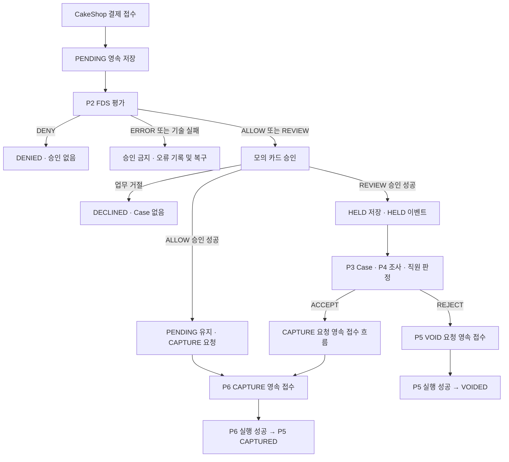

# P5 1차 시연 설계

기준·범위·미결 C번호는 [README](README.md)를 따른다. 이 문서의 계약은 필요한 정보와 책임을 정의한다.
실제 클래스명·DTO 필드명·URL·HTTP 코드·물리 스키마는 합의 전 확정하지 않는다.

## 1. 결제 흐름과 상태

| 상태 | 의미·진입 조건 |
| --- | --- |
| PENDING | 최초 접수 후 평가·승인·매입 대기. ALLOW 승인 성공만으로 변경하지 않음 |
| DENIED | FDS DENY. 카드 승인 요청 없음 |
| DECLINED | ALLOW/REVIEW지만 카드 승인 업무 거절 |
| HELD | REVIEW + 승인 성공 + 매입 보류. HELD 통지를 통해 즉시 Case 연결 |
| CAPTURED | P6의 실제 매입 성공을 확인하고 P5가 반영 |
| VOIDED | P5의 실제 승인 취소 성공 확인 |
| EXPIRED | 카드 승인 만료 확인. 주문 기한 만료와 다름 |

FDS의 ERROR와 기술 타임아웃은 DENIED/DECLINED가 아니다. 초기 PENDING 기록과 확인 가능한 오류를 남기며,
최종 유효 판정을 얻기 전 승인하지 않는다. 복구·재시도 세부 기준은 C2에서 정한다. 카드 승인 기술 실패도 업무 거절 DECLINED로 바꾸지 않고 작업 오류/UNKNOWN으로 추적한다.
P2가 전달한 판정을 사용하며 점수 계산을 P5에 복제하지 않는다. 50 미만/50~80/80 초과는 최종 확인 전 시연용 임시 기준이다.

ALLOW의 CAPTURE에는 직원 판정·Case가 필요 없다. REVIEW 승인 실패에는 HELD·Case를 만들지 않는다.
HELD 1건도 통지한다. Case 병합의 30분은 P3 정책이며 P5 만료 시간이 아니다.
직원 ACCEPT는 재승인이 아니며, REJECT는 환불이 아닌 승인 취소 요청이다.
ACCEPT 접수 이후에도 실제 매입 성공 전까지 HELD를 유지하는 안을 제안한다(C3·C4 합의 대기). 별도 APPROVED 상태를 추가하지 않고,
상태만으로 매입을 허용하지 않는다. 해당 승인과 직원 ACCEPT에 연결된 유효 조치 요청이 있어야 한다.

### W1 내부 규칙 작업본

- [PaymentStatus](../../backend/src/main/java/com/donworry/payment/entity/PaymentStatus.java): 정본의 결제 상태 7개. JPA Entity가 아닌 enum이다.
- [PaymentRules](../../backend/src/main/java/com/donworry/payment/service/PaymentRules.java): 저장·호출·발행 없이 다음 상태와 다음 단계를 반환하는 순수 규칙이다.
- 입력 State는 결제 상태와 승인 사실(NOT_REQUESTED/SUCCEEDED/DECLINED/UNKNOWN)을 함께 받는다. ALLOW 승인 후의 PENDING을 신규 접수로 오인하지 않는다.
- FDS 결과는 점수가 아닌 내부 FdsVerdict를 입력받는다. P2 DTO·승인 결과의 변환과 채택 평가 고정은 W2에서 연결한다.
- FDS ERROR는 RECORD_FDS_ERROR, 승인 기술 실패는 UNKNOWN과 RECONCILE_AUTHORIZATION을 반환한다. 실제 오류 기록·조회·복구는 아직 수행하지 않는다.
- 직원 판정은 HELD에서 CAPTURE/VOID 요청 종류만 반환한다. 판정 후 상태·영속 접수·실행 결과는 이 메서드로 변경하지 않는다.
- 승인된 결제·승인 불명·종료 결제에서 FDS/신규 승인 단계를 재시작하면 예외로 거절한다. 실제 요청 멱등성과 동시성은 저장 계층 작업이다.
- State와 내부 enum은 payment 내부 구현용이다. 공유 DTO·DB 컬럼·Spring Bean 등록을 추가하지 않는다.

## 2. 데이터 소유권과 최소 저장

FDS 연계 기준에서 P5가 소유하는 테이블은 `payment`다. 두 컬럼 제외 후 전체는
`payment(8) + fds_evaluation(6) + security_case(8) + case_payment(4) + ai_report(8) + payment_decision(7) + action_handoff(9) + case_history(7) = 57`이다.

| payment 컬럼 | 의미 |
| --- | --- |
| payment_id | P5 결제 식별자 |
| merchant_id | 가맹점 원천 식별자, 다른 모듈 물리 FK 없음 |
| customer_ref | 고객 참조 |
| order_ref | CakeShop 주문 참조 |
| amount | 서버가 검증한 결제 금액 |
| status | 위 P5 상태 |
| authorization_ref | 성공한 승인 식별자. 승인 전 NULL |
| created_at | 최초 결제 접수 시각 |

`auth_expires_at`은 사용하지 않는다. P2의 `rule_set_version`도 이번 범위에 없다.
타입·길이·유니크 범위·금액 단위는 C1에서 확정한다. 가이드의 9/7/59개 표기는 두 컬럼 제외 전 개수다.
모듈 내부는 물리 FK, 모듈 간은 ID 논리 참조를 사용한다. 핵심 기록을 임의 삭제하지 않는다.

### 2.1. 최소 저장 구조 제안 — 팀 합의 대기

정본의 payment 8개 컬럼은 유지하고 **P5 보조 테이블 3개**를 제안한다.
총 4개는 P5 내부 저장안이며, FDS Baseline의 8개 테이블·57개 컬럼에 보조 테이블을 포함한 수가 아니다.
물리 타입·길이·DDL은 미확정이다. 선택 이유·대안은 [ADR-0010](../decisions/0010-payment-operation-storage.md)에 기록한다.

| 저장소 | 저장할 것 | 소유·제약 |
| --- | --- | --- |
| payment | 현재 결제 상태·승인 참조와 정본 8개 컬럼 | P5. 다른 모듈 FK 없음 |
| payment_request | CakeShop 원 요청, 요청 재생 기준, 채택한 FDS 판정 | P5. 결제 최초 생성과 같은 커밋 |
| payment_operation | AUTH/VOID 실행과 CAPTURE 중계 요청의 현재 접수·실행 결과 | P5. CAPTURE 실제 실행 정본은 P6 |
| payment_history | 상태·접수·실행 시도·실패·결과의 변경 사실 | P5. INSERT 전용, 해당 업무 변경과 같은 커밋 |

P3의 action_handoff, P6의 CAPTURE 작업을 P5 테이블로 옮기지 않는다.
공통 이벤트 발행 기록은 별도 인프라다. 아래 보조 테이블만 만든다고 이벤트 전달이 보장되는 것은 아니다(C5).

#### payment_request — 최초 결제 요청

| 필드 | 논리 타입·NULL | 목적 |
| --- | --- | --- |
| request_id | UUID, 필수·PK | P5 접수 ID. P2 evaluationRequestId로도 사용 |
| payment_id | UUID, 필수·내부 FK·UNIQUE | 생성한 결제 1건 |
| merchant_id | String, 필수·논리 참조 | 가맹점별 요청 키의 UNIQUE 범위. payment의 가맹점과 일치 |
| idempotency_key | String, 필수 | CakeShop 요청 키. 가맹점·결제접수 범위에서 유일 |
| request_hash | String, 필수 | 인증된 가맹점·고객·주문·금액·모의 카드·신호 스냅샷을 정규화한 해시 |
| request_data | JSON, 필수 | 모의 카드 참조·허용된 위험 신호 등 재개에 필요한 최소 입력. 금액·주문 정본은 payment |
| evaluation_id / fds_result | P2 식별자 / 판정, 평가 전 NULL | P2가 반환한 평가 참조와 이 요청에 채택한 결과. P2 평가 정본을 대체하지 않음 |
| processing_status | Enum, 필수 | RECEIVED / FDS_ERROR / EVALUATED / PROCESSED 제안 |
| last_error_code | String, 선택 | 기술 실패·복구 이유. 위험 판정과 별개 |
| created_at / updated_at | Instant, 필수 | 접수·갱신 시각 |

`UNIQUE(payment_id)`와 가맹점별 요청 키 제약이 필요하다. merchant_id 중복 저장은 요청 키 제약을 위한 것이며
payment와의 일치는 같은 생성 트랜잭션에서 검증한다.
구체 제약은 `UNIQUE(merchant_id, idempotency_key)`다. 같은 주문·다른 키의 중복 결제 허용 여부는 C1 미결이며 자동 병합하지 않는다.
카드번호·CVC·인증 토큰 원문은 request_data에 저장하지 않는다. 실제 카드 데이터는 이번 범위 밖이다.

PROCESSED는 FDS 차단·승인 거절 또는 승인 결과와 후속 이벤트 기록까지 끝났다는 **접수 처리 완료**이며 매입 완료가 아니다.
FDS_ERROR 뒤 같은 요청 재시도는 C2 계약에 따라 같은 evaluationRequestId로 기존 평가를 확인한다.
새 평가 허용 시점은 별도 합의하며, 승인 이후 최신 평가를 다시 읽어 승인 경로를 변경하지 않는다.
평가 결과 중복·시각 동률의 선택은 P2 계약으로 정하고, P5는 실제 처리에 채택한 evaluation_id를 보존한다.

#### payment_operation — 금융 조치와 중계

| 필드 | 논리 타입·NULL | 목적 |
| --- | --- | --- |
| operation_id | UUID, 필수·PK | P5 작업/중계 식별자. 이벤트·조회·모의 실행의 안정적인 키 |
| payment_id | UUID, 필수·내부 FK | 대상 결제 |
| operation_type | Enum, 필수 | AUTH / CAPTURE / VOID. AUTH는 P5 내부 승인 작업 |
| origin | Enum, 필수 | CHECKOUT / FDS_ALLOW / STAFF_DECISION |
| decision_id | P3 식별자, 직원 조치에만 필수 | 논리 참조. P3 판정 증빙, ALLOW는 NULL |
| idempotency_key / request_hash | String, 필수 | 조치별 동일 요청 재생·충돌 검출 |
| acceptance_status | Enum, 필수 | WAITING / ACCEPTED / REJECTED. **최종 담당 모듈의 접수**만 표현 |
| target_operation_id | String, 접수 확인 전 NULL | AUTH/VOID는 P5 operation_id, CAPTURE는 P6 작업 ID |
| execution_status | Enum, 필수 | NOT_STARTED / RUNNING / SUCCEEDED / FAILED / UNKNOWN |
| attempt_no | Integer, 필수·최초 0 | 실행 시도 순서. CAPTURE는 P6가 전달한 순서 |
| result_ref | String, 성공 전 NULL | AUTH 승인 참조, VOID 취소 참조, CAPTURE는 P6 성공 결과 참조 |
| last_error_code | String, 선택 | 접수/실행 실패 원인. 상세 구분은 이력에 보존 |
| requested_at / accepted_at / completed_at | Instant | 요청은 필수, 접수·성공 확정 전 나머지는 NULL |

AUTH/VOID 요청을 P5가 영속 저장하면 acceptance_status=ACCEPTED,
CAPTURE는 P5 저장만으로 WAITING이며 P6의 커밋된 접수 확인 후 ACCEPTED다.
ACCEPTED는 실행 실패·UNKNOWN에도 유지한다. REJECTED는 **접수 거절**이며 실행 실패 FAILED와 다르다.
completed_at은 성공 확정 시각이다. 실패 시도 시각은 이력에 남긴다.
REJECTED 중 오류 코드가 재시도 가능하다고 합의된 경우에만 동일 요청 재전송으로 기존 작업을 재접수한다.
CAPTURE는 WAITING으로 되돌려 재발행하고 최종 담당 접수를 다시 확인한다. 원 operation_id·키는 유지하며 영구 거절은 재생만 한다.
이 과정에서 P3는 확인된 실패를 FAILED로 기록할 수 있고, 재접수 후에는 최신 접수 버전을 따른다. ACCEPTED는 이후 실행 실패로 변경하지 않는다.

최소 제약 제안: `UNIQUE(payment_id, operation_type)`, `UNIQUE(origin, idempotency_key)`,
직원 조치의 `decision_id` 유일성(전역 유일 ID라는 C3 가정, 아니면 합의된 범위로 변경). AUTH·자동 CAPTURE 키는 P5가 결제/종류로 안정적으로 생성하며 STAFF_DECISION 키와 이름 공간을 분리한다.
키는 다른 결제·조치에 재사용할 수 없고, 요청 해시에는 가맹점·결제·판정·조치가 포함된다.
같은 결제·같은 조치를 다른 키로 보내면 새 작업으로 만들지 않고 충돌로 반환한다. 복구는 원 키·원 작업을 사용한다.
한 결제의 CAPTURE와 VOID는 서로 다른 종류여서 위 유니크만으로 상호 배제를 보장하지 못한다.
payment 행을 잠그고 기존 조치·승인·판정을 확인하여 첫 유효 조치만 선택한다. UNKNOWN이나 실행 실패만으로 반대 조치를 허용하지 않는다.
P6도 원 CAPTURE 작업을 다시 사용하고 실행 직전 승인·선택 조치의 일치 여부를 검증한다(C4).

AUTH/VOID의 MVP 모의 실행은 P5 내부 Java 처리와 operation 결과 저장을 같은 DB 트랜잭션으로 묶는 안이다.
모의 실행이 외부 상태를 바꾸지 않는다는 전제이며 실제 카드사에도 적용되는 보장은 아니다.
P6는 CAPTURE 실행·원장과 승인 참조의 검증을 소유한다. P5가 매입을 대신 실행하지 않는다.

#### payment_history — 기본 감사와 결과 순서

| 필드 | 논리 타입·NULL | 목적 |
| --- | --- | --- |
| history_id | UUID, 필수·PK | 이력 식별자 |
| payment_id / sequence_no | UUID / Long, 필수 | 내부 FK, 결제별 증가 순서. UNIQUE(payment_id, sequence_no) |
| operation_id | UUID, 선택·내부 FK | 금융 작업 관련 이력인 경우 |
| event_type | Enum, 필수 | PAYMENT_CREATED / FDS_FAILED / FDS_SELECTED / AUTH_RESULT / HELD_CONFIRMED / OPERATION_ACCEPTANCE / EXECUTION_ATTEMPT / EXECUTION_RESULT |
| event_data | JSON, 필수 | 이전/이후 상태, 시도 번호, 결과·오류·소스 메시지 ID 등 필요한 변경 사실 |
| created_at | Instant, 필수 | 해당 기록 시각 |

payment 행 잠금 아래 순서를 배정한다. 한 트랜잭션의 상태·조치 변경과 이력을 함께 저장한다.
실행 실패도 별도 결과 기록 트랜잭션을 커밋하여 남긴다. 업무 전체 롤백으로 실패 원인을 지우지 않는다.
재실행 중 사라진 RUNNING은 UNKNOWN으로 추적하고 실제 결과를 대조한 후 재시도한다.
CAPTURE 결과의 원 eventId·attemptNo·결과 해시를 보존해 동일 소스의 모순 결과를 검출한다.
접수 변경마다 해당 이력의 sequence_no를 receiptVersion으로 발행한다. P3는 최신 receiptVersion을 기록·비교하고 오래된 결과를 적용하지 않는다.
P3의 저장 위치는 기존 case_history.event_data 활용 또는 합의된 별도 방식이며 action_handoff 정본에 컬럼을 임의 추가하지 않는다.

HELD·접수 결과·CakeShop 통지 이벤트는 해당 커밋의 불변 스냅샷으로 발행하고 발행 기록을 함께 남긴다.
CakeShop의 version은 상태·승인 참조 등 공개 조회 스냅샷이 변경된 이력의 sequence_no를 사용한다. 현재 조회도 해당 마지막 공개 변경 버전을 반환한다. 같은 통지 재전송은 원 eventId/version을 유지한다.
발행 기록이 대기인 이벤트를 재전달하고, HTTP 통지 리스너는 수신 확인 후에만 완료 처리하는 방안을 C5·C7에서 검증한다.
Registry의 이력/보존과 업무 이력의 보존은 별개다. 성공 업무 키와 핵심 이력을 임의 삭제하지 않는다.

## 3. 모듈 간 DTO 초안 — 필드·상태 모두 제안

기본 타입안은 P5 생성 ID=UUID, 타 모듈/외부 참조=String, 시각=Instant(UTC), 금액=Long(원 단위 양수)다. UUID를 String 참조로 전달할 때는 표준 UUID 문자열로 변환한다.
KRW 단일 통화·최댓값·DB 타입은 C1 합의 전 가정이다. 모든 DTO의 enum도 아래 범위만 제안하며 실제 Java 코드는 아직 없다.
`필수`는 값 누락 불가, `선택`은 NULL 가능이다. 인증 주체는 신뢰된 컨텍스트로 받아 DTO의 merchantId와 대조한다.

### 3.1. P2 평가 — fds/api 소유

| DTO | 필수 필드 | 선택 필드·규칙 |
| --- | --- | --- |
| FdsEvaluationRequest | evaluationRequestId(UUID=request_id), paymentId(UUID), merchantId(String), customerRef(String), orderRef(String), amount(Long), requestedAt(Instant), signals(RiskSignals) | signals의 실제 확보 값만 전달. 아래 최소 필드안의 채택 여부는 P2/P1 계약. 모르는 신호를 false/0으로 만들지 않음 |
| FdsEvaluationResponse | evaluationRequestId(UUID), evaluationId(String), result(ALLOW/REVIEW/DENY/ERROR), evaluatedAt(Instant) | riskScore(Integer, ERROR 시 NULL 가능), errorCode(String, ERROR 시 필수). rule_set_version 없음 |

RiskSignals의 최소 필드안은 cardRef(String, 필수·모의 카드 참조), deviceRef(String, 선택),
recentPasswordResetAt(Instant, 선택), newShippingAddress(Boolean, 선택)이다. 카드/기기 신규 여부·반복 횟수는 P2가 확보한 근거로 계산한다.
선택 필드 NULL은 미확보/미확인이며 안전한 신호라는 뜻이 아니다. P1/CakeShop에서 실제 제공·검증 가능한 필드만 C2 합의 후 사용한다.

동일 evaluationRequestId의 기술 재전송과 명시적 재평가를 구분한다. 응답의 요청·결제 연관성을 확인한 뒤 저장한다.
P2는 요청 재료로 평가하고 P5 Entity·Repository를 역참조하지 않는다.

### 3.2. P3 HELD·직원 조치 — payment/api 소유

| DTO | 필수 필드 | 선택 필드·규칙 |
| --- | --- | --- |
| PaymentHeld 이벤트 | eventId(UUID), occurredAt(Instant), paymentId(UUID), merchantId(String), customerRef(String), orderRef(String), amount(Long), authorizationRef(String), evaluationId(String) | HELD 커밋 후 발행. occurredAt은 HELD 확정 시각. 같은 결제 재전달은 원 eventId 유지 |
| FinancialActionRequest | paymentId(UUID), merchantId(String), decisionId(String), actionType(CAPTURE/VOID), idempotencyKey(String) | P3의 커밋된 ACCEPT→CAPTURE, REJECT→VOID만 전달. 직원 사유·AI 본문은 복제하지 않음 |
| ActionReceipt / HandoffResult 이벤트 | p5OperationId(UUID), paymentId(UUID), merchantId(String), decisionId(String), actionType, targetModule(P5/P6), acceptanceStatus(WAITING/ACCEPTED/REJECTED), receiptVersion(Long), recordedAt(Instant) | targetOperationId(String)·acceptedAt(Instant)은 ACCEPTED 시 필수. errorCode는 REJECTED 시 필수. 이벤트에는 eventId·occurredAt 추가 |
| ActionStatusQuery | merchantId(String), idempotencyKey(String) | 해당 STAFF_DECISION 요청 키로 조회. 없으면 NOT_FOUND라는 조회 결과이며 접수 거절로 간주하지 않음 |

키 충돌·잘못된 조치는 업무 오류로 응답하며 기존 작업을 변경하지 않는다. HTTP 상태 코드는 별도 매핑 대상이다.
P3는 WAITING→REQUESTED, ACCEPTED→ACCEPTED, REJECTED→FAILED로 자신의 action_handoff를 반영한다.
P5 동기 응답의 CAPTURE WAITING은 P6 영속 접수 완료가 아니다. VOID ACCEPTED는 실행 성공이 아니다.
조회 결과와 결과 이벤트의 업무 필드는 동일하게 유지한다. ALLOW 경로에는 decisionId가 없어 P3 인계 결과를 발행하지 않는다.
P5는 P3를 조회해 판정을 재검증하지 않고 인증된 P3 호출과 decisionId·action 매핑 계약을 신뢰한다.

### 3.3. P6 CAPTURE·접수·실행 결과 — payment/api 소유

| DTO | 필수 필드 | 선택 필드·규칙 |
| --- | --- | --- |
| CaptureRequested 이벤트 | eventId(UUID), occurredAt(Instant), p5OperationId(UUID), paymentId(UUID), merchantId(String), amount(Long), authorizationRef(String), idempotencyKey(String), origin(FDS_ALLOW/STAFF_DECISION) | decisionId(String): STAFF_DECISION에만 필수. P6 중복 기준은 p5OperationId, 키/본문 일치도 확인 |
| CaptureAcceptanceRequest | p5OperationId(UUID), paymentId(UUID), merchantId(String), acceptanceStatus(ACCEPTED/REJECTED), sourceVersion(Long≥1), recordedAt(Instant) | targetOperationId(String)·acceptedAt(Instant)은 ACCEPTED 시 필수. errorCode는 REJECTED 시 필수. P6 작업 저장 커밋 후 호출 |
| CaptureExecutionResultRequest | eventId(UUID), p5OperationId(UUID), paymentId(UUID), merchantId(String), targetOperationId(String), authorizationRef(String), amount(Long), attemptNo(Integer≥1), executionStatus(SUCCEEDED/FAILED/UNKNOWN), occurredAt(Instant) | resultRef(String)는 성공 시 필수, errorCode는 FAILED/UNKNOWN 시 필수. 성공은 원 승인·금액과 일치해야 함 |
| CaptureExecutionCheck / CaptureExecutionPermission | 입력 p5OperationId·paymentId·merchantId·authorizationRef, 출력 allowed(Boolean)·reasonCode(String) | 원 요청·승인·선택 조치·현재 결과를 확인. 재실행은 원 작업만 허용하며 UNKNOWN이면 대조 우선. P6 실행 직전 호출하는 안(C4) |
| ResultAck | p5OperationId(UUID), outcome(APPLIED/DUPLICATE/RECONCILIATION_REQUIRED) | 식별자·금액·결과 충돌은 별도 오류. 재확인이 필요한 결과를 성공 반영했다고 응답하지 않음 |

P5는 요청 ID·결제·가맹점·P6 작업의 일치와 조치 유형을 검증한다. 성공 결과의 승인 참조·금액도 원 CAPTURE 요청과 일치해야 한다. 같은 작업·동일 접수 확인은 중복 성공 응답이다.
P6의 sourceVersion은 접수 결과 변경 순서이며 동일 버전의 다른 본문은 충돌이다. 최신 소스 버전과 본문은 payment_history에 보존한다.
낮은 버전은 재적용하지 않는다. ACCEPTED 후 거절로 되돌리거나 서로 다른 targetOperationId로 덮어쓰지 않는다. 모순이면 기록·대조한다.
결과가 접수 확인보다 먼저 오면 **P6가 커밋된 ACCEPTED 확인을 먼저 재전송하고 결과를 재시도하는 안**을 제안한다.
P5는 RECONCILIATION_REQUIRED를 반환하며 해당 결과를 적용 완료로 보거나 P3 접수 완료를 추론하지 않는다.

같은 eventId의 동일 본문은 DUPLICATE, 다른 본문은 충돌이다. 낮은 attemptNo의 실패/불명 결과는 이력으로만 남기고 현재 상태를 되돌리지 않는다.
낮은 시도의 늦은 성공이 확인된 실패·새 시도와 모순되면 자동 무시하지 않고 추가 실행 중지·대조 대상으로 남긴다.
같은 시도 UNKNOWN→확인된 SUCCEEDED/FAILED는 허용하되, 확인된 성공을 실패로 덮어쓰지 않는다.
새 시도는 이전 시도가 확인된 실패일 때만 허용한다. UNKNOWN에서는 원 작업 상태를 확인하고 무조건 재매입하지 않는다.
P6의 안정적인 작업 ID·시도 번호·결과 재전달 보장은 C4 합의가 필요하다.

### 3.4. 읽기 계약과 외부 연결

| DTO·경계 | 최소 필드안 | 검증 |
| --- | --- | --- |
| PaymentReadQuery / PaymentSnapshot (payment/api) | 입력 merchantId·paymentIds 또는 customerRef·조회 범위, 출력 paymentId·merchantId·customerRef·orderRef·amount·status·authorizationRef·createdAt | 다건 크기·조회 기간 제한은 합의. Case 소속·직원 권한은 상위 investigation에서 검증하고 P5가 가맹점 범위를 확인 |
| CreatePaymentRequest (CakeShop HTTP) | idempotencyKey·merchantId·customerRef·orderRef·amount·mockCardRef·확보한 signals | 인증된 서버만 호출. 신뢰할 주문 금액 검증 경로는 C1. 모의 카드 참조 외 원문 카드정보 없음 |
| PaymentStatusResponse | paymentId·orderRef·status·version, authorizationRef(승인 전 NULL) | 현재 상태 조회. PENDING/HELD를 최종 결제 성공으로 표시하지 않음 |
| PaymentStatusChanged 통지 | eventId·paymentId·merchantId·orderRef·status·version·occurredAt | 원 스냅샷 재전송. CakeShop은 eventId 중복 제거·낮은 version 무시, 수신 확인·조회 대조. C7 합의 |

P5를 통한 Case 기반 AI 조회는 [ADR-0009](../decisions/0009-ai-investigation-call-structure.md)의 상위 Tool 창구에서 조합한다.
P5가 Case를 역조회하거나 FastAPI에 금융 변경 Tool을 제공하지 않는다.
모의 AUTH/VOID 입력은 operationId·paymentId·amount·mockCardRef 또는 authorizationRef,
출력은 성공 참조/업무 거절 코드다. 이 내부 값은 P3/P6 공개 DTO로 노출할 필요가 없다.

## 4. 접수·트랜잭션·복구

| 단계 | 영속화와 완료 기준 |
| --- | --- |
| 결제 접수 | PENDING을 먼저 커밋한 뒤 FDS 평가. 이후 실패로 최초 접수 자체를 없애지 않음 |
| 승인 결과 | 승인 성공 참조·상태·후속 이벤트 발행 기록의 일관성 확보. 내부 모의 AUTH/VOID는 작업 결과와 같은 DB 커밋을 제안. 구현·실패 주입은 C6 확인 필요 |
| P3 판정 | P3가 판정·action_handoff REQUESTED·감사 이력을 같은 트랜잭션으로 저장하고 커밋 후 P5 호출 |
| P5 조치 접수 | 같은 키·같은 내용은 기존 접수 재생. 다른 내용은 충돌. 접수 기록과 필요한 발행 기록 커밋 후 응답 |
| CAPTURE 인계 | P6의 작업 영속 저장 확인 전에는 최종 접수 완료로 통지하지 않음. P6 확인 후 P3 결과 통지 |
| VOID 인계 | P5 VOID 작업 영속 저장 확인으로 접수 완료. 실행 완료를 기다리지 않음. 동기 응답으로도 접수 확인 가능 |
| 실제 실행 | VOID 실행 성공은 P5, CAPTURE 실행 성공은 P6가 확인. 결과 식별자 검증 후 P5 상태·이력·통지 대상 결과 반영 |

P3 인계의 REQUESTED/ACCEPTED/FAILED는 P3 상태이며 P5 결제 상태에 넣지 않는다.
단순 발행·구독·메모리 큐 등록은 영속 접수 증거가 아니다. 타임아웃·응답 유실은 접수 불명으로 조회·같은 키 재시도한다.
확인된 거절/인계 실패만 실패로 통지한다. 접수 후 실행 실패를 인계 실패로 되돌리지 않는다.

커밋 후 이벤트는 유실 복구 가능한 발행 기록을 사용한다. 정본은 Modulith Event Publication Registry 또는 Outbox를 허용하며,
저장소 ADR-0001은 Registry를 제안한다. 의존성·초기화 설정의 존재만으로 전달 보장을 검증했다고 볼 수 없다(C5).
HELD 이벤트 누락, P6 접수 확인 누락, P3 결과 통지 누락에 각각 재전달/조회·대조 경로를 마련한다.
P3/P5/P6 전체를 한 트랜잭션으로 묶지 않는다. P6 접수 확인은 P6 커밋 후 별도 P5 트랜잭션으로 반영한다.

실행이 접수 결과보다 먼저 도착할 수 있다. 요청·작업 ID로 대조하고 이전/중복 결과가 최종 상태를 덮어쓰지 않도록 한다.
접수 정보가 누락된 결과는 §3.3의 재확인·재전송안으로 처리하며 C4 합의 전 확정하지 않는다.
매입과 VOID는 동일 승인에서 동시에 성공할 수 없도록 P5 접수 제어와 P6 실행 직전 검증을 함께 설계한다.
P5의 짧은 DB 잠금만으로 비동기 P6 실행 전체가 보호된다고 가정하지 않는다.

실제 실행 결과 불명 시 조회·대조 없이 무조건 재실행하지 않는다. 동일 승인·작업에 대한 멱등성과 확인 경로가 필요하다(C6).
실행 실패는 해당 모듈에서 기록·복구하고 이미 CLOSED인 Case를 자동 재개하거나 직원 판정을 변경하지 않는다.
성공 결과는 Case 종료 전에도 반영할 수 있으며, Case CLOSED를 실행 시작 신호로 사용하지 않는다.
