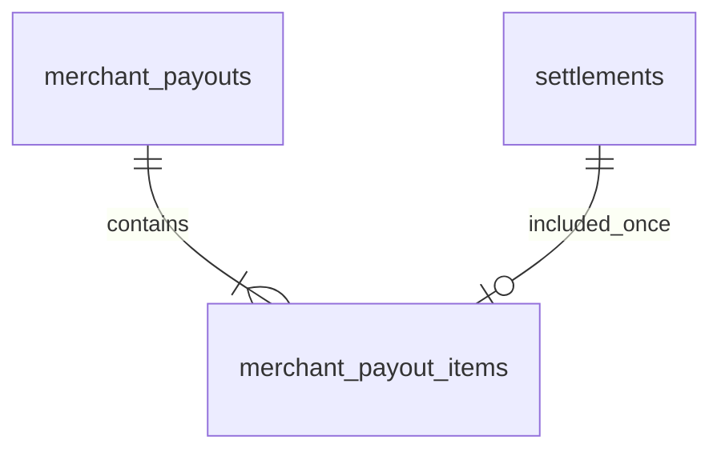

# P6 2단계 — 가맹점별 일정산 지급 원장

- 담당 P6 민정 / #474 / 2026-11-03
- 사용자 진행 승인에 따른 구현·PR 리뷰 대상. Notion 동기화·운영 배포 완료를 의미하지 않는다.
- [D+3 정책](d3-policy-and-erd.md), [ADR-0070](../decisions/0070-p6-merchant-daily-payouts.md)

## 지급 단위와 시각

1. 매입일 기준 영업일 D+3 `scheduled_at`과 기존 수수료/순정산액을 유지한다.
2. 기한이 지난 SCHEDULED를 가맹점별로 묶어 원장 한 건과 정산별 상세를 함께 저장한다.
3. 지급일은 처리 시점의 Asia/Seoul 날짜다. 과거 cutoff로 실행해도 과거 날짜에 지급했다고 기록하지 않는다.
4. 원장/정산의 completed_at은 실제 확정 처리 시각으로 통일한다. 외부 은행 송금은 없다.
5. 같은 가맹점·지급일의 완료 원장은 다시 열거나 금액을 추가하지 않는다.
6. 같은 날 확정 이후 뒤늦게 들어온 대상과 실행 시작 시 ID 상한 밖 대상은 SCHEDULED로 남겨 다음 날 실행에 포함한다. 다음 날이 휴일이어도 기존 정책의 지연 복구 배치 대상이며 D+3 자체의 영업일 계산은 바뀌지 않는다.
7. 기본 cron은 기존 매일 03:00 Asia/Seoul, 기본 비활성을 유지한다. 이번 PR에서 자동 지급을 활성화하지 않는다.

현재 환불 차감은 항상 0이다. 지급액 = 포함된 순정산액 합계이며 수수료를 재계산하지 않는다.
순정산액 0원도 정산 상세와 완료 기록을 남긴다. 합계가 BIGINT 범위를 넘으면 해당 가맹점 전체를 롤백한다.

## ERD — 이번에 생성하는 P6 테이블

### merchant_payouts

| 컬럼 | 타입 | NULL | 설명 |
| --- | --- | --- | --- |
| payout_id | BIGINT | N | PK AUTO_INCREMENT |
| merchant_id | BIGINT | N | P1 논리 참조. 다른 담당 FK 없음 |
| payout_date | DATE | N | 실제 처리의 한국 날짜 |
| status | VARCHAR(30) | N | PENDING / COMPLETED |
| origin | VARCHAR(20) | N | BATCH / LEGACY_BACKFILL |
| settlement_total | BIGINT | N | 상세 순정산액 합계 |
| refund_deduction_total | BIGINT | N | 현재 0. 후속 환불 차감 연결 대상 |
| payout_amount | BIGINT | N | 합계 - 환불 차감액 |
| completed_at | DATETIME(6) | Y | 완료 후 필수, UTC |
| created_at / updated_at | DATETIME(6) | N | UTC |

- UNIQUE(merchant_id,payout_date).
- 양수 가맹점, 허용 상태/출처, 0 이상 합계·차감 및 차감<=합계, 지급액 일치 CHECK.
- PENDING은 트랜잭션 안에서만 만들어지고 성공 시 COMPLETED로 커밋된다. 실패 시 새 원장도 롤백되어 영속적인 실패 상태를 남기지 않는다.
- 실패 사유는 배치 로그에 merchantId와 함께 기록한다. 최종 실패·운영 재전달 도구는 추가 범위다.

### merchant_payout_items

| 컬럼 | 타입 | NULL | 설명 |
| --- | --- | --- | --- |
| payout_item_id | BIGINT | N | PK AUTO_INCREMENT |
| payout_id | BIGINT | N | P6 원장 내부 FK |
| settlement_id | BIGINT | N | P6 정산 내부 FK, UNIQUE |
| settlement_amount | BIGINT | N | 포함 당시 순정산액 스냅샷, 0 이상 |
| created_at | DATETIME(6) | N | UTC |

payout_id 인덱스로 상세를 조회한다. 정산별 UNIQUE가 날짜가 달라도 중복 포함을 막는다.
두 FK는 삭제 연쇄를 설정하지 않는다. 원장·상세·참조 정산은 금융 이력으로 보존한다.

## 배치·트랜잭션·중복 방지

- 기존 스케줄러/배치 진입점은 유지한다. 새 HTTP API나 다른 모듈 의존을 추가하지 않는다.
- 한 실행의 cutoff와 정산 ID 상한을 고정한다. 상한 이하 대상의 가맹점 ID를 DISTINCT로 200개씩 조회한다.
- 후보 조회 연결을 반환한 뒤 가맹점마다 REQUIRES_NEW 트랜잭션을 실행하므로 풀 크기 1에서도 부모 조회 연결을 잡고 기다리지 않는다.
- 지급 트랜잭션만 READ_COMMITTED를 사용한다. REPEATABLE_READ의 사전 조회 스냅샷 이후 다른 실행이 지급 원장을 만들면 UPSERT가 스냅샷 충돌로 실패할 수 있기 때문이다. 일관성은 지급 행·정산 행 잠금과 UNIQUE로 보장한다. 다른 조회·모듈의 격리 수준은 바꾸지 않는다.
- `(merchant_id,payout_date)` UPSERT → 지급 행 쓰기 잠금 → 해당 가맹점 정산 행 잠금 순서다.
- 잠금 뒤 지급 완료 여부와 매입·결제·가맹점·금액·저장된 정산 가능 시각을 다시 확인한다. 달력으로 정산일을 재계산하지 않는다.
- 지급 합계, 모든 상세, 포함 정산의 COMPLETED 전환을 같은 트랜잭션에 저장한다. 하나가 잘못되거나 저장이 실패하면 해당 가맹점 전체가 롤백된다.
- 이미 완료된 다른 가맹점은 유지하고 다음 가맹점을 계속 처리한다. 실패한 가맹점의 미완료 건은 후속 실행 후보로 남는다.
- 같은 날 성공한 가맹점은 재실행 시 제외한다. 따라서 같은 날 성공 뒤 추가된 대상은 다음 날로 이월된다.
- SettlementBatchResult의 scanned/completed/skipped/failed는 이제 정산 건수가 아닌 가맹점 지급 처리 수다. 지급 상세의 건수는 원장에서 확인한다.

## 기존 완료 기록 전환

- 운영 적용 전 구버전 배치·관련 쓰기를 중지하고 백업한다. 기존 migration은 수정하지 않는다.
- 신규 migration이 기존 COMPLETED를 `(merchant_id, 한국 completed_at 날짜)`로 묶어 LEGACY_BACKFILL 원장과 상세를 만든다.
- 완료 원금·수수료·정산금·시각·상태를 포함해 원 captures/settlements 행은 수정하지 않는다. SCHEDULED/CANCELED는 이력 원장에 포함하지 않는다.
- 이력 원장의 완료 시각은 포함된 원 정산의 가장 늦은 완료 시각이다. 생성/수정 시각은 이력 생성 시점이며, 출처가 과거 여러 완료를 모았음을 명시한다.
- 기존에도 하루 한 번 지급했다는 의미는 아니다. 과거 이력을 사후 집계한 원장이다.
- 현재 날짜의 LEGACY_BACKFILL 원장도 이미 지급된 날로 취급하므로 그날 추가 미완료 대상은 다음 날에 지급한다.
- 완료 시각 누락, 잘못된 가맹점/음수 금액, 일별 합계 BIGINT 초과는 영구 원장 테이블 생성 전에 거절한다. 원본을 지우거나 임의 날짜·금액으로 보정하지 않는다.
- 그 외 DDL 이후 실패 시 부분 적용 가능성은 여전히 있다. 자동 repair·DB 초기화 없이 담당자가 원인과 적용 단계를 확인한다.

## 후속 연결과 제외 범위

- 환불 이벤트 수신·조정 원장·회수 이월/차감은 3~5단계다. 이 구현이 환불과 배치의 경합을 해결했다고 주장하지 않는다.
- 후속 환불은 지급 상세의 포함 여부로 지급 전/후를 판정하고, 가맹점 공통 잠금/조정 잔액과 같은 트랜잭션에서 조율해야 한다.
- 현금흐름은 차감이 없는 현재 정산 완료액으로 기존 결과를 유지한다. 같은 날 지급 마감 후 늦게 들어온 미완료 대상의 예측일은 기존 화면에서 연체로 보일 수 있으며 지급 원장 기반 예상 유입일 보완은 조회/예측 단계에서 한다.
- 지급 원장 조회 HTTP·새 프론트·실제 송금·운영 활성화는 이번 범위가 아니다.

## 검증 계획

- 합계/상세/완료 시각 일치, 0원, 가맹점 격리, 같은 주문번호, 동일일 재실행, 동시 실행.
- 상세 저장 오류와 합계 오버플로의 전체 롤백·재시도, 다른 가맹점 계속 처리.
- ID 상한 밖 대상, 당일 마감 후 신규 대상의 다음 날 지급.
- 과거 완료 원본 보존, 한국 날짜 경계 집계, 이력 출처·상세 UNIQUE/FK, 부정확 이력 전환 거절.
- `spotlessApply check`, 팀 MariaDB 11.8 UTC/Seoul 검증. 실행 결과/미검증은 PR에 커밋별로 기록한다.

## 로컬 검증 결과 (PR 생성 시점)

- 일반 `spotlessApply check` 통과. ModularityTests·ArchitectureTests 포함.
- 별도 신규 MariaDB 12.3 DB에서 P6 통합 테스트 14개 클래스/64개 전부 통과. JDBC 연결만 로컬 보조 설정으로 바꿨으며 저장소 공용 테스트 설정은 수정하지 않았다.
- 별도 DB 세 개에서 기존 완료 이력/한국 날짜별 집계/상세 중복 방지/재적용, 완료 시각 누락 거절, 일별 합계 BIGINT 초과 거절을 확인했다. 기존 매입·정산 원본 불변을 대조했다.
- 표준 MariaDB 11.8 전환 테스트는 로컬 컨테이너 생성(OCI/cgroup pids) 오류로 초기화 단계에서 막혔다. 원격 전체 UTC/Seoul 검증 결과를 PR에서 확인해야 한다.
- 개인 donworry DB 초기화·변경, 운영 배치 활성화, P5 환불 실행 활성화는 하지 않았다.

두 실제 JDBC 연결의 사전 확인을 배리어로 동기화한 경쟁 검사에서 READ_COMMITTED 적용 후 단일 지급·정산별 단일 포함·합계 일치를 확인했다. 연결 풀 크기 1의 직렬화 검사와 별도로 수행했다.
