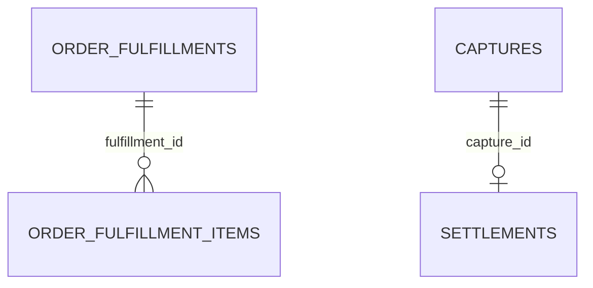

# P6 픽업·상품 저장 ERD

상태: 사용자 승인, PR 리뷰 대상. Notion 최신 동기화·실제 CakeShop 호출·배포 완료와 구분한다.
주문 식별·잠금·조회는 `(merchant_id, order_id)`를 함께 사용한다. 다른 가맹점은 같은 주문번호를 독립적으로 사용할 수 있다.

## 테이블

| order_fulfillments 컬럼 | 타입 | NULL | 의미 |
| --- | --- | --- | --- |
| fulfillment_id | BIGINT | N | PK AUTO_INCREMENT |
| merchant_id | BIGINT | Y | P1 논리 참조, FK 없음 |
| order_id | VARCHAR(100) | N | CakeShop 주문번호, 가맹점과 복합 UNIQUE |
| scheduled_fulfillment_at | DATETIME(6) | Y | 예정 픽업 시각 |
| fulfilled_at | DATETIME(6) | Y | 실제 픽업 완료 시각 |
| created_at / updated_at | DATETIME(6) | N | UTC 저장·갱신 시각 |

신규 주문 확보 행은 매입 요청 또는 HMAC 인증의 양수 가맹점 ID를 처음부터 저장한다. 두 픽업 시각은 비어 있을 수 있다.
기존 `merchant_id IS NULL` 행은 삭제·추정 귀속하지 않고 보존하며 정상 수신 경로에서 조회·연결하지 않는다. 별도 소유자 확인 후 명시적인 정리가 필요하다.
외부 API의 필수 시각 검증과 내부 자리 확보 행의 NULL 조건을 구분한다.

| order_fulfillment_items 컬럼 | 타입 | NULL | 의미 |
| --- | --- | --- | --- |
| fulfillment_item_id | BIGINT | N | PK AUTO_INCREMENT |
| fulfillment_id | BIGINT | N | 같은 P6 부모의 물리 FK |
| item_sequence | INT | N | 원본 배열 순서, 1부터 시작 |
| product_name | VARCHAR(150) | N | 주문 시점 상품명 스냅샷 |
| quantity | INT | N | 양수 수량 |
| created_at | DATETIME(6) | N | 최초 저장 시각, UTC |

UNIQUE(fulfillment_id, item_sequence), 양수 순서·수량 CHECK, 빈 상품명 CHECK를 적용한다.
상품명 UNIQUE는 두지 않는다. 같은 이름의 다른 옵션 항목도 따로 보관한다.
부모 삭제 CASCADE를 사용하지 않으며 상품·주문을 삭제하는 외부 API를 제공하지 않는다.
가맹점·주문번호는 부모에 있으므로 상품 행에 복제하지 않는다.

기존 settlements에는 nullable DATETIME(6) 세 개를 추가한다.

| 컬럼 | 값 |
| --- | --- |
| expected_settlement_at | 예정 픽업 + 정확히 72시간 |
| scheduled_at | 실제 픽업 + 정확히 72시간; 완료 확정 가능 시점 |
| completed_at | 후속 배치용 예약 컬럼. 이번 기능에서는 NULL 유지 |

기존 행의 시각은 추정해서 채우지 않는다. 기존 금액·수수료·상태는 유지한다.

order_fulfillments는 UNIQUE(merchant_id, order_id), captures는 비고유 인덱스 idx_captures_merchant_order(merchant_id, order_id)를 사용한다.
매입의 UNIQUE(payment_id)는 유지한다. 같은 가맹점·주문에 매입이 여러 건이면 임의 선택하지 않고 충돌로 처리한다. 도착 순서가 자유로워 주문과 매입 사이에 FK는 두지 않는다.
기존 NULL 행 보존을 위해 DB nullable은 유지하지만 신규 서비스 경로에서는 NULL 가맹점 ID를 거절한다.

## 동시성·원자성

모든 진입점은 주문 행을 INSERT ON DUPLICATE KEY UPDATE로 확보하고 PESSIMISTIC_WRITE로 잠근다.
매입은 주문 잠금 → 결제 중복 확인 → 매입·정산 생성 → 일정 연결 → 기존 완료 이벤트 발행 순서다.
픽업은 주문 잠금 → 시각·상품 반영 → 매입·가맹점 대조 → 일정 연결 순서다.
잠금은 같은 트랜잭션의 종료까지 유지한다. 동일 요청은 재사용하고 상충 요청은 전체 롤백한다.
픽업이 먼저 오면 저장한 뒤 매입이 연결하고, 매입이 먼저 오면 이후 픽업이 기존 정산 일정에 반영된다.
실패한 요청에서 생성한 주문·상품·시각은 롤백하되 과거 커밋은 보존한다.

## SQL 범위

신규 5개: create_order_fulfillments, add_settlement_schedule_times, create_order_fulfillment_items, scope_order_fulfillments_by_merchant, index_captures_merchant_order.
기존 3개 SQL을 수정하지 않고 후속 migration으로 키를 전환하고 인덱스를 추가한다.
현재 dev에 있는 migration은 수정·삭제하지 않는다. 취소·현금흐름·지출 SQL은 포함하지 않는다.
픽업을 받았다는 이유로 매입·정산을 새로 생성하거나 정산 상태를 COMPLETED로 바꾸지 않는다.
